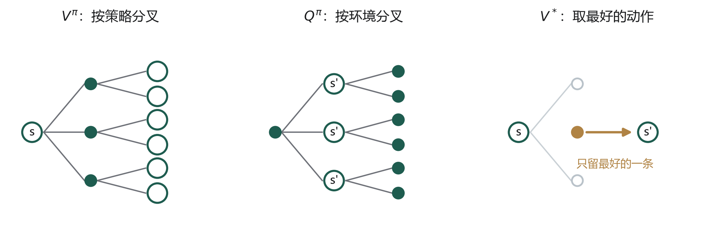

## 回报、价值与贝尔曼方程

上一章把问题写成了 MDP。这一章定义目标，再把它拆成一个可以迭代求解的方程。

### 回报

从时刻 $t$ 开始的折扣累积奖励叫回报。

$$
G_t = r_{t+1} + \gamma r_{t+2} + \gamma^2 r_{t+3} + \cdots = \sum_{k=0}^{\infty}\gamma^k r_{t+k+1}
$$

它有一个递归形式，这个形式后面会反复用到。

$$
G_t = r_{t+1} + \gamma G_{t+1}
$$

一句话解释，今天的回报等于明天的奖励加上打折后的明天的回报。

目标是最大化期望回报 $\mathbb{E}_\pi[G_t]$。这里必须取期望，因为策略有随机性，环境也有随机性，同一条策略跑两次结果不同。

### 两个价值函数

状态价值是在状态 $s$ 下按策略 $\pi$ 走下去的期望回报。

$$
V^\pi(s) = \mathbb{E}_\pi\left[G_t \mid s_t = s\right]
$$

动作价值是在状态 $s$ 下先做动作 $a$，之后再按 $\pi$ 走的期望回报。

$$
Q^\pi(s,a) = \mathbb{E}_\pi\left[G_t \mid s_t = s, a_t = a\right]
$$

两者的关系很直接。

$$
V^\pi(s) = \sum_a \pi(a\mid s)\, Q^\pi(s,a)
$$

有了这两个函数，比较策略就有了标准。如果对所有的状态都有 $V^{\pi'}(s)\ge V^\pi(s)$，就说 $\pi'$ 不差于 $\pi$。最优价值函数记为 $V^*$ 和 $Q^*$。

### 贝尔曼期望方程

把回报的递归形式代进价值函数，得到贝尔曼期望方程。

$$
V^\pi(s) = \sum_a \pi(a\mid s)\sum_{s'} P(s'\mid s,a)\left[r(s,a) + \gamma V^\pi(s')\right]
$$

这个式子说的是，当前状态的价值等于“这一步的奖励”加上“打折后的下一状态价值的期望”，对所有可能的动作和下一状态取平均。

它把无限长的求和变成了一个关于自身的方程。这是整个领域的枢纽，后面的算法都是它的不同解法。

### 贝尔曼最优方程

最优价值函数满足一个稍微不同的方程。

$$
V^*(s) = \max_a \sum_{s'} P(s'\mid s,a)\left[r(s,a) + \gamma V^*(s')\right]
$$

$$
Q^*(s,a) = \sum_{s'} P(s'\mid s,a)\left[r(s,a) + \gamma \max_{a'} Q^*(s',a')\right]
$$

区别在于 $\max$ 取代了按策略平均。它表达的意思是，在最优情况下，每个状态都会选最好的动作。

这里有一个不太直观的地方。贝尔曼期望方程是线性的，可以用矩阵求逆解出来。贝尔曼最优方程里有 $\max$，是非线性的，一般没有闭式解，只能迭代。

### 备份图

把方程画成图，会清楚很多。图 2-1 是三种备份。

空心圆表示状态，实心点表示动作。从状态出发，按策略分叉到各个动作；从动作出发，按环境分叉到各个下一状态。价值就是从叶子往根一层层算回来的。

这个图看起来简单，但它解释了为什么不同的算法可以统一描述。动态规划是知道所有分支概率的完整备份，蒙特卡洛是走一条分支采样的备份，时序差分是用估计值代替分支的近似备份。

### 为什么迭代会收敛

定义贝尔曼算子 $\mathcal{T}$，它把任意一个价值函数映射成新的价值函数。

$$
(\mathcal{T}V)(s) = \max_a \sum_{s'} P(s'\mid s,a)\left[r(s,a) + \gamma V(s')\right]
$$

可以证明 $\mathcal{T}$ 是一个压缩映射，压缩因子是 $\gamma$。

$$
\|\mathcal{T}V_1 - \mathcal{T}V_2\|_\infty \le \gamma \|V_1 - V_2\|_\infty
$$

证明只用两行。$\max$ 满足 $|\max_a f(a) - \max_a g(a)|\le \max_a|f(a)-g(a)|$，再对状态求和取权重，$\gamma$ 提出来即可。

压缩映射有一个重要性质，反复作用会收敛到唯一的不动点。因为每次作用都把两个函数的距离缩小到原来的 $\gamma$ 倍，误差按几何级数衰减。

这个结论解释了两件事。第一，值迭代一定会收敛，而且误差每轮至少缩小 $\gamma$ 倍。第二，$\gamma$ 越接近一，收敛越慢。第三章的网格实验用了三十四轮，因为 $\gamma$ 只有零点九；如果取零点九九，可能要几百轮。

### 一个容易混淆的点

$V^*$ 和 $V^\pi$ 都是价值函数，但含义不同。前者对应最优策略，后者对应给定策略。算法迭代过程中，我们通常在估计 $V^\pi$，同时改进 $\pi$，两个东西一起变。

这也是为什么策略迭代的收敛性证明要绕一圈，价值和策略同时在动，不能直接套用压缩映射的结论。第三章会说明，策略改进保证价值单调不降，而价值有上界，所以一定会停在一个最优点。

下一章讲怎么用这些方程实际算出答案。
