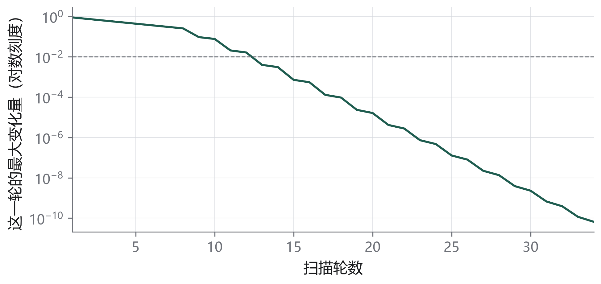

## 动态规划：策略迭代与值迭代

贝尔曼方程给了递归关系，但递归本身不产生答案。要算出价值，还需要一个迭代过程。

动态规划是最直接的做法。它假设环境完全已知，转移概率和奖励都能查到，然后反复用贝尔曼方程更新价值，直到收敛。真实问题里很少有这种条件，但它是理解后续所有算法的起点。

### 策略评估

给定策略 $\pi$，要算 $V^\pi$。方法是把贝尔曼期望方程当成更新规则。

$$
V_{k+1}(s) = \sum_a \pi(a\mid s)\sum_{s'} P(s'\mid s,a)\left[r(s,a) + \gamma V_k(s')\right]
$$

反复应用，$V_k$ 会收敛到 $V^\pi$。收敛的依据是第二章的压缩映射性质，每次迭代误差至少缩小 $\gamma$ 倍。

代码很短。

```python
for sweep in range(max_sweeps):
    delta = 0.0
    for s in states:
        v = sum(pi[s][a] * (reward(s, a) + gamma * sum(P(s, a, s2) * V[s2]
                for s2 in states)) for a in actions)
        delta = max(delta, abs(v - V[s]))
        V[s] = v
    if delta < 1e-8:
        break
```

注意这里是同步更新还是异步更新的区别。上面这段在原地更新，后面的状态用到了本轮刚更新过的值，这叫异步。同步更新要复制一份旧表。两种都收敛，异步通常更快。

### 评估到底要扫多少轮

这个问题在实际工程里很要紧，因为它直接决定训练时间。

理论上给的是一个上界，误差每轮乘 $\gamma$，所以从初值到精度 $\epsilon$ 需要大约 $\log(\epsilon)/\log(\gamma)$ 轮。$\gamma$ 取零点九，要从误差一降到十的负十次方，按这个上界算需要两百多轮。

实际跑出来少很多。同样那个五乘五网格，从零初值出发，三十四轮就把两轮之间的最大变化压到了十的负十次方以下，$\gamma$ 取零点九九也只有三十八轮。差距来自上界用的是最坏情况，实际误差的下降速度由转移矩阵的次大特征值决定，常常比 $\gamma$ 小得多。

初值也有影响。从零开始，误差要穿过整个值域；从一个粗略的猜测开始，比如用“离出口的步数”估一个初值，常常能省一大半轮数。这个技巧在实时控制里很常用，上一帧的解直接当下一帧的初值，因为环境变化很慢。

收敛阈值要和 $\gamma$ 匹配。第二章给过结论，两轮之差小于 $\epsilon$ 时，离真值的距离大约是 $\epsilon\gamma/(1-\gamma)$。$\gamma$ 零点九时放大九倍，零点九九时放大九十九倍。所以阈值不能拍一个十的负八次方就完事，得先想清楚要多准。

### 策略改进

有了 $V^\pi$，可以检查每个状态是否有更好的动作。

$$
\pi'(s) = \arg\max_a \sum_{s'} P(s'\mid s,a)\left[r(s,a) + \gamma V^\pi(s')\right]
$$

这个操作叫贪心改进。有一个定理保证，改进后的策略不差于原策略，而且除非原策略已经最优，否则至少有一个状态严格变好。

定理的证明用到一个技巧，把新策略的价值写成旧价值加上优势。只要每个状态都选了优势最大的动作，新价值就处处不小于旧价值。

### 改进定理的三步

把它写完整，比记住结论有用。

第一步，看一步。新策略在状态 $s$ 选的动作，在旧策略的价值下不差于旧策略自己选的动作，所以拿新策略走一步，再回到旧策略，得到的价值不小于 $V^\pi(s)$。

$$
Q^\pi(s,\pi'(s)) = \max_a Q^\pi(s,a) \ge Q^\pi(s,\pi(s)) = V^\pi(s)
$$

最后那个等号要注意，它只在旧策略是确定性的时候成立。随机策略下 $V^\pi$ 是各个动作的加权平均，单个动作的 $Q$ 可能比它大也可能比它小，这时候“至少有一个动作更好”仍然成立，因为平均值不可能超过最大值。

第二步，展开两步。用新策略走第一步，之后的价值不小于旧策略的价值，所以

$$
V^{\pi'}(s) \ge r(s,\pi'(s)) + \gamma\sum_{s'}P(s'\mid s,\pi'(s))V^\pi(s')
$$

这一步用的是同一个不等式，只是把下一步的价值换成了旧的。

第三步，反复用。把上面这个式子里的 $V^\pi$ 再拆成“一步奖励加打折的后续”，可以得到 $V^{\pi'}$ 不小于“两步新策略加剩余旧策略”的值，继续拆，得到 $V^{\pi'}(s)\ge V^\pi(s)$。严格的写法要取极限，$\gamma<1$ 保证了余项趋于零。一句话解释，新策略每一步都不比旧策略差，累加起来自然不差。

“至少一个严格更好”这一半用的是一模一样的论证。如果某个状态上新策略严格选了更好的动作，那么从这个状态出发的整条链上都会严格变好，只要后面还有机会拿到奖励。如果那个状态之后立刻终止，严格性就未必传得下去，这也是定理表述里要限定条件的原因。

### 策略迭代

把评估和改进交替进行，就是策略迭代。

```text
初始化策略 pi
重复：
    评估：算出 V^pi
    改进：对每个状态取贪心动作，得到 pi'
    如果 pi' 与 pi 相同，停止
    pi <- pi'
```

它会有限步终止。原因是每次改进都严格提升价值，而确定性策略的数量有限，不可能无限提升。

代价是每一轮评估都要迭代到收敛，很贵。实际实现里通常只评估几轮就改进，这个变体叫**截断的策略迭代**。

### 值迭代

把评估截断到只做一轮，就得到值迭代。

$$
V_{k+1}(s) = \max_a \sum_{s'} P(s'\mid s,a)\left[r(s,a) + \gamma V_k(s')\right]
$$

它把评估和改进合并成一步，每次更新同时做两件事。收敛之后，最优策略由 $\arg\max$ 直接读出。

值迭代的收敛速度由 $\gamma$ 决定。图 3-1 是第二章那个五乘五网格的收敛曲线，纵轴是每轮更新的最大变化量，对数刻度。



曲线在对数坐标下接近一条直线，说明误差每轮按固定比例缩小。这个比例就是 $\gamma$。实测的斜率与理论值吻合，可以作为实现正确性的一个检查。

### 两种迭代的真实成本

书上常说策略迭代轮数少、值迭代轮数多，这话对一半。轮数是外层轮数，不代表总计算量。

在同一个五乘五网格上实测。值迭代从零初值到两轮之差小于十的负十次方，一共扫了三十四轮，每轮扫一遍所有状态。策略迭代只用了四轮外层，但每轮都要把策略评估到收敛，四轮加起来扫了二百一十八遍。$\gamma$ 换成零点九九，差距更大，策略迭代的评估扫了一千三百八十八遍，值迭代还是三十八遍。

表 3-1 把三个变体放在一起，数据都来自同一个环境、同一个收敛阈值。

::: {.tabcap}
表 3-1　三种动态规划变体在五乘五网格上的实际开销（$\gamma=0.9$）
:::

| 方法 | 外层轮数 | 总扫描次数 | 起点价值 |
| --- | --- | --- | --- |
| 值迭代 | 三十四 | 三十四 | 0.5519 |
| 策略迭代 | 四 | 二百一十八 | 0.5519 |
| 每轮只评估一次 | 七 | 七 | 0.5432 |

最后一行的结果值得多看两眼。每轮只评估一次，七轮就停止了，因为策略不再变，但它算出的价值比真值低了大约百分之一点六。原因是评估根本没收敛，价值还差一截，只是差得不够多，不足以改变贪心动作。换句话说，策略对了，价值没对。如果下游要用价值本身，比如做风险估计，这个误差就不能接受。

那么策略迭代的优势在哪。在状态多、动作多、策略改进幅度大的问题上。它的外层轮数不随状态数增长太多，而值迭代每改进一次策略都要传递到所有状态。在小网格上，扫描一遍很便宜，两种方法都能秒算；在实际系统里，一遍扫描可能要几分钟，这时候外层轮数才是关键。选择方法时应当算总计算量，而不是看论文里报的轮数。

### 一份能跑的完整实现

把前面的碎片接起来，写成可运行的版本。模型用字典存，$P[s][a]$ 是一个从下一状态到概率的映射。

```python
def lookahead(V, s, a, P, R, gamma):
    total = 0.0
    for s2, p in P[s][a].items():
        total += p * (R[s][a][s2] + gamma * V[s2])
    return total

def evaluate(policy, states, P, R, gamma, tol=1e-8, cap=10000):
    V = {s: 0.0 for s in states}
    for _ in range(cap):
        delta = 0.0
        for s in states:
            v = lookahead(V, s, policy[s], P, R, gamma)
            delta = max(delta, abs(v - V[s]))
            V[s] = v
        if delta < tol:
            break
    return V

def improve(V, states, actions, P, R, gamma):
    new_policy = {}
    for s in states:
        new_policy[s] = max(actions, key=lambda a: lookahead(V, s, a, P, R, gamma))
    return new_policy

def policy_iteration(states, actions, P, R, gamma):
    policy = {s: actions[0] for s in states}
    while True:
        V = evaluate(policy, states, P, R, gamma)
        new_policy = improve(V, states, actions, P, R, gamma)
        if new_policy == policy:
            return policy, V
        policy = new_policy
```

这段代码有几个故意写得保守的地方。评估用的是原地更新，收敛依然有保证，但和同步版本的结果会有细微差别。停止条件用两轮之差，前面说过它在 $\gamma$ 大的时候会偏乐观。策略比较用字典相等，要求动作是可哈希的对象。

如果想改成值迭代，把 `evaluate` 和 `improve` 合成一个函数，每次用 $\max$ 代替按策略取值就行。代码几乎不变，变的是语义。

### 实现里的六个坑

第一个，终止状态没有排除。终止状态也要有值吗？大多数写法里设为零并不再更新。如果把它当成普通状态继续自举，零会被一步步推高，整张表跟着偏。判断办法是看终止状态的值是不是始终为零。

第二个，奖励拿的是“进入的状态”还是“离开的状态”。两种写法都可以，但整份代码必须统一，否则同一个格子会被计两次或者零次。

第三，异步更新的顺序影响收敛速度但不影响结果。从终点往回扫常常比从起点往前扫快，因为价值是从终点往前传的。这个优化不需要改算法，改一下循环顺序就行。

第四，`argmax` 遇到平局。前面看到过，网格中心往上和往右的价值差不到千分之一。浮点误差会让每次迭代选出不同的动作，策略看着一直在变，收敛判据用“策略不变”就会死循环。用价值变化量判停更安全。

第五，收敛阈值和 $\gamma$ 不匹配。这一点前面已经说过，$\gamma$ 大的时候阈值要跟着收紧。

第六，状态集合和转移里的状态不一致。模型里出现了不在状态列表里的状态，会直接报键错误；反过来，状态列表里有永远不会被访问的状态，它的值永远是零，看着像收敛其实没算。后者更隐蔽，写调试打印时把每轮变化最大的状态打出来，能很快发现。

### 用三个数字交叉验证

写完一份实现，怎么知道对不对。不要只看曲线，用几个已知的数去卡。

第一个数是收敛轮数。同一个环境、同一个初值、同一个阈值，轮数应当稳定，换一台机器也不该变。如果每次跑都不一样，说明里面有随机性或者字典顺序在捣鬼。

第二个数是最终价值。两种方法必须给出同一个数。值迭代和策略迭代的代码路径完全不同，它们对上了，基本可以排除逻辑错误。

```python
pi_policy, pi_v = policy_iteration(states, actions, P, R, gamma)
vi_v = value_iteration(states, actions, P, R, gamma)
worst = max(abs(pi_v[s] - vi_v[s]) for s in states)
print("max gap", worst)
assert worst < 1e-6, "two solvers disagree"
```

这段断言看着简陋，但它能捕获绝大多数实现错误。真写错的时候，两者的差距往往不在小数点后面，而是整个数量级。

第三个数是合理性。起点价值 0.5519 可以手工估一下。从左上角到出口直线走四步，每步负零点零四，打完折大约负零点一，再加终点的一分，量级合理。如果算出来是五点五或者负五，不用查代码，先查奖励是不是写错了。

三个数都对上，再去看策略长什么样。把每个格子的箭头打出来，能一眼看出它是不是绕开了陷阱。这一步比看价值更能发现“数字对了但策略很怪”，比如两个相邻格子的箭头指来指去。

### 三者的关系

策略迭代、截断策略迭代、值迭代，其实是同一个框架的不同参数。

如果评估做到完全收敛，是策略迭代。如果评估做 $k$ 轮，是截断策略迭代。如果 $k=1$，是值迭代。三者都收敛到同一个最优点。

这个统一视角有用。它说明“评估”和“改进”不是两个独立的步骤，而是一个连续的谱。后面讲到的所有算法，都可以在这个谱上找到位置。

### 广义策略迭代

把上面那句话再推一步，就是广义策略迭代。它不要求评估收敛，也不要求改进一次到位，只要求两者都在向对方靠拢。

框架很松。任意一个价值函数和一个策略，评估让价值更接近这个策略的真值，改进让策略对这个价值更贪心。两个方向轮流推，最后会停在一个自洽的点，策略对自己的价值贪心，价值又是这个策略的真值。那个点就是最优。

这个描述之所以有用，是因为它把几乎所有算法都包了进去。值迭代是评估只做一步的广义策略迭代。Q 学习是评估用采样估计、改进隐式地写成 $\max$ 的版本。演员评论家是评估由评论家负责、改进由演员负责的版本。甚至大模型的对齐训练也能套进去，评论家是奖励模型，演员是策略，两者交替优化。

代价是这个框架没有告诉你收敛速度。具体算法好不好，还要看每一步的估计准不准、步长怎么取。框架只保证方向对，不保证走得多快。

### 截断评估丢掉了什么

策略迭代有单调性保证，因为它每轮都算准了价值再改进。一旦截断，这个保证就没有了。

道理很简单。价值没算准时，贪心动作可能是错的，改进之后策略反而变差。在网格上跑一下，每轮只评估一次，七轮之后策略稳定下来，价值比真值低百分之一点六，但策略本身是对的。这是好消息，说明实践中这个误差往往不足以把动作选错。

坏消息是它没有保证。换个环境，比如两个动作的价值差很小但后果差很多，粗略的价值估计就可能选错，而且一旦选错，后续的评估会围着错策略转，出不来。这类失败在调试时很难认，因为曲线看上去是收敛的。

所以工程上有个折中做法。平时用截断，同时定期（比如每十轮）做一次完整评估，如果完整评估得到的策略和当前策略不一致，就回退。这个检查不便宜，但它能提前发现“收敛到错地方”这种最难查的问题。

### 异步扫描的三种顺序

值迭代写起来是一个双重循环，外面轮数，里面状态。里面那层按什么顺序扫，影响很大。

顺序扫描最简单，按状态编号从头到尾。收敛速度取决于状态怎么编号。如果价值是从终点往前传的，从终点开始扫就会很快，因为一轮就能把信息传到终点旁边，下一轮再传一格。反过来扫就要多花好几轮。

随机扫描每轮打乱顺序。好处是不会因为编号方式而变得特别慢，坏处是不能利用结构。在状态顺序没有意义的问题上，它反而更稳。

优先级扫描走得更远。它维护一个待更新队列，每次只挑“上次更新时变化最大”的状态，更新它，再把它的前驱状态加进队列，因为它的值变了，前驱的自举目标也变了。直觉是只算那些真正会变的地方，不动已经稳定的区域。在稀疏奖励的网格上，这个做法的扫描次数往往比顺序扫描少一个数量级。代价是要额外维护队列和前驱关系，内存和实现复杂度都上去了。

这三种扫法都不改变最终结果，只改变花多久到达。当状态很多而又没法全部扫一遍时，优先级扫描几乎是唯一可行的选择。

### 异步到底能省多少

前面提过一句“异步通常更快”，具体快多少可以量一下。

同一个五乘五网格，同步更新（拿上一轮的副本算）需要三十四轮。改成原地更新，同样从零初值、同样阈值，十九轮就停了。原因是原地更新在同一次扫描里就能把新值传给后面的状态，信息一轮走得更远。

扫描顺序也有影响，但没有那么直接。按行顺序扫十九轮，倒着扫也是十九轮，按“离出口远近”排序反而要二十三轮。这个结果和直觉不太一致，因为向四个方向的滑落使得价值传播不止一个方向，先更新哪个状态会改变后续状态拿到的新鲜程度，好坏不总能预先想清楚。

所以调扫描顺序不要凭直觉，量一下。代价很小，改一行循环顺序而已，却能省下将近一半的轮数。这也是为什么库里的实现几乎都用原地更新，很少老老实实做同步备份。

不过要注意一个副作用。异步更新的中间结果依赖于顺序，两个实现即使算法相同，中间过程的数值也会不同，对不上是正常的。最后收敛到同一个值，才是需要验证的事。

### 动态规划的局限

第一个局限是需要模型。$P$ 和 $r$ 必须已知，而且要能枚举所有下一状态。真实问题里这两条通常都不成立。

第二个局限是状态必须有限且不多。二十五个格子可以枚举，一张图片不行。即使用函数逼近代替表格，动态规划的每次更新仍然要对所有状态做一遍，代价太高。

第三个局限是维度灾难。状态维度每增加一维，网格点数指数增长。十个维度就已经难以承受。

还有一个前提条件容易被忽略，状态必须是离散且可枚举的。连续状态要先离散化，而离散化的粒度本身就是一个难题。格子切得细，状态数爆炸；切得粗，行为完全不同的状态被归成一类，最优策略就不可达。这个两难在后面的函数逼近里会换一个形式出现，不再是分格子，而是选特征的容量。

顺带说一句，动态规划对奖励的尺度很敏感。奖励整体乘一千，最优策略不变，但收敛阈值需要跟着调，否则要么提前停，要么白跑。写通用求解器时最好把奖励归一化，或者把阈值写成相对于奖励尺度的量。

这三个局限指向同一个方向，需要一种不需要模型、只靠采样、每次只更新访问到的状态的方法。这就是下一章的蒙特卡洛和时序差分。

不过在往下走之前，值得说清楚动态规划今天还在哪用。它不是历史陈列品。

第一类是小规模但要求快的场景。电梯调度、机械臂抓取序列、仓库拣货路线，状态数几千到几万，模型可以从历史数据里拟合出来，跑一次值迭代不到一秒。这类任务用强化学习反而麻烦，因为采样成本高，而模型已经现成。

第二类是作为基准。自己写的采样算法对不对，可以拿一个能用动态规划求精确解的小环境去比。如果连这个都学不到最优，问题就在算法或实现，不在环境太复杂。这个做法在调试新算法时非常有用，能省掉很多猜测。

第三类是模型预测控制里的短程规划。每一步只往前算几层，算完执行第一个动作，下一时刻重算。这里用的不是完整的动态规划，而是同一个递推的一个截断版本。自动驾驶和机器人里这种用法很普遍，因为它能处理约束，也便于在嵌入式设备上跑。

还有一个隐形的用途，它定义了什么叫收敛。所有采样方法的评价标准，都是“能不能逼近动态规划给出的那个数”。没有这个参照，学习曲线好不好看就没有意义。
