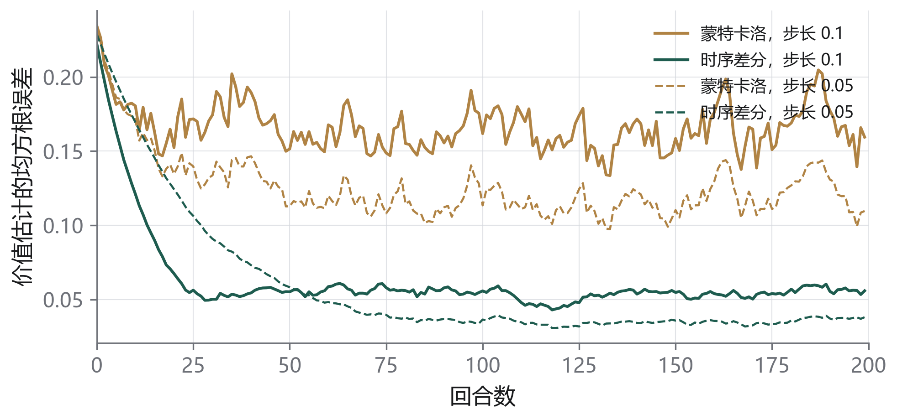
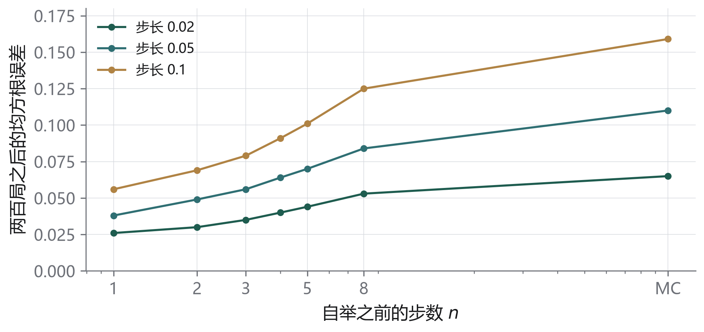

## 蒙特卡洛与时序差分

动态规划需要模型。如果不给模型，只让智能体自己在环境里跑，还能不能估计价值？

答案是能，有两条路。一条是等一整局结束，用实际拿到的回报去估计；另一条是每走一步就用下一状态的估计去更新。前者叫蒙特卡洛，后者叫时序差分。它们的差别看起来只是“等多久”，实际影响很深。

### 蒙特卡洛

蒙特卡洛的想法最朴素。要估计 $V^\pi(s)$，就按 $\pi$ 走很多局，把每次经过 $s$ 之后拿到的回报平均起来。

$$
V(s) \leftarrow V(s) + \alpha\left[G_t - V(s)\right]
$$

$G_t$ 是实际回报，从 $t$ 时刻一直加到回合结束。$\alpha$ 是步长，控制每次更新挪多少。

这个估计是无偏的，因为 $G_t$ 的期望就是 $V^\pi(s)$。代价是方差大，一局里后面发生的事情全算在这一次估计上，随机性叠加得很厉害。

还有一个限制，必须等到回合结束才能更新。有些任务没有终点，蒙特卡洛就用不了。

### 时序差分

时序差分不等回合结束，它用下一步的估计代替实际的未来。

$$
V(s) \leftarrow V(s) + \alpha\left[r + \gamma V(s') - V(s)\right]
$$

方括号里的量叫时序差分误差，通常记作 $\delta$。它衡量“走了一步之后，原来的估计错了多少”。

这个更新只用一步的数据，立刻可以执行。代价是引入了偏差，因为 $V(s')$ 本身是估计，不是真值。这种做法叫自举。

### 偏差和方差，分开算

两种方法的差别常被说成“一个准一个快”，这种说法没说到点子上。真正的差别在两个统计量上。

偏差是估计量的期望和真值之间的距离。蒙特卡洛的估计量是实际回报，它的期望就是真值，所以偏差为零。时序差分的估计量里含有当前的价值估计，如果估计本身是错的，目标就是错的，偏差不为零。

方差是估计量在重复实验中的波动。一局的回报从第一步累加到结束，每一步的随机性都叠在里面，方差随步数增长。时序差分只用一步的随机性，方差很小。

这个取舍可以写成一句话，用多少步的自举，就换多少方差回来。步数为一时方差最小，偏差最大；步数为无穷时偏差消失，方差最大。中间每个步数都对应一个不同的点。

诊断的时候这两个量要分开看，因为它们的表现不一样。偏差会让误差曲线停在某个非零的水平上，无论跑多久都不再下降；方差会让曲线上下抖，但平均值是对的。看到一个不下降的平台，先怀疑偏差；看到一个很大的波动带，先怀疑方差。这个区分在调参时省时间，也解释了为什么固定步长时蒙特卡洛有一个降不下去的误差下限，而时序差分可以靠小步长慢慢磨。

### 一个实验看清楚

一个七状态的随机游走很适合做这个对比。五个中间状态排成一行，两边是终止状态，往右走到底得一分，往左走到底得零分。每个状态的真实价值，就是从那里出发最终走到右端的概率，可以精确算出来。

用两种方法各跑两百局，三十个种子平均，看图 4-1。

实验的细节值得交代。真实价值可以直接解方程得到，中间那个状态是零点五。两种方法用同样的步长去跑，每组三十个种子，画的是两百局内每一步的误差，用五个状态上的均方根而不是平均值，因为它对单个状态的偏差更敏感。步长取了三档，图里画的是最有代表性的那一档。

这样的设置比只跑一个种子有意义得多。单次实验里，时序差分赢还是蒙特卡洛赢，可能只是运气。三十个种子的平均把运气抹掉，剩下的才是方法的性质。

读这类图还有一个习惯要养成，先看纵轴刻度和对数坐标。误差曲线在对数坐标下是一条直线，说明它在按几何速度下降；在普通坐标下看着像直线，则说明它降得很慢。同一组数据换个刻度就能得出相反的印象，所以报结论前要看清楚画的是什么。



时序差分的误差降得又快又低，两百局之后在零点零五附近。蒙特卡洛在大步长下前期降得快，但很快进入平台，一直在零点一五上下波动，降不下去。

这个现象可以用方差解释。蒙特卡洛的每次估计都依赖整局的随机结果，方差大；步长又不能太小，否则学得慢。两者夹在一起，就形成了一个误差下限。时序差分每次只用一步的随机性，方差小，可以用更小的步长稳定收敛。

### 差多少步：n 步回报

两边都不极端的选择是中间那一段，走 $n$ 步再自举。

$$
G_t^{(n)} = r_{t+1} + \gamma r_{t+2} + \cdots + \gamma^{n-1}r_{t+n} + \gamma^{n}V(s_{t+n})
$$

前 $n$ 步用真实奖励，第 $n$ 步之后用估计值顶上。$n=1$ 就是时序差分，$n$ 大到超过回合长度就是蒙特卡洛。一句话解释，先走几步看看再猜。

图 4-2 是同一个随机游走上的实测，三条线对应三个步长。



曲线有几个值得读的地方。

在这个任务上，$n$ 越大误差越大，而且三条线都是单调上升，没有出现教科书里“中间某个 $n$ 最好”的形状。原因不难找。这个随机游走从中间出发，平均只要四步就到端点，所以 $n$ 取五已经等于跑完整个回合，再往上只是纯蒙特卡洛。中间段根本不存在，自然也就没有中间的最优点。

步长影响整体高度，不影响形状。步长从零点零二加到零点一，每条线都抬高了一倍左右，但单调性不变。这说明在这个任务里，方差是主导因素，而方差随 $n$ 增长。

这张图对实际工作的意思是，$n$ 不能拍脑袋取大。回合短的任务，$n$ 取三到五就够；回合长、奖励稀疏的任务，$n$ 取大才有意义，因为一步的自举偏差太大。判断的办法是把 $n$ 当成一个超参数，在验证集上试，而不是从论文里抄一个数。

实现上要小心两件事。一是回合末尾不足 $n$ 步，剩下的部分要用实际回报补完，不能再自举。二是这 $n$ 步可能跨过终止状态，跨过之后就必须截断。这两处写错，结果会系统性偏高。

```python
def n_step_target(rewards, values, t, n, gamma, done_at):
    total = 0.0
    for k in range(n):
        i = t + k
        total += (gamma ** k) * rewards[i]
        if done_at[i]:
            return total
    return total + (gamma ** n) * values[t + n]
```

### 偏差与方差的取舍

两种方法各有各的问题。

蒙特卡洛无偏，但方差大，收敛慢，且必须等回合结束。

时序差分有偏，偏差来自自举，但方差小，收敛快，可以在线更新。

这个取舍可以用一个参数来调节，就是 $\lambda$。$\lambda=0$ 是纯时序差分，只看一步；$\lambda=1$ 是纯蒙特卡洛，看到回合结束；中间的值在两者之间插值。

这个想法叫 TD($\lambda$)，实现上常用资格迹（eligibility trace）。它为每个状态维护一个衰减的记忆，越近访问过的状态记忆越强，更新时按记忆加权。这样一次更新可以同时影响最近访问的一串状态，兼具两种方法的长处。

资格迹在实际工程中用得不多，因为实现复杂，和神经网络结合时也不好处理。但它的思想留了下来，第九章的广义优势估计就是同一个取舍在策略梯度上的版本。

### 前向视角与后向视角

$\lambda$ 这件事有两种写法，看起来完全不同，数学上等价。

前向视角是从回报出发的。把 $n$ 步回报按几何权重平均起来，权重是 $(1-\lambda)\lambda^{n-1}$，得到 $\lambda$ 回报。$\lambda$ 为零时只有一步那一项，$\lambda$ 为一时就只剩完整的蒙特卡洛回报。一句话解释，把所有步数的估计混在一起，越长的估计权越轻。

前向视角的问题是要等回合结束才能算，因为它需要所有 $n$ 步的回报。这就丢掉了时序差分最大的好处，能在线更新。

后向视角从另一个方向入手。它给每个状态一个资格迹，记录“这个状态最近被访问得有多新鲜”，每走一步就把所有痕迹乘上 $\gamma\lambda$ 衰减一点，刚访问的加一。更新时按痕迹加权，痕迹大的状态改得多。

```python
for t in range(len(states) - 1):
    s, s2 = states[t], states[t + 1]
    delta = rewards[t] + gamma * values[s2] - values[s]  # td error
    trace[s] += 1.0
    for k in visited_states:
        values[k] += alpha * delta * trace[k]
        trace[k] *= gamma * lam
```

这段代码只往前看一步，却等效于前向视角里对任意长回报的加权。这个等效性不是近似，在回合结束时两种写法给出的更新总量完全相同。直觉是，后面某一步的误差会通过痕迹往前传，传到多远由 $\lambda$ 控制，而前向视角里那些远期的回报权重也是由 $\lambda$ 控制的。

实现上有两种痕迹。累计型每访问一次就加一，适合回合制；替换型每次都置一，适合持续任务，因为它不会让同一个状态反复叠加权重。选错一种不会崩，但结果会不一样。

### 实测：λ 往哪边调

还是在那个五状态随机游走上，步长固定零点一，两百局，三十个种子。

$\lambda$ 取零时均方根误差零点零五六，取零点四时零点零六零，取零点七时零点零七五，取零点九时零点一一零，取一时零点一五九。

单调上升。和 $n$ 步那一组数据形状一致，原因也一致，回合太短，$\lambda$ 大一点就等于蒙特卡洛。

这个结果不能直接搬到别的任务上。回合长、奖励稀疏的任务里，$\lambda$ 大一点常常明显好于零，因为它把远期的真实奖励带进来了，而不是靠一个还没学会的价值函数去猜。判断该取多少，有个经验做法：看自举的偏差有多大。拿一个学得不错的价值函数，比较一步目标和真实回报，差距大就调大 $\lambda$，差距小就调小。

另一个经验是 $\lambda$ 和步长耦合。$\lambda$ 大，方差大，步长就要小；两者一起调，不要单独动一个。

### 为什么自举能work

有人会问，用一个估计去更新另一个估计，不会越估越偏吗？

会偏，但只要更新规则满足一定条件，偏差会收敛。这些条件通常写成两步长序列的要求，步长逐步减小，但总和发散。直观上，前期大步修正，后期小步微调，偏差在这个过程中被逐渐消化。

把这两个条件写得具体一点。总和发散保证不管从多远的地方出发都能走到目标附近，不会被一个太小的步长卡在半路；平方和收敛保证后期的抖动足够小，能在目标附近停下来而不是绕圈。典型的取法是步长正比于一的多少次方分之一，指数取在零与一之间。指数等于一时两个条件刚好卡在边界上，理论上不保证，实践中却常常能用，因为它对非平稳环境更适应。

实践中步长通常是固定的，不满足这些条件。所以理论上保证的收敛，实际中未必成立，这也是为什么调学习率很重要。

还有一个更实际的解释。自举把长程的随机性拆成了很多短程的更新，每次只用一步的信息，方差小。虽然引入了偏差，但偏差的方向通常是对的，因为下一状态的估计已经包含了未来信息。两者相抵，效果往往更好。

### 批量解法：把数据一次用完

还有一个角度能看清两种方法的区别，把所有数据存起来一次算。

蒙特卡洛的批量解法很直接。把每个状态出现过的回报全部平均，就是它该有的值。数据固定，重复算多少遍结果都一样，这就是最小二乘意义下的最优拟合。

时序差分的批量解法不一样。它反复用同一批数据跑一步更新，最后会停在一个不动点上。这个不动点满足“每个状态的价值等于它的一步目标在数据上的平均”。这个条件有个名字，叫确定性等价，意思是把估计值当成真的，再解贝尔曼方程。

差在哪里。在表格表示下，两者其实收敛到同一个解，因为每个状态可以独立拟合，最小二乘解就是真实期望。所以表格方法里这个区别看不出来。

一旦换成函数逼近，两者就分开了。蒙特卡洛的最小二乘解是“在特征能表达的空间里尽量拟合真值”，时序差分的不动点是“在特征空间里让贝尔曼误差为零”。后者不一定最小化真值误差，这个差距在第六章会用具体数字看到。

这个观察解释了一个现象。同一份数据，用蒙特卡洛拟合出来的价值函数更像真值，用时序差分拟合出来的价值函数在控制任务里反而更好用。因为控制关心的是一步之间的关系，不是绝对数值。

### 它学的是期望，不是分布

一个容易误解的地方。价值函数只描述平均回报，不描述回报的波动。

两个策略的期望回报可能完全一样，一个是稳定的每步一分，另一个是一半概率零分一半概率两分。只学期望，这两者分不出来。在大多数任务是够用的，因为目标就是最大化期望。在风险管理里不够用，因为要避开大额亏损，光看平均值看不出来。

想让智能体知道分布，就要学整个分布，而不是一个数。第七章的分布式 DQN 做的就是这件事，它输出每个价值区间的概率，再从中取期望做决策，同时保留了方差和分位数的信息。

这也是一个判断标准。如果任务的失败代价远大于成功收益，比如医疗或者金融，那么只看期望的策略天然偏向冒险，因为它把极小概率的大亏平均掉了。这种情形的正解是改目标，比如用条件风险价值，或者给亏损加一个不对称的惩罚。单纯调算法解决不了。

### TD 误差本身是一个有用的信号

时序差分误差 $\delta$ 通常被当成中间变量，算完就扔。它其实是一个可以直接用的量。

它衡量预测和现实之间的差。差大，说明这个状态动作对还没学好，或者环境变了。差小，说明预测靠谱。这个性质被用在三个地方。

一是优先级。回放的时候优先抽误差大的样本，学习效率明显提升，第七章的优先经验回放就是这个思路。

二是异常检测。部署之后如果 TD 误差突然变大，往往意味着环境进入了训练时没见过的区域，或者传感器坏了。这比监控奖励更早报警，因为奖励可能还没体现出来。

三是好奇心。把误差的大小当成内在奖励，鼓励智能体去那些预测不准的地方，这是一类探索方法的核心。它有效的原因是，预测不准的地方通常信息量大。

用的时候要注意，误差大不一定是坏事。奖励本来就有随机性的任务里，误差永远不会很小。所以阈值要按任务的噪声水平来定，而不是固定一个数。

### 什么时候该用哪一种

把前面的内容收一下，给一个可以照着做的判断顺序。

第一步看回合长度。回合很长或者没有终点，蒙特卡洛直接出局，因为它要等结束。这一步就筛掉了大部分真实任务。

第二步看奖励密度。每步都有反馈，时序差分很好用。奖励稀疏到几十步才有一次，一步的自举几乎学不到东西，这时需要多步或者 $\lambda$ 大一点。

第三步看数据量。数据能无限采，用蒙特卡洛或者大 $n$ 的回报更省事，因为它没有偏差。数据很贵，比如真机训练，用一步时序差分，因为每条数据都被充分利用。

第四步看状态是否能枚举。状态有限，表格方法足够，上面这些选择都成立。状态连续，就要换函数逼近，第六章讲的稳定性问题会盖过这里的偏差方差取舍。

这个顺序不完美，但它能避免常见的错配，比如在有终止但回合极长的任务上用蒙特卡洛，或者在稀疏奖励任务上用纯一步自举然后抱怨学不动。

最后补一句关于实现的话。这三种方法在表格里的代码量差不多，都是几行循环，真正让它们跑出正确结果的是细节，而不是公式。奖励的索引差一位、终止状态的标志没传、轮数不够就判停，这些错误比选错算法常见得多。写完先在一个能算出精确解的小环境上对一遍，比调一天超参数有用。

### 从预测到控制

上面讲的都是估计价值，属于预测问题。要做控制，还需要把估计变成策略。

蒙特卡洛控制有两种做法。一种是估计动作价值 $Q(s,a)$，然后贪心改进，这叫蒙特卡洛控制。另一种是只估计状态价值，用模型推出动作价值，但这又需要模型，绕回去了。

时序差分控制更直接，第五章的 Q 学习和 SARSA 就是它的两个版本。它们的区别只在更新时用哪个动作的价值，而这个区别决定了算法是在轨还是离轨。

### 做控制多出来的两个麻烦

从预测走到控制，会多出两个问题。

第一个是探索。估值时策略是给定的，怎么做都无所谓。控制时要改进策略，而贪心策略一旦固定，就再也不会去尝试其他动作，那些动作的价值永远是初始值。如果初始值恰好偏低，它就永远不会被选中，哪怕它其实是更好的选择。这个死循环靠随机化打破。

具体做法有两种。一种是起始状态随机化，让每个状态动作对都有可能作为起点被访问一次，叫探索性起始。它在真机上没法用，因为你不能决定机器人从哪里开始。另一种是让策略始终留一点随机性，比如每次以一成概率随机选动作，这叫 $\epsilon$-贪心，是实践中的默认做法。

第二个是要不要用别人的数据。自己采的数据只能反映自己的策略，学得快但容易固步自封；用旧策略或者别人的数据可以复用，分布对不上，需要重要性采样修正。蒙特卡洛的重要性采样很直接，把整条轨迹的概率比乘上去就行。轨迹越长，比值的方差越大，所以实际使用时要截断。

这两个问题在下一章会变成具体的算法。$\epsilon$-贪心决定了 SARSA 学的是哪个策略，重要性采样决定了 Q 学习为什么能拿旧数据学最优策略。
