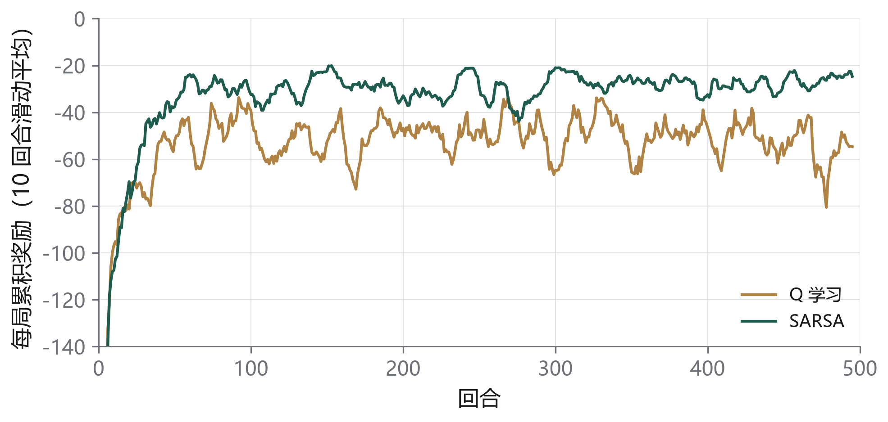

## Q 学习与 SARSA：离轨与在轨

时序差分可以做预测。要做控制，需要估计动作价值，然后用它改进策略。这一章讲两个最基本的做法，它们的区别只有一个符号，结果却差很多。

### Q 学习

Q 学习的更新规则是第二章贝尔曼最优方程的直接翻译。

$$
Q(s,a) \leftarrow Q(s,a) + \alpha\left[r + \gamma \max_{a'}Q(s',a') - Q(s,a)\right]
$$

注意那个 $\max$。它假设下一步会选当前最好的动作，不管实际有没有选。这个假设让 Q 学习学的是最优动作价值 $Q^*$，而不是当前策略的价值。

写成一句话就是，$\max$ 把“下一步会怎么做”这件事固定成了“选最好的”，与行为策略无关。这也是它能在策略还在变的时候直接瞄准最优解的原因。

这就是**离轨**的含义。学习的目标是最优策略，而产生数据的行为可以是任意策略。你甚至可以拿别人录的数据来学，只要数据里覆盖了足够多的状态动作组合。

### SARSA

SARSA 的名字来自它用到的五个量，$s, a, r, s', a'$。

$$
Q(s,a) \leftarrow Q(s,a) + \alpha\left[r + \gamma Q(s',a') - Q(s,a)\right]
$$

区别只在目标里用的是实际选的下一个动作 $a'$，不是最大值。这意味着它学的是当前策略的价值，包括策略里那些随机探索的部分。

判断一个算法在轨还是离轨，有个简单的办法。看更新目标里的“下一步价值”是按什么策略算的。按当前行为策略算，是在轨；按另一个策略算，是离轨。这个区别和用不用 $\max$ 不完全等价，但在这两个算法上正好重合。

还有一个更实用的判断方法。问自己，如果换一个完全不同的策略去采数据，这个算法还能学对吗。能，就是离轨；不能，就是在轨。Q 学习能，所以它可以吃别人录好的日志；SARSA 不能，因为它的目标里带着那个策略的随机性，换策略就全错了。

这叫**在轨**。学的是正在执行的那个策略，数据也必须由这个策略产生。

### 目标策略和行为策略

把这两个词分清楚，后面很多混淆都消失了。

行为策略是产生数据的那个策略，记作 $b$。目标策略是我们要评估和改进的那个策略，记作 $\pi$。在轨方法里两者是同一个，离轨方法里可以不同。

Q 学习是离轨的。它的目标策略是贪心的，行为策略可以是 $\epsilon$-贪心，甚至可以是一段录好的日志。SARSA 是在轨的，两者都是那个带探索的 $\epsilon$-贪心策略。

离轨要成立，有一个前提叫覆盖。行为策略必须能以非零概率访问到目标策略会去的所有状态动作。如果行为策略从来不去某个区域，那边的价值就永远是初始值，而目标策略可能恰好想往那里走。这个条件在表格里还能检查，到了函数逼近就很难验证，第六章的不稳定有一部分就源于它。

覆盖条件还解释了一件事。为什么可以用旧数据训练 Q 学习。旧策略产生的数据覆盖了足够多的状态动作，目标策略只是在这些数据里挑最好的，不需要新的采样分布。反过来，用完全没探索过的数据去训练，学出来的 Q 值在没见过的区域是空的，一部署就出问题。

### 一个实验看清楚

悬崖行走是说明这个差别最经典的例子。四行十二列的格子，最后一行从第二列到第十一列是悬崖，走进去扣一百分并回到起点。起点在左下，终点在右下。每走一步扣一分。

最优路径是贴着悬崖边缘走，一共十三步，拿到负十三分。但这条路径很危险，随机探索时一不小心就掉下去。

十三步是怎么来的。起点在左下，终点在右下，中间隔十一列，横向要走十一步；纵向从上往下走一行再回一行，多两步，加起来十三步。任何绕路的走法都必须多花步数，所以在没有随机性的情况下，这条路径是唯一最优的。

把惩罚改一下，最优路径就变了。如果掉下去的惩罚从一百降到五，最优路径仍然是贴崖走，但绕路的代价相对变高了，所以绕路更不可取。反过来，把掉下去的惩罚提到一千，绕路的吸引力就上升。这个参数决定了任务严格不严格，也决定了两种算法的差距有多大。做对比实验时，这个数不交代清楚，结论就没有可比性。

两种算法各跑五百局，十个种子平均，结果在图 5-1。

实验设置交代一下。折扣因子零点九五，步长零点五，探索率零点一，每个算法跑五百局，十个种子取平均，曲线做了十局滑动平均。步长取零点五看起来很大，在表格方法里是常见的做法，因为每个表项需要很快跟上新的目标。

步长这么大还能稳，靠的是取平均。单次实验的曲线抖得厉害，十局滑动之后才能看出趋势。这一点在读强化学习的图时要有心理准备，绝大多数曲线背后都做了平滑，原始数据的方差往往比图上大好几倍。



SARSA 的曲线稳定在负二十五附近，Q 学习在负五十附近波动，而且起伏更大。

原因在更新目标里的那个 $\max$。Q 学习假设下一步总选最好的动作，所以它认为贴着悬崖走是安全的，价值估计很高。但实际执行时，有一成的概率随机走，一掉下去就是负一百。SARSA 的目标里包含了这个随机性，它算出贴崖走的期望回报很低，于是学会了绕远路。

绕远路每步多花几分，但不会掉下去。从长期平均看，这是更划算的选择。

把探索率换几档再跑，结论会更清楚。每组十个种子，取最后一百局的平均，见表 5-1。

::: {.tabcap}
表 5-1　悬崖行走上两种算法在不同探索率下的表现（最后一百局平均回报）
:::

| 探索率 | Q 学习 | SARSA |
| --- | --- | --- |
| 0.01 | -16.0 | -17.5 |
| 0.05 | -30.4 | -24.3 |
| 0.10 | -53.6 | -27.2 |
| 0.20 | -102.6 | -65.3 |
| 0.30 | -221.3 | -85.0 |

表格里有两个转折。

探索率很小的时候，Q 学习反而略好。因为它学到的是最优路径，十三步走完，扣十三分；SARSA 学到的是绕路，十七步，扣十七分。这时候随机性几乎不会把智能体推进悬崖，贴着边走的风险很低。

探索率一大，差距迅速拉开。零点一时 Q 学习掉到负五十三，SARSA 还有负二十七。原因是 Q 学习认为贴崖走安全，而实际执行时有一成的概率乱走，一次掉下去就是负一百，抵消掉好几次成功。

还有一个细节值得看。SARSA 的方差也大，探索率零点二那一档，十个种子的标准差到了六十二，说明有些种子学成了绕路，有些还在贴着悬崖走。学习过程本身受随机性影响很大，这是它比 Q 学习更难复现的地方。

把这些数字和“哪个更好”连起来。探索率是训练时的设置，部署时通常把它降到零。如果部署时探索率真的是零，Q 学习的最优路径确实更好。如果部署时还有噪声，比如执行器有误差、传感器有抖动，那么 SARSA 学到的绕路才是对的选择。所以问题的实质是，训练时的探索率和部署时的噪声水平是否一致。

### 多步版本

一步的目标只用到一个奖励，信号很弱。把目标换成 $n$ 步的真实奖励加自举，就是多步 Q 学习。

它和第四章的 $n$ 步回报是同一个东西，只是把状态价值换成了动作价值。$n$ 取大，偏差小方差大；取小，反过来。悬崖任务里，$n$ 取三到五通常比一步稳，因为一步的目标在悬崖边上太乐观，多走几步的真实惩罚能把这份乐观压下去。

实现上要注意两件事。一是 $n$ 步可能跨过终止，跨过之后要用实际回报截断。二是要维护一个长度为 $n$ 的缓冲，把最近的转移存起来，等凑够 $n$ 步再更新。这个缓冲在多环境并行训练时会变成 $n$ 乘环境数，内存开销不能忽略。

多步的另一个好处是传播快。一步的更新每次只把信息往前传一格，$n$ 步的更新一次能传 $n$ 格。奖励稀疏的任务里，这个差别很明显，因为信息传得慢意味着要跑很多局才能让起点附近的价值动起来。

### 哪个更好

没有绝对答案，取决于你要什么。

如果你要的是最优策略，而且部署时能保证不犯错，Q 学习更合适。它在训练时可能摔得很惨，但学到的策略是最优的。

如果训练和执行用同一个带探索的策略，或者在真实系统里探索有代价，SARSA 更合适。它学到的策略更保守，实际表现更稳。

选哪个还有一个工程上的考量，数据能不能复用。

离轨的 Q 学习可以反复用同一批数据，甚至用别的策略采的数据。这在真实系统里很值钱，因为采一次数据的成本可能很高。代价是覆盖问题，数据里没有的区域学不到，而算法自己不知道这一点，它会给出一个自信但错误的估计。

在轨的 SARSA 必须用当前策略采样，数据用完就得扔。样本效率低，但每一份数据都和正在学的策略匹配，没有分布错位。

还有第三种做法，把两者混起来。用旧数据训练时按重要性采样加权，或者用一个新的策略只探索最不确定的区域。这类方法在工业系统里常见，因为纯离轨太冒险，纯在轨太贵。

还有一个更细的差别。Q 学习的收敛性有严格证明，在满足步长条件、所有状态动作被无限次访问的前提下，它以概率一收敛到 $Q^*$。SARSA 的收敛证明依赖于策略本身也在收敛，条件更复杂。

### 实现上的三个错处

第一个是终止状态的处理。到达终点之后，目标里不能再有折扣项，否则价值会被推高。代码里通常写成目标的最后一项乘以“非终止标志”，这个标志算错一次，整张表就偏了。悬崖任务里终点只有一格，写错很难发现，因为曲线看着还在涨。

第二个是探索率的衰减。固定零点一能学，但学到的策略不是最优，因为部署时还在乱走。通常让它从大一点开始，逐步降到零点零一左右。降得太快学不完，降得太慢最后几步全是随机动作。

第三个是初始值。全零初始化在负奖励的任务里比较危险，因为所有动作看起来一样，贪心选择靠编号，前面的动作先被试到。乐观初始化，也就是把初值设得比真实值高，可以逼着智能体把每个动作都试一遍。这一招在奖励都是负的任务里特别有效，因为“试没试过”和“好不好”被分开了。

这三处都不在论文的公式里，但它们决定了算法在具体环境里能不能跑起来。


### 最大化偏差

Q 学习还有一个理论上的毛病，叫**最大化偏差**。

$\max$ 操作会放大噪声。假设两个动作的真实价值都是零，但估计有随机误差，一个是正零点一，一个是负零点一。取最大值得到正零点一，比真实值高。这种高估会通过自举不断累积，最后学出来的价值系统性偏高。

这里有个细节容易搞混。偏差不是来自噪声本身，而是来自“取最大值”和“噪声”同时存在。没有噪声，取最大值得到的就是真实的最大值，没有问题；没有取最大值，噪声的平均是零，也没有问题。两者凑在一起，最大值的期望大于期望的最大值，这个不等式就是全部来源。

这个问题在动作多、噪声大的时候更严重。解决方法叫**双估计**，维护两个独立的估计，用一个选动作，用另一个评估。double DQN（双估计 DQN，2015 年提出）用的就是这个技巧。

### 偏差能有多大

把噪声写具体一点。假设两个动作的真实价值都是零，各自的估计带独立的噪声，标准差是 $\sigma$。取最大值之后，期望比真实值高出的量大致是 $\sigma\sqrt{2\ln m}$，$m$ 是动作数。

这个式子说明两件事。噪声越大高估越多，动作越多高估也越多。动作数从二加到十，根号里的对数只涨了一点点，所以主要的影响来自噪声。但动作数很多的时候，这一项仍然不可忽略。

数值上感受一下。噪声标准差零点一，两个动作，期望高估大约零点一二；十个动作，大约零点二一。真实价值是零，估出来是正的零点二，然后这个高估通过自举传到前一个状态，一层层叠加，最后整张表都偏高。

双估计的做法很朴素。维护两张表 $Q_1$ 和 $Q_2$，每次随机挑一张更新。算目标时，用一张表选动作，另一张表给这个动作打分。

```python
if rng.random() < 0.5:
    a_star = int(np.argmax(q1[s2]))
    target = r + gamma * q2[s2, a_star]
    q1[s, a] += alpha * (target - q1[s, a])
else:
    a_star = int(np.argmax(q2[s2]))
    target = r + gamma * q1[s2, a_star]
    q2[s, a] += alpha * (target - q2[s, a])
```

关键在于选动作和打分用了不同的表。选出来的动作在打分表上可能并不最高，这正是我们要的，因为它抵消了“被选中的动作天然偏高”这一效应。

代价是内存翻倍。动作很多时可以选择另一种写法，只用一张表加一个随机数，每次更新时随机决定用当前表还是复制表来评估，内存回到原来的水平，效果略差一点。

这个技巧不能消除偏差，因为自举本身还有偏差。它消除的只是取最大值带来的那一部分，而这一部分在实践中往往是大头。

### 收敛条件

两个算法要收敛，需要满足几个条件。

每个状态动作对要被访问无限次。这要求探索足够充分，实践中靠 $\epsilon$-贪心或者乐观初始化来近似。

步长要满足 Robbins-Monro 条件，总和发散但平方和收敛。固定步长不满足，但在非平稳问题上反而更好用，因为它能持续适应。

奖励和价值的方差要有限。这一条通常成立，除非奖励设计有问题。

真实实验里这些条件很难严格满足。所以实际做法是看曲线，而不是看证明。

### 把收敛条件拆开看

这三条不是形式主义，每一条都对应一种实际会遇到的失败。

无限次访问解决的是“没去过的地方永远是初始值”。一个状态动作对如果只被访问过一次，它的估计就停在那一次的回报上，噪声有多大就偏多少。要让它稳定，必须反复访问，让不同次的结果平均起来。实践中用 $\epsilon$-贪心近似这个条件，$\epsilon$ 太小就近似不了，因为稀有路径永远走不到。

步长条件解决的是“能不能既走得动又停得下来”。总和发散保证能走到，平方和收敛保证能停住。固定步长不满足后者，所以严格来说不会收敛到一个点，而是在最优点附近的一个邻域里晃。这个邻域的大小和步长成正比，步长减半，误差也差不多减半。

方差有限解决的是“平均有没有意义”。奖励如果是重尾的，偶尔出现一个极大的值，平均值会被单次观测主导，更新一次就把估计拉到很远。这类问题的解法是裁剪奖励或者改用中位数之类的稳健统计量。

证明的思路值得一提。表格下的 Q 学习可以看成一个随机逼近过程，每一步的更新是“真实期望更新”加一个零均值的噪声。真实期望更新是一个带 $\max$ 的收缩算子，不动点就是 $Q^*$；噪声在步长满足条件时被平均掉。两件事合起来，就得到依概率一收敛。

SARSA 的证明要绕一道。它的算子是跟着策略走的，策略在变，算子也在变，所以需要额外假设策略最终稳定下来。这个假设叫“无穷次探索下的贪心”，简称 GLIE，要求每一步都以递减但不为零的概率探索。实际实现里 $\epsilon$ 衰减到一个小常数就停了，所以严格的条件不满足，收敛只是近似。

这两段说明一个区别。Q 学习的收敛结论更强，因为它不依赖策略；SARSA 的结论更弱，但它学的东西更贴近实际执行的行为。哪个更“对”，取决于你要的是最优值还是部署表现。

### 一个折中：期望 SARSA

在 Q 学习和 SARSA 之间还有一个中间版本，叫期望 SARSA。它不用实际选的下一个动作，而是对下一步所有动作按策略概率加权。

$$
Q(s,a) \leftarrow Q(s,a) + \alpha\left[r + \gamma\sum_{a'}\pi(a'\mid s')Q(s',a') - Q(s,a)\right]
$$

它保留了 SARSA 的性质，学的是当前策略的价值，同时把 $a'$ 的随机性用期望消掉了。代价是每步要多算一遍所有动作的加权和，动作多的时候开销明显。

好处是方差比 SARSA 小。SARSA 的目标里含有一个采样得到的 $a'$，期望 SARSA 把这个采样换成了精确平均，等于免费做了一次方差缩减。在同样的探索率下，它的曲线通常更平滑。

它和 Q 学习的关系也有意思。把策略换成贪心的，也就是把权重集中到最大值上，期望 SARSA 就退化成 Q 学习。所以这三者的差别只是“下一步按什么分布平均”，一个谱上的三个点。

### 从表格到函数

到这里，表格方法的基本盘讲完了。它能解决的问题有个共同点，状态数量有限且不多。

一旦状态是连续的、高维的，表格就不够了。需要用一个函数去近似 $Q$，这个函数可以是线性的，也可以是神经网络。下一章讲换成函数之后会遇到什么麻烦，那些麻烦比想象中严重。

先把边界说清楚。表格方法能撑到多大，取决于内存和访问次数。一张 $1000\times10$ 的表只有一万个数，内存不是问题，问题是访问。每个表项要被访问足够多次才能学准，一万个状态动作对，每对至少几十次，就是几十万步的交互。真实系统里一步可能要几秒钟，这个量级已经很难接受。

状态往高维走，情况立刻变糟。把位置、速度、角度都离散成十档，三维就是一千个状态；再加两维，就是十万。而多数控制任务的维度是十几维，算出来连内存都放不下。

还有一类问题表格天然无法处理，状态是连续的但没有明显分界。两个相差很小的状态，比如温度二十点一度和二十点二度，表格会把它们当成毫不相关的两个东西，各学一遍。人一眼能看出它们该有相似的价值，算法看不出来。

这两件事指向同一个需求，让“相似的状态有相似的价值”。这正是函数逼近要做的事，也是下一章的主题。它带来的第一个好处是泛化，第二个麻烦也是泛化。
