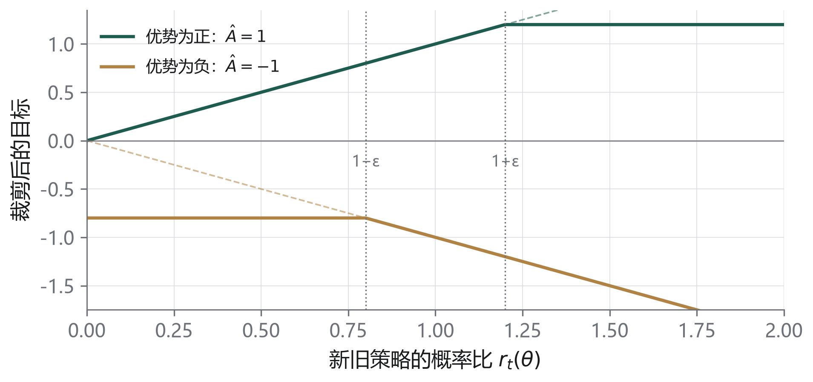

## TRPO 与 PPO：为什么要裁剪

策略梯度有一个隐患。梯度只告诉你往哪个方向走，没告诉你走多远。步长稍大，策略就会跳到一个完全不同的地方，之前的数据全部作废，训练崩掉。

这一章讲两种限制步长的方法。TRPO 用约束，PPO 用裁剪，后者因为实现简单成了工业标准。

### 步长为什么危险

策略梯度的目标是用旧策略采的数据估计新策略的回报。这个估计只在两个策略接近时才准。

如果新策略和旧策略差很远，重要性采样的比值会变得很大或者很小，估计的方差爆炸。更糟的是，旧数据里根本没出现过的动作，新策略可能给了很高的概率，这部分完全没有数据支撑，估计完全靠猜。

所以要限制新策略不要离旧策略太远。问题是怎么衡量“远”。

### TRPO 的做法

TRPO 用 KL 散度衡量两个策略的距离，把它作为约束。

$$
\max_\theta\ \mathbb{E}\left[\frac{\pi_\theta(a\mid s)}{\pi_{\theta_{\text{old}}}(a\mid s)}A(s,a)\right]
\quad\text{s.t.}\quad
\mathbb{E}\left[D_{\text{KL}}\left(\pi_{\theta_{\text{old}}}\|\pi_\theta\right)\right]\le\delta
$$

目标是一阶近似，约束是二阶的。求解需要计算 Fisher 信息矩阵的逆，用共轭梯度法，实现复杂。

效果很好，但工程上麻烦。每次更新要解一个约束优化问题，在大模型上开销太大。

### PPO 的做法

PPO 把约束换成一个更简单的东西，裁剪。

$$
L^{\text{CLIP}}(\theta) = \mathbb{E}\left[\min\left(r_t(\theta)\hat{A}_t,\ \text{clip}\left(r_t(\theta),1-\epsilon,1+\epsilon\right)\hat{A}_t\right)\right]
$$

$r_t(\theta)$ 是新旧策略的概率比。$\epsilon$ 通常取零点二。

图 10-1 画的是这个目标。实线是裁剪后的值，虚线是不裁剪的值。

看两条实线。

优势为正的时候，比值超过 $1+\epsilon$ 之后目标不再增长。也就是说，继续提高这个动作的概率不会带来更多收益，优化没有动力再推。

优势为负的时候，比值低于 $1-\epsilon$ 之后目标也不再下降。这个方向上的推动同样被限制住。

两个方向合起来，新策略不会离旧策略太远。这个限制比 KL 约束粗糙，但很有效，而且只需要一次前向和反向。

### 为什么 min 是必要的

有人会问，为什么不直接用 clip，还要套一个 min。

原因是 clip 只在一个方向上起作用。如果优势为正，clip 把过大的比值截断，但如果比值变得很小，clip 不会阻止目标变大，优化会倾向于把概率压到零。这时候 min 会选中未裁剪的值，避免这种病态。

反过来，优势为负时同理。min 保证了目标始终是“裁剪”和“未裁剪”中更保守的那个，优化不会利用 clip 的边界做文章。

### 实现细节

几个容易出错的地方。

**优势归一化**。同一批数据里的优势减去均值除以标准差，能让不同批次之间的尺度一致。不做这一步，PPO 对学习率很敏感。

**多轮训练**。同一批数据可以训练几轮，通常四到十轮。轮数太多，新策略会偏离旧策略太远，裁剪也救不回来。这是 PPO 里最需要凭经验调的一个参数。

**价值裁剪**。有些实现也会裁剪价值函数的更新，防止价值估计一次跳太远。

**学习率退火**。训练后期降低学习率，让策略稳定下来。

**梯度裁剪**。全局梯度范数限制在一个阈值内，防止某一次异常的大梯度。

这些细节都不在论文的核心公式里，但它们决定了实现能不能跑出论文的结果。这也是为什么同一个算法，不同团队的复现效果差别很大。

### TRPO 和 PPO 的取舍

TRPO 的理论更干净，它有单调改进的保证。在信任域内，新策略的回报一定不差于旧策略，这在实际训练中很值钱。

PPO 没有这个保证，裁剪只是一个启发式。但它实现简单，容易并行，在大规模训练上更有优势。

大模型的对齐训练几乎都用 PPO 或者它的变体，原因主要在这里。当模型有几百亿参数时，TRPO 的二阶计算根本做不起。

### 一个常见的误读

PPO 常被说成“简单版 TRPO”。这个说法不太准确。

PPO 的裁剪不是 KL 约束的近似，它做了不同的假设。裁剪限制的是单个动作的概率比，而不是整体分布的 KL。两者在大多数情况下行为相似，但在极端情况下会有差别。

理解这个差别，有助于在训练出问题时知道该往哪查。如果 KL 很大但比值都在区间内，说明问题在分布的整体形状上，裁剪管不到。

下一章处理连续动作。前面的方法大多假设动作是离散的，连续动作需要新的工具。
