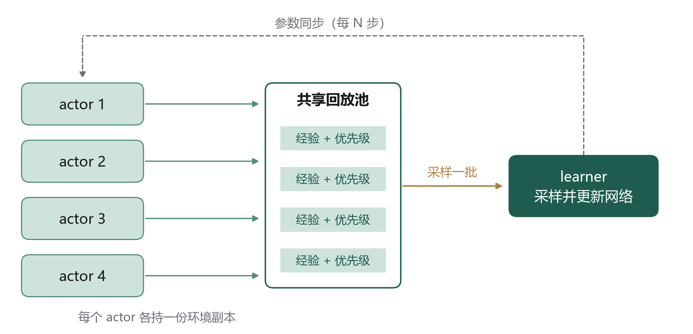

## 分布式强化学习

一台三十二核的机器上跑 PPO，GPU 利用率只有百分之十几。

原因很朴素。采样在 CPU 上跑，一个环境往前走一步只能产生一个转移，几百个状态维度的观测还要做预处理。三十二个环境并行，也就勉强喂饱半张卡。算法本身没有错，瓶颈在结构上。

这一章讲怎么把采样和学习拆开，以及拆开之后多出来的麻烦。

### 为什么要拆

在轨算法有一个硬性要求，数据必须由当前策略产生。于是采样和更新严格交替，采一批，更一轮，再采一批。

这两件事吃的是不同的硬件。采样是单线程的、分支多的、几乎不做浮点矩阵乘法的活，适合铺满 CPU 核。更新是规整的矩阵乘法，适合 GPU。交替执行意味着任何时刻总有一半硬件闲着，吞吐的上限是两者之和除以二。

拆开之后，采样端和更新端各自按自己的节奏跑，中间用一个缓冲区连起来。吞吐由慢的那一个决定，而不是两者之和。这个改动对最终学到的策略没有影响，纯粹是工程收益，所以在论文里常常一笔带过，在实际系统里却是能不能跑起来的分界线。

### 先把账算清楚

拆之前先算一下瓶颈在哪，否则拆完也不知道收益从哪来。

设一个环境步进要一毫秒，含物理仿真和观测预处理。一个 actor 一秒最多一千步。三十二个 actor 并行，理论上每秒三万二千步。

再看 learner。一批两千零四十八条，一次更新在 GPU 上要十毫秒，含前向、反向、优化器。每秒一百次更新，也就是每秒消费二十万条样本。

两边的差距是六倍。actor 供不上，learner 在等数据。

这时拆开没用，因为瓶颈在采样。要么加 actor，要么把环境步进加速。加到两百个 actor，采样速度到二十万步每秒，两边平衡。

反过来，如果环境很轻，一步只要五十微秒，一个 actor 每秒两万步，三十二个就是六十四万步，learner 每秒只能消费二十万步，那瓶颈在 learner，加 actor 是浪费，该做的是增大批量或者减少更新次数。

这两个方向的处理完全不同，所以在拆之前一定要先量出这两个数。方法很简单，在单机上分别计时，采样多少步每秒，更新多少次每秒，再乘以计划中的并行度。

还有一个隐藏的成本。观测的预处理常常比仿真本身还贵。图像要缩放、转灰度、堆叠四帧，这几步在 CPU 上是几毫秒。所以图像任务的 actor 数量要比状态向量任务多得多，不是因为仿真慢，是因为预处理慢。

### 三种架构

Ape-X 是最早把这套结构写清楚的。几十个 actor 各自跑环境，把经验带着优先级写进一个共享回放池，一个 learner 从池里采样更新，定期把参数广播出去。

有一个细节值得注意。优先级的计算放在 actor 上，用 actor 自己的网络算 TD 误差，作为这条经验的初始优先级。这样写入时就有优先级可用，learner 不必回头重算。

### Ape-X 的优先级细节

优先回放从分布式里搬过来，有几处要改。

优先级的定义是 TD 误差的绝对值取 $\alpha$ 次方。

$$
p_i = \left|\delta_i\right|^{\alpha} + \epsilon
$$

白话：误差大的样本优先采样，$\alpha$ 取零点六把差距压平一点，不加压平的话少数样本会占掉全部采样。$\epsilon$ 是一个小正数，保证每条样本都有一点概率。

采样概率是优先级归一化之后的结果，但直接按概率采会让更新有偏，因为采样分布和数据分布不一致。修正用重要性权重。

$$
w_i = \left(\frac{1}{N}\cdot\frac{1}{P(i)}\right)^{\beta}
$$

白话：被采到的概率越小，权重越大。$\beta$ 从零点四线性升到一，前期偏置大但方差小，后期方差大但偏置小。

分布式下有个新问题。优先级是在 actor 上算的，用的是 actor 那一版网络。等这条样本被采到，learner 的网络已经变了，优先级不再是当前误差。

修法是把优先级的计算挪到写入时做一次，之后不再更新，靠新近程度打折来补偿。具体是给每条样本记一个写入时间，采样概率里乘一个随年龄衰减的因子，老的样本概率略低。

这个修法是启发式的，但它解决了一个真实问题。不这么做的话，回放池会被早期那些"当时误差很大"的样本长期占据，而这些样本对新网络已经没有信息量了。

R2D2 在 Ape-X 的结构上加了两样东西。一是分布式价值，网络输出的是价值分布而不是期望值，配上优先回放，样本效率又高一截。二是循环网络，用 LSTM 处理部分可观测。

循环状态带来一个麻烦。从回放池里取出一段经验时，LSTM 的隐状态是用更早的参数算出来的，直接用会把旧状态带进来。R2D2 的办法是先用一段前缀把状态预热，叫 burn-in。它还发现，burn-in 段的隐状态用零初始化，比用存下来的隐状态更稳，这一点相当反直觉。

### R2D2 的两个细节

R2D2 在 Ape-X 上加循环网络，随之带来两个工程细节。

**burn-in**。从回放池取一段长度为八十的序列，前面再接四十步做预热。预热段的损失不算，只用来把 LSTM 的隐状态推到一个合理的位置。

为什么需要预热。因为存下来的隐状态是用旧参数算出来的，直接拿来用等于把旧策略的记忆塞进新策略。四十步的预热足够让隐状态被当前参数"洗"一遍，代价是每批多算一半的前向。

**零初始化反而更稳**。这件事反直觉。存下来的隐状态理论上信息更多，实测却不如从零开始预热。R2D2 的论文专门讨论过，解释是存下来的状态带着旧策略的偏置，网络会学会依赖这个偏置，一旦参数更新，这个依赖就成了噪声源。从零开始预热，网络学到的是"从无记忆状态出发，四十步内重建出有用的记忆"，这个能力对参数变化更鲁棒。

这条经验后来被反复验证。做循环网络的离线或者在轨训练时，先试零初始化预热，比调试存储状态省事。

还有一个实现细节。序列采样要保证同一条序列在同一个回合内，跨回合的序列会把两个不相关的状态接在一起，隐状态被污染。做法是在回合边界截断，短序列补齐或者丢弃。

IMPALA 走另一条路。它不设回放池，actor 采完一批就送走，learner 直接在这批数据上更新。快，但数据一定滞后，actor 用的是几轮之前的参数。这种滞后会让在轨算法的前提失效，于是它用 V-trace 修正。

$$
\rho_t = \min\left(\bar\rho,\; \frac{\pi(a_t\mid s_t)}{\mu(a_t\mid s_t)}\right),
\qquad
c_t = \min\left(\bar c,\; \frac{\pi(a_t\mid s_t)}{\mu(a_t\mid s_t)}\right)
$$

$\mu$ 是产生数据的旧策略，$\pi$ 是当前策略。$\rho$ 截断到 $\bar\rho$，用来给这一项的更新加权；$c$ 截断到 $\bar c$，只用来沿时间往回传播。

白话：偏离得越远，这条经验的权重越小，截断保证方差有界。代价是有偏，因为截断本身就是在丢信息。$\bar\rho$ 取一，就变成一种很保守的修正，只沿着旧策略走过的方向轻轻推一下。

### V-trace 逐项看

V-trace 的公式不长，但每一项的作用要拆开。

$$
v_s = V(s) + \sum_{t=s}^{s+n-1}\gamma^{t-s}\left(\prod_{k=s}^{t-1}c_k\right)\rho_t\left(r_t + \gamma V(s_{t+1}) - V(s_t)\right)
$$

白话：从当前状态的价值出发，把未来 $n$ 步的时序差分误差加起来，每一步乘一个折扣、一个累积的截断系数、一个重要性权重。

三个系数各管一件事。

$\rho_t$ 截断到 $\bar\rho$，控制这一项的幅度。$\bar\rho$ 等于一时，正向的更新被完全允许，负向的被截断，这是保守的选择。$\bar\rho$ 大于一，允许更激进的修正，方差上升。

$c_k$ 截断到 $\bar c$，控制沿时间传播的衰减。它出现在累积乘积里，越远的影响被压得越小。

$\gamma$ 是折扣，和原来的回报定义一致。

两个截断的目的不同。$\rho$ 管"这一步的误差算多少"，$c$ 管"这个误差往后传多远"。分开设置是因为它们影响的量不同，一个影响偏差，一个影响方差。

收敛性上，V-trace 收敛到的不是 $\pi$ 的价值，而是一个介于行为策略和当前策略之间的策略的价值。这两者的差距由 $\bar\rho$ 和 $\bar c$ 决定。取一的时候差距最小，但方差最大。这是一条显式的取舍曲线，不是实现细节。

和 PPO 的裁剪比，两者的哲学不同。PPO 限制策略更新的幅度，从源头减少偏离。V-trace 不限制策略，只修正数据上的偏差。前者要求数据新鲜，后者能容忍旧数据。所以 PPO 适合同步架构，V-trace 适合异步架构。

### 通信里传什么

actor 发给 learner 的东西大小差别很大。一条转移只有观测、动作、奖励、终止标志。带循环状态的每步还要多几百个浮点。参数则相反，从 learner 到 actor 是整份网络，几 MB 到几百 MB。

所以参数同步的频率要省着用。常见做法是每几百步同步一次，或者用发布订阅，actor 自己去拉最新的版本号。

### 通信量估一下

参数同步的频率不是随便定的，算一下就知道了。

一个三层全连接，输入一百二十八维，两个隐藏层各二百五十六，输出和动作维度有关。参数量大约是 $128\times256 + 256\times256 + 256\times n$，加起来十万量级。单精度浮点，四百 KB 左右。

一个 Atari 用的卷积网络，参数量在一百七十万上下，单精度接近七 MB。

假设两百个 actor，每四百步同步一次。每个 actor 每秒一千步，也就是每秒同步二点五次，总共每秒五百次同步。每次七 MB，带宽需求三点五 GB 每秒。这个数在单机上已经吃满了 PCIe，跨机器要走网络，直接爆炸。

所以图像任务的同步频率必须降下来，或者用压参数量、梯度压缩、只同步部分层这些手段。实践中常见的是几千步同步一次，配合 V-trace 容忍陈旧。

状态向量任务轻松得多。四百 KB 乘上每秒五百次，两百 MB 每秒，普通内存带宽完全够。这也是为什么状态向量任务的分布式实现简单，图像任务的实现到处是坑。

还有一个方向是反过来。actor 不推参数，learner 不广播，改成 actor 主动拉。用发布订阅，learner 每更新若干次发一个版本号，actor 在回合边界检查版本号，发现有新的就拉。这样同步发生在 actor 空闲的时刻，不会打断正在跑的一步。

同步方式决定了数据的陈旧程度。同步更新让所有 actor 等同一份参数，行为一致，但慢的 actor 会拖住所有人。异步各自跑，吞吐高，可不同 actor 的数据来自不同版本的策略，混在一起训练就是离轨的，需要用上面的修正项把偏差压回来。

### 陈旧度要监控

分布式训练出问题时，最先要看的是数据的陈旧度。

定义很简单。一条样本产生时用的策略版本，和它被学习时用的策略版本，差几版。

$$
\text{staleness} = \text{version}_{\text{learn}} - \text{version}_{\text{act}}
$$

白话：这批数据落后了几轮。落后一版到两版，在轨算法还能接受。落后十版，重要性权重会剧烈波动，修正项截断之后基本等于丢掉信息。

监控的方法是在每条样本里带一个版本号，学习时统计这一批的均值和中位数。曲线突然上升，说明 actor 供得太快或者 learner 太慢，队列在积压。

队列长度也是一个直接指标。队列一直满，说明生产快于消费。队列一直是空的，说明 actor 不够。理想状态是在半满附近小幅波动。

这两个指标合起来能定位绝大多数吞吐问题。曲线变差时先看这两个数，再怀疑算法。

还有一个坑。有的实现里队列是无界的，积压不会报错，只会让陈旧度慢慢爬升。跑到几小时之后曲线突然崩，回头看才发现队列里堆了几十万条旧数据。加一个上限，满了就丢最旧的，比无界安全。

### 单机上也能用的部分

很多团队不需要真正的分布式。单机上开几个进程跑环境，主进程做更新，这套结构已经能吃掉大部分收益。

PyTorch 生态里的做法是用多进程的环境包装器，一次返回一批观测，一次接收一批动作。八个到十六个环境并行，在状态向量任务上就能把 GPU 喂到七成以上。

这里有一个和分布的真正区别。单机的多个环境通常用同一份参数，同步发生在每一步，所以数据是新鲜的，不需要重要性修正。这就是为什么 PPO 用环境并行就够了，而 Ape-X 那套修正项在单机上用不上。

环境数量不是越多越好。八个环境，每步的批量是八乘回合长度；六十四个环境，批量变大，学习率要跟着调。而且环境之间的相关性高，光靠加环境数提升的多样性有限，不如加随机化，比如每个环境用不同的初始状态分布。

实测经验是状态向量任务八到十六个环境，图像任务三十二到六十四，再往上收益递减，因为预处理成了瓶颈。

### 优先回放的麻烦

单机里，优先级由当前网络算，比较准。分布式下，优先级是 actor 用旧网络算的，等它被采到，网络已经变了好几轮。

更麻烦的是正反馈。优先级高的经验被反复采样，如果这些经验来自同一个 actor 的同一段轨迹，回放池里的多样性就下降。learner 在这几个样本上过拟合，actor 又照着这个网络继续采，同一种经验被越推越高。

修法有几种。按新近程度打折，刚写入的优先级调高一点，老的随时间衰减。按 actor 分组采样，保证每个 actor 有固定份额。定期用 learner 的网络重算一批优先级，代价是多一次前向。

这三种都是补丁，不改变问题本身。分布式系统里的数据不像单机那样均匀，任何依赖“样本独立同分布”的假设都要重新检查。

图 16-1 画的是这三段的关系。左边的 actor 各自持有一份环境副本，用旧参数采样，把经验和优先级一起送进中间的回放池。learner 在右侧采样更新，再把新参数广播回左侧。整条链路上最慢的一环决定吞吐，通常是环境本身。

把三种架构放在一起对照。

::: {.tabcap}
表 16-1　三种分布式架构的取舍
:::

| 项目 | Ape-X | R2D2 | IMPALA |
| --- | --- | --- | --- |
| 回放池 | 共享，带优先级 | 共享，带优先级 | 无 |
| 数据新鲜度 | 陈旧 | 陈旧 | 陈旧 |
| 偏差修正 | 重要性权重 | 重要性权重 | V-trace |
| 循环网络 | 不支持 | 支持，需 burn-in | 可选 |
| 适合的任务 | 离散动作，单帧 | 部分可观测 | 大规模并行 |
| 主要麻烦 | 优先级过时 | 序列采样复杂 | 参数同步带宽 |

R2D2 用的零件最多。优先级、分布式价值、循环网络三样一起上，实现复杂度最高，但在部分可观测的 Atari 上是当时最好的结果。

IMPALA 的结构最轻。没有回放池意味着没有优先级要维护，也没有序列要采样，所有复杂性都在修正项上。它适合那种环境特别多、每个环境产生数据很快的场景，比如三维导航或者大规模仿真。

三者共同的限制是一样的。分布式把吞吐提上去了，但每条数据的价值没有提高。要真正提高样本效率，得减少需要的样本数，那是算法层面的事，不是架构层面的事。

### 一段工程判断

分布式不是免费的。它把单机的调试问题变成分布式系统的调试问题。actor 挂掉、缓冲区写满、参数版本对不上，每一种都会让曲线莫名其妙地变差，而且看不出来是哪一段出了问题。

先确认单机版跑通、曲线合理，再拆。拆的时候先把 actor 数量从一到二，跑通了再加。多数任务在八个到三十个 actor 之间就能吃满一张卡，再多是浪费，因为 learner 变成瓶颈，队列越积越长，数据的陈旧程度反而上去了。

### 一个 actor 挂了会怎样

分布式系统的调试成本大部分来自这里。

actor 挂掉有两种。一种是进程崩了，另一种是进程还在但环境卡住不再返回。前者容易发现，后者会让队列慢慢空掉，learner 从每秒一百次更新掉到十次，曲线变平，日志里没有任何错误。

对付卡住要加心跳。每个 actor 定期上报一个计数，learner 发现某个 actor 超过阈值没动，就重启它的环境。重启成本对多数环境可以接受，但如果环境有状态，重启会让那段轨迹断掉，需要注意不要把它当成回合终止写进回放池。

还有一种更隐蔽的故障是数据错位。某个 actor 的观测预处理参数被改过，它送来的观测分布和其他 actor 不一样。这种情况在训练上表现为价值估计有轻微的偏，很轻微，从曲线看不出来，只有训练完做逐 actor 的评估才能发现。

回放池本身也会出问题。多个进程写同一个池，如果没有锁或者锁的粒度太粗，会出现数据丢失或者顺序错乱。前者让样本变少，后者让序列采样拿到拼错的片段，循环网络会学出莫名其妙的记忆。

这些问题在单机上不存在，所以从单机迁到分布式的第一周，大部分时间是在修基础设施，不是在调算法。这一点要有预期。

### 并行度上去了学习率怎么调

actor 多了之后，单位时间内 learner 看到的样本变多，步数也变多。学习率不动，等于训练速度被人为提高了一截，曲线会抖甚至发散。

线性缩放是一个粗糙但常用的规则。批量翻倍，学习率翻倍。它的依据是小批量下梯度的噪声大，大批量噪声小，可以走大步。但这条规则只在批量不是特别大时成立，批量到几千之后收益递减，再按线性放大会崩。

更稳的做法是按更新次数算而不是按样本数算。学习者每做一次参数更新，参数只该动一点点，跟这次更新看到多少样本有关，但关系不是线性的。实践中常用的是批量翻倍、学习率乘一点四到一点七，再配一个短期的预热。

预热这一步在分布式里比单机更重要。训练开始前几百步，学习率从小值线性升到目标值，让优化器状态和归一化统计量都稳定下来。不预热的话，前几步的梯度尺度差异很大，参数会被推到一个很差的区域，之后花很久爬回来。

还有一个常被忽略的地方。并行度变了，探索噪声的尺度也要跟着变。两百个 actor 各自加同样大的噪声，总体采到的动作分布比单机宽得多，策略会学到一个偏保守的价值。噪声尺度按 $1/\sqrt{n}$ 缩是一个起点，实际要试。

还有一个经验。actor 数量上去之后，学习率一般要跟着调，因为每一步更新看到的样本更多，有效批量变大了。

下一章把环境本身也改掉。不再是一个智能体对着一个固定的环境，而是几个智能体互相成为对方环境的一部分。
