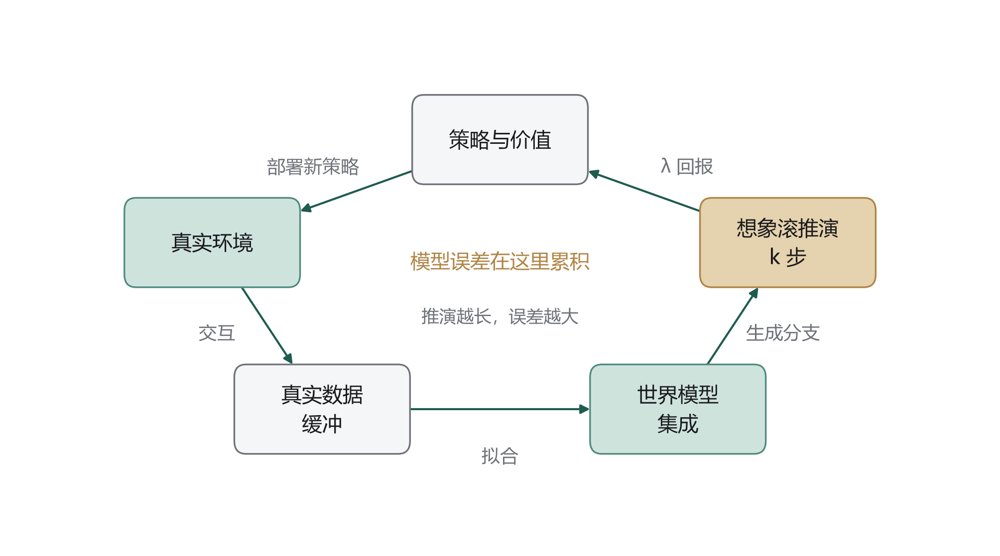

## 基于模型的进阶

前面讲过模型利用。学到的模型一定有误差，智能体会主动去找误差大的地方，学出在模型里完美、在现实里荒谬的行为。当时把它当成一个需要提防的毛病。

这一章换个角度。如果误差能被控制住，模型就是最便宜的数据来源。真实交互一次要几秒钟，模型里滚一步只要几微秒。这个差距足够大，值得为它多花点工程。

### 误差怎么累积

先把这个敌人量一下。假设模型每一步的预测偏差是 $\epsilon_m$，奖励的偏差是 $\epsilon_r$，有一个粗糙的界。

$$
\left|J(\pi, \hat M) - J(\pi, M)\right|
\le \frac{\epsilon_r}{1-\gamma}
+ \frac{2\gamma\,\epsilon_m\,R_{\max}}{(1-\gamma)^2}
$$

白话：第一项是奖励预测的偏差，第二项是转移预测的偏差。注意第二项的分母多了一个 $(1-\gamma)$，说明它会随折扣接近一而放大得更快。这个界很松，但指出的方向是对的，误差主要来自转移，而且惩罚是二次的。

还有一层更麻烦的。误差不只随步数累积，还会把策略推出数据分布。策略一旦走到没数据的地方，模型的误差跳一个台阶，界里的 $\epsilon_m$ 本身就变了。

所以实用的做法不是把模型训得多准，而是控制推演走多远。

### MBPO 与短滚推演

MBPO（model-based policy optimization，2019 年提出）的做法是从真实数据里取一个状态，在模型里滚 $k$ 步，$k$ 取一到五，然后用这个分支的末端去更新 Q。

$$
\mathcal{L}_Q = \mathbb{E}_{(s,a)\sim\mathcal{D}\cup\mathcal{D}_{\text{model}}}
\left[\left(r + \gamma\, \bar V(s') - Q(s,a)\right)^2\right]
$$

这里的 $s'$ 可能来自真实数据，也可能来自模型的第 $k$ 步。$\bar V$ 是目标网络的价值。

模型不是单个，而是 $N$ 个，通常五到七个，用不同初始化训练。每步推演随机挑一个。效果是，在数据覆盖好的区域几个模型一致，在没数据的地方分歧大，而分歧本身就是一个不确定性的度量。

$k$ 的选择有讲究。太大，误差累积吃掉收益；太小，模型提供的新信息不够，等于没用。MBPO 的做法是随训练进度调 $k$，早期小，等模型变准了再放大。这个调度看着像工程技巧，其实是在跟上面那个界做交易。

### Dreamer 的潜空间

Dreamer 走得更远。它不在观测空间建模型，而是在一个压缩的潜空间里建。

编码器把观测压成随机潜状态 $z_t$，转移模型在潜空间里预测下一个 $z$，解码器把 $z$ 还原成观测。这个结构叫循环状态空间模型。

训练目标有两块。

$$
\mathcal{L} = \mathbb{E}\left[-\ln p(o_t \mid z_t)\right]
+ \beta\,\mathbb{E}\left[\mathrm{KL}\left(q(z_t \mid h_t, o_t)\,\|\,p(z_t \mid h_t)\right)\right]
$$

第一项是重建损失，第二项是正则。白话：重建要求潜状态保留足够的信息把观测还原，KL 要求它别偏离先验太远。$h_t$ 是循环网络的隐状态，负责记住历史。两项拉扯的结果是一个既紧凑又能预测的表示。

策略和价值都在潜空间里学，回报用 $\lambda$-回报。

$$
R_t^\lambda = r_t + \gamma\left[(1-\lambda)V(z_{t+1}) + \lambda R_{t+1}^\lambda\right],
\qquad R_T^\lambda = V(z_T)
$$

展开就是一串按 $\lambda$ 加权的多步回报。$\lambda$ 等于零退化成一步自举，偏差大方差小；等于一退化成蒙特卡洛，方差大偏差小。中间的值在两者之间插值，和广义优势估计里的那个 $\lambda$ 是同一个角色。

Dreamer 的收益在于，所有想象都在低维潜空间里跑，成本低，而且不生成观测，省掉了一大块误差来源。图像上有噪声，像素级的预测误差常常集中在不重要的细节上，把观测压成潜状态之后，这些细节被自然地过滤掉了。

### 误差如何被利用

只要策略是在模型里优化的，它就会去找模型的错。

典型的现象是这样。模型在某些状态附近没有数据，预测出的奖励偏高，策略学会一直待在那里。曲线在模型里漂亮得不像话，一放到真实环境立刻崩。有些工作里，模型给出的想象回报能比真实回报高一两个数量级，那不是算法变好了，是幻觉。

对策大致三类。

惩罚不确定性，把集成的方差或者一个单独判别器的输出当成奖励的减项，分歧大的地方扣分。保守规划，只相信模型给出的下界，宁可低估。混合训练，把模型里的想象数据和真实数据放在一起更新价值，靠真实数据把估值拉回来，MBPO 走的是这条。

但每一种都在给模型加约束，约束一多，模型能提供的额外信息就少了。这里没有免费的部分，省下来的真实交互，是用模型的可用性和调参成本换的。

图 18-1 是这个循环的样子。左边是真实环境和数据缓冲，中间是模型和它生成的想象分支，右上是策略与价值的更新，最后一条箭头把新策略送回环境。误差在模型那一侧累积，所以控制它的手段都集中在那里，要么缩短推演，要么给推演的结果打折。

### 什么时候值得用

判断标准只有一个，你的真实交互贵不贵。

机械臂、自动驾驶、化工过程，交互一次几分钟甚至几小时，模型的方法能把样本效率提高一个数量级，值得。游戏和仿真环境，交互便宜，免模型方法更简单更稳，用模型反而多出一层要调的东西。

还有一条容易被忽略。模型能给的不只是更多的数据，还有梯度。在模型里可以对动作直接求导，一步算出该往哪走，这是免模型方法做不到的。规划、轨迹优化、模型预测控制，靠的都是这一点。

下一章把最后一样东西也从人工设计里拿掉。奖励不写了，让人做示范，从示范里把它反推出来。
