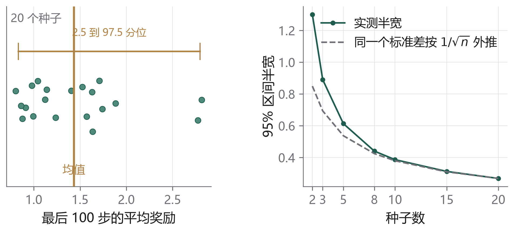

## 评估、复现与样本效率

最后一章讲判断。

一个算法好不好，不能只看论文里的曲线。要看它在什么条件下、跑了几次、和谁比、代价多大。这几件事合起来，才构成一个可信的结论。

### 样本效率

先看一个具体的对比。同样在 CartPole 上，三种算法达到相近水平所需的交互步数差别很大。

::: {.tabcap}
表 20-1　三种算法在 CartPole 上的数据量
:::

| 算法 | 训练量 | 达到的水平 | 备注 |
| --- | --- | --- | --- |
| DQN | 约 6 万步 | 中位数 177，最好 500 | 离轨，可重复利用数据 |
| REINFORCE | 约 10 万步 | 三个种子均到 500 | 在轨，数据用完即弃 |
| PPO | 约 12 万步 | 三个种子均接近 500 | 在轨，同批数据训十轮 |

这些数字只在这个任务、这套配置下成立，不能直接搬到别处。但它们能说明一件事，样本效率不是单一的数字，它和稳定性、实现复杂度绑在一起。

DQN 用的数据最少，但结果最不稳定。REINFORCE 简单，数据量中等。PPO 数据最多，但最稳。选择哪一个，取决于你更在意什么。

### 学习曲线怎么读

一条曲线里至少有三层信息，横轴的量、纵轴的量、曲线的形状。三层都读对，结论才靠得住。

横轴要用样本数或者环境步数，不要用墙钟时间。用时间比较，会把实现效率的差别混进算法比较里，一个写得快的实现看起来算法更好。

横轴常常要用对数。多数算法的前期进步快，后期慢，线性横轴上前期的差别被压成一条竖线，什么都看不清。对数横轴能同时看到前期的斜率和中后期的平台。

纵轴的量要写清楚是训练回报还是评估回报。训练回报受探索噪声影响，评估回报才是真实水平。两者常常差百分之十到二十，混用会让不同论文的数字无法比较。

曲线的形状有三种典型。一直平，学不动，检查奖励和探索。先升后平，正常收敛。先升后掉，过拟合、约束失效或者数值问题。第三种最容易被平均曲线掩盖，因为平均之后看起来是平，实际上每个种子都在掉，只是掉的时间不同。

平滑要写出来。滑窗多大，是指数平滑还是移动平均，这些细节决定曲线看起来是否好看。有人用很大的滑窗让曲线变平顺，读者会误以为训练很稳。规范的做法是画原始曲线的浅色版本加平滑后的深色版本，两者都给。

### 种子方差有多大

不用猜，跑一下就知道。

十臂赌博机，$\epsilon$ 等于零点一，动作价值用样本平均，跑一千步，二十个种子。最后一百步的平均奖励，均值一点四三，标准差零点五七，最小零点八一，最大二点八二。

同一个算法，同一套超参数，只有种子不同，最终水平差了三倍以上。

差距的来源可以拆开看。每个种子的真实臂均值是随机的，最好的臂可能是零点五，也可能是二点五，这决定了这个种子上限有多高。学习过程中的采样噪声决定它能不能找到那个最好的臂。两个因素叠加，就有了这个分布。

图 20-1 左边画的这二十个点。它们不是误差，是真实存在的分布。

如果只跑三个种子，抽到的最好和最差可能只差百分之五，也可能差一倍。前者会让你误以为算法很稳，后者会让你误以为算法不能用。

这也是为什么单种子的对比没有意义。一个算法在一个种子上赢了另一个算法，完全可能是运气。

实践里有一个折中。日常调参用三个固定种子，跑得快，能看出大方向。定稿前用二十个种子重跑最好的三个配置，这一步常常会推翻前面的结论。三个种子的排序和二十个种子的排序不一致是常事，因为前者的区间宽到互相重叠。

如果算力实在不够，至少做到两条。所有对比用同一批种子，排序至少是配对比较。以及明确写出种子数，不要用误差棒伪装确定性。

图表也一样。同一批数据画折线还是画柱状，横轴用线性还是对数，能让两个差百分之五的算法看起来差一倍，或者看起来一样。图要能让读者自己判断，不是替读者下结论。

### 评估的规范

评估一个策略，要注意几件事。

用单独的评估环境，不要复用训练环境的状态。

固定评估种子，让不同实验之间的对比公平。

评估足够多局。CartPole 上二十局够用，奖励稀疏的任务可能要一百局以上。

这五条里，只有第一条需要改代码。做法是单独建一个评估环境实例，用独立的随机数发生器，和训练环境完全隔离。有人图省事复用训练环境，代价是评估结果里混着训练状态的残留，同一个检查点评两次数不一样。这个 bug 很小，症状很隐蔽，值得一开始就避开。

关掉探索。训练时的随机性会让评估结果偏低，而且不稳定。

报告分布而不是单点。多个种子的中位数、四分位、最好最差，比一个平均值信息量大得多。

### 置信区间

如果只有三个种子，不要急着算置信区间。样本太少，算出来的区间没有意义。

五个以上种子可以给出一个粗略的范围。十个以上比较可靠。如果实验很贵，跑不了很多次，那就老老实实说“三个种子”，不要用统计术语包装。

这一点在论文里经常被忽略。有些工作只跑三个种子，却报告很小的误差棒，读者会误以为结果很稳。

### 置信区间怎么算

图 20-1 右边是同一批数据换一个角度看。横轴是种子数，纵轴是 95% 区间的半宽。

三个种子，半宽零点八九。十个种子，零点三九。二十个种子，零点二七。

三点种子的时候，区间宽到把均值上下各零点九都包进去，而这个任务的回报范围本身只有二点几。这意味着报告"均值一点四三加减零点八九"几乎不传达信息，读者无法判断它比另一个算法的一点六是好还是差。

### 报哪个数

同一个实验，可以报均值、中位数、四分位、最好的一次、曲线下面积。选哪个，会改变结论。

均值受极端值影响。二十个种子里有一个崩到零点零几，均值立刻掉一个台阶，但中位数几乎不动。如果崩溃是算法本身的问题，均值更诚实；如果崩溃是环境配置的偶发故障，中位数更能反映算法的真实水平。

四分位间距回答的是"稳不稳"。中位数高但间距大，说明这个算法靠运气。

曲线下面积适合比较学得快慢。它对前期表现更敏感，适合那些关心"多长时间能用"的场景。峰值回报适合离线训练、一次部署的场景。

还有一类指标是近几年的推荐做法，叫四分位均值。做法是去掉最差和最好的各四分之一，剩下的取平均。它比均值抗极端值，比中位数用了更多信息。

$$
\text{IQM} = \frac{1}{|\mathcal{S}|}\sum_{s\in\mathcal{S}} x_s,\qquad \mathcal{S} = \text{去掉两端各 25\% 的种子}
$$

白话：掐头去尾再平均。二十个种子的话，用中间十个。

无论选哪个，都要同时给出样本量和分布的形状。一个数字加一根误差棒，信息量太少。

### 复现的障碍

强化学习的结果难复现，原因有几个层次。

代码层面，随机种子、库版本、硬件差异都会影响结果。GPU 上的浮点运算不保证完全一致。

实验层面，超参数搜索的空间很大，论文里给出的往往是调好的值。用默认值跑，结果可能差很远。

报告层面，有些工作只报告成功的配置，失败的不写。这会让后来者低估难度。

### 复现别人的结果

复现失败是常态，不是例外。有几件事按顺序做，能少走弯路。

先用作者给的代码和配置跑一遍。这一步不是为了验证，是为了确认环境和依赖能装上。很多复现卡在这一步，几天就过去了。

再确认评估协议一致。评估用多少局，从什么初始状态出发，探索噪声关不关，这些细节在论文里常常只写一句或者不写。和作者联系问清楚，比自己猜快。

然后看基线。如果你复现的算法和论文差百分之十，先确认基线是不是也差百分之十。如果两者同向偏移，问题多半在环境或者评估，不在算法。

超参数搜索的范围要一致。论文报的是调好的结果，你和它比时也该给自己的方法同样的搜索预算。只调自己的不调基线，是比较里最常见的偏差。

最后接受一部分不可复现。分布式训练的浮点非确定性、GPU 型号带来的数值差异、库版本的行为变化，这些都会让结果有一点偏移。文献里报告的差异如果小于种子方差，本来就不该当结论。

### 评估频率也是一条曲线

评估不是免费的，多久评一次是一个要定的事。

评得太密，训练时间被评估吃掉。一个要跑几万步的任务，每千步评十局，评估占的时间可能超过训练。评得太疏，曲线变成几个点，看不出中期的变化。

经验做法是按总预算的百分之一到三花在评估上。总预算一百万步，评估花一到三万步，每五千步评一次、每次二十局，差不多就是这个量。

还有一件事要定，用哪个检查点。训练结束的那个不一定最好，尤其是后期开始过拟合的时候。规范的报告会同时给出"最后一个检查点"和"历史最好的检查点"，前者反映训练稳定性，后者反映方法的上限。只报后者会让结果虚高，只报前者会让好方法看起来平庸。

保存检查点也有成本。每个检查点几百 MB，跑二十个种子，存十个检查点就是几十 GB。实践里通常只存最有希望的几个和最后一个。

评估的局数要够。二十局在成功率上给出的估计误差大约是百分之十，一百局能到百分之四。如果两个算法的差距是五个百分点，二十局的评估根本分不出来。

一个务实的态度是，把复现目标定成"在种子方差的范围内一致"，而不是"数字一样"。前者是科学，后者是执念。

### 指标之外的两件事

有两个东西不进曲线，但决定了结果能不能用。

一是推理成本。同一个回报，一个策略每步要跑五次前向，另一个只跑一次，部署时的差别是几倍。论文里常常只报回报，实际选型时推理成本经常是第一道筛选。

二是失效形态。策略崩的时候是怎么崩的，慢慢地掉，还是突然跳到零。慢慢掉可以靠监控提前发现，突然跳没有预警，只能靠安全层兜。这两种形态在平均回报上完全一样，工程上的含义差很远。

所以一个完整的评估报告，除了回报和方差，还该写清楚每步的计算量，以及跑两千局里最差的那两百局什么样。

### 预算怎么对齐

比较两个算法，第一个要回答的问题是用什么当预算。三种口径，结论可能完全不同。

**样本预算**。给两方相同的环境交互步数。这是强化学习论文的默认口径，因为它衡量的是"数据效率"。适合交互昂贵的场景。

**墙钟预算**。给两方相同的时间。这个口径把实现效率算进去了。一个算法样本效率高但每步计算量大十倍，在这个口径下会输。适合工程落地。

**算力预算**。给两方相同的浮点运算量或者相同的 GPU 小时。这个口径最公平，也最少被用，因为不好测。

三者选哪个取决于你想回答什么问题。想问"哪个方法更懂数据"，用样本预算。想问"给我一周能跑出什么"，用墙钟。

常见的偷换有三种。

一种是给基线更少的预算。基线的超参数没调，训练步数减半，然后报告"我们的方法更好"。这种问题在开源代码的对比里最常见。

另一种是用评估次数当免费。模型方法要做大量评估，评估也是交互。把评估算进预算，某些方法的优势会缩小一半。

第三种是选择性报告。跑了二十组配置，只报最好的那组，而且不说明。读者看到的是一个点，实际是一个分布的最大值。这个做法在任何预算口径下都不公平。

规范的做法是写清楚三件事，预算的口径、每个方法在预算内跑了多少组配置、报告的是哪个统计量。三件事都写清楚，读者才能自己判断结论的强度。

### 日志里该记什么

实验记不全，三个月后没人能说清那个曲线是怎么跑出来的。有几项必须在训练开始前就写进日志。

配置的全部内容，不是摘要。优化器的每个参数、网络的每一层、环境的每个开关，都写进去。合并了默认值之后的最终配置才是有效的。

随机种子。除了主种子，环境、numpy、torch 的种子都单独记。有人只设了主种子，环境用的是系统熵，结果跑三次差很多，还以为是算法不稳。

代码版本。git 的 commit 号加上工作区的脏标记。跑实验时改了代码不提交，事后无从追溯。

环境版本。库的版本号，尤其是深度学习框架和仿真器。仿真器的小版本升级经常改变物理参数，成绩直接变了。

评估协议。评估用多少局，从什么状态开始，探索关不关，评估频率多少。这几项决定了曲线能不能和别人的比。

硬件。GPU 型号和数量。浮点非确定性会让同样的种子在不同硬件上给出不同的结果，这一条在排查诡异差异时是第一个要看的。

这些项加起来不到二十行代码，全部自动记录，不用手工填。带来的收益是任何一条曲线都能追溯到完整的上下文。

### 一个报告模板

想把结果报告清楚，可以按这个结构写。

先写问题的一句话描述，和对环境的精确版本。然后写预算，样本数、墙钟、硬件三样都给。

接着写主结果。用一张表，每一行一个算法，列是种子数、中位数、四分位间距、最好最差。不要只给均值。

然后是学习曲线。横轴对数，纵轴用独立的评估回报，画出每个种子的浅色线和总体中位数的深色线。

再写消融。按种子配对的方式报告差值，给出区间。

最后写失败案例。哪些配置跑崩了，崩的样子是什么。这一节最少人写，信息量最大，因为它告诉读者这个方法的边界在哪。

整套下来一页纸就够。一页纸写不清的结果，通常是实验设计本身没想清。

### 消融怎么做才说明问题

消融的目的是回答"这个零件有没有用"，不是"这个零件能不能去掉之后还能跑"。

做法是控制变量。每次只改一个东西，其他全部固定，包括种子。用同一批种子做对照，能消掉种子带来的方差，这一点比多跑几个种子更有效。

$$
\Delta = \frac{1}{N}\sum_{i=1}^{N}\left(x_i^{\text{full}} - x_i^{\text{ablation}}\right)
$$

白话：按种子配对相减，再取平均。配对之后，种子带来的共同波动被抵消，剩下的差值更接近零件的真实贡献。

消融要注意两个陷阱。

一个是交互效应。去掉 A 和去掉 B 各自影响很小，同时去掉影响很大，说明两者是互补的。只做单项消融会得出"两个都没用"的错结论。至少要做一次全去掉的对照。

另一个是预算不公平。去掉一个零件之后训练变快，如果给它的样本预算不变，它相当于多训了一段。要在相同样本数、相同墙钟时间两个口径下各看一次。

消融的范围也要控制。六个零件全组合是六十四组，跑不完。实际做法是先做单项，把影响大的三个挑出来做组合，剩下的保持不变。论文里常见的"完整消融"其实是这种分层设计，不是穷举。

### 一份自查清单

做完一个实验，可以问自己几个问题。

配置是否完整记录，包括所有超参数和随机种子。

结果是否跑了多个种子，是否报告了分布。

基线是否公平，是否用了同样的训练预算和评估方式。

评估是否独立，是否关掉了探索。

结论是否超过了证据。一个任务上的结果，不能直接推广到所有任务。

这几条都不难做到，但每一条都有人栽在上面。

### 一个更长远的视角

强化学习这个领域，方法更新得很快，但判断标准变得慢。

十年前人们关心能不能学会，现在关心学得多快、多稳、多省。这个变化背后是整个领域从实验室走向工程。

工程上的判断标准和论文不同。论文看峰值，工程看底线。论文看一个任务，工程看一批任务。论文能接受偶尔失败，工程不能。

所以读论文时，除了看它做到了什么，还要看它在什么条件下失败。这部分往往写在附录里，或者根本不写，需要自己判断。

### 收尾

本书从 MDP 讲到这里，覆盖了强化学习的主干和几个正在长出来的分支。公式不少，但每一条都对应一个具体的问题。

后面几章讲的东西看起来分散。约束是给回报加一条红线，分布式是把采样和学习拆到两台机器上，多智能体是环境里多了几个也在学的对手，基于模型的进阶是把模型用得更狠一点，逆强化学习干脆把奖励也交给数据。它们都不推翻前面的推导，只是在同一条主干上加了一个条件，代价和稳定性要重新分配一次。

如果只记一件事，希望是这个。所有这些算法都在做同一个权衡，用多少数据、换多少稳定性、付出多少实现复杂度。没有哪个算法在所有维度上都最好，选择取决于你的约束。

把镜头拉到大模型上，那里的状态是文本，动作是词，奖励来自人类偏好或者自动检验。很多名词会变，底下的逻辑还是本书讲的这些。
