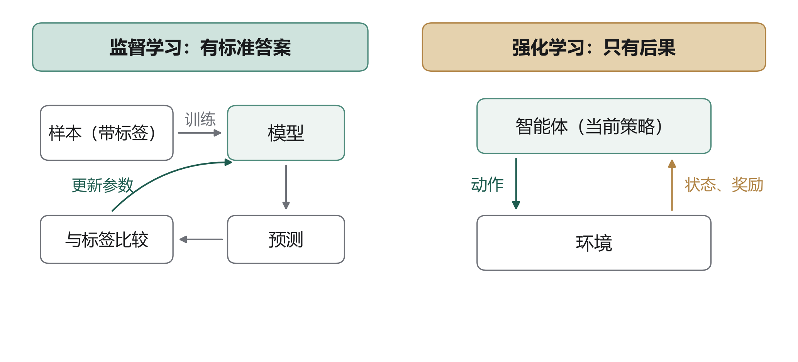

## 从推荐流到红绿灯：看不见的决策者

早上拿起手机，第一条视频是算法挑的。地铁口的红绿灯时长，是交通部门按车流调过的。到了公司，邮箱把不重要的信归到一处，搜索引擎猜你想找的是哪个页面。这些决定都由程序做出，做了成千上万次，而且大多没有人盯着。

这些程序有一个共同点，它们做的是**选择**，不是**判断**。判断有标准答案，一张图里是不是猫，答案是或否。选择没有现成的答案，只能先做一个，然后看世界怎么回应。回应好，下次多做一点；回应差，下次换个做法。

强化学习研究的正是这类问题。它的英文是 reinforcement learning，直译过来是“通过强化而学习”，但这个译名容易让人误解，好像有个老师在旁边不断夸奖。真实的情况往往更冷清：没有人告诉程序该怎么做，只有事情发生之后的一个结果。

### 一天里被算法做了多少次决定

举个更具体的例子。假设你在做一款手机游戏的关卡设计，想让新手在前三关留下来。你可以改的东西很多，敌人的血量、金币的掉落、提示出现的时机。你不知道哪种组合最好，只能上线一个版本，观察一周的留存率，再改。

这里有几个细节值得注意。第一，你能做的改动不是无限的，只能从若干选项里挑一个，就像回合制游戏里的出牌。第二，你看到的结果不是立刻出现的，玩家要玩几天才决定走不走。第三，同一个改动在不同玩家身上效果不同，你看到的留存率是一个平均值。

强化学习的语言几乎是为这种场景量身定做的。程序有若干可选的**动作**，做动作之后世界进入新的**状态**，并给出一个**奖励**（留存率涨了就是正奖励，掉了就是负奖励）。程序要学的是一套从状态到动作的对应关系，使得长期累积下来的奖励尽量大。

图 1-1 把这件事和监督学习放在一起看。左边是有标准答案的学习：一堆图片，每张标好“猫”或“不是猫”，模型的任务是模仿这些标签。右边是没有标准答案的学习：模型做一个动作，环境给出反馈，模型据此调整，再去做下一个动作。左边教的是“这道题的答案是什么”，右边教的是“这样做的后果是什么”。

### 有标准答案的问题

监督学习在过去十几年里解决了很多问题，它的成功有一个前提，每一个训练样本都带着正确答案。这个前提在图像识别、语音转写、机器翻译里大致成立，因为人类可以事后标注。

但有些问题没法这样标注。想象你要训练一个程序下围棋。你可以把人类棋谱喂给它，让它模仿高手的每一手，这就是 AlphaGo 早期做过的事。可一旦它想超过人类，就没有现成答案可抄了。一步棋好不好，取决于对手怎么应，也取决于后面几十步的走势。没有哪个人能对每一个局面都给出正确答案，连顶尖棋手也做不到。

再比如让机械臂把桌上的杯子抓起来。你可以录下人类操作的轨迹让它模仿，但杯子的位置、桌面摩擦、光照每次都不一样，模仿得再像，也会在某个没见过的姿态上失败。真正让它学会的办法是让它自己抓，抓掉了就重来，抓起来就记住这一次的手感。

这两类问题的共同点是，正确答案依赖于后续的一连串选择，而这一连串选择又依赖于智能体自己。它必须自己产生数据，而不能只消费别人给的数据。

### 只有反馈，没有答案

强化学习的输入不是答案，而是反馈。这个区分看起来细微，后果却很大。

反馈有几个特点。它是**评价性**的，只告诉你这一步好不好，不告诉你最好的做法是什么。它是**延迟的**，一盘棋要走完才知道输赢，中间每一步都没有分数。它是**有噪声的**，同样的动作在不同情况下结果不同，运气占了很大比重。

因为只有评价，智能体必须自己解决一个额外的问题，哪些动作该为最终结果负责。一盘棋输掉，可能是第 137 手的失误，也可能是开局就走了偏。这个把最终结果分摊到各个中间动作上的过程，叫**信用分配**（credit assignment）。它的数学形式这里不展开，先用直觉理解，这是强化学习里最本质的难点之一。

因为反馈有噪声，智能体还不能太轻信。一次偶然的成功可能只是运气，如果立刻把策略改过去，下次就未必灵。所以几乎所有算法都会做某种平均或平滑，用很多次尝试的结果来判断一个做法到底好不好。

因为反馈延迟，智能体还得做一些看起来“吃亏”的选择。有时候必须暂时放弃眼前的小利，去尝试没走过的路，才可能发现更好的做法。这就是探索与利用的矛盾，第四章专门讲它。

::: {.keypoint}
**一句话概括**：强化学习让智能体在没有标准答案的情况下，通过与环境反复交互、根据反馈调整行为，学会让长期累积的奖励尽量大。
:::

### 一次决定的好坏，往往要等很久

把延迟这件事单独拎出来看，会发现它比想象中普遍。

下棋，胜负在最后。投资，收益在几年后。吃药，效果在疗程结束时才看得出来。写一段代码，bug 可能到线上才暴露。这些场景里，每一步都只有微弱的信号，或者干脆没有信号。

人类对付延迟的办法是建立一个中间评价。棋手会判断“这个局面我的子力更活”，程序员会判断“这段代码可读性不错”。这些中间判断不是最终结果，但它们和最终结果相关，能让学习在结果出现之前就进行。

强化学习里的**价值函数**（value function）就扮演这个角色。它估计的不是眼前这一步能拿多少分，而是从当前局面出发，未来一共能拿多少分。有了它，即使奖励要到很晚才出现，智能体也能在中间每一步给出一个有根据的判断。第五章会专门讲价值函数怎么来的，以及它为什么是几乎所有现代算法的骨架。

还有一层麻烦。延迟意味着你很难判断一个决定是好是坏，因为影响它的因素太多。如果智能体在第十步改了做法，而奖励在第一百步才出现，它怎么知道这个改动的功劳或责任？这就是为什么强化学习里的结论总带着误差范围，单次结果说明不了什么，必须跑很多次，用统计的办法把噪声压下去。

### 这门技术在解决什么

回到开头那个问题，为什么这两年强化学习又热了起来。

一部分原因是游戏和机器人，让程序在仿真里练几百万次，再把学到的本领搬到现实。另一部分原因是大模型。一个语言模型预训练完之后，能续写、能答题，但它的行为不一定符合人的期望。让它更有用、更少胡说、更愿意按步骤推理，靠的都是强化学习这一类方法。这条线后面还会讲到，这里先建立直觉。

在往下读之前，只需要记住一件事：强化学习处理的不是“这道题的答案是什么”，而是“这样做之后会发生什么，我该怎样调整”。接下来的几章，把这个处境里的每个零件拆开来看。
