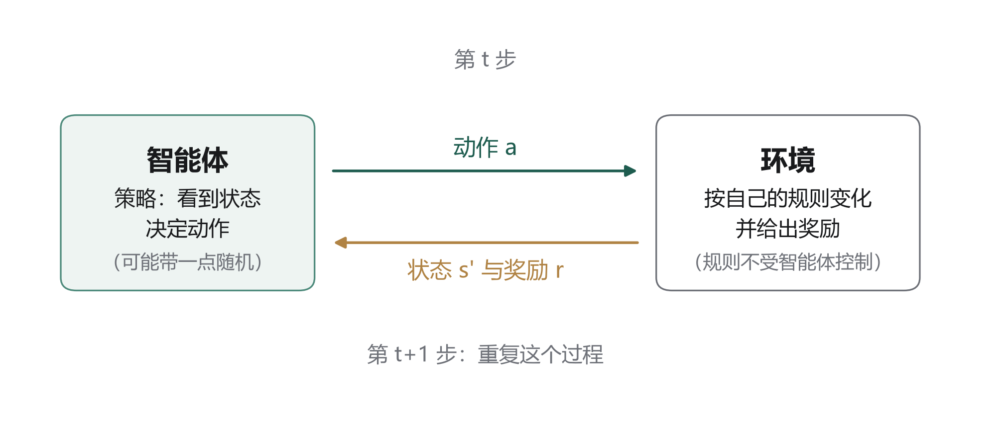

## 五个词搭起一个世界

强化学习的所有讨论，都建立在一套很小的词汇上。智能体、环境、状态、动作、奖励。这五个词看起来简单，每个都有讲究，含糊过去的话，后面读论文会处处卡住。

这一章不写公式，只把它们放回一个具体的机器里。这个机器是一台扫地机器人，它在你家客厅里工作，走一步看一步，没电了自己回去充。

### 一台扫地机器人

客厅里有沙发、茶几、地毯和充电座。机器人底部有轮子，前面有碰撞传感器，顶部有激光测距，还有一个摄像头。它的任务是尽可能把地板扫干净，别卡住，别从楼梯上掉下去，电量低了要记得回去充电。

晚上八点，你在手机上按了“开始清扫”，然后出门吃饭。接下来两小时的事，能把这五个词演一遍。

机器人从充电座退出来，沿墙走一圈，这是出厂预设的规矩。走到沙发腿那儿被卡住，蹭几次退出来，换个角度绕过。上了地毯阻力变大，它把吸力调高。钻进茶几下面被卡，倒车出来换一侧再试。扫到一半电量剩两成，它往充电座走，路上被拖鞋挡住，绕开，回座充电。第二天早上你看到一张画歪的地图，还有一条提示，说茶几下面那块它没进去过。

把这件事拆成五个词。

机器人自己叫**智能体**（agent）。它在每一个时刻做一件事，这件事会影响接下来的处境。它不控制沙发的位置，也不控制电量下降的速度，这些由外部决定。

机器人之外的一切叫**环境**（environment）。地板、家具、电量、甚至用户什么时候把它抱起来，都算环境的一部分。环境有自己的规律，机器人只能通过动作去影响它，不能直接命令它。

机器人此刻的处境叫**状态**（state）。严格地说，状态是环境的一个完整描述：地板哪里脏、电量多少、自己在哪个位置、朝向哪里。现实里智能体拿不到完整状态，它只能拿到传感器读到的部分，这部分叫**观测**（observation）。为了方便，书里很多时候不区分这两个词，但遇到“不完全可观测”这类说法时，指的就是它们确实不同。

机器人能做的事叫**动作**（action）。往前走、后退、左转、右转、启动吸尘、回充。动作的集合叫**动作空间**（action space）。如果动作是有限的几个，叫离散动作空间；如果动作是一个连续的量，比如给轮子一个 -1 到 1 之间的速度，叫连续动作空间。两种空间的算法细节不同，但基本框架是一样的。

环境给机器人的反馈叫**奖励**（reward）。扫到一块脏地方就加一点分，撞到沙发扣分，掉下楼梯扣一大笔，回到充电座也加分。奖励是一个数，可正可负。智能体唯一的目标，就是让这个数在长期累积下来尽量大。

图 2-1 是这五个词组成的一个循环。智能体看到状态，选一个动作交给环境，环境因此改变，并返回新的状态和一个奖励。这个循环重复下去，就构成了一段**轨迹**（trajectory）。

### 状态和观测不是一回事

状态是完整描述，观测是拿到的那一部分。这个区别值得单独讲，因为它是很多失败的根源。

最清楚的例子是打牌。真实状态里包括每个人手里的牌、牌堆的顺序。你能观测到的只有自己手里的牌和已经打出去的牌。你做的每个决定，依据的都是这个残缺的版本。如果你按“我看到的”去设计策略，碰上老手就会吃亏，因为老手在根据你打牌的节奏推断你看不到的东西。

再举一个感官被遮住的例子。半夜关灯找钥匙，你手里只有触觉。手指没碰到的地方你不知道有没有钥匙，找过的抽屉你得记住，不然会翻两遍。这里没有“亮着的房间”这个全局视野，只有一步一步摸出来的局部信息。

扫地机器人身上也有同样的事，只是形式更隐蔽。它的轮子转了多少圈能算出走了多远，这个叫里程计。轮子在地毯上打滑，里程计就会漂移。它以为自己还在客厅正中，其实已经偏到走廊去了。摄像头在床底下会失效，激光雷达被窗帘挡住会读出一个假距离。传感器不会告诉机器人“我现在瞎了”，它给出的是错误但看起来正常的数字。

这种处境叫**部分可观测**（partially observable）。它的后果是一条听着有点绕的结论，在这种问题里，最合适的做法常常取决于历史，而不只是眼前这一帧。同样一张画面，如果前一秒机器人正在往东走，该继续，如果前一秒它刚被撞了一下，该停下检查。画面一样，动作不同，因为画面之外还有信息。

工程上的补救办法有几种。最简单的是把最近几帧拼在一起喂进去，让“变化”本身成为信息。第二种是给智能体加记忆，让它自己维护一个对处境的内部判断，相当于在心里记一句“我大概在走廊，电量还有三成”。第三种是干脆承认不知道，让它同时保留几个可能的处境，随着观测一点点排除。三种办法的复杂度和效果都不同，但方向是一致的，都是想办法把观测补成状态。

### 状态：智能体看到的那一面

状态这个词最容易含糊。很多人第一反应是“状态就是画面”，其实画面只是状态的一种表现形式。

对扫地机器人来说，同一间客厅可以有好几种状态表示。激光测距给出的是一圈距离读数，摄像头给出的是一张图片，工程师还可能手工写一个结构化向量，包含坐标、朝向、电量、已清扫比例。这些都是对同一个真实处境的不同描述，哪一种更好，取决于要解决的问题。

描述得越完整，学习越容易，但代价也越高。完整的房间布局需要精确建图，图片需要卷积网络去处理，手工向量需要有人设计。选择状态表示是强化学习工程里最实际的工作之一，很多时候效果不好不是因为算法不行，而是状态里缺了关键信息。

有一个经典例子能说明状态为什么会缺信息。假设你在一间屋子里找钥匙，屋里有灯，但灯每隔几秒闪一下。如果你只看当前这一帧画面，你可能分不清灯是亮的还是灭的，因为画面里根本没有这一帧之前的信息。这种处境就叫部分可观测。解决办法通常是把最近几帧拼起来，或者用记忆网络记住之前看到的东西。

这里有一个不太直观的结论。状态不是客观世界的全部，而是智能体做决策时能够依据的全部。凡是它感知不到的，对它来说就不存在。所以设计状态，其实是在决定“这个智能体能考虑哪些因素”。这件事做错了，再好的算法也补不回来。

反过来也有一个坑。状态里塞进太多无关的东西，学习会变慢。给扫地机器人的状态里放一段背景音乐的音量，它永远学不会这跟清扫有什么关系，反而要多花样本去排除这个干扰。状态不是越全越好，而是“该有的都有，不该有的都没有”。这句话说起来容易，做起来要靠对业务的理解决定。

还有一个常被忽略的点，状态要给智能体足够的信息判断“我做得怎么样”。如果状态里没有“已清扫比例”，机器人无法知道自己还剩多少活，它就只能一直扫到没电。这类缺失在复盘训练曲线时表现为“学得慢”，很难一眼看出来。

### 动作：能做的事，以及做不了的事

动作空间决定了智能体能力的上限。扫地机器人如果只能前进和停止，它永远学不会绕开茶几。动作设计得太粗，学出来的策略会很笨；设计得太细，学习会变难，因为要试的组合太多。

动作分成三种形态，各自的难处不同。

::: {.tabcap}
表 2-1　动作空间的三种形态
:::

| 形态 | 例子 | 好处 | 难处 |
| --- | --- | --- | --- |
| 离散 | 上下左右四个方向，围棋的三百多个落点 | 好枚举，容易比较 | 精细控制要拆成很多小步 |
| 连续 | 方向盘角度、油门开度、关节力矩 | 动作自然平滑 | 每一步有无穷多种选择，试不过来 |
| 组合 | 先选“抓”还是“推”，再定方向和力度 | 贴近真实任务 | 两层要一起学，出错时难归因 |

除了形态，还有几种差别在形式化的时候要处理。有的动作只影响当下，比如从三个按钮里点一个。有的动作有持续性，按住油门，效果会持续到松开为止。有的动作会改变后续可选的动作集合，比如在游戏里打开一个菜单，之后只能选菜单里的项。这几种在数学上写法不同，但都要在建模时说清楚。

还有几个属性影响学习难度。

一个是**粒度**。同样是开车，如果让程序直接控制方向盘的角度和油门的开度，它要学的是一个很细的映射。如果把动作改成“保持车道”“向左变道”“减速”，学习会快得多，因为每个动作都有明确的语义，出错也容易发现。业界的常见做法是底层用连续控制、高层用一套抽象动作，把难学的部分和好学的部分分开。

一个是**频率和平滑性**。每秒做一百次决策和每两秒做一次，是完全不同的两个问题。前者序列很长，信用分配极难；后者反应迟钝，可能错过时机。如果每一步都独立选，即使每次都选得不错，连起来也可能抖成一团，机器人原地哆嗦、机械臂咔咔响都是这个原因。常见补救是让动作之间有关联，或者对动作的变化量本身扣一点分。

还有一个常被忽略的细节，动作是智能体唯一能改变世界的手段。它不能直接改分数，不能直接改状态，只能通过动作去影响环境，再由环境的规律产生结果。这条约束看起来很自然，但它引出一个重要后果：智能体学到的策略，一定是“在某个状态下做某个动作”的对应关系，而不是“直接给出目标”。它必须一步一步地走。

### 奖励：唯一的目标，也是最大的陷阱

奖励是强化学习里最关键的零件。它定义了什么叫“做得好”，其他一切都是为它服务的。

设计奖励是一件比想象中难的事。常见的错误有几种。

第一种是奖励和真实目标不一致。假设你训练一个扫地机器人，奖励设成“走过多少格地板”。它很快就会学会在地板上画圈，因为这样走过的格子最多，而地板一点没扫干净。这类现象叫**奖励黑客**（reward hacking），后面讲大模型对齐时还会遇到它。赛艇类游戏里有更著名的版本，程序发现原地转圈反复吃同一个道具比认真比赛得分快，于是它就不比赛了。推荐系统也有，把点击率当奖励，最后学出来的是标题党，点进去三秒就退出。

第二种是奖励太稀疏。如果只有扫完整个房间才给一次奖励，机器人在学会之前要摸索很久，中间没有任何反馈可以依据。这时候需要设计一些中间奖励，比如每扫到一块脏地方给一点分。中间奖励也叫**塑形**（reward shaping），它能让学习变快，但如果设计得不好，会把智能体引向错误的行为。

塑形的风险值得多说一句。教小孩写字，你先夸他握笔姿势对，再夸笔画顺序对，最后才看他写得好不好。这些中间夸奖是有用的，但小孩可能停在“握笔很标准”这一步，字写得一塌糊涂还挺得意。塑形项被优化到极致，反而偏离了原本的目标，这个毛病在成人世界里有个名字叫指标替代。

第三种是奖励太密集，反而让它只顾眼前。如果每走一步都给分，机器人可能学会原地打转，因为这样最快拿到分，根本不去考虑扫完整个房间。

判断一个奖励设计得对不对，有个简单的自查方法。问自己一句，如果智能体只做这一件事，其他什么都不做，还能拿高分吗？扫地机器人只画圈、推荐系统只推标题党、客服机器人只说“我理解您的心情”，如果这些都能拿高分，奖励里就有漏洞。漏洞不会自己消失，智能体会精准地找到它。

::: {.keypoint}
奖励不是“给智能体一个目标”这么简单，它实际上在定义智能体会变成什么样子。你奖励什么，它就会拼命优化什么，包括你没想让它优化的那部分。
:::

### 回合、终止和截断

强化学习的过程通常被切成一段一段，每一段叫一个**回合**（episode）。一盘棋是一个回合，一局游戏是一个回合，从满电到没电也是一段过程。回合结束时，环境进入一个终止状态，之后需要重置才能继续。

回合怎么结束，有三种不同的情况，初学者经常混在一起。

第一种是**终止**（termination）。任务真的做完了。棋下完了，游戏通关了，机器人掉下楼梯了。终止之后没有未来，后面不会再有奖励，价值是零。

第二种是**截断**（truncation）。任务没做完，是外面有人喊停。训练时为了控制开销，常常规定一局最多走一千步，走满就切。或者机器人跑了两小时，你回家把它关了。这时世界还在，未来还在，只是我们没继续看。

这两者的区别听起来像学究式的区分，实际后果很大。如果代码把截断当成终止，智能体会学到一个错误的信念，以为“时间一到世界就消失”。表现出来是它在临近步数上限时开始乱来，反正做什么都无所谓。这个 bug 在工程里非常常见，症状是训练曲线看起来还行，实际部署就出问题，因为真实任务没有那个一千步的上限。

第三种是**持续性任务**（continuing task）。根本没有回合。让服务器一直调度请求，让空调一直控温，让推荐系统一直服务。这种任务没有“结束”这个概念，讨论时会把奖励按时间打折再累加，避免总和发散。

生活里的类比很清楚。看电影是回合制的，散场就是散场。在电影院被工作人员提前请出去是截断，片子还没放完。值班是持续性的，交接班只是换人，事情一直在进行。三种情况对应三种处理方式，分不清就会写出奇怪的代码。

### 回合与折扣

折扣是另一个需要直觉的概念。假设有两个选择，一个现在给你 100 块，一个一年后给你 100 块，多数人会选现在。

原因有三个，都值得单独想一下。

第一是不确定性。一年之内可能发生很多事，承诺未必兑现，通胀会吃掉一部分。远期的东西天然更不可靠。

第二是机会成本。现在拿到的钱可以立刻投出去生利。一年后的 100 块，等于放弃了这一年的收益。

第三是数学上的收敛。如果任务不终止，每一步都有正奖励，那么不打折的总和会一直加到无穷大，任何“最优”都失去意义。乘上折扣之后总和有一个上界，问题才变得可解。这一条纯粹是技术需要，但在教材里被提得最多。

强化学习用一个介于 0 和 1 之间的数 γ 来表示这种偏好，未来的奖励每过一步就乘一次 γ。

γ 等于 0.9 时，十步之后的奖励只剩下大约三分之一的分量。γ 等于 0.99 时，十步之后还有九成。这个数直接决定了智能体有多“看重未来”。太接近 0，它会变得短视；太接近 1，它会为了遥远的目标牺牲当下，而且学习会变得不稳定。第三章会详细讲这个取舍。

顺便提一个有意思的对照。行为经济学发现，人对未来的贴现不是这样几何衰减的，而是近处折得狠、远处折得缓，所以人会拖延，也会为很久以后的事过度焦虑。强化学习用的是几何折扣，因为它好算、能保证收敛。这是一个建模上的选择，不是对人性的描述。理解这一点，就不会把“智能体短视”当成一种性格缺陷，它只是参数选小了。

### 两个常见的误区

读到这里，有两个想法最容易冒出来，都得先按住。

第一个误区是以为状态越详细越好。信息多了总没坏处，那就全塞进去。实际不是这样。无关信息会稀释学习信号，让智能体花大量样本去发现“这段音乐的音量和扫得干不干净没关系”。更重要的是，状态变复杂之后，同一个处境会分裂成很多看起来不同的样子，智能体得为每一种都学一遍。业界的经验是先把状态压到只留决策必需的东西，不够再加，而不是一开始就全上。

第二个误区是以为奖励越密越好。密集奖励学得快，听上去全是好处。可密集奖励同时把你对任务的理解强加给了智能体。你规定每扫一块脏地方加一分，它就只盯着脏地方，不会去学会“先扫卧室再扫客厅更省电”这种你没想到但更好的策略。奖励太密，等于替智能体把路都铺好了，它学不到超出你想象的东西。稀疏奖励学得慢，但它给出的空间更大。这个取舍没有标准答案，取决于你更怕学不会，还是更怕学歪。

实际工程里，奖励常常是几项加权。清扫覆盖算一项，电量消耗扣一项，碰撞再扣一项。权重怎么定就是价值判断。把电量权重调大，它就学会草草扫一遍赶紧回去；把覆盖调大，它就在外面多待一会儿。没有“正确”的权重，只有你更在乎哪个。这件事最好在动手写代码之前想清楚，因为训练完之后再改权重，等于重新来过。

### 把这五个词套回现实

用这五个词，可以把很多问题重新描述一遍。这一步看着像练习，其实是判断一个问题能不能用强化学习做的第一个关口。

先提一句环境怎么划。多数人第一次接触这套语言时，会以为“环境”就是物理世界。其实环境是相对智能体划出来的，凡是智能体改不动、只能适应的部分都算环境。对推荐系统来说，环境里包括用户的耐心、竞争对手的内容库。这条界线划在哪里，直接决定了问题难不难。

推荐系统。状态是用户的历史行为和当前上下文，动作是推哪条内容，奖励是点击、停留时长或者是否卸载。难点在奖励，点击容易测但不代表用户真的满意，卸载信号又太稀疏。

自动驾驶。状态是传感器读到的路况，动作是油门、刹车、转向，奖励与安全、舒适、到达时间相关。难点在试错的代价，你不能让一辆真车去撞一下看看会怎样，所以大部分学习发生在仿真里。

大模型。状态是已经生成的文本，动作是下一个词，奖励来自人类偏好或者答案是否正确。这个类比看起来奇怪，后面讲 RLHF 时会说明它为什么成立，以及成立到什么程度。难点在奖励的来源，谁来判定一段回答好不好。

仓库里的库存管理。状态是库存量和需求预测，动作是订多少货，奖励是利润减去仓储成本。难点在需求本身的随机性，你订多了压资金，订少了丢生意，而且这个决定的效果要几周后才见分晓。

一旦能用这五个词描述清楚一个问题，剩下的问题就变成技术问题：状态怎么表示，奖励怎么设计，用哪个算法去学。而技术问题是可以逐个解决的。反过来说，如果连五个词都填不满，多半是问题还没想清楚，这时候换什么算法都没用。

接下来要处理的，是这套框架里最别扭的一件事。奖励往往来得很晚，而智能体必须在每一步都做决定。这个时间差，是强化学习区别于其他学习方法的核心困难。
