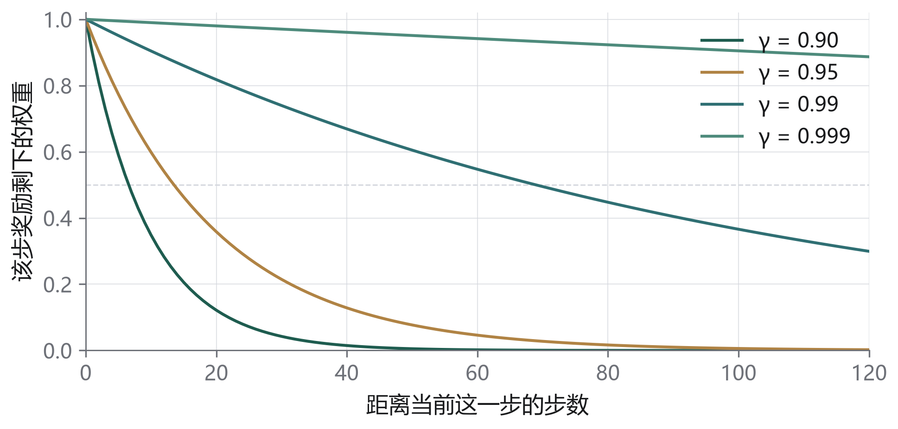

## 延迟的奖赏：为什么不能只看眼前

一盘棋下到中盘，你觉得形势不错。三十手之后你输了。复盘的时候你想找到那个转折点，可能是第 137 手的一次退让，也可能是第 40 手埋下的隐患。无论答案是什么，有一件事很清楚，输赢这个信号出现在最后，而需要为它负责的决定分布在整盘棋里。

强化学习的全部算法，都在对付这个时间差。这一章把它拆开看：奖励为什么要往回分摊，未来该打多少折，以及当奖励几乎不出现时，智能体靠什么撑下去。

### 第 137 手的失误

想象一个简化到极点的迷宫。五步之内走到出口得 10 分，掉进陷阱扣 10 分，其他每一步 0 分。智能体第一次乱走，运气不错，走对了，拿到 10 分。它该学什么？

如果只看最后那一步，“到达出口”这个动作被奖励了，它会倾向于在出口附近重复同样的动作。但真正有用的信息是前面那五步合起来构成了一条正确路径。它需要把这 10 分往回分配给每一步，让这条路上每个“状态加动作”的组合都变得更有吸引力。

人类复盘时就是这么做的。棋手会说“这个局面下不该弃子”，判断依据不是这一手立刻丢了多少，而是它导致了后面的败势。这种把最终结果往回追溯、分摊到中间决策上的过程，就是第一章提到的**信用分配**。

信用分配难在两点。一是责任分散，最终结果由几十上百个决定共同造成，每一个的贡献都只占一小部分。二是混杂因素，同一个局面下换个对手，结果可能完全不同，你很难判断这次的失败是决策错了还是运气差。

图 3-1 画的是这件事。一条轨迹走到终点拿到奖励，这个奖励需要沿着路径往回传，越靠近终点的动作分到的影响越直接，越早的动作影响越间接。传的方式不同，就分出了不同的算法家族。

### 这笔账算在谁头上

最朴素的想法是平均分。这条路径上有五步，最后得了 10 分，那就每一步记 2 分。这个办法在步数固定、路径唯一时勉强能用，一旦路径长短不一就立刻失效。

好一点的想法是按距离加权。越靠近终点的动作，对结果的影响越直接，分到的权重越大。这个直觉背后有一个现实理由，越早的决定，中间有越多的机会被后续动作修正。第 1 手走偏了，第 10 手还能补回来；第 137 手失误，往往没机会补了。

再进一步，权重会随时间指数衰减。这不是随意选的，它对应一个很实际的考虑，远期的事情不确定性更大。你可能算准了前十步，但算不准第一百步之后对手怎么应。既然算不准，就不该把太多信任押在上面。

这套加权方式在数学上写成折扣累积回报，这里只需要记住它的形状，一个随步数指数衰减的权重。

### 未来值多少钱

折扣因子 γ 是一个介于 0 和 1 之间的数。它决定了智能体愿意为多远的未来做打算。

γ 等于 0 的时候，智能体完全短视，只看这一步的奖励。扫地机器人会学会原地转圈，因为转圈时吸尘器一直开着，每一刻都有“正在清扫”的奖励。下棋程序会学会吃掉眼前能吃的子，不管后面会不会被将死。

γ 接近 1 的时候，智能体愿意等。它会为了十步之后的胜利忍受当下的损失。代价是学习的方差变大，因为远期结果受太多偶然因素影响，一次采样很难说明问题。

图 3-2 画的是不同 γ 下，一步奖励在累积回报里还剩多少分量。γ 等于 0.9 时，第十步的奖励只剩下三成多。γ 等于 0.99 时，第十步还有九成，第一百步还有三成多。这条曲线的形状解释了为什么同样的算法，换个 γ 就表现出完全不同的性格。

选择 γ 没有通用答案，它取决于任务本身的时间尺度。一局几秒的弹球游戏，γ 取 0.9 就够。一盘要下几百手的围棋，γ 必须非常接近 1，否则智能体根本看不到终局的胜负。做实验时经常要试几个值，看哪个能让曲线学起来。

顺便说一句，γ 还有一个技术作用，它保证累积回报不会无限增长。如果任务没有终止，而每一步都有正奖励，那么不折扣的总和会发散到无穷大，任何“最优”都失去意义。乘上折扣之后，总和有一个上界，问题才变得可解。

### 回报：把未来折成今天的分数

把每一步的奖励按折扣加权加起来，得到一个数，叫**回报**（return）。它是智能体真正想最大化的东西，而不是某一步的即时奖励。

这个区分值得强调。很多初学者会误以为强化学习在优化“每一步都拿到奖励”，实际上它在优化“整段过程的加权总和”。这两者经常冲突。为了最终的高分，中途可能要主动扣分，比如在游戏里牺牲一个单位换取战略优势。

回报还有一个性质，它是随机的。同样的策略，跑两次得到的回报可能差很多，因为环境有随机性，对手也在变。所以智能体学的不是“这条路径的回报”，而是“按这个策略走下去，平均能拿到多少回报”。这个平均值叫**期望回报**，是所有算法的优化目标。

### 两种近视

延迟奖励带来的麻烦，会以两种相反的形式出现。

一种是只看一步。智能体每次都挑当下奖励最高的动作，这叫贪心。它在很多任务上表现不差，因为多数任务的即时奖励和长期目标方向一致。但在需要铺垫的任务上会彻底失败。经典例子是“牺牲一颗子换取全局优势”，贪心策略永远学不会，因为牺牲那一步的即时奖励是负的。

另一种是看得太远而失去焦点。当 γ 很接近 1，而奖励又很稀疏时，智能体的更新信号会被稀释。它做了一百步才拿到一次反馈，这一百步里哪一步起了作用，几乎无法判断。表现出来就是学得极慢，或者干脆不学。

工程上的常见做法是在两者之间找平衡。用不太接近 1 的 γ 先把基础行为学出来，再逐步调大。或者引入中间奖励，把一段长过程切成几段短过程。这些技巧在实际训练里用得很多。

### 奖励稀疏时靠什么撑住

最极端的情况是奖励几乎不出现。走迷宫，只有到出口才有分；玩解谜游戏，只有通关才有分。随机探索在这种情况下几乎不可能碰到奖励，学习会停滞。

人类面对这种问题时不会干等。你会好奇，会主动去没去过的地方看看，会因为“这里好像有点特别”而多停留一会儿。这种行为本身就带来信息，即使没有分数。

强化学习里有一类方法模仿这种倾向，给智能体额外的好奇心奖励。常见做法是奖励它遇到“没见过的状态”，或者奖励它去那些它自己预测不准、因而信息量可能更大的状态。具体来说，智能体自己学一个“环境模型”，用来预测“在当前状态 $s$ 做动作 $a$ 后，下一个状态 $s'$ 会是什么”。 如果实际发生的下一状态和它预测的差很多，就说明这个地方/这个转移它“没见过、没搞懂”。 内在奖励就给这个“预测误差”加分，鼓励它去那些自己预测不准的地方探索。这些方法统称**内在奖励**（intrinsic reward），与外部环境给的分数相对。它能让智能体在没有任何外部反馈时也持续探索，代价是可能沉迷于无关的新鲜事物。具体做法有好几种，原理都是给没见过的东西加分。

另一条路是模仿。先让人示范几条成功路径，智能体从示范里学到大致方向，再去自己探索。这条路在大模型的对齐训练里用得非常多，后面会看到它的现代版本。

到这里，第一部要交代的三件事说完了。智能体在环境里做选择，选择的结果来得晚，而且需要往回分摊。接下来的问题是，它该怎样在“用已知的好办法”和“试试没走过的路”之间分配精力。这不是一个技术细节，而是所有学习行为的起点。
