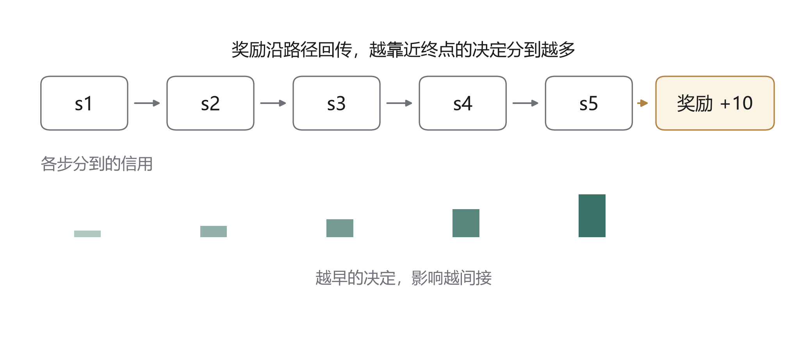

## 延迟的奖赏：为什么不能只看眼前

一盘棋下到中盘，你觉得形势不错。三十手之后你输了。复盘的时候你想找到那个转折点，可能是第 137 手的一次退让，也可能是第 40 手埋下的隐患。无论答案是什么，有一件事很清楚，输赢这个信号出现在最后，而需要为它负责的决定分布在整盘棋里。

强化学习的全部算法，都在对付这个时间差。这一章把它拆开看：奖励为什么要往回分摊，未来该打多少折，以及当奖励几乎不出现时，智能体靠什么撑下去。

### 第 137 手的失误

复盘通常是这样进行的。你和教练坐在棋盘前，从第 100 手开始摆。摆到第 137 手，他停下来，说这一手不该退，应该顶住。你当时觉得退一步能稳住，事后看那一步之后整条边都塌了。可如果对手在第 140 手应错了，你的退让就成了好棋。同一手棋，评价取决于后面几十手怎么走，而那几十手又取决于对手。

这就是延迟奖励最原始的形态。信号在终点，决定在过程，两者之间隔着一条长长的链。

换一个简化到极点的迷宫。五步之内走到出口得 10 分，掉进陷阱扣 10 分，其他每一步 0 分。智能体第一次乱走，运气不错，走对了，拿到 10 分。它该学什么？

如果只看最后那一步，“到达出口”这个动作被奖励了，它会倾向于在出口附近重复同样的动作。但真正有用的信息是前面那五步合起来构成了一条正确路径。它需要把这 10 分往回分配给每一步，让这条路上每个“状态加动作”的组合都变得更有吸引力。

这里有个容易犯的错，值得点出来。有人会想，那就把奖励给整条路径，路径上的每一步都加一点。这个想法方向对，但做法上有个陷阱。如果每一次走通都平均加分，那么一条绕远的路径和一条最近的路径会得到同样的总分，智能体就没理由走近路。所以往回分的权重不能是平的，得让“这段路有多必要”体现在里面。这正是各种算法分歧的地方。

人类复盘时就是这么做的。棋手会说“这个局面下不该弃子”，判断依据不是这一手立刻丢了多少，而是它导致了后面的败势。这种把最终结果往回追溯、分摊到中间决策上的过程，就是第一章提到的**信用分配**。

信用分配难在两点。一是责任分散，最终结果由几十上百个决定共同造成，每一个的贡献都只占一小部分。二是混杂因素，同一个局面下换个对手，结果可能完全不同，你很难判断这次的失败是决策错了还是运气差。

图 3-1 画的是这件事。一条轨迹走到终点拿到奖励，这个奖励需要沿着路径往回传，越靠近终点的动作分到的影响越直接，越早的动作影响越间接。传的方式不同，就分出了不同的算法家族。

### 这笔账算在谁头上

把奖励往回分，有几种朴素的做法，一种比一种靠谱，也都各有代价。

最朴素的是平均分。这条路径上有五步，最后得了 10 分，那就每一步记 2 分。这个办法在步数固定、路径唯一时勉强能用，一旦路径长短不一就立刻失效。它还有个更深的毛病，它假设每一步的贡献相同，而在真实任务里，一步关键决策和一步无所谓的过场，价值差得很远。

好一点的想法是按距离加权。越靠近终点的动作，对结果的影响越直接，分到的权重越大。这个直觉背后有一个现实理由，越早的决定，中间有越多的机会被后续动作修正。第 1 手走偏了，第 10 手还能补回来；第 137 手失误，往往没机会补了。

再进一步，权重会随时间指数衰减。这不是随意选的，它对应一个很实际的考虑，远期的事情不确定性更大。你可能算准了前十步，但算不准第一百步之后对手怎么应。既然算不准，就不该把太多信任押在上面。这套加权方式在数学上写成折扣累积回报，这里只需要记住它的形状，一个随步数指数衰减的权重。

还有一种做法不太一样，它不硬分摊，而是学一个中间量。让智能体自己去估计“从这个局面往后大概能拿多少分”。这个估计最初很粗，走一次、更新一点，走得多了就慢慢准了。好处是不需要人定规则，坏处是两个毛病。一是要很多次重复才稳，二是估计和估计之间会互相影响，前面估错了会带偏后面，错的地方还会来回震荡。

这些做法其实对应不同的哲学。平均分假设每一步一样重要，按距离加权假设近的影响大，学一个价值则干脆放弃人为规定，把这件事交给数据。现代算法基本都走第三条路，但不是因为它更聪明，而是因为它更能适应长短不一、结构复杂的任务。

### 未来值多少钱

折扣因子 γ 是一个介于 0 和 1 之间的数。它决定了智能体愿意为多远的未来做打算。

先说这个数为什么非有不可。一是未来不确定，二是现在拿到的可以先用。这两条都是常识，也是人愿意要现钱的理由。除此之外还有一个技术上的理由，后面会提到，没有折扣的总和可能发散。

真正要小心的是取值的后果。

γ 等于 0 的时候，智能体完全短视，只看这一步的奖励。扫地机器人会学会原地转圈，因为转圈时吸尘器一直开着，每一刻都有“正在清扫”的奖励。下棋程序会学会吃掉眼前能吃的子，不管后面会不会被将死。

这种短视在现实系统里有很多变体。推荐系统如果只看点开率，会偏爱十几秒的短视频，因为它的反馈来得最快。客服系统如果只看单次通话时长，会学会急着挂电话。工厂如果只看当期产量，会推迟设备保养。这些系统都不是“坏”，它们只是被教会了看眼前。

γ 接近 1 的时候，智能体愿意等。它会为了十步之后的胜利忍受当下的损失。代价是学习的方差变大，因为远期结果受太多偶然因素影响，一次采样很难说明问题。还有一个更隐蔽的代价，信号要沿着很长的链往回传，传得越远越稀，学起来就慢。实践中常见的症状是训练前期几乎不动，很久之后突然开始上升。

图 3-2 画的是不同 γ 下，一步奖励在累积回报里还剩多少分量。γ 等于 0.9 时，第十步的奖励只剩下三成多。γ 等于 0.99 时，第十步还有九成，第一百步还有三成多。这条曲线的形状解释了为什么同样的算法，换个 γ 就表现出完全不同的性格。

选择 γ 没有通用答案，它取决于任务本身的时间尺度。一局几秒的弹球游戏，γ 取 0.9 就够。一盘要下几百手的围棋，γ 必须非常接近 1，否则智能体根本看不到终局的胜负。做实验时经常要试几个值，看哪个能让曲线学起来。有条经验可以借用，先想清楚“希望它往前看多少步”，再按“多少步之后权重降到很小”去反推。这个换算不难，比凭感觉调靠谱。

顺便说一句，γ 还有一个技术作用，它保证累积回报不会无限增长。如果任务没有终止，而每一步都有正奖励，那么不折扣的总和会发散到无穷大，任何“最优”都失去意义。乘上折扣之后，总和有一个上界，问题才变得可解。

### 回报：把未来折成今天的分数

把每一步的奖励按折扣加权加起来，得到一个数，叫**回报**（return）。它是智能体真正想最大化的东西，而不是某一步的即时奖励。

这个区分值得强调。很多初学者会误以为强化学习在优化“每一步都拿到奖励”，实际上它在优化“整段过程的加权总和”。这两者经常冲突。为了最终的高分，中途可能要主动扣分，比如在游戏里牺牲一个单位换取战略优势。

用两个玩家作对比会更清楚。一个每步都拿小分，走了十步，每步一分，加起来十分。另一个前面九步一分没拿，最后一步拿了二十分。按即时奖励看，前者一直很“正确”；按回报看，后者赢了一倍。智能体要学的是后一种判断。

回报还有一个性质，它是随机的。同样的策略，跑两次得到的回报可能差很多，因为环境有随机性，对手也在变。所以智能体学的不是“这条路径的回报”，而是“按这个策略走下去，平均能拿到多少回报”。这个平均值叫**期望回报**，是所有算法的优化目标。

这个性质带来一个反直觉的结论。一次特别幸运的成功，不该让智能体把当时的做法当成真理。它只是平均值上的一个高点。反过来，一次倒霉的失败也不该让整个策略被推翻。学得稳的算法都在做同一件事，用很多次结果去估计那个平均值，而不是盯着最近一次。

还有一层要分清。回报是那一次实际发生的数字，价值是对未来回报的预期。前者已经发生，后者是估出来的。一个策略可能运气好拿了很多，平均下来其实一般；也可能这次表现差，但长期看是对的。学习要做的是让估计贴近那个平均值，而不是把某一次的运气当成能力。这也是为什么训练总要看很多局的曲线，单看一局没有意义。

### 两种近视

延迟奖励带来的麻烦，会以两种相反的形式出现。

一种是只看一步。智能体每次都挑当下奖励最高的动作，这叫贪心。它在很多任务上表现不差，因为多数任务的即时奖励和长期目标方向一致。但在需要铺垫的任务上会彻底失败。经典例子是“牺牲一颗子换取全局优势”，贪心策略永远学不会，因为牺牲那一步的即时奖励是负的。

投资里的版本更贴近生活。盯着每天的涨跌做决定，最容易的结果是频繁买卖，手续费交了一大笔，收益还不如一直拿着。每天的信息是即时的，可它和长期收益的关系很弱。

另一种是看得太远而失去焦点。当 γ 很接近 1，而奖励又很稀疏时，智能体的更新信号会被稀释。它做了一百步才拿到一次反馈，这一百步里哪一步起了作用，几乎无法判断。表现出来就是学得极慢，或者干脆不学。

远视还有一种表现，容易被忽略。当价值估计本身不准时，看得越远，误差被放大的机会越多。就像用一张比例尺不对的地图规划长途路线，走得越远偏得越厉害。所以有些任务宁愿把 γ 调小一点，接受一点短视，换取估计的稳定。这种做法在仿真和现实有差距时特别常见。如果模型对远期的预测本身不可信，信任它就等于放大误差。

工程上的常见做法是在两者之间找平衡。用不太接近 1 的 γ 先把基础行为学出来，再逐步调大。或者引入中间奖励，把一段长过程切成几段短过程。这些技巧在实际训练里用得很多。它们共同的想法是，先让智能体在近处站稳，再慢慢把视野推远。

真遇到问题时，怎么判断是哪一种。短视的症状是“很忙但没进展”，行为看起来很勤快，分数上不去，录像里能看到它反复做同一个小动作。远视的症状是“几乎不动”，训练曲线长时间是一条平线，偶尔跳一下又落回去。两种症状完全不同，对付的办法也不同。前者要调大 γ 或加中间奖励，后者要先缩短视野把基础行为学出来。分不清就乱调参数，往往越调越差。

### 奖励稀疏时靠什么撑住

最极端的情况是奖励几乎不出现。走迷宫，只有到出口才有分；玩解谜游戏，只有通关才有分。随机探索在这种情况下几乎不可能碰到奖励，学习会停滞。

人类面对这种问题时不会干等。你会好奇，会主动去没去过的地方看看，会因为“这里好像有点特别”而多停留一会儿。这种行为本身就带来信息，即使没有分数。

强化学习里有一类方法模仿这种倾向，给智能体额外的好奇心奖励。常见做法是奖励它遇到“没见过的状态”，或者奖励它去那些它自己预测不准、因而信息量可能更大的状态。具体一点说，让智能体自己学一套预测能力，看到当前处境和打算做的动作，就猜下一刻会变成什么样。如果实际发生的情况和它猜的差很远，说明这个地方它还没搞懂。内在奖励就给这个“猜错的程度”加分，鼓励它往自己不懂的地方去。这些方法统称**内在奖励**（intrinsic reward），与外部环境给的分数相对。

好奇心有个著名的副作用。如果环境里有一台永远播放随机噪声的电视，智能体会一直盯着它看，因为那里的画面永远猜不准，预测误差一直很大，内在奖励源源不断。它学会了追求“搞不懂”，而不是“搞懂”。这个问题至今没有彻底解决，只能靠一些额外的约束压住。它提醒我们，任何一种替代奖励都可能被钻空子，包括“好奇心”这种听起来很纯粹的。

另一条路是模仿。先让人示范几条成功路径，智能体从示范里学到大致方向，再去自己探索。这条路在大模型的对齐训练里用得非常多，后面会看到它的现代版本。它省掉了从零摸索的那一段，代价是天花板受示范者限制，人没想到的做法它也想不出来。

第三条路是课程。既然一步到位太难，就把任务拆成由易到难的几级。教小孩游泳先在浅水池，学琴先练音阶，玩游戏先过教学关。机器人的做法类似，先在没有障碍的平地学走，再加障碍，再换地面材质。每一级都比上一级难一点点，让智能体始终处在“稍微努力就能拿到奖励”的区间里。

三条路的分工大致是这样。好奇心负责在没有方向时动起来，示范负责给出一个可用的起点，课程负责把目标切成能咽下去的块。真实系统里通常三条都用，比例按任务调。

### 把奖励分成几层

上一节说的课程，是这件事的一个侧面。更一般的做法是把奖励按时间尺度分成几层，每层管一件事。

最上面是**终局奖励**，它定义目标。通关得一分，考试及格，项目上线。它最准确，也最稀疏，可能一整局只出现一次。

中间是**阶段奖励**，它提供方向。打完这一关的 boss，学完一个单元，完成一个模块的联调。它比终局密，一粒一粒地把长过程串起来。

最下面是**即时奖励**，它提供反馈。走对一步，答对一道题，代码通过一次编译。它最密，也最容易把人带偏。

::: {.tabcap}
表 3-1　奖励的三个层次与各自的角色
:::

| 层次 | 出现的频率 | 作用 | 设计错了会怎样 |
| --- | --- | --- | --- |
| 终局 | 一局一次或更少 | 定义什么算成功 | 目标定歪，全盘皆歪 |
| 阶段 | 一局几次到几十次 | 把长过程切成可学的段 | 智能体停在中间层刷分，不去碰终局 |
| 即时 | 每一步 | 让学习信号不至于断掉 | 只顾眼前，学会各种小动作 |

分层的核心权衡是同一个东西在不同尺度上的重复。层次越多，学习越快，你替智能体做的假设也越多。每加一层，都等于告诉它“这件事值得追求”，而它会不会因此忘了最终目标，取决于权重怎么配。

有个简单的自查办法。问自己，如果智能体只把中间层做到极致，终局会怎样？如果答案是“终局完蛋但它照样拿高分”，权重就是错的。教育里最常见的版本是，学生把作业刷得很漂亮，考试一塌糊涂。这不是学生的问题，是奖励的问题。

### 三个案例

三个不同领域的例子，能看出上面的道理在哪落地。

游戏关卡。终局奖励是通关，阶段奖励是击败关卡 boss 或者推进剧情，即时奖励是捡金币、打小怪。这里最容易出的问题是刷金币。如果金币给得太多，玩家会发现站在刷怪点来回打比推进度更划算，游戏就失去了节奏。设计者的对策通常是把金币收益和推进度挂钩，或者让刷怪点的产出递减。这本质上是在改奖励结构，不是改玩家。

教育。终局奖励是期末成绩，或者几年后还在不在用，阶段奖励是单元测验，即时奖励是每天作业的批改反馈。问题在于，期末太远，作业太近，学生自然会围着作业转。背答案、抄作业、只练会考的题型，都是在这个结构下最理性的选择。想改，只能动结构，比如把“讲给别人听”“做一个小项目”放进阶段层，让理解和分数重新对齐。这件事难，因为改结构要动评价体系，不只是改一句鼓励的话。

投资。终局奖励是多年后的资产，阶段奖励是季度或年度的收益，即时奖励是每天的涨跌。绝大多数人败在第三层。每天都有数字在跳，每个数字都像反馈，于是频繁操作，把长期收益磨掉。专业的做法是有意把即时层屏蔽掉，比如规定自己一个季度才看一次账户。这不是自欺，是承认人会被密集反馈牵着走。

三个案例的结构是一样的。终局太远，需要中间层撑住；中间层一密，就容易被刷；被刷之后，改的应该是奖励结构，不是骂执行者。这个思路不只适用于算法，也适用于任何用指标管人的地方。

到这里，第一部要交代的三件事说完了。智能体在环境里做选择，选择的结果来得晚，而且需要往回分摊。接下来的问题是，它该怎样在“用已知的好办法”和“试试没走过的路”之间分配精力。这不是一个技术细节，而是所有学习行为的起点。
