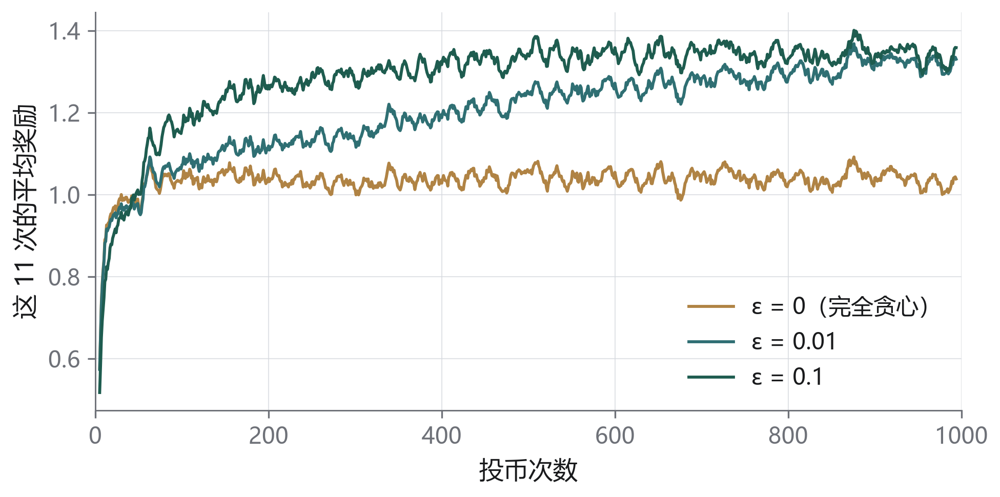

## 探索与利用：老虎机教给我们的事

中午选饭馆，你面对一个很小的问题。公司楼下有三家店，一家你常去，味道稳定但吃腻了；另外两家没试过，可能更好，也可能踩雷。你只有一个胃，今天只能选一家。

这件事放大到几万次，就是强化学习里最基础的难题。每一次选择都在消耗机会，已知的好选择能保证收益，未知的选择可能带来更高的收益。你要在两者之间分配次数。

### 这顿饭其实是一道算术题

三家店的情况值得摊开看。常去那家你吃了两年，菜单背得下来，口味稳定在七分上下，不会难吃，也不会有惊喜。隔壁新开的川菜馆，看照片像是九分的水平，也可能是三分，光看菜单判断不了。再远那家，同事说过一句“还行”，这句话几乎没有信息，你甚至不确定他指的是哪家。

你只有一个胃，一顿饭只能选一家。今天没去的那两家，明天还在，但明天你可能加班，可能带饭，可能临时想换口味。机会不会无限次发放，这是第一个约束。

第二个约束是记忆不可靠。你隐约记得半年前吃坏过一次肚子，可到底是哪家店，已经想不起来。人对经验的记录残缺，样本少，还带着情绪和偏见。机器不会有这个问题，它会老实记下每一次结果，但样本量同样是硬限制。

第三个约束是判断的时机。等你把三家都试过三遍，一个月就过去了，而这一个月你每天都在吃饭。试错的成本不是抽象概念，它就是那些不太满意的午饭。

三条约束摆在一起，这顿饭就成了一道题。今天要不要赌一把，取决于三件事，你对那家新店有多不确定，赌错的代价有多大，以后还有多少次机会。强化学习里的方法，本质上都是在用不同方式处理这三件事。

这类决定还有一个常见变体，就是完全不试。有人一辈子只去熟店，也有人顿顿都想尝新。前者稳定但天花板低，后者信息多但常常吃得不好。真正的差别不在性格，在机会有多少次。如果这是你在这座城市的最后一顿饭，熟店是对的，如果要在这住十年，早晚得试。

### 十台老虎机

赌场里的老虎机是这个问题最干净的模型。一排机器，每台吐出硬币的概率不同，你不知道哪台最好，只能一台一台地投。每次投币的结果是随机的，多投几次才能大致判断一台机器的好坏。

这个问题叫**多臂老虎机**（multi-armed bandit），名字来自早期赌场里那些带机械臂的机器。它的英文缩写是 MAB，在推荐系统和广告投放里出现得非常频繁。

老虎机问题比完整的强化学习简单，因为你做的选择不会改变世界的状态。投完这台，下一把还能投这台，机器的概率始终不变。完整的问题里，选择会改变处境，处境又影响后续的选择，一层套一层。但老虎机保留了最关键的那部分张力，所以几乎所有教材都从这里开始。

它因此成了一个通用的原型。任何“反复在若干选项之间分配额度、结果带随机性、只能靠试才知道好坏”的问题，都可以先按它来想。广告该把预算分给哪个素材，医生该给下一批病人用哪种剂量，服务器该把请求发到哪个机房，首页该把哪个位置让给哪个版本，都是这个形状。

差别就在状态这一项上。完整问题里走错一步会把你带进一个更差的处境，之后每个选择都受影响，而老虎机里每一次投币都是重新开始。这个差别让老虎机的分析非常干净，也让它覆盖不了“选择的后果会改变未来选项”这一类问题。

但探索最纯粹的版本就在这里。状态带来的复杂性可以后面再加，先把“要不要试”想清楚。

为什么教材喜欢用十台而不是两台。两台机器的差别太容易看出来，试几次就能分辨，探索的困难显不出来。十台机器里，最好的那台和次好的可能只差一点点，要靠很多次尝试才能分开。这才逼近真实场景里的麻烦。

### 贪心与它的代价

最直接的做法是每次都选当前看起来最好的那台机器。这叫**贪心**（greedy）。你试了几轮，觉得第二台出币最多，之后就一直投第二台。

贪心的毛病很明显。如果某台机器在前几次碰巧表现很差，你会永远不再碰它，而它可能恰恰是最好的那台。运气不好加上判断过早，一个好选择就这样被埋掉了。

还有一种更隐蔽的锁死，与运气无关。两台机器真实水平一样，一台稳定，一台波动极大。前几次恰好抽到前者正常、后者低谷，估计就长期偏低，之后不再碰它，也就永远没机会修正。

贪心还有一个结构性缺陷，它不会自我纠正。它的信息来源是自己的选择，而它只选看起来最好的那个，其他选项的数据永远停在最初那几条上。数据不再增长，判断自然不会变，这不是算错，是它没机会再算。

修正的办法是留一点随机性。大部分时候选当前最好的，偶尔随机换一台。这个概率通常记作 ε，做法叫 **ε-贪心**（epsilon-greedy）。ε 等于 0.1，意思是九成的时候按经验选，一成的时候瞎选。

ε 的取值又是一个取舍。设得太大，你会不断在明显很差的机器上浪费机会；设得太小，你需要很久才能发现更好的那台。很多系统会让 ε 随时间衰减，刚开始多试，后面慢慢收敛。

衰减快慢本身是个参数。降太快等于回到贪心，前面的探索白花，降太慢，会一直在明显更差的选项上浪费额度。常见做法是分段降，冷启动给足探索，攒够样本再收紧。另一种按剩余机会降，以后还会来很多次就慢慢试，只来一次就直接给当前最好的。

图 4-1 是用十台老虎机跑出来的真实结果。三组曲线分别对应 ε 等于 0、0.01 和 0.1，每组都是三百次独立实验的平均。完全贪心的那条线起步不慢，但很快停在一条较低的平台上，因为它被早期的一次坏运气锁死了。ε 等于 0.1 的那条线前期涨得慢一些，最后却到达更高的位置。

这条曲线值得记住。它说明探索不是一种浪费，而是为了拿到信息必须付的成本。完全不探索的策略在短期内看起来最优，长期一定吃亏。

### 更聪明的试探

ε-贪心有一个粗糙的地方，它对所有不确定的选项一视同仁。实际上有些机器你已经试了三十次，结果很稳定；有些只试了两次，还完全说不准。后者显然更值得再试。

**置信上界**（upper confidence bound，UCB）就是按这个思路做的。它给每台机器的估计值加上一个和“试过多少次”有关的奖励项。试得少的机器这一项大，于是更容易被选中。随着试验次数增加，这一项慢慢变小，选择自然回到真正表现好的那台。

这个做法有一句很精辟的概括，叫“乐观地面对不确定性”。你不是在猜哪台机器最好，而是在猜哪台机器的上限最高。哪怕一台机器当前表现平平，只要它还有可能很好，就值得再给它一次机会。

它和 ε-贪心的差别在“该试哪一个”。ε-贪心是随机挑一个没试过的，置信上界是专门挑最没把握的。前者可能把机会浪费在早已确定很差的机器上，后者不会。代价是要在每次选择时把所有选项算一遍，选项成千上万时这笔开销不小。所以大规模推荐系统更常用汤普森采样，或者干脆用简单的 ε-贪心。

置信上界的代价是要知道奖励的大致范围。加分项的尺度得和奖励的尺度匹配，定得太大，所有选项都会被轮流试一遍，探索量失控，定得太小，它就退化成贪心。真实系统的奖励尺度经常变，今天是点击率，明天是成交额，同一个加分项就不合适，工程上往往要先把奖励归一化。

它还假设世界不变。如果一台机器的真实水平在慢慢下降，内容会过时，素材会疲劳，历史样本太多反而拖累它，加分项上不去，反应就慢。这类“会过期的老虎机”在推荐系统里很常见，需要让老样本的权重随时间衰减。

### 那一项加分到底该多大

置信上界的公式长得简单，坏在里面的常数。

加分项和试验次数的平方根成反比。试了四次和试了一百次，加分项差五倍。所以刚试过两次的机器会被抬得很高，试过两百次的机器几乎不再有加分，选择自然回到表现上。

常数取多少，直接决定探索的强度。在一组十臂老虎机上做过对比，每臂的真实点击率随机取，一千次拉动，两百次独立实验平均下来，常数取零点五时累计遗憾约三十一，取一点零时变成八十多，取二点零时涨到一百七十多。同一套算法，只改一个数，遗憾差五倍。这不是实现问题，是尺度问题。奖励在零到一之间时，一点零已经算偏大，二点零就等于逼着它把所有选项轮流试一遍。

所以工程上第一步不是调常数，是把奖励归一化。点击率本来就在零到一之间，好办。成交额、停留时长、营收这类指标要先缩放到一个固定区间，再套公式。缩放用的统计量要固定下来，不能每天重算，否则加分项的尺度会跟着数据漂。

第二件事是算得动。每次选择要对所有候选算一遍加分项，候选上万时这笔开销不可忽略。常见的近似是先按当前估值粗筛出一批候选，只在其中算加分项。这会让探索不那么彻底，但工程上通常够用，因为估值很低的候选本来也不太可能突然变好。

第三件事是不要忘记世界会变。加了滑动窗口或者折扣之后，老样本的权重下降，加分项会重新变大，探索自动回来。这也是处理内容疲劳最直接的办法。窗口开多大是个取舍，开小了估值噪声大，开大了反应慢。

### 抽一次再决定

还有一种更彻底的做法，叫**汤普森采样**（Thompson sampling）。它不估计一个数，而是维护一个关于“这台机器有多好”的概率分布。每次选择时，从每个分布里随机抽一个值，选抽到最大的那台。试得少的机器分布很宽，抽到高值的概率不小，于是自动获得了探索机会。这个办法在广告和推荐系统里用得非常多，实现简单，效果常常好于 UCB。

假设你有两台广告机 A、B，你想知道哪台点击率高。你每次只能选一台展示，目标是尽量多拿点击。 传统贪心做法是：先试几次；估计 A 的点击率是 0.5，B 是 0.4；以后一直选 A。问题是 B 可能只是试得少，真实点击率其实更高，你过早放弃它了。

汤普森采样维护的不是一个数，而是一个“信念分布”。对每台机器，它不是只记 A 的点击率大约是 0.5，而是记：（1）A 的点击率可能在 0.45 到 0.55 之间；（2）B 的点击率可能在 0.1 到 0.9 之间，因为我只试了 B 两次。

这个“可能在多少到多少之间”就是概率分布。试得多的机器，分布很窄，因此对它比较确定；试得少的机器，分布很宽，对它很不确定。

每次选择时，从每个分布里抽一个临时分数，比如现在：（1）A 试了 100 次，点击 50 次，它的分布很窄，集中在 0.5 附近；（2）B 只试了 2 次，点击 1 次，它的分布很宽，可能在 0.2，也可能在 0.8。

每次展示广告前，汤普森采样这样做：从 A 的分布里随机抽一个值，比如抽到 0.48；从 B 的分布里随机抽一个值，比如抽到 0.77；因为 0.77 > 0.48，这次选 B。下一次可能：A 抽到 0.52；B 抽到 0.31；那这次选 A。注意，它不是永远选 B，也不是按平均值选，而是按“这次抽样结果”选。

### 抽样为什么能自动探索

试得少的机器会自动获得探索机会，因为试得少的机器分布很宽。分布宽意味着，虽然它平均可能不高，但它“有可能很高”。比如 B 只试过 2 次，你对它很不确定。它的分布里包含 0.8、0.9 这种高值。每次抽样时，B 有一定概率抽到高值。一旦抽到高值，它就会被选中，于是获得一次尝试机会。

注意，从分布里抽出来的值是智能体用来做决策的“临时信念分数”，不是真实奖励。实际尝试后环境给的奖励才是真实结果，用来更新分布。我们能看出，这就是一个条件概率，根据分布抽样出的信念来做决策。所以说，汤普森采样本质上是贝叶斯条件概率 + 后验抽样。汤普森采样维护的是“在历史数据条件下，每个选项有多好”的条件概率分布；每次从后验分布抽样只决定这次试谁；真正影响分布的是尝试后得到的真实结果，它通过贝叶斯条件化更新后验分布。它是在做条件概率的更新，抽样负责探索决策，观测负责修正信念分布。

这套做法有一个好处，它不需要规定探索强度。不确定性大，抽样自然分散，不确定性小，抽样自然集中，探索量自己会调节。代价是每次都要维护一个分布，分布的形状还得和问题匹配。点击率适合用贝塔分布，收益类的问题常用正态分布。形状选错，探索的性格就变了，可能过于保守，也可能过于鲁莽。

顺带说一个实践细节，采样次数不必很多。每次只抽一个值，抽完就决定，不需要精确算出分布的最高点在哪。这正是它比精确计算省事的地方。

### 贝塔分布是怎么长出来的

汤普森采样听起来抽象，其实只用到两个计数器。

初始时对每台机器记两个数，成功次数和失败次数，都从一开一。这个起点对应一个均匀分布，意思是“我什么都不知道，从零到一的任何一个点击率都有可能”。

试了两次，中了一次，两个数变成二和二。此时的分布还是以零点五为中心，但宽度明显收窄了一点。从这个分布里抽样，抽到零点八以上的概率大约一成。

试了一百次，中了五十次，两个数变成五十一和五十一。中心仍然在零点五，宽度却窄了很多，抽到零点八以上的概率几乎为零。同样是零点五的均值，一个还会被抽中高值而获得尝试，另一个基本不会。

具体多宽，可以用标准差看。二和二的分布标准差约零点二二，五十一和五十一的分布约零点零五，差四倍多。这就是探索自动调节的全部机制，试得少的分布宽，宽就容易被抽到高值。

更新规则也只有一句。每次展示后，有点击就把成功数加一，没有就把失败数加一。不需要学习率，不需要调参，这个性质让它在工程上特别好用，因为少了一个会调错的东西。

它也有失灵的时候。点击率以外的奖励不适合用贝塔分布，比如收益是连续金额，得换成别的分布形状。分布形状选错，探索的性格就变了。还有一个更根本的前提，它假设每台机器的水平不变。真实系统里素材会疲劳，点击率天天在掉，这时候要让老的计数慢慢失效，比如每次更新前把所有计数乘一个小于一的系数。

### 探索要付多少代价

既然探索有成本，就可以把它量化。一个常用的量叫**遗憾**（regret），指的是“如果我一开始就知道哪台最好，能拿到多少”和“我实际拿到多少”之间的差。

任何策略的遗憾都会随时间增长，因为学习总要花时间。区别在于增长速度。好的策略让遗憾增长得很慢，比如随时间对数增长；差的策略会让遗憾线性增长，等于一直在犯同样的错误。

这个视角很有用。它把“探索”从一种感觉变成了一个可以比较的量。工程师评估一个推荐系统时，经常看的就是它在多长时间内把遗憾压到多低。

遗憾比平均分更能说明问题，因为它有一个明确的参照。平均分只能横向比两个策略，谁高谁低，看不出离天花板还有多远。遗憾的基准是“一开始就知道哪个最好”的那个策略，也就是理论上的上限。同样拿八分的两个系统，一个的上限是八点五，另一个的上限是十五，前者的遗憾小得多，也更接近自己的极限。

遗憾还可以画成曲线。横轴是尝试次数，纵轴是累计少拿的收益。两条曲线的斜率差，就是两个策略的水平差。运营团队看这种曲线比看平均点击率直观，因为斜率会告诉你再跑一天还能不能改进。曲线变平，说明探索的收益已经榨干，可以停了。

遗憾还分两种。一种是试错花掉的，你在探索上消耗的机会。另一种是本可以更好却没找到，一直用着次优选项慢慢损失的收益。前一种会在探索结束时停止，后一种会一直累积。看一个系统有没有真正学会，主要看第二种有没有归零。

### 遗憾这笔账怎么算

遗憾的定义简单，算起来也简单，难在它随时间怎么长。

假设十台机器，最好的那台点击率零点五，第二好的零点四五。每选一次第二好的，就少拿零点零五个点击的期望。挂在这台上不走，一千次少五十个点击，一万次少五百个。这就是线性的遗憾，错误一直没被纠正。

好的策略不是这样。前一百次它可能乱试，平均每次亏零点二，累计亏二十。之后它基本锁定最好的那台，只是偶尔为了确认再试一下，每步亏零点零零三，九百步下来亏不到三。总遗憾停在二十几，增长变得极慢。

这两种形状的差别，比总数值的差别更重要。线性增长意味着“再跑一天还是这么亏”，对数增长意味着“再跑一天的边际损失很小”。运营上看曲线斜率就是这个道理，斜率不降，说明策略没有在学习，只是在消耗。

还有一个容易被忽略的账，探索的成本由谁承担。推荐系统里，探索的代价落在被分到实验组的那批用户身上，他们的体验会比其他人差一点。这个代价在总收益里看不见，但在用户投诉里看得见。所以真实系统通常把探索限制在小流量，并且优先把探索放在影响小、可逆的位置上，比如列表的第六位而不是第一位。

### 老虎机的五个变体

教科书里的老虎机是一排固定概率的机器。真实问题几乎都不是这个样子，常见的变形有五种。

最常见的是上下文老虎机。每做决定之前先看一眼当前情况，比如用户是新人还是老用户、是早上还是深夜、在哪个城市。不同情况下的最优选项不同，学习的不是一个排序，而是一个“情况到选项”的映射。推荐、广告、动态定价基本都是这个形状。它比老虎机难，因为要把情况分块，块分得太细每块样本不够，分得太粗又抓不住差异。

第二种是非平稳老虎机。机器的水平会随时间变，素材会疲劳，竞品会降价，季节会变。这种问题的核心不是“试得更聪明”，而是“忘得更快”。常用的办法是给旧样本打折，或者只保留最近一段时间的统计。判断自己是不是遇到了这种问题，看一件事，历史最优的那个选项最近的表现是否持续低于它的长期均值。

第三种是大规模候选。候选从十台变成一百万条内容，每一条都单独维护统计不现实。做法通常是把候选按特征归类，同类共享统计，或者先用一个模型粗排，再对少量候选做精细的探索。这时候汤普森采样的分布不是按条目建，而是按特征建。

第四种是延迟反馈。点了广告，用户可能三天后才下单。反馈没有立刻回来，统计就一直偏低，策略会误以为这个选项不好。处理办法是把“已发出但还没回来”的样本先记着，等结果回来再补，或者在等待期间用一个预估的转化率顶上。

第五种是带约束的老虎机。每个选项不只有收益，还有成本。预算有限、库存有限、频次有上限。这时候不能只看收益最高的那个，要在约束内分配。常见的做法是把约束折成惩罚项，或者把问题写成“在预算内最大化收益”，用拉格朗日那类办法求解。

表 4-1 把这五种变体和各自的难点列在一起。

::: {.tabcap}
表 4-1　老虎机的五种变体与各自的难点
:::

| 变体 | 与标准问题的差别 | 主要难点 | 常见对策 |
| --- | --- | --- | --- |
| 上下文老虎机 | 每次决定前多一个情境 | 情境怎么分块，样本被摊薄 | 用特征做共享，模型给估值 |
| 非平稳老虎机 | 真实水平随时间变化 | 旧样本拖累判断 | 滑动窗口，给旧样本打折 |
| 大规模候选 | 候选从十个变成百万级 | 算不动，样本太散 | 先粗排再探索，按特征归类 |
| 延迟反馈 | 结果过几天才回来 | 学习滞后，误判差的选项 | 挂账等结果，先填预估值 |
| 带约束 | 除收益还有预算和频次 | 收益与成本的权衡 | 折成惩罚项，按约束求解 |

五种的共同点在于，纯理论的保证大多失效了。教科书的遗憾上界建立在固定分布、独立同分布这些假设上，真实系统一条都不满足。理论仍然有用，它告诉你哪一类方法的遗憾增长速度更慢，但具体到你的系统，还是要靠离线回放和小流量实验来验证。

### 这个矛盾在别处的样子

老虎机是实验室里的模型，但同样的张力在很多地方出现。

推荐系统给新用户推什么。全推热门内容最稳，但永远不知道这个用户会不会喜欢小众的东西。

新药临床试验的剂量选择。已知有效剂量最安全，但可能错过了更优的剂量。

大模型生成答案时的采样温度。温度低，模型总选概率最高的词，输出稳定但没有惊喜；温度高，模型愿意选次优的词，可能写出更好的句子，也可能胡言乱语。

再往深一层，大模型的对齐训练里也有这个矛盾的现代版本。模型在训练中不断生成答案，一部分答案被送去评估。如果永远只优化当前看起来最好的那类回答，模型会越来越窄，最后只会说一种话。所以在训练数据里保留一定的多样性，本身就是一种探索。

这些场景里，探索是有边界的。饭馆可以随便试，广告不能，因为每一次试都在花真钱，还可能伤到用户体验。医疗上的探索更谨慎，剂量试错的对象是人。所以真实系统里，探索通常被限制在一个小流量里，比如只把百分之一的用户分给实验组，其余照常。这样既能积累信息，也不会把风险放大到不可接受。

再举两个日常的例子。找房子的时候，看几套就该定，因为房源在流失，犹犹豫豫会错过好房子，这是探索的成本在涨。换工作的时候，人往往只在自己熟悉的行业里跳，因为试错的代价太大，一次错误的跳槽要花两年修复。这两件事的差别不在理性程度，在试错的可逆性。

还有一类边界来自不可逆。有些选项一旦试了就回不去，删库、解约、公开承诺都算。这类决策不适合交给探索机制，需要人来做。能用探索解决的问题，前提是试错可逆，或者至少代价可控。

### 温度就是一次探索预算

大模型每生成一个词，都要从词表上的概率分布里挑一个。挑的方式由温度控制，而温度本质上就是把探索的强度做成一个旋钮。

温度接近零，模型几乎总选概率最高的那个词。输出稳定，可复现，同一段提示问十次得到十个一样的回答。代价是它不会去试第二可能的表达，长文容易重复，遇到需要绕一下的推理题也绕不出来，因为绕的那一步在当下概率不高。

温度等于一，按模型原本的概率抽。这是训练时的分布，多样性正常，也保留了出错的可能。温度往上调，分布被摊平，冷门词的机会变大，句子更容易出人意料，也更容易语法崩坏。调到很高的时候，输出近似随机拼字。

有一类调法比单纯调温度更常用，就是只在头部几个候选里抽。先把概率最高的若干个词留下，其余的丢掉，再在留下的里面归一化。这样做的好处是永远不会抽到明显不合理的词，多样性只体现在合理候选之间的选择上。温度管的是陡峭程度，截断管的是候选范围，两者配合才能既有多样性又不胡说。

这里有一个容易被忽略的判断。推理时给用户的输出，探索基本是浪费。用户要的是一个好答案，不是十个不同答案里的随机一个。所以线上服务的温度通常调得很低，接近确定。

探索真正有价值的地方在别处。一是合成数据，让模型对同一个问题生成多条不同思路，再用某种标准筛掉差的，留下的多样性就是训练的养料。二是自我对弈和搜索，需要在多条候选路径之间比较，此时的高温相当于给搜索提供宽度，温度太低，所有采样都一样，搜索就白做了。三是训练本身，策略必须保持随机，否则学不到新东西。

同一个旋钮，在训练时是必需品，在服务时是风险源。分不清这两种场合，就会出现两种典型错误，线上回答千篇一律，或者训练数据里全是同一种思路。

### 三个常见误区

关于探索，有三个反复出现的误解。

第一个误解是探索等于浪费。看起来每次试错都少赚了一点，但信息的价值会在后面兑现。真正的浪费是不探索，然后把一个错误的判断用到底。判断的标准不是这一把赚了多少，是一路跑下来总共赚了多少。

第二个误解是探索越多越好。探索有成本，而且成本随场景放大。在一个只有十次机会的问题里，把一半机会花在试错上，剩下的不够兑现。好策略是在信息价值和机会成本之间找平衡，不是把探索当成美德。

第三个误解是随机就是探索。乱试不带方向，试过的东西也不一定被记住。有效的探索有两个前提，一是记住结果，二是按结果调整下一次试什么。没有记忆和更新的随机只是噪声。这也是为什么 ε-贪心比纯随机强，它至少九成时间在用已知的好选择。

三个误区背后是同一个混淆，把探索当成一种态度，而不是一笔投资。投资要算回报，探索的回报是信息，信息的价值取决于后面还有多少次决策要用到它。这样看，探索的多少就不该是一个固定的百分比，而该随剩余机会、试错代价和信息价值一起变。

判断一个系统探索得对不对，可以问三个问题。它记住试过的结果了吗，它按结果调整了吗，它知道每次试的代价吗。三个都答是，探索大概率是有效的，有一个答不出来，就需要回头看设计。

到这里，智能体已经知道该在什么状态下做什么动作了。但它是怎么做出这个判断的？下一章介绍强化学习里最核心的一个中间量，它把“这个局面好不好”变成一个数，让学习可以在结果出现之前进行。
