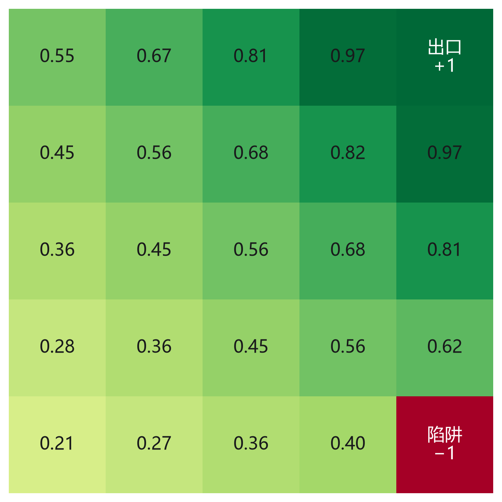

## 给状态打分：价值与 Q 值

棋手看一眼局面，会说“这棋我已经输了一半”。这句话里没有计算，只有判断。他心里有一个模糊的分数，衡量从这个局面走下去大概会怎样。强化学习把这个模糊的判断变成一个明确的数，叫价值。

价值函数是整个领域的骨架。几乎所有能在实际问题上跑起来的算法，都在用某种方式估计或使用它。理解它，后面读 DQN、PPO、甚至大模型的对齐方法，都会轻松很多。

### 一个数概括一个局面

设想你在玩一个很简单的游戏。屏幕上有一个小人，左走一步得 0 分，右走一步得 0 分，走到最右边的门里得 10 分。中间有一个坑，掉进去扣 10 分，游戏结束。

从任何一个位置出发，只要按最优的方式走，最终能拿到多少分是可以算出来的。离门越近，期望分数越高；坑旁边的位置，期望分数很低；坑的正上方如果只能往右走，那基本是死路。

这个“从当前状态出发，按某个策略走下去，未来能拿到的回报的期望”，就是**状态价值**（state value），通常写作 V(s)。它是一个数，每个状态对应一个。

V(s) 有两个限定词不能省。第一是“按某个策略”，同一个局面，高手和初学者走下去的结果完全不同，所以价值总是相对于策略而言的。第二是“期望”，因为环境有随机性，同样的走法可能遇到不同的结果，价值是平均意义上的。

对扫地机器人来说，V(s) 可以理解成“站在这个位置、电量这么多的情况下，接下来还能扫多干净”。对下棋程序来说，V(s) 是“从这个局面出发的胜率估计”。对大模型来说，V(状态) 是“已经生成了这段文字，接下来这句话整体能得到多高的评价”。最后这个类比会在讲大模型的部分展开。

### 同一个局面，不同动作

只知道一个局面好不好，还不够做决定。你需要知道每个动作分别会把你带到哪里。

于是有了**动作价值**（action value），写作 Q(s,a)。它问的是：在状态 s 下做动作 a，之后按策略继续走，期望能拿到多少回报。

V 和 Q 的关系很简单。V(s) 是在状态 s 下按策略选动作的平均结果，Q(s,a) 是先把动作定下来之后的结果。如果策略是在若干动作里按概率选，那么 V(s) 就是各个 Q(s,a) 按概率加权平均。

有了 Q，做决定就变成比较。当前状态下哪个动作的 Q 最大，就选哪个。所有基于价值的算法，本质上都在做这件事，先学 Q，再对 Q 取最大值。

### 一步加未来

Q 值怎么算？如果只看到手奖励，那它和贪心没区别。关键在于它包含未来。

贝尔曼给出了一个分解方式。在状态 s 做动作 a，你会立刻得到奖励 r，然后进入新状态 s'。从 s' 开始，后面还能拿到多少，正是 Q(s',a') 或 V(s')。所以当前的价值等于“这一步的奖励”加上“打折后的未来价值”。

这个分解看起来像一句废话，但它把无限长的问题变成了递归。你不需要一次算清整条路径，只需要算清一步，剩下的交给下一状态的价值去处理。所有后续算法都是在这个递归上做文章。

这个分解有严格的数学形式，这里不展开，只要建立直觉：价值可以一步一步往回倒推。终点有明确的价值，它前一个状态的价值等于“到达终点的奖励”加上一点折扣后的终点价值，再往前同理。倒推几轮，整张地图的价值就填满了。

### 迷宫里的数字

图 5-1 是一个具体例子。五乘五的格子，右上角是出口，进去得 1 分；右下角是陷阱，进去扣 1 分；其余格子每走一步扣 0.04 分，算作走路的成本。动作不是完全可靠的，有 10% 的概率滑向别的方向。折扣因子取 0.9。

图里的数字是用值迭代算出来的，不是估的。最高的是出口，往外一层层降低。降低的幅度并不均匀，右列下半段的数字（0.62 和 0.40）明显低于同一行左边的数字，因为那里离陷阱近，一次打滑就可能掉进去。左下角最低，只有 0.21，既离出口最远，又每一步都在扣分。

这张图说明了几件事。价值不只是距离的函数，还要看风险。陷阱正上方那一格价值 0.62，同行靠左的格子是 0.81，这一步的差距就是打滑的代价。价值还带有方向性，同一列里越靠下越低，因为越往下走，绕回出口的路越长，扣的分越多。

如果把这套数字交给一个完全不懂规则的智能体，它只要每次都往数字更高的相邻格子走，就能走到出口。这就是价值函数的用处，它把“怎么玩这个游戏”压缩成了一张可以查的表。

### 用自己的估计更新自己

真实问题里，状态多得数不清，价值不可能靠倒推算出来。你只能估计。

估计的办法是采样。走到某个状态，实际拿到了一些奖励，用这个结果去修正原来的估计。如果实际比估计好，就把估计往上调一点；如果差，就往下调。调多少由学习率决定，这个数在几乎所有算法里都会出现。

这里有一个微妙的地方。更新时用到的“未来价值”，本身也是一个估计值，不是真实值。用自己的估计去更新自己，这种做法叫**自举**（bootstrapping）。

自举听起来不太可靠，像是拽着自己的鞋带往上提。它确实会带来偏差，估计值会互相影响，初期可能一起跑偏。但它的好处巨大，你不需要等到一整局结束就能更新，每走一步都能学一点。这让学习快了很多，也是现代算法能在复杂问题上跑起来的原因之一。

### 为什么它这么重要

价值函数的重要性，可以从三个角度看。

第一，它让延迟的奖励变得可用。原始反馈只有一个终点信号，价值把信号提前铺满了整条路径，每一步都有东西可学。

第二，它让决策变便宜。没有价值函数，选动作要往前推演很多步；有了它，比较几个数就够。这也是 AlphaGo 这类系统能在有限时间里思考的原因，它把大量推演压缩成了价值估计。

第三，它是很多算法的公共语言。基于价值的方法直接学它，策略梯度方法用它做基线来降低方差，大模型的对齐训练里也有一个价值网络在估计“这个回答大概能得多少分”。不同流派的分歧在于怎么用它，而不在于要不要用它。

不过价值函数只回答“这个局面值多少”，没有直接回答“该怎么动”。要把价值变成行为，还需要一个东西，把打分转换成选择。下一章讲它。
