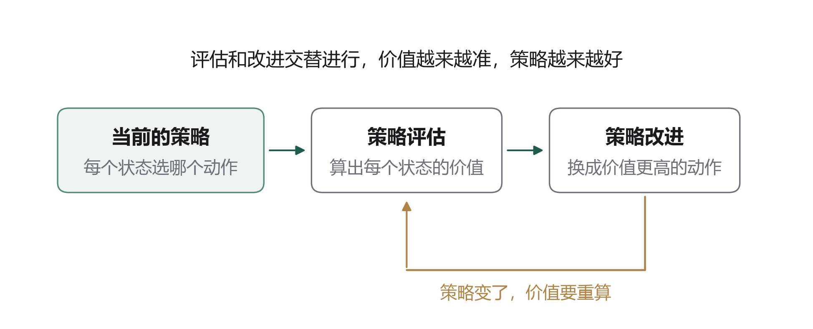

## 从打分到行动：策略与它的两种脾气

价值和 Q 值回答的是“这个局面值多少”。真正在环境里行动的，是一个把状态映射到动作的东西，叫策略。它才是智能体身上最终起作用的那部分。

这一章把策略单独拿出来看。它长什么样，为什么有时要故意随机，以及“评估”和“改进”这两个动作怎样交替，把一个糟糕的策略慢慢磨成一个好的。

### 策略是一张对照表

**策略**（policy）通常写作 π。给定一个状态，它给出该做什么。最直接的写法是一张表，每个状态对应一个动作。网格世界里有二十五个格子，表就有二十五行，查起来很快。

表的问题是装不下。真实问题的状态太多，图像、传感器读数、语言上下文，都不是有限的几行能列完的。所以实际操作中策略往往是一个函数，输入状态，输出动作。这个函数可以是线性的，也可以是神经网络。换成一个小网络可以解决一部分问题，代价是会带来新的不稳定，后面会讲。

策略还有另一种写法，输出的是动作上的概率分布。同样一个局面，它有七成概率往左，三成往右。这种策略叫**随机策略**（stochastic policy），输出单一动作的叫**确定性策略**（deterministic policy）。

### 为什么有时要故意随机

随机策略初看很奇怪。既然知道哪个动作最好，为什么还要按概率选一个差的？

石头剪刀布是最好的例子。如果你的策略是确定的，对手观察几次就能算出来，然后每次都赢你。最优打法是三个动作各三分之一，谁也占不到便宜。这里的随机不是犹豫，而是策略本身的一部分。

游戏里也有类似的情况。格斗游戏里如果总是同一套连招，对手很快就能防住。真正的高手会在关键节点做一些看起来没必要的变招。这些变招的价值不在于这一招本身有多好，而在于让对手无法预测。

还有一层原因与学习有关。训练过程中，策略需要收集数据来改进自己。如果策略完全确定，它只会走同一条路，永远发现不了别的可能。保留一点随机性，等于给学习留了一扇门。第七章会看到，DQN 这类算法靠 ε-贪心来保留这扇门，第九章的 PPO 则直接把随机性写进策略本身。

::: {.keypoint}
确定性策略在执行时更省事，随机策略在学习时更有用。工程上常见的做法是训练时随机、部署时取最可能的动作，或者在两者之间调一个温度。
:::

### 评估与改进的循环

有了策略，就可以评价它。评价的方式是算它的价值函数，也就是按这个策略走下去，每个状态平均能拿多少分。这一步叫**策略评估**（policy evaluation）。

评估完之后，通常会发现问题。某些状态下，明明有更好的动作，策略却没有选。于是把那些状态下更差的动作换掉，换成当前看起来更好的。这一步叫**策略改进**（policy improvement）。

改进后的策略又需要重新评估，因为改了行为，价值也变了。评估、改进、再评估，这个循环反复进行，价值越来越准，策略越来越好，最后稳定下来，就得到最优策略。

图 6-1 画的是这个循环。它是动态规划的核心，也是理解后面所有算法的钥匙。不同的算法区别只在于，评估这一步用什么办法做，改进这一步用什么办法做。

在状态数很多的问题里，完整的评估太贵。常见的替代做法是只评估一步就改进，然后马上再评估一步。这种交替进行的办法叫**广义策略迭代**（generalized policy iteration）。听上去像偷工减料，实际效果很好，因为价值和策略会一起慢慢逼近正确答案。

### 在轨与离轨

有一组词会反复出现在论文里，叫**在轨**（on-policy）和**离轨**（off-policy）。它们的区别在于，用来学习的数据是谁产生的。

在轨的意思是，学习和行动用同一个策略。智能体按当前策略走，用这些经验改进当前策略。它的优点是数据分布和目标一致，学起来稳。缺点是探索受限，因为策略本身决定了能看到什么。而且数据用完就废，样本效率不高。

离轨的意思是，学习和行动可以用不同的策略。你可以用一个爱乱试的策略去收集数据，然后从中学习一个完全不同的、更谨慎的策略。好处是数据可以反复用，可以来自人、来自旧版本、来自别的智能体。缺点是数据分布和目标不一致，学习容易不稳定。

这个区别在大模型上格外重要。RLHF 的训练数据来自模型自己生成，属于在轨；而 DPO 直接用一批人类标注的偏好数据，属于离轨，所以它能省掉在线采样这一大块成本。

### 探索写在策略里

回到第四章的问题。探索不只是一个独立的技巧，它可以直接写进策略。

一种写法是在动作上加噪声。选动作时按概率扰动一下，偶尔选个次优的。另一种写法是在参数上加噪声，让整个策略轻微抖动。还有一种是给策略加一个熵奖励，鼓励它保持一定的随机程度。熵越大，策略越分散，探索越充分。

这个思路在连续动作的问题上特别自然。机械臂的关节角度是连续的，没法像表格那样列出所有动作，但可以输出一个高斯分布，均值是推荐动作，方差控制探索幅度。训练过程中方差会自己调整，需要探索时变大，学会之后变小。

熵奖励还有一层意义，它防止策略过早收敛到一个局部最优。这个问题在强化学习里非常普遍，尤其在奖励稀疏的时候。策略一旦变得完全确定，就再也试不出新的可能。保留一点熵，等于给未来的自己留了一条退路。

到这里，第一部的概念已经齐了。智能体、环境、状态、动作、奖励，加上价值、策略、探索。这些词组合起来，可以描述一整类学习问题。接下来的问题是，这套东西真的在复杂问题上跑起来过吗。答案在下一部的几个故事里。
