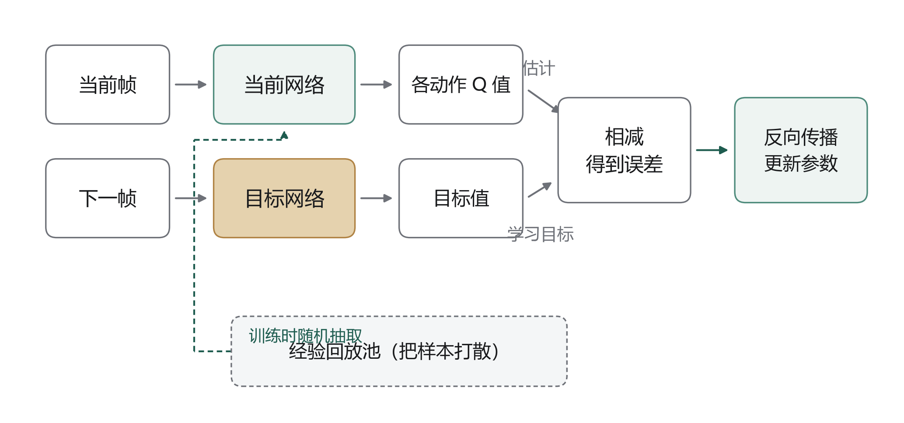

## 一次游戏的胜利：DQN 与 Atari 的突破

前面几章的内容在理论上早就齐了。贝尔曼方程在五十年代就有了，Q 学习在八十年代末就被提出来，策略梯度的想法也出现过很多次。但这些方法长期只能处理小问题，状态一多就失效。

转折发生在 2013 年。一家叫 DeepMind 的公司发表了一篇论文，用同一个网络结构玩了七款 Atari 游戏，其中三款的得分超过了人类高手。两年后，同一套方法扩展到四十九款游戏，发表在《自然》上。这件事被媒体反复报道，强化学习也由此进入公众视野。

这一章讲的就是这件事。它看起来像一次算法突破，实际上更像一次工程突破。核心部件几乎都在，缺的是几个看似琐碎的处理，让一个本来会发散的组合变得能训练。理解了这几处处理各自对着什么问题，也就理解了深度强化学习后来为什么长成现在这个样子。

### 为什么以前不行

老办法靠一张表存 Q 值。状态有多少种，表就有多少行。格子世界只有几十个状态，一张表绰绰有余。

Atari（Atari 2600 游戏，2013 年起成为基准）游戏的画面是 210×160 的彩色图像。颜色组合的数量是一个天文数字，就算把画面缩小、转成灰度、四帧叠起来，可能的状态仍然是天文数字的级别。没有任何一张表装得下，也没有任何一台机器能把每个状态都试一遍。

这个“缩小、灰度、四帧”的过程值得说清楚，因为后面所有的讨论都建立在它上面。原始画面是红绿蓝三个通道，每个像素每个通道有几百种取值，直接喂进去，连“两个画面像不像”都很难定义。所以实际做法是先把画面缩到很小的尺寸，把颜色去掉只留亮度，再把连续四帧叠成一个输入。缩小是为了让计算量可接受，四帧是为了让网络看出往哪个方向动。单看一帧，球在哪里；看四帧，才知道球往哪里飞。这一步不是可有可无的预处理，它决定了网络能不能把“运动”当成一样可学的东西。

即便做了这些压缩，状态的数量仍然是天文数字。可以换个角度体会。一局游戏几千帧，每一帧都是一个状态，而帧与帧之间的画面几乎不重复。想靠每个状态都试一遍来填表，等于要求机器把人类几十年玩过的所有画面都经历一遍，还要多得多。这不是算力不够的问题，是这条路根本走不通。

更麻烦的是，相似的画面应该对应相似的价值。游戏里的小球往左偏了一个像素，状态编号完全不同，但对玩家来说几乎是同一件事。表格没法表达这种相似性，它把每个状态当成独立的个体。神经网络可以，因为它的输入是连续的像素，相近的输入自然给出相近的输出。

思路因此变成：用神经网络代替表格，输入画面，输出每个动作的 Q 值。这个想法本身不新鲜，八十年代就有人试过，但效果很差，训练经常发散。DeepMind 的贡献主要不是这个想法，而是让它在实践中真的能跑起来的三项工程决定。

### 相似的状态应该得到相似的答案

上一节里那句“相似的画面应该对应相似的价值”，值得单独展开，因为它是整条路线的根基。

设想你在一款游戏里学会了看到子弹从右边飞来就往左躲。下一次子弹从右边飞来，位置高了一点，速度慢了一点，画面和上次不完全一样。表格的做法是把这当成一个全新的状态，之前学到的答案用不上，只能从头再试。人不会这样，人会认出这还是那件事，把旧经验搬过来。

神经网络的做法接近人。它的输入是一堆像素值，输出是每个动作的分数。同一批参数被所有状态共用，所以一个状态上的经验会自动影响输入相近的其他状态。这种影响不是精确的复制，而是一种平滑的过渡，学到的是一大片区域的规律，不是一个个孤立的答案。

这个性质有个名字叫泛化。它是神经网络能在高维输入上工作的原因，也是它危险的地方。

泛化的另一面是混淆。两个画面在像素上很接近，但该做的动作完全相反。比如球在屏幕左上角还是右上角，画面的大部分是一样的，最优动作却一个向左一个向右。网络如果容量不够，或者输入里缺少区分这两者的信息，就会把两者混成一个，学出一个折中的、两边都不对的答案。这种问题在文献里叫混叠，本质上是“看起来一样”和“其实不一样”之间的冲突。

对付它有几种办法。把输入做得更有区分度，比如把帧与帧的差也送进去，让运动方向变成显式的信息。把网络做大一些，让它有足够容量记住区别。还有就是接受一定程度的混淆，靠更多数据和更长训练把错误平均掉。

所以“用网络替代表格”不是一句口号。它把“记不住”换成了“会串味”，把状态爆炸换成了另一种误差。这个交换是划算的，因为串味可以通过数据和容量缓解，状态爆炸没有解。

### 预处理里的五个决定

从原始画面到网络输入，中间有一串决定。每一个看起来都是小事，合起来决定训练能不能收敛。

第一个是去色。Atari 的画面是红绿蓝三通道，改成灰度之后信息少了，但对判断该往哪走几乎没影响。这一步把输入量降到三分之一，也让“同一件事在不同配色下”变成同一个输入。局限也存在，有些游戏里颜色本身是信号，比如靠颜色区分敌我，去掉颜色就丢了这个信息。

第二个是缩小。原始画面两百一十乘一百六十，缩到八十四乘八十四。缩小不是为了好看，是为了让计算量落到能承受的范围。缩得太狠，小球变成一个模糊的点，位置精度不够。缩得不够，一层卷积的开销就翻几倍。八十四这个尺寸是当年试出来的平衡点，今天的硬件能支持更大的输入，很多复现改用九十六甚至一百二十八。

第三个是跳帧。游戏每秒六十帧，如果每帧都做一次决定，一秒要决策六十次，相邻两帧的差别微乎其微，等于把同一个状态重复学了四遍。做法是每四帧做一次决定，中间重复上一个动作。这样一局的时间跨度不变，决策次数降到四分之一。跳帧还有一个副作用，中间那三帧发生的意外看不到，所以有些实现会在跳过的帧里取最大奖励，避免漏掉关键事件。

第四个是叠帧。单看一帧，你知道球在哪，不知道球往哪个方向飞。把最近四帧摞成一个输入，运动方向就成了可以从数据里读出来的信息。四帧覆盖大约六十分之一秒到十五分之一秒的时间跨度，足够判断速度，又不至于把太久以前的信息带进来。

第五个是取最大值。Atari 2600 的硬件有个毛病，画面会闪烁，同一个物体在相邻两帧里可能忽有忽无。直接叠帧会把闪烁当成运动。做法是最近两帧逐像素取最大值，把闪掉的补回来。这一步纯属对特定硬件缺陷的补丁，换一个环境就不需要。

这五个决定之外还有两个细节。像素值要缩到零到一之间，否则梯度尺度不对。每局开始时随机执行若干个空操作，让初始状态有变化，避免网络把“开局第一帧的样子”当成固定前提。

预处理的重要程度经常被低估。同样一套 DQN，预处理做对了能学会，做错了完全不学，而代码看起来一模一样。判断预处理有没有问题，最简单的办法是把网络输入打印成图片看一眼，人眼看着都认不出的画面，网络也认不出。

### 用网络替代表格，难在哪

想法很简单，做起来很难。八十年代就有人试过，效果不好，训练经常发散。原因不是网络不够大，而是三件事凑在一起会互相放大。

第一件是用估计去更新估计。Q 学习的目标里含下一状态的最大 Q 值，而这个 Q 值也是网络算出来的。表格时代这不是问题，因为每个格子独立，更新一格不影响别的格。换成网络之后，一次参数更新会同时改变所有状态的估计，包括刚被当作目标的那一个。目标跟着参数一起动，学起来像追自己的影子。

第二件是数据高度相关。连续的画面几乎一样，如果按时间顺序喂给网络，一批数据说的其实是同一件事。梯度会朝一个方向连续推很多次，参数被推得很远，再遇到相反的情况又要拉回来。曲线因此剧烈抖动，严重时直接发散。

第三件是数据分布会变。策略一更新，它看到的状态分布就变了。网络刚适应一种走法，下一轮又要在新的分布上工作，之前的经验被覆盖。这在后来有个名字叫灾难性遗忘。人学开车不会因为学了骑车就忘了开车，网络会。

这三件事单独出现都还好办，凑在一起就麻烦了，因为它们互相加剧。相关的数据让参数移动得更猛，移动得猛让目标变得更快，目标乱动又让相关的数据产生更大的错误。后来的教材把这种组合叫“致命三要素”，名字有点夸张，描述的确实是这个结构。

还有一层现实条件的因素。九十年代的算力和数据都撑不住这种训练，没有能跑得动的显卡，也没有足够长的游戏录像。神经网络自己也还不成熟，初始化、优化器、激活函数都在摸索。所以“想法早就有了”和“能跑起来”之间，隔了差不多二十年。

DQN 的贡献，就是找到了三个简单的手段，把这几种效应各自压住一部分。它们不是理论上的最优解，但在实践中足够好用。

### 三件套

第一件是**经验回放**（experience replay）。智能体把每一步的经历存进一个大缓冲区，训练时从里面随机抽一批出来学。

这个做法解决了一个隐蔽的问题。连续几步的画面几乎一样，如果按顺序学，网络会连续看到高度相关的样本，参数被同一个方向反复推动，容易跑偏。随机抽样打散了相关性，让每一批数据更像是独立采样。它还有一个好处，一条经验可以被反复使用，样本效率提高不少。

如果没有回放，训练仍然能跑，但曲线会很毛躁，同一款游戏换个随机种子，结果可能差很远。更糟的是它容易陷入“最近玩什么就学什么”。智能体在某一关刷了很久，网络就把这一关的规律当成全部，换个场景立刻失灵。回放池相当于一个记忆库，让每次更新都能复习到各种场面，包括很久以前遇到的。代价是占内存，池子有限，老经验会被挤出去，太旧的又是由很差的策略产生的。

第二件是**目标网络**（target network）。算 Q 值的目标时要用到下一步的 Q 值，如果两边用同一个网络，目标会跟着参数一起动，像一个人追自己的影子。做法是复制一份网络，隔一段时间才同步一次参数，让目标在一段时间内保持稳定。

同步的频率是一个要调的数。同步太勤，等于没有目标网络，追影子的毛病原样回来，价值估计会震荡。同步太慢，目标用的是一份很旧的网络，学出来的东西滞后，训练变慢，极端情况下会学到一个过时的答案。常见的做法是每一万步左右同步一次，或者用软更新，每次只把目标网络往当前网络挪一点点。如果没有目标网络，早期实现里能看到很典型的现象，损失先降后升，Q 值越跑越大，最后爆掉。

把这两件放进一个具体循环会更清楚。每一步拼出最近四帧喂给主网络，按分数最高的键行动，偶尔随机一下，把经历存进池子。每走四步从池子里抽一小批，算目标再反向传播。如果这一步之后游戏结束，目标就是这个奖励本身，没结束才加上下一状态的价值。每走一万步左右把参数复制给目标网络。

循环里有个地方容易出错，就是游戏结束的那一步。算目标时不能加上下一状态的价值，因为游戏已经结束，后面没有价值可言。忘了这一条，网络会学到“死掉之后还有未来收益”，于是它不怕死，也不急着赢。很多复现失败的原因就藏在这种地方，而不是算法本身。探索的比例也要随训练衰减，早期跟着还不可信的 Q 值走等于跟着噪声走，后期乱试只会拉低分数。这套流程里没有一处是聪明的算法，更多是一份操作规范。

### 训练里的六个开关

DQN 的代码不长，能调的开关不多，每一个都会明显改变结果。

学习率。论文里用的是零点零零零二五，配合 RMSProp 优化器。这个数偏小，因为目标本身在动，步子大一点就会震荡。换成 Adam 时通常要再降一个量级，因为 Adam 自带步长归一化，等效步长更大。

梯度裁剪。把每次更新的梯度限制在一个范围内，防止某一批数据把参数推飞。这个手段在价值方法里几乎是必需的，因为目标里带着最大值操作，偶尔会出现一个特别大的误差。

误差函数的形状。平方误差对大误差特别敏感，一个离谱的样本能主导整批更新。常见做法是换成对异常值不敏感的形式，误差超过一定范围就改成线性增长。这个改动让训练对偶发的坏样本更耐受。

回放池大小。论文里是一百万帧。池子太小，样本很快被新数据挤掉，多样性不够。池子太大，里面的数据大量来自很差的早期策略，学起来会拖后腿。一百万这个量级对应几十小时的游戏，够用但不奢侈。

批大小。论文里三十二。批太小，梯度噪声大。批太大，同样多的数据只能更新更少的次数。这个数和学习率要一起调，单独改一个往往变差。

探索的衰减。从完全随机开始，在一百万帧内线性降到一成。降得太快，早期就锁定在一条差路上。降得太慢，后期还在乱试，分数上不去。目标网络的同步间隔是另一个类似的数，论文里每一万步同步一次。

这六个开关有一个共同点，它们的合理值都依赖任务的时长。一局只有两百步的任务，把回放池设成一百万帧没有意义，因为池子里的数据覆盖了几千局，早就超出需要。判断的办法是先估一下“一局多少步、需要看多少局才能学会”，再按这个量级去设缓冲区。

### 奖励裁剪，以及统一的尺度

第三件是**奖励裁剪**。不同游戏的得分尺度差别很大，有的几十，有的上百万。把所有正奖励记成 1，负奖励记成 -1，零保持零，让同一个学习率能适应所有游戏。这个做法牺牲了分数的绝对信息，换来的是跨游戏的一致性。

不裁剪会怎样，可以想成用同一双鞋走所有的路。分数量级大的游戏，梯度也大，稍微一更新就把参数推得很远，训练炸掉。分数量级小的游戏，梯度几乎为零，网络学了很多局还在原地。裁剪把这些差别抹平，代价是抹掉的同时也抹掉了“多拿一分”和“多拿一百分”的区别。

这个代价很具体。有些游戏里，同一个动作拿十分和拿一百分是有区别的。裁剪之后都变成一个正号，网络失去了多拿分的动力，只学会要拿分，学不会要拿更多分。在一部分游戏上这不是大问题，因为赢和输的差别足够大。在另一些游戏上，它会让水平停在一个人均线上，明明还能做得更好。

表 7-1 把三件套和它们针对的毛病放在一起。这张表也可以反过来读，当成三种失败模式的清单。

::: {.tabcap}
表 7-1　DQN 的三个工程手段各自针对什么
:::

| 手段 | 针对的毛病 | 去掉之后会怎样 | 代价 |
| --- | --- | --- | --- |
| 经验回放 | 连续样本高度相关，数据只能用一次 | 曲线毛躁，换个种子结果差很远，容易只记住最近的场面 | 占内存，池子里的旧经验会过时 |
| 目标网络 | 目标和估计共用参数，追自己的影子 | 损失先降后升，价值估计震荡甚至发散 | 多一份网络，多一个要调的同步频率 |
| 奖励裁剪 | 不同游戏的分数量级差太远 | 同一个学习率在某些游戏上步子过大，在另一些上几乎不动 | 丢掉分差信息，学不会尽量多拿分 |

图 7-1 是这三件套的关系。左边是当前网络，用当前画面算出各个动作的 Q 值；右边是目标网络，用下一帧画面算出目标值。两者的差就是误差，反向传播回去更新当前网络。经验回放池在中间，为每次更新提供一批打散过的样本。

### 结果和它的含义

在四十九款游戏上，这套方法有一半左右达到或超过了人类测试员的水准。有的游戏它玩得极好，比如打砖块，它能找到一条把球打到墙后反复得分的路线。有的游戏它完全不行，比如《蒙特祖玛的复仇》，需要一连串特定动作才能拿到第一个奖励，随机探索几乎碰不到。

先说清楚“超过人类”是怎么算的。每款游戏的人类基准不是世界纪录，而是找一批人先玩上一段时间，取他们的得分。所以“达到人类水准”大致等于“和玩过一段时间的人差不多”，不是“超过高手”。而且不同游戏的分数量级差得很远，直接比绝对分数没有意义，论文用的是相对人类基准的比例。

打砖块的例子值得多说一句。那条把球打到墙后的路线，人类玩家很少这么玩，因为规则上没写可以这样，而且一旦失手就是自毁。智能体没有这层顾虑，它只看到这样做分数一直涨。这件事有两种解读。一种说它发现了人类没想到的策略，这确实是探索的价值。另一种说它学会的是钻规则的空子，放到真实任务里，这种空子往往有代价。两种解读都对，取决于你把游戏当成什么。

学不会的游戏可以分几类。一类是奖励太稀疏，整局只有一个关键时刻给分，中间几十秒什么都没发生，随机探索几乎碰不到那个时刻。一类是需要长链条的因果，比如先拿钥匙再开门，中间隔了几百步，光靠一步步的分数反馈串不起来。还有一类是需要读懂画面里的语义关系，比如知道某个颜色代表敌人还是道具，这些信息在像素层面并不显眼。

这一节的结论可以收成一句。DQN 证明了神经网络能从像素里学出还不错的策略，但它学到的是这款游戏怎么刷分，不是这类游戏怎么玩。

### 它的毛病

DQN 有几个被反复讨论的弱点。

样本效率低。要玩几千万帧才能学会一款游戏，人类可能几分钟就上手了。这意味着它不能直接用在真实世界的机器人上，因为真机没法承受几千万次试错。

这个差距有多大，换个说法会更清楚。几千万帧按每秒六十帧算，是几十小时的连续游戏，机器要在加速的模拟器里跑，还要反复训练。人学会一款 Atari 游戏通常几十分钟，靠的是先验知识和看一次就会的能力。两者之间不是十倍二十倍的差距，是几个数量级的差距。这也是后来一大批提高样本效率工作的起点。

对超参数敏感。学习率、回放池大小、目标网络的同步频率、探索的衰减速度，这些数改一改，结果可能天差地别。论文里给出的设置是调了很久的结果，换一个游戏未必适用。

敏感的具体表现是同一套代码，一款游戏很好，另一款完全不学。排查起来很痛苦，因为你分不清是算法不适合这个任务，还是某个数设错了。实践中的经验是先在一款简单的游戏上确认实现正确，再去试难的。如果简单的也学不会，多半是实现里有 bug。

高估问题。取最大值这个操作天然带一点乐观偏差，噪声大的时候，被高估的动作更容易被选中，误差会累积。后来的 Double DQN（双估计 DQN，2015 年提出）专门修这个问题。

取最大为什么会高估，值得说清楚。假设每个动作的真实价值是固定的，但网络给出的估计带随机误差。取最大值的时候，取到的往往是真实值加一个正的误差，因为误差为负的那些被比下去了。动作越多，偏差越大。这本来只是统计上的小毛病，问题在于 Q 学习会把这个高估值当成下一步的目标，再取一次最大，偏差被一层层放大。Double DQN 的做法是把选动作和打分分开，用主网络选，用目标网络打分，两个网络的误差不容易同时朝一个方向。

还有一个更根本的限制。DQN 只能在离散动作里选，因为要对每个动作算一个 Q 值再比较。机械臂的关节角度是连续的，没法枚举。硬要枚举也能做，把角度切成一百份，两个关节就是一万个组合，三个关节就是一百万个。这个办法在维度低时能用，维度一高就崩。这个限制催生了另一条路线，直接学策略而不是学价值，第九章会讲。

### 失败模式的清单

DQN 训不起来的时候，症状通常能归到几类。认得快，修得也快。

价值爆炸。表现是损失先降后升，Q 值一路往上，最后变成天文数字。原因多半是目标网络没生效，或者同步太频繁，目标跟着参数一起动。也可能是奖励没有裁剪，某个游戏的分数是几千，梯度直接把参数推飞。

学会刷分。表现是分数上去了，但看录像发现行为荒唐。打砖块里把球打到墙后反复得分，赛车游戏里原地转圈。这不是 bug，是奖励定义和探索共同作用的结果。修法是改奖励或者改环境，不是改网络。

卡在早期水平。表现是训练很久分数不动，录像里行为机械。原因可能是探索衰减太快，早早就锁在一条差路上。也可能是状态里缺信息，策略没法区分该做不同动作的局面。区分办法是人为把探索比例调回高位，看分数会不会动。

对随机种子极其敏感。同一份代码，换一个种子，一款游戏很好，另一款完全不学。原因通常是某处不稳定被放大了，比如学习率偏高，或者回放池太小导致样本相关性没打散。修法是先把这些数往保守方向调，再看结果是否稳定。

训练分数高、评估分数低。原因是训练时还在探索，评估时用贪心。两者的差距说明策略在“最可能的动作”上还不够好，只是在“平均抽样”下还行。这个差距在训练后期应该收窄，一直不收窄说明策略没学透。

还有一类不容易发现的，成绩看起来正常但行为脆。轻轻扰动一下画面，比如把背景换个颜色，分数掉一大截。这说明网络依赖了背景的纹理而不是游戏本身。这类问题在 Atari 上不明显，因为测试和训练的画面一样，但它是后来做视觉迁移时最大的障碍。

表 7-2 把症状和排查顺序放在一起。

::: {.tabcap}
表 7-2　DQN 常见失败模式与排查顺序
:::

| 症状 | 先查什么 | 再查什么 |
| --- | --- | --- |
| Q 值一路上涨不收 | 目标网络是否生效，同步间隔 | 奖励是否裁剪，梯度是否裁剪 |
| 分数涨但行为荒唐 | 奖励定义有没有漏洞 | 环境判定是否有捷径可钻 |
| 长期停在低分 | 探索衰减是否太快 | 状态里是否缺关键信息 |
| 换种子结果差很远 | 学习率是否偏高 | 回放池是否太小 |
| 训练高评估低 | 评估是否关掉探索 | 策略是否只在平均意义上学好 |

这份清单的顺序有讲究。先查实现层面的错，再查设计层面的错。因为实现错了，无论怎么调设计都不会好，而实现对了之后，设计问题才有讨论的意义。

### 改进家族的三条线

DQN 之后的一批改进，可以归成三条线，每条线修的是同一个东西的不同侧面。

第一条线修估计偏差。Double DQN 把“选动作”和“打分”分开，用主网络选，用目标网络打分。原来的做法是同一个网络既选又打分，取最大时天然偏向被高估的动作。分开之后，高估明显减少，同一款游戏的分数能提高一截。

第二条线修结构。Dueling 结构把 Q 拆成两部分，一部分衡量“这个状态本身有多好”，另一部分衡量“这个动作比平均好多少”。很多状态下动作选哪个差别不大，拆开之后网络不必为每个动作单独学一遍状态的好坏，样本效率提高。这个结构在动作影响小、状态影响大的游戏里效果最明显。

第三条线修采样。优先回放让“误差大的样本”更容易被抽到，因为那些样本里还有没学会的东西。做法是给每条经验记一个优先级，按优先级抽样，再对采样偏差做修正。它能让学习快不少，代价是实现复杂，优先级设得不好会反复学少数异常样本，把网络带偏。

三条线之外还有两个方向。一个是分布式价值，不估计一个期望值，而估计一整条收益分布，学到的信息更多，在一些需要规避风险的任务上更合适。另一个是把探索写进网络，用带噪声的参数代替随机的动作选择，让探索的强度随状态变化。

2017 年有一个把这些拼在一起的版本，把六种改进合到一个系统里，在同一批游戏上明显超过原来的 DQN。它的意义不在于哪个零件新，而在于说明这些改进是互补的，各自修一个毛病，合起来才完整。

三条线的共同前提没有变，都还是在离散动作上做价值估计。动作连续时，取最大值这一步就没法做，这条路走到头了。这个限制催生了策略梯度那一支，下一章之后的第九章会讲。

### “通用智能体”该怎么理解

媒体当时的说法是“通用人工智能的雏形”、“一个网络学会所有游戏”。

这个说法有一定道理，毕竟网络结构、超参数、奖励处理在四十九款游戏上完全一样。但它也有很多保留。每款游戏仍然要单独训练，一个训练好的网络不会玩另一款游戏。所谓的通用，指的是方法通用，不是能力通用。

把通用这个词拆成三层，会看得更清楚。

一层是方法通用。同一套代码不改一行就能跑四十九款游戏，这在当年是件新鲜事，之前每个任务都要专门设计特征、专门调奖励。这一层成立，也是 DQN 最实质的贡献。

一层是接口通用。输入永远是像素，输出永远是按键，中间不需要人告诉它这是球拍、那是敌人。接口统一是谈通用的前提，只有输入输出统一，才能说同一个系统在处理不同任务。

一层是能力通用。一个训练好的网络能不能玩它没见过的游戏，答案几乎是不能。把它放到另一款游戏的画面上，它输出的动作基本是噪声。

前两层成立，第三层不成立，这就是“通用”这个词容易误导的地方。可以打个比方。一位老师用同一套方法教了四十九门课，每门都教得不错，这叫方法通用。但这位老师不是一个学会了四十九门课的学生，换成第五十门课，他还要重新备课。

有一点也要说公平。DQN 之后的很多工作，通用性确实在提高。一个网络同时玩多款游戏的做法出现了，用文字描述任务再让同一个智能体去做的做法也出现了。今天说“通用智能体”，通常指的是这类能接受多种指令、在多种环境里工作的系统，而不是 2015 年那个只在像素上刷分的网络。词没变，指的东西变了。

如果只记住一件事，应该是这个。DQN 的成功不在算法多精巧，而在于它把几个简单的工程手段组合起来，让神经网络能够在噪声大、反馈稀疏、数据相关的环境里稳定学习。这个组合后来成了深度强化学习的标准配置，具体实现并不复杂，难的是几个细节的配合。

### 复现时按什么顺序走

自己从零写一份 DQN，直接上四十九款游戏是浪费时间。有条更快的路。

先用一个能打印出来的小环境，比如格子世界，把整套循环跑通。状态是坐标，动作是四个方向，奖励放到位。这里要确认的东西只有三件，奖励有没有进缓冲区，目标在终止那一步有没有少加未来价值，参数有没有真的在更新。三件都对，环境换成 CartPole，因为它的状态连续，能检验网络输入的处理。

CartPole 跑通再换画面输入。这一步会暴露预处理的问题，输入的形状、通道顺序、归一化范围，任何一处不对都会让训练完全不学。判断办法是把网络的输入还原成图片看一眼，人眼看着正常，才轮到怀疑算法。

最后才上 Atari。到这一步仍有大量时间会花在环境接口上，帧率控制、随机跳帧、终止判定、分数读取，每一处都可能让结果和论文对不上。

这个顺序的道理是，把可能的错误来源一个个排除掉。一次只引入一个新变量，出错时才知道是谁的问题。反过来，一上手就上复杂环境，出了问题既可能是算法，也可能是预处理，还可能是环境接口，排查会非常痛苦。顺序本身就是一种调试工具，先缩小搜索范围，再逐步放开。

### 从游戏到棋

Atari 的突破说明神经网络能处理高维输入。但游戏还有一个特点，每一步都能拿到分数，反馈不算太稀疏。

这个特点值得展开，因为它决定了后面方法的走向。Atari 的奖励虽然有时稀疏，但至少是每时每刻都可能出现的。打砖块每打掉一块砖就有分，乒乓球每失一分就有负分。智能体可以在几百步之内拿到一些信号，知道自己大致在往哪个方向走。

而且 Atari 的试错成本极低。一个模拟器可以开很多份并行，一秒钟跑几千帧，一局游戏几秒就结束。动作空间也小，最多十几个按键。这些条件加在一起，才让几千万帧这个数字变得可以接受。换成真机，同样的算法连一局都跑不完。

棋类完全不同。一盘棋几百手，只有最后才有胜负。状态空间也大得多，围棋的可能局面数量超过了可观测宇宙的原子总数。在这种规模下，光靠试错和 Q 学习是不够的，需要把搜索加进来。

为什么搜索能解决这个问题，可以说得更具体一点。Q 学习靠奖励信号往回传播，信号要传几百步才能覆盖到开局，中间没有任何反馈，传播会衰减到几乎没有。搜索不一样，它可以在当前这一步就把棋下完，直接看到胜负，然后把这个结果记在当前这一步上。相当于人为造出了一批中间的胜负信号。

还有一个条件让棋类比 Atari 更适合搜索。棋的规则完全已知，模拟一步的代价几乎为零，你可以随时假装走一步看看后果，不用承担任何风险。游戏里也类似，但游戏的状态由模拟器给出，棋的状态由自己算出来，而且完全准确。这个便利在现实世界里不成立，机器人没法假装摔一跤。

下一章讲的就是这件事。它把强化学习和传统的博弈树搜索结合起来，做出了一套能赢世界冠军的系统。这套系统后来演化出的自我对弈方法，又反过来影响了大模型的训练。
