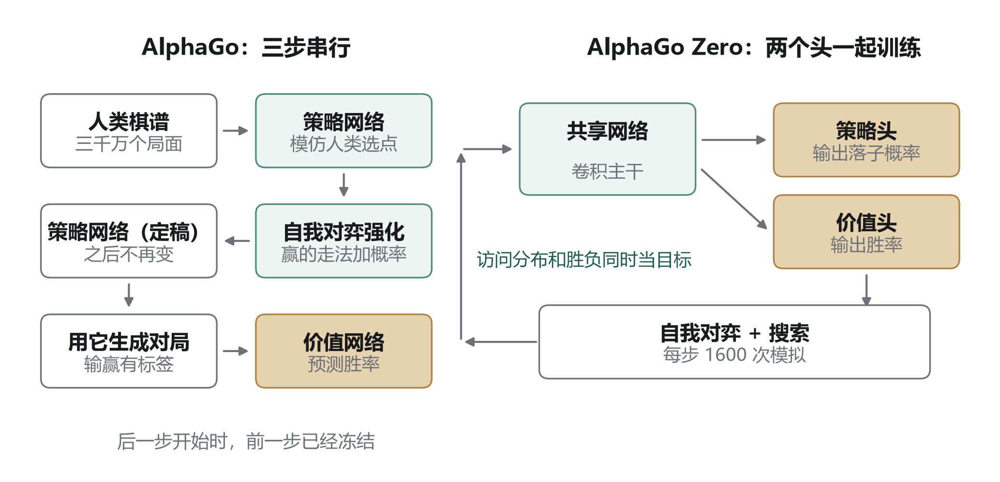

## 走一步看十步：AlphaGo 与搜索

2016 年 3 月，首尔。一台机器和世界顶尖棋手李世石下了五盘棋，赢了四盘。这件事的影响远超围棋圈，很多人第一次意识到，机器可以在一个被认为需要“直觉”和“大局观”的领域里超过人类。

赢下比赛的系统叫 AlphaGo。它不是单纯的强化学习，也不是单纯的搜索，而是把几样东西拼在一起。理解这个拼接方式，比记住它的名字更有用。

这一章要回答两个常被跳过的细节。策略网络和价值网络到底是一起训练还是分开训练。以及后来的版本不用人类棋谱，自己跟自己下，它凭什么知道该往哪里搜。

### 围棋难在哪里

国际象棋的程序在 1997 年就赢了世界冠军，用的是暴力搜索，把未来很多步的可能都算一遍。围棋不行。

第一个原因是分支太多。国际象棋每一步平均有三十几种走法，围棋有两百多种。多算十步，复杂度差了几个数量级。

第二个原因是局面难以评估。国际象棋里，子力价值比较清楚，一个后顶九个兵，程序员可以写一个还不错的评估函数。围棋里，一块棋的死活要到几十手之后才见分晓，孤立地数子没有意义。同一个局面，高手说“白棋稍好”，问他好多少，他说不清。

第三个原因是人类的棋谱不够用。国际象棋有几百年的积累，围棋的顶级棋谱相对少得多，靠模仿人类很难达到顶尖。

### 蒙特卡洛树搜索

在这些限制下，传统做法是**蒙特卡洛树搜索**（Monte Carlo tree search，MCTS）。它的思路是：不把所有可能都算完，只算最有希望的那几条。

具体做法是一棵不断长大的树。从当前局面出发，每个可能的走法是一个分支。系统会反复做四件事。

**选择**。从根节点往下走，每一步挑一个“看起来有希望”的分支。挑选的标准同时考虑两件事，这个分支之前的平均结果好不好，以及它被访问过多少次。访问得少的分支会被适当照顾，这和第四章老虎机里的置信上界是同一个思想。

**扩展**。走到一个还没展开的节点时，加上一个新的子节点，代表一个没试过的走法。

**模拟**。从这个新节点开始，用比较快的策略把棋下完，一直下到分出胜负为止。这一步不需要下得好，只需要给出一个粗略的结果。

**回传**。把模拟的胜负结果沿着来路往回记，更新路径上每个节点的统计量。

这四步重复成千上万次，树的形状就会向有希望的分支倾斜。最后选择访问次数最多的那个走法。

图 8-1 是这四步的循环。它本质上是把计算资源集中投在最值得深挖的地方，而不是平均分配给所有可能。

MCTS 有一个很大的优点，它不需要一个准确的局面评估函数，只要能把棋下完并判断胜负就行。代价是它需要大量的模拟，而且模拟的质量差时，结果会很粗糙。在 AlphaGo 之前，MCTS 在围棋上只能达到业余水平。

### 搜索到底搜多大

这里先算一笔账，因为后面讲“搜索空间”时会反复用到。

围棋的合法着手，在一个空棋盘上是三百六十一个点，中盘大约两百多个。如果按两百算，往下看十步，粗略有 $200^{10}$ 种走法，这个数字已经远超可观测宇宙的原子数。往下看一百五十步，更是无法想象。

所以“把搜索空间走一遍”从来不是选项。MCTS 也从不这么做。它在每一步只维护一棵局部的树，根节点是当前局面，边是当前合法着手，然后给定一个模拟次数预算，比如一千六百次。一千六百次模拟意味着这一手棋只展开一千六百个节点，和 $200^{10}$ 相比是九牛一毛。

换句话说，搜索空间是规则给定的，但实际被搜索的部分，是由预算和“先看哪里”的策略共同决定的。MCTS 的作用不是穷举，而是在有限预算下，把注意力放到更可能出结果的分支上。

### 两个网络，各管一件事

AlphaGo 的关键改动，是用神经网络改善 MCTS 的两个环节。

第一个是**策略网络**。它输入棋盘局面，输出每个位置落子的概率。它的作用是缩小搜索范围，把明显不合理的走法直接排除掉，让 MCTS 不必在两百多个分支上平均用力。在树里，这个概率被当作先验，决定先展开哪些子节点。

第二个是**价值网络**。它输入局面，输出一个数，表示当前局面下自己获胜的概率。它的作用是代替“把棋下完看结果”这一步。原来需要模拟几百步，现在一次前向计算就给出判断，而且比快速走子策略的判断准得多。

2016 年那版还有一个不起眼但很重要的零件，**快速走子策略**。它是一个很轻的线性模型，专门负责“从这个局面随便下完”，速度极快，质量一般。MCTS 评估叶子节点时，会把价值网络的判断和快速走子的结果按比例混合。价值网络准，但它是学出来的，会有系统性偏差；快速走子粗糙，但它是真实下完的结果，能校正一部分偏差。

三个零件在树里的分工可以这样记。策略网络决定“往哪里想”，价值网络决定“想到这里值不值得”，快速走子负责“实在拿不准就下完看看”。图 8-2 是它们和搜索的关系。

### 分开训练，还是一起训练

这是最容易被一句话带过的地方，值得拆开讲。

2016 年的 AlphaGo 是**分开训练**的，而且分三步，顺序不能乱。

第一步，用人类棋谱训练策略网络。三千万个局面，每个局面标注了人类棋手实际下在哪里，用监督学习让网络学会模仿。这一步只求“像人”，不求“最强”。

第二步，用自我对弈强化这个策略网络。让当前网络和之前的版本下棋，赢了就提高这盘棋里各步的概率，输了就降低。这一步把“像人”变成“能赢”。论文里把这一步得到的网络叫强化学习策略网络。

第三步，训练价值网络。用第二步得到的策略网络自己下棋，生成几百万个局面，每个局面记下最终的胜负，然后训练一个网络去预测“从这个局面出发，胜率是多少”。

注意第三步的输入，是第二步那个已经固定的策略网络产生的。价值网络学的是“按这个策略走下去会怎样”，策略一变，它的估计就过时了。所以三步必须串行，第三步开始时第二步已经停下。

到了实际对局，三个网络全部冻结，只做前向计算。MCTS 用它们提供的先验和价值来搜索，搜索本身不更新任何参数。

2017 年的 AlphaGo Zero 换了一种做法，**一个网络，两个输出头，同时训练**。

网络的前面几十层是共享的，后面分出两个头。一个头输出落子概率，另一个头输出胜率。一次前向计算同时得到两个结果，一次反向传播同时更新两个头。

它的训练数据来自自我对弈加搜索。对局中，MCTS 会产生每个局面的“访问次数分布”，这个分布比网络自己的先验更靠谱，于是被当作策略头的目标。对局结束后有胜负，胜率被当作价值头的目标。两个目标来自同一批对局，所以可以放在一个损失函数里一起优化。

为什么 2016 年不这么做？原因不神秘。价值网络的目标依赖策略，策略还在变的时候，价值目标是不稳定的。分开训练可以先把策略定下来，再学价值，避免追一个移动的目标。Zero 之所以能合起来，是因为两个头的目标都来自同一次搜索，搜索用的是当前网络，目标和参数是自洽的，联合训练不会打架。

表 8-1 把两版的关键差别列在一起。

::: {.tabcap}
表 8-1　AlphaGo 与 AlphaGo Zero 的训练方式对比
:::

| 项目 | AlphaGo（2016） | AlphaGo Zero（2017） |
| --- | --- | --- |
| 人类棋谱 | 用来监督训练策略网络 | 完全不用 |
| 网络数量 | 策略网络、价值网络、快速走子策略 | 一个网络，两个输出头 |
| 训练顺序 | 分三步，串行，后一步用前一步的固定结果 | 一次训练，两个头同时更新 |
| 搜索中的作用 | 先验 + 价值 + 快速走子结果混合 | 先验 + 价值 |
| 训练数据 | 人类棋谱 + 自我对弈 | 只有自我对弈 |

图 8-3 画的是这两种训练流程的差别。

### 没有棋谱，搜索空间从哪来

这是第二个常被问住的问题。不用人类棋谱，网络一开始是随机的，它凭什么知道该往哪里搜？

先把“搜索空间”这个词拆开。它有两层意思。

一层是规则给定的合法空间，所有合法的落子序列。这一层和有没有棋谱无关，围棋规则写在那里，空间就有那么大。

另一层是实际被搜索到的部分。这一层由三件事决定，每一步的模拟预算，策略网络给出的先验，以及价值网络在多深处截断。

AlphaGo Zero 的做法是，每一步给定一千六百次模拟。搜索从当前局面开始，按先验和访问次数往下走。先验高的分支先被展开，先验低的分支要等别的分支被证明不行了才有机会。价值网络在叶子节点给出胜率，搜索不再往下。于是一千六百次模拟只覆盖了巨大空间里很小的一块，但这块是被先验和价值筛过的。

那先验一开始是随机的，怎么办？

答案是，随机的先验也能让搜索比随机下棋好一点点。因为规则提供了不会骗人的胜负，MCTS 即使在一堆随机先验里，也能通过模拟发现“这几步之后老是输”。搜索的结果是访问次数分布，它比先验更接近“哪一步真的好”。这个分布被拿去训练网络，网络的先验就变好了一点。下一轮自我对弈，更好的先验让搜索更准，搜索又给出更好的分布。

这个循环不需要人类棋谱，只需要三样东西。规则，能判断胜负。搜索，能在预算内把先验修正一点。网络，能把修正记住并泛化到没见过的局面。

早期确实很弱。随机网络下出来的棋很难看，搜索也只能在很浅的层面纠正。但每一轮只需要“比上一轮好一点”，几百万局之后，这个差距会累积成质变。AlphaGo Zero 训练三天，自我对弈约五百万局，就以一百比零战胜了击败李世石的版本。

还有两个工程细节帮助搜索发散。一个是根节点的狄利克雷噪声，在搜索开始时给各个分支加一点随机扰动，避免每局都走同一条路。另一个是温度参数，开局阶段按访问次数概率采样，让对局有变化，中后盘才改成几乎确定的选择。这两条都是为了保证自我对弈能覆盖足够多的局面，而不是早早收敛到一种下法。

### 从 AlphaGo 到 AlphaZero

AlphaGo Zero 把人类棋谱去掉之后，还有一个更进一步的版本，AlphaZero。

同一套方法，不针对围棋做特殊设计，直接用在国际象棋和将棋上，也达到了顶尖水平。训练时间按论文报告，围棋约三十四小时，国际象棋约八小时，将棋约两小时，用的是大量专用硬件。它每步的模拟次数比 AlphaGo Zero 少一些，大约八百次，靠更强的网络弥补。

这里有一个值得记住的观点。自我对弈是一种极其高效的数据生成方式。你不需要人类标注，规则本身就提供了答案，胜负不会骗人。围棋的规则简单到几行代码就能写完，但它蕴含的可能性足够深，深到可以撑起一次真正的学习。

### 这套思路的遗产

AlphaGo 之后，“搜索加学习”成了处理复杂决策问题的标准思路。它的现代版本出现在很多地方。

大模型做数学题时，会生成多条推理路径，再挑一条最好的。这可以看成一种浅层的搜索。更复杂的做法会让模型在推理过程中回溯，试一条路走不通就退回来换一条。

代码生成也是这样。模型先生成一个版本，跑测试，失败就根据错误信息修改。这个过程本质上是在一个巨大的动作空间里做带反馈的搜索。

还有一个更直接的遗产，是自我对弈的思路被搬到了语言模型上。模型生成答案，用某种方式判断对错，把对的答案留下来训练自己。这条线后面还会详细讲，包括它在什么条件下有效，在什么条件下会崩。

不过在讲大模型之前，还要回到地面。棋类游戏的规则完全已知，模拟一次的成本几乎为零。现实世界不是这样，机器人摔一跤要修，仿真和现实之间还有差距。下一章讲这个差距，以及人们怎么对付它。
