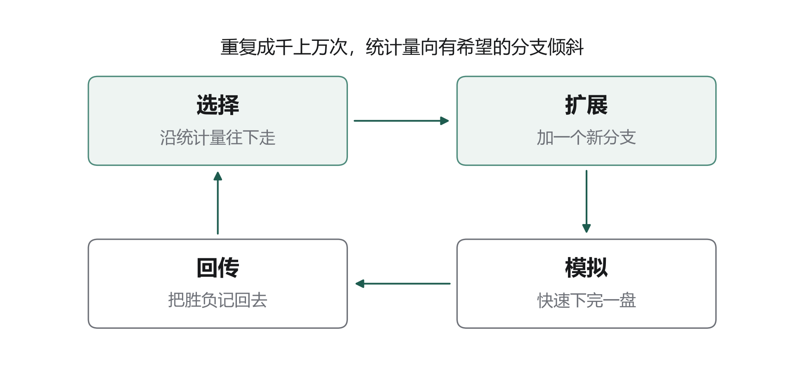
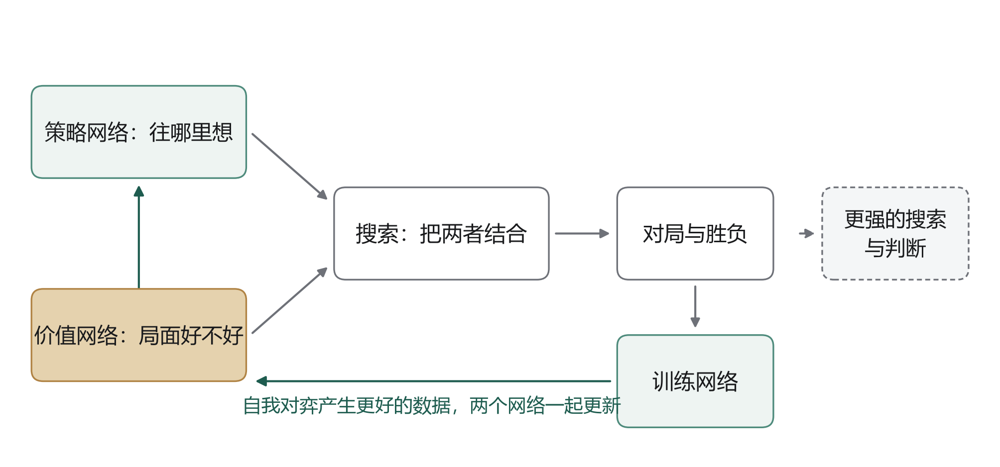

## 走一步看十步：AlphaGo 与搜索

2016 年 3 月，首尔。一台机器和世界顶尖棋手李世石下了五盘棋，赢了四盘。这件事的影响远超围棋圈，很多人第一次意识到，机器可以在一个被认为需要“直觉”和“大局观”的领域里超过人类。

赢下比赛的系统叫 AlphaGo。它不是单纯的强化学习，也不是单纯的搜索，而是把几样东西拼在一起。理解这个拼接方式，比记住它的名字更有用。

### 围棋难在哪里

国际象棋的程序在 1997 年就赢了世界冠军，用的是暴力搜索，把未来很多步的可能都算一遍。围棋不行。

第一个原因是分支太多。国际象棋每一步平均有三十几种走法，围棋有两百多种。多算十步，复杂度差了几个数量级。

第二个原因是局面难以评估。国际象棋里，子力价值比较清楚，一个后顶九个兵，程序员可以写一个还不错的评估函数。围棋里，一块棋的死活要到几十手之后才见分晓，孤立地数子没有意义。同一个局面，高手说“白棋稍好”，问他好多少，他说不清。

第三个原因是人类的棋谱不够用。国际象棋有几百年的积累，围棋的顶级棋谱相对少得多，靠模仿人类很难达到顶尖。

### 蒙特卡洛树搜索

在这些限制下，传统做法是**蒙特卡洛树搜索**（Monte Carlo tree search，MCTS）。它的思路是：不把所有可能都算完，只算最有希望的那几条。

具体做法是一棵不断长大的树。从当前局面出发，每个可能的走法是一个分支。系统会反复做四件事。

**选择**。从根节点往下走，每一步挑一个“看起来有希望”的分支。挑选的标准同时考虑两件事，这个分支之前的平均结果好不好，以及它被访问过多少次。访问得少的分支会被适当照顾，这和第四章老虎机里的置信上界是同一个思想。

**扩展**。走到一个还没展开的节点时，加上一个新的子节点，代表一个没试过的走法。

**模拟**。从这个新节点开始，用比较快的策略把棋下完，一直下到分出胜负为止。这一步不需要下得好，只需要给出一个粗略的结果。

**回传**。把模拟的胜负结果沿着来路往回记，更新路径上每个节点的统计量。

这四步重复成千上万次，树的形状就会向有希望的分支倾斜。最后选择访问次数最多的那个走法。

图 8-1 是这四步的循环。它本质上是把计算资源集中投在最值得深挖的地方，而不是平均分配给所有可能。

MCTS 有一个很大的优点，它不需要一个准确的局面评估函数，只要能把棋下完并判断胜负就行。代价是它需要大量的模拟，而且模拟的质量差时，结果会很粗糙。在 AlphaGo 之前，MCTS 在围棋上只能达到业余水平。

### 两个网络

AlphaGo 的关键改动，是用神经网络改善 MCTS 的两个环节。

第一个是**策略网络**。它输入棋盘局面，输出每个位置落子的概率。这个网络先在人类棋谱上做监督学习，学会像人一样下棋，再用自我对弈强化。它的作用是缩小搜索范围，把明显不合理的走法直接排除掉，让 MCTS 不必在两百多个分支上平均用力。

第二个是**价值网络**。它输入局面，输出一个数，表示当前局面下自己获胜的概率。它的作用是代替“把棋下完看结果”这一步。原来需要模拟几百步，现在一次前向计算就给出判断，而且比快速走子策略的判断准得多。

两个网络分工明确。策略网络回答“往哪里想”，价值网络回答“这个局面好不好”。MCTS 把两者结合起来，用策略网络生成候选，用价值网络评估叶子节点，再把搜索结果反过来作为训练数据，继续训练两个网络。

这就形成了一个闭环。网络让搜索更强，搜索产生更高质量的对局，高质量对局又让网络更强。图 8-2 画的正是这个循环。

### 从 AlphaGo 到 AlphaZero

AlphaGo 的第一版还依赖人类棋谱。后来的 AlphaGo Zero 把这一步也去掉了。它不学人类棋谱，从完全随机下起，只靠自己和自己下。

这个改动听起来更简单，实际上更难，因为初期没有任何可用的知识。但它带来的结果很有意思。AlphaGo Zero 训练三天，自我对弈了约五百万局，就以一百比零战胜了击败李世石的版本。而且它下出了一些人类棋手很少采用的定式，后来被证明是有效的。

再往后是 AlphaZero。同一套方法，不针对围棋做特殊设计，直接用在国际象棋和将棋上，也达到了顶尖水平。训练时间按论文报告，围棋约三十四小时，国际象棋约八小时，将棋约两小时，用的是大量专用硬件。

这里有一个值得记住的观点。自我对弈是一种极其高效的数据生成方式。你不需要人类标注，规则本身就提供了答案，胜负不会骗人。围棋的规则简单到几行代码就能写完，但它蕴含的可能性足够深，深到可以撑起一次真正的学习。

### 这套思路的遗产

AlphaGo 之后，“搜索加学习”成了处理复杂决策问题的标准思路。它的现代版本出现在很多地方。

大模型做数学题时，会生成多条推理路径，再挑一条最好的。这可以看成一种浅层的搜索。更复杂的做法会让模型在推理过程中回溯，试一条路走不通就退回来换一条。

代码生成也是这样。模型先生成一个版本，跑测试，失败就根据错误信息修改。这个过程本质上是在一个巨大的动作空间里做带反馈的搜索。

还有一个更直接的遗产，是自我对弈的思路被搬到了语言模型上。模型生成答案，用某种方式判断对错，把对的答案留下来训练自己。这条线后面还会详细讲，包括它在什么条件下有效，在什么条件下会崩。

不过在讲大模型之前，还要回到地面。棋类游戏的规则完全已知，模拟一次的成本几乎为零。现实世界不是这样，机器人摔一跤要修，仿真和现实之间还有差距。下一章讲这个差距，以及人们怎么对付它。
