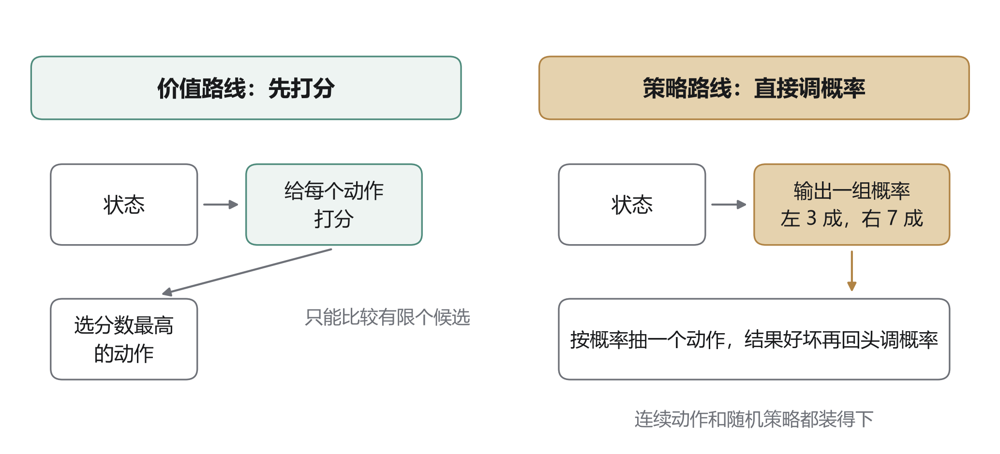

## 策略梯度与 PPO：为什么不给动作打分也能学

前面几章的方法有一个共同点，都先给动作打分，再挑分数最高的。这条思路清楚，但在两个地方会卡住。

一个是连续动作。机械臂的关节角度有无限多种，没法一个个打分再比较。另一个是随机性。有些场合最优策略本来就是随机的，比如猜拳，打分再取最大反而学不会。

这一章讲另一条路，跳过打分，直接调整“做某个动作的概率”。它也是今天大模型训练里最常用的那套方法。

### 两条路的分岔

图 9-1 把两条路放在一起看。

左边是价值路线。网络学会给每个动作打分，执行时取分数最高的。DQN 走的就是这条。

右边是策略路线。网络直接输出一组概率，比如向左三成、向右七成，执行时按概率抽一个。学习的目标不是让分数更准，而是让“好动作的概率”变大。

两条路都能解决 CartPole，但在连续动作和高随机性的任务上，策略路线更自然。原因很简单，概率分布可以描述无限多种动作，而“取最大”只能处理有限个候选。

### 一个概率就是策略

策略网络的输出通常是一组数，经过归一化变成概率。选动作时按概率抽，训练时记录下“这次抽到了什么，当时概率是多少”。

这个记录很关键。如果某次抽到的动作后来带来了好结果，就把这个动作的概率调高一点；结果差，就调低一点。调整的幅度和“这个结果比平时好多少”成正比。

这听起来像训狗。做对了给零食，做错了没有。区别在于，这里不是简单地重复或回避某个动作，而是按比例调整概率，而且调整的是“在什么状态下更可能做什么”。

### 一局结束才更新

最朴素的做法叫 REINFORCE。走完一整局，算出总回报，然后用这个回报去调整这一局里所有动作的概率。

问题很明显。一局里有几十步，最后得分高，所有动作的概率都被调高，包括那些其实很糟糕的动作。最后得分低，正确的动作也被连累。

这就是第一章讲过的信用分配，在策略路线上它以另一种形式出现。价值方法用打分来分摊责任，策略方法需要别的手段。

### 减掉一个基准

一个简单有效的办法是减掉基准。不看绝对回报，而看“这一局比平均好多少”。

具体做法是维护一个估计，代表当前水平下平均能拿多少分。某一局超过平均，这一局的动作概率调高；低于平均，调低。这样好评和差评就有了参照，不再一味地全部调高。

这个基准可以是一个滑动平均，也可以是一个学出来的价值网络。后者就是“演员评论家”结构，演员负责选动作，评论家负责评价当前状态值多少。

减去基准不会改变学习的方向，只会让更新的幅度更合理。它在数学上有一个漂亮的证明，但直觉很简单，参照系选对了，噪声就小了。

### PPO：每次只拧一点

即使有了基准，策略更新还有一个隐患，步子可能太大。

一次更新把某个动作的概率从一成推到九成，听起来很高效，实际上很危险。新策略再也不会尝试别的动作，之前收集的数据全部作废，训练可能就此卡死。

PPO 的做法是给更新加一个限位器。它比较新旧策略对同一个动作的概率，如果变化超过一定比例，就不再给额外的奖励。

打个比方。你想把音量从三格调到七格，直接拧到底可能会炸耳朵。PPO 的做法是每次只允许拧一点，超出的部分不算数。这样即使方向判断错了，也不会一次走太远。

这个改动很小，效果很好。它让策略在训练中稳步移动，而不是跳来跳去。今天大模型的对齐训练几乎都用它或者它的变体，原因就在这里。

### 它也是大模型的主力

后面讲 RLHF 时会看到，让语言模型学会“好好回答”，用的就是这套方法。

模型生成一段回答，奖励模型给一个分数，然后用 PPO 调整模型，让高分回答的概率变大。整个流程和 CartPole 上没有本质区别，只是动作从“左或右”变成了“十几万个词里选一个”，一局从几百步变成了几百个 token。

### 它的代价

PPO 不是免费的。

它需要不断生成新数据，因为策略一变，旧数据的分布就对不上了。这让训练成本很高，尤其在大模型上。

它对超参数敏感。步子限制得多紧、一次用多少数据、学习率多大，这些数调不好，训练要么很慢，要么崩掉。

它还有一个隐蔽的问题，容易被奖励钻空子。这一点在讲大模型的那一部会详细说。

到这里，强化学习在游戏和机器人上的主要方法都出现过了。下一章把视角从实验室移到现实世界，看这套东西在推荐、调度、芯片和科学里长什么样。
