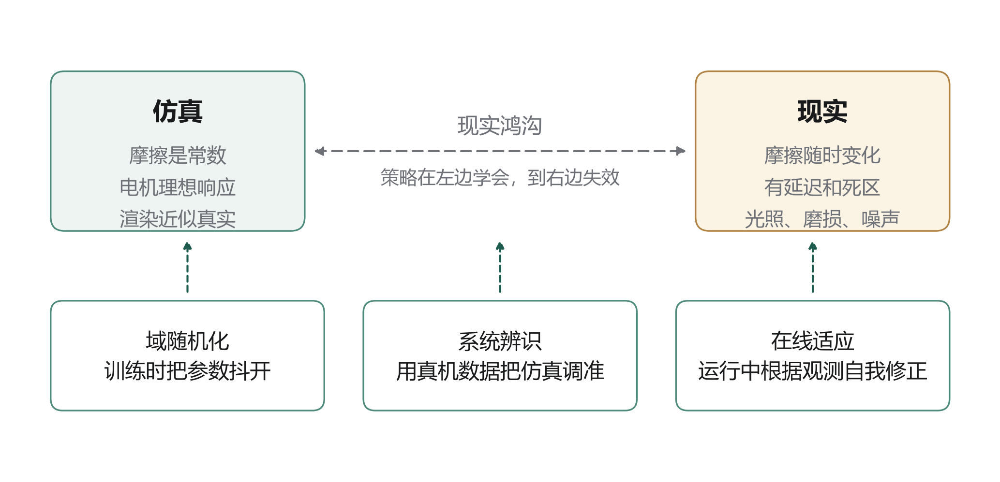

## 从屏幕到地面：仿真与现实的差距

游戏和棋类有一个共同的便利，你可以无限次重来，成本几乎为零。现实世界不行。机器人摔一跤要修，汽车撞一次要赔，化学实验做错可能有危险。

所以强化学习在现实问题上的标准做法是，先在仿真里练，再搬到真机上。这件事听起来顺理成章，做起来处处是坑。这一章讲这个坑在哪，以及目前最常用的几种填法。

### 仿真和现实差在哪

假设你要训练一个机械臂抓杯子。在仿真里，你写一个杯子模型，设定摩擦系数、质量、表面反光，然后让机械臂练几百万次。它在仿真里抓得很稳。

搬到真机上，它可能一上手就滑掉。原因很多。

摩擦系数在仿真里是一个常数，真实世界里同一只杯子在不同桌面上不同，手上有汗也不同。电机的响应有延迟和死区，仿真里通常是理想响应。传感器的噪声分布和真实的不一样。光线变化会改变视觉输入，仿真里的渲染很难完全还原。机械臂用久了会磨损，关节间隙变大。

这些差异加在一起，构成所谓的**现实鸿沟**（reality gap）。智能体在仿真里学到的策略，本质上是对仿真环境的过拟合，一旦环境变了，性能就掉下来。

### 让仿真变得不那么确定

最常用的对策叫**域随机化**（domain randomization）。既然不知道真实世界的参数具体是多少，那就在训练时把这些参数随机化。

摩擦系数不让它固定，每次重置时在 0.3 到 1.2 之间随机取。杯子的大小、重量、颜色随机。光照方向、桌面纹理随机。相机的位置有微小抖动，电机有延迟。

这样训出来的策略，面对的是成千上万个略微不同的世界。它学到的不是“在这个特定世界里怎么抓”，而是“在一族世界里怎么抓”。只要真实世界落在这个族里，策略就能用。

这个办法有一个前提，随机化的范围要覆盖真实情况。范围设窄了不管用，设得太宽策略会变得过于保守。实践中往往先用真机测几组数据，估计参数的大致范围，再据此设定。

图 10-1 把差距和三种常见的对策放在一起。

### 一只手的例子

2018 年，OpenAI 公布了一个手内操作的研究。任务是让一只带五指机械手把一个方块翻转成指定朝向。

难点在于接触。手指和方块之间的接触点每时每刻都在变，摩擦力、形变、滑动都很难精确建模。用传统控制方法写规则，几乎不可能覆盖所有情况。

他们的做法是在仿真里并行训练。为了跟上真机的速度，他们把仿真器放到 GPU 上，同时跑几千个环境，让模型在同样的墙钟时间里经历相当于几年的操作。训练时用了大量随机化，方块的大小、重量、摩擦、表面的随机纹理，还有重力方向、关节的阻尼、观测的延迟。

结果是策略能直接搬到真机上，而且在没见过的新方块、新朝向上也能工作。这个结果当时引起了不小的关注，因为它说明域随机化可以在接触密集的任务上奏效。

值得说明的是，这套方法对仿真的保真度要求很高，也需要大量算力。它不是“随便找个开源仿真器就能用”，而是围绕任务做了很多工程。

### 另一种思路：让仿真跟着现实校准

域随机化是“让策略适应很多世界”。另一条路是“让仿真尽量像现实”，也就是**系统辨识**（system identification）。先用真机采一些数据，估计质量、摩擦、延迟这些参数，把仿真调准，再在里面训练。

这个办法在参数少、可测量的时候效果好，比如机械臂的连杆质量。但在接触复杂、参数多的任务上很难调准，因为要拟合的东西太多，数据又少。

实践中常常两者结合。先用系统辨识把主要参数调到大致的范围，再在这个范围里做随机化，留出余量。

还有一类方法叫**在线适应**。策略在真机上运行时，会根据最近的观测调整自己的行为。比如它发现实际的摩擦比自己以为的小，就自动减小抓握的力度变化。这类方法让策略具备一定的自我修正能力，代价是训练更复杂，需要让策略在仿真里见过各种“自己判断错了”的情况。

### 四足机器人和自动驾驶

四足机器人是这几年强化学习落地比较成功的方向。原因有几个，仿真相对容易建，摔倒的成本低（有保护架），而且控制频率高，反馈密集。

常见的做法是把强化学习和传统控制结合起来。底层用模型预测控制保证稳定性，上层用强化学习学步态和适应策略。也有纯强化学习的方案，在仿真里用大规模并行训练，把地形、负载、推力扰动都随机化，直接部署到真机。这类系统能在雪地、碎石、楼梯上行走，遇到踢一脚也能自己站稳。

自动驾驶更谨慎。真车不能随便试错，仿真的保真度又不够，所以主线仍然是感知加规则加监督学习。强化学习用在一些局部问题上，比如变道决策、路口通行、轨迹优化。这些子问题的动作空间小，评价指标清楚，风险可控。

### 在想象里练

还有一条更激进的路，让智能体在一个学出来的模型里训练，而不是在真实环境里。这个学出来的模型叫**世界模型**（world model）。

做法是先收集一批真实交互数据，训练一个网络预测“做了某个动作之后，下一帧会变成什么样，会得到多少奖励”。这个网络就是世界模型。然后让智能体在这个模型里想象着训练，因为不需要和真实环境交互，速度可以快很多。

这条路的吸引力在于样本效率。真实世界的数据很贵，如果能用少量数据学一个够用的模型，剩下的学习都在模型里完成，成本会低很多。

难点在于模型误差。世界模型不可能完全准，智能体在模型里学久了，会找到模型的漏洞，学出一些在模型里得分很高、在现实里完全无效的行为。这类现象和奖励黑客是同一类问题。常见的对策是限制在模型里推演的步数，或者用真实数据不断校正模型。

世界模型在 2024 年之后成了一个热词，被很多人看作通向更通用智能体的一条路。这个方向还在快速变化，这里只做一个概念上的交代。

### 落到现实的三条经验

第一，先想清楚失败的成本。如果失败很便宜，可以直接在真实环境里试，比如推荐系统的 A/B 测试。如果失败很贵，就必须用仿真，并且认真对待仿真与现实的差距。

第二，尽量把问题缩小。全自主的机器人很难训，但一个只负责抓取的子模块、一个只负责调速的子模块，就容易得多。工程上常见的是把大问题拆成几个小问题，只对其中适合学习的部分用强化学习。

第三，留出安全边界。学习出来的策略在训练分布内表现好，出了分布就可能做出奇怪的事。部署时通常要加一层规则或保护机制，在策略输出异常时接管。

到这里，强化学习在游戏、棋类、机器人上的故事讲完了。下一部回到开头提到的那个问题，为什么大模型也要用它，以及它在大模型上到底做了什么。
