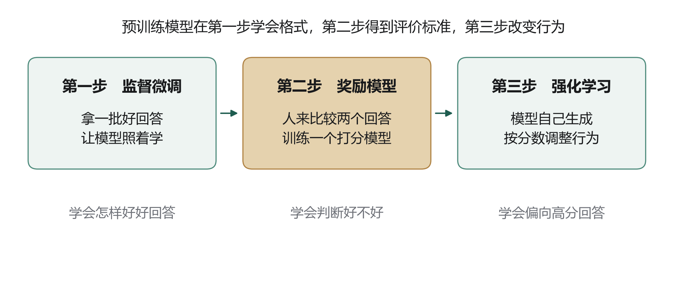

## 大模型为什么用强化学习：三句话说清 RLHF

一个语言模型预训练完之后，能做很多事：续写文章、翻译、回答问题、写代码。但它也有让人头疼的毛病：有时会编造事实，有时会顺着用户的错误前提往下说，有时答得很长却没什么用。

这些毛病不能靠“多喂点数据”解决，因为它们不是知识问题，而是行为问题。模型知道正确答案，但它不一定愿意按你希望的方式回答。让它更符合人的期望，靠的是强化学习这一类方法。这一章讲最常见的那套流程，通常叫 RLHF，人类反馈强化学习。

### 语言模型其实在做选择

先建立第一层类比。生成一段回答，是一个词一个词往外蹦的过程。每蹦一个词，就是一次选择。已经生成的文本是状态，下一个词是动作，词表就是动作空间。

有了这个对应关系，强化学习的整套语言都能套上去。策略是模型本身，参数就是策略的参数。轨迹是一整段回答。奖励是对这段回答的评价，可以是人打的分，也可以是一个模型打的分。

这个类比有一个不太自然的地方。语言模型的动作空间非常大，词表动辄十几万，而且每一步的选择都会影响后面所有步骤。棋类的动作空间也大，但至少规则明确、状态可枚举。语言的状态是无限的，任何一句话都可能出现。这个差别让训练变得困难，后面会具体讲。

### 三阶段

RLHF 的标准流程分三步。这套流程在 2022 年的一篇论文里被系统地描述过，之后成了行业惯例。

第一步是**监督微调**（supervised fine-tuning，SFT）。收集一批高质量的回答，用普通的监督学习让模型模仿。这一步教的是“什么叫好好回答”，格式、语气、长度、结构，都在这一步定型。没有这一步，后面的强化学习会在一个完全没有章法的模型上乱试，很难收敛。

第二步是训练**奖励模型**（reward model）。让模型对同一问题的多个回答做比较，人来判断哪个更好。这些比较数据训练出另一个模型，它输入一段问答，输出一个分数，代表这段回答有多好。用比较而不是打绝对分，是因为人对“哪个更好”的判断比“打几分”更一致。

第三步是用强化学习优化策略模型。模型生成回答，奖励模型打分，用这个分去更新模型参数，让它更倾向于生成高分回答。常用的算法是 PPO，也有后来出现的 DPO 等替代方案。

图 12-1 画的是这三步的关系。第一步教格式，第二步学评价，第三步按评价调行为。

### 为什么不能直接让奖励模型当老师

有人会问，既然有了奖励模型，为什么不直接用它的分数做监督学习，非要绕一圈做强化学习？

原因是奖励模型只给分，不给答案。它告诉你这段回答得 8 分，那段得 6 分，但不会告诉你 8 分的回答长什么样。要用这个信号，模型必须自己生成候选，然后根据分数调整生成这些候选的概率。这正是强化学习在做的事。

还有一层原因。如果直接用奖励模型的分数做监督学习，你需要给它一批标准答案，而标准答案往往就是人类写的，那又回到了模仿。强化学习允许模型自己探索，生成人类没想到但同样好的回答。这是它比纯模仿更有潜力的地方。

### 这一步改了什么

RLHF 的效果在公开的对比里相当明显。2022 年那篇论文报告，一个 13 亿参数的模型经过这套训练后，在人类评价里比 1750 亿参数的原始模型更受欢迎。参数差了一百多倍，说明“行为对齐”和“知识量”是两件不同的事。

实际用起来，变化主要体现在几个方面。回答更愿意配合，不会一上来就说“我不能”；格式更符合期待，该列点的时候列点；遇到不确定的问题，更倾向于承认不知道，而不是编一个答案；有害内容的拒答更稳定。

代价也有。模型可能变得过于保守，该回答的也拒答。可能变得啰嗦，为了显得周到而重复。还可能学会迎合评价者的偏好，而不是给出真正正确的答案。这类问题统称为对齐税，是这套方法要付的代价。

### 这套流程的麻烦

RLHF 在工程上很重。要有人标注偏好数据，要训练和维护一个奖励模型，要在训练中反复采样，还要处理 PPO 本身的不稳定。三四个模型同时在显存里，成本很高。

更麻烦的是奖励模型会被钻空子。策略模型在优化过程中会找到奖励模型的弱点，生成一些在奖励模型看来分很高、在人看来很糟糕的回答。这个现象叫**奖励黑客**（reward hacking），是 RLHF 最让人头疼的问题之一。

于是有了后来的简化路线。有的方法试图绕开奖励模型，直接用偏好数据优化策略，代表是 DPO。有的方法试图绕开人类偏好，用可以自动检查的答案做奖励，代表是近两年在数学和代码任务上大放异彩的可验证奖励训练。

下一章讲这条新路线。它让模型学会了在回答之前先想一会儿，也让“推理”这件事第一次变成了可以用强化学习直接训练的能力。
