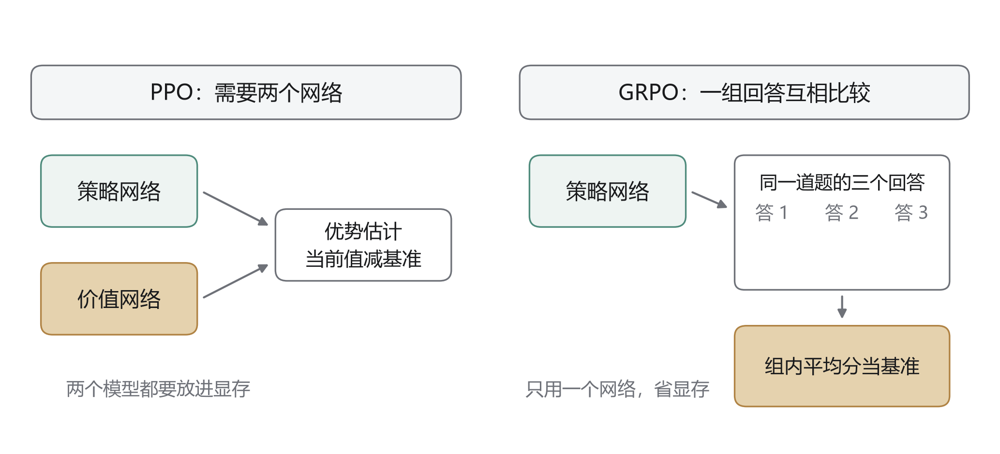

## 让模型自己检查答案：可验证奖励与推理模型

2024 年秋天，一类新的模型开始出现。它们在回答之前会先写一段很长的思考过程，把问题拆开，试几种思路，发现走错了就退回来。数学题和编程题的成绩明显提高，代价是回答变慢、变贵。

这类能力是怎么训练出来的？公开的资料指向同一条线索：当答案可以被自动检查时，强化学习就有了一个不会骗人的奖励来源。这一章讲这条线索，以及它为什么有效、在哪儿失效。

### 一个不会说谎的奖励

人类偏好有两个问题。第一贵，标注要花钱花时间。第二不可靠，不同标注者对同一个回答的判断可能相反，而且容易被表面特征带偏，比如更长的回答看起来更认真。

但如果任务是解一道数学题，答案对不对是可以自动判断的。模型输出一个数，和标准答案一比就知道。编程题更直接，跑一遍测试用例，通过就是通过。

这种奖励叫**可验证奖励**（verifiable reward）。它的好处很明显，不需要人，不会有偏见，不会疲劳，可以无限次给出判断。用它做强化学习，训练信号干净得多。

“干净”具体指三件事。一是一致，同一份答案今天判对，明天还是判对，人做不到。二是便宜，写验证器的成本是一次性的，跑一万次和跑一次差不多，人类偏好相反，每多一条数据就多一份钱。三是可追查，答案错在哪一步能定位到，人只能给一个笼统的低分。

但不会说谎是相对的。验证器是人写的，规则有漏洞它就会说谎，而且说得比人更系统。人判断错了会犹豫，程序判断错了会稳定地错无数次。后面专门讲验证器怎么写，主要就是防这件事。

表 13-1 是两种奖励来源的对比。

::: {.tabcap}
表 13-1　人类偏好与可验证奖励的差别
:::

| 维度 | 人类偏好 | 可验证奖励 |
| --- | --- | --- |
| 成本 | 每条都要人看 | 一次写好，反复使用 |
| 一致性 | 标注者之间会分歧 | 同一答案永远同一结果 |
| 速度 | 受人力限制 | 跟算力走 |
| 覆盖面 | 几乎所有任务都能标 | 只有能被程序判定的任务 |
| 主要风险 | 偏见、疲劳、被表面特征带偏 | 规则漏洞被系统性利用 |

英文里这个过程常被写成 RLVR（reinforcement learning with verifiable rewards，带可验证奖励的强化学习）。它不是一种新算法，而是把已有的算法用在一个特殊设定的奖励上。策略梯度还是策略梯度，换的只是打分那一环。

### 为什么数学和代码先突破

可验证奖励能用的任务有一个共同点，答案能被程序判断。数学题、代码题、逻辑推理、格式转换，都属于这一类。

这些任务恰好还有另一个特点，正确率可以随思考长度提高。一道难题，多想一会儿、多试几种解法，做对的概率会上升。这给了强化学习发挥的空间，模型可以通过调整“想多久、怎么想”来提高得分。

相比之下，写文章、做咨询、判断一段话是否得体，没有客观的对错，也没有“多想一会儿就更对”的保证。这些任务仍然要靠人类偏好，进步慢得多。

所以过去两年推理能力的提升，很大程度上是“可验证任务”这个窄领域的突破，不是所有任务一起变强。看清这一点，读新闻时就不会被“模型学会了推理”这种笼统说法带偏。

把条件说得严格一点，要同时满足三条。答案能被程序判定，这是硬条件。思考长度能换来正确率，如果多想不会更对，强化学习只会学到“别想太久”。答案空间有结构，错误能定位到某一步，写一段产品文案就没法说第三步写错了。

还有一层误解值得拆开。“模型学会了推理”容易让人以为推理是通用的。实际观察到的迁移弱得多，数学题上练出来的思考习惯，换到需要常识判断的问题上帮助有限。

### 2024 年之前和之后

用可验证奖励做强化学习不是 2024 年的新想法。数学题自动判分、代码跑测试，这些做法在更早的模型上就有实验，只是那时被看成针对特定任务的技巧，没人认为这是一条通往通用推理的路。

真正的转折有两个标志性事件，分别来自两家公司。

第一个是 OpenAI 的 o1。OpenAI 2015 年成立，2022 年底用 ChatGPT 把大模型带进公众视野，此后的 GPT-4 走的是“预训练加人类偏好对齐”的路线。2024 年 9 月，OpenAI 发布 o1，第一次公开把“用强化学习训练模型生成思考过程”当成核心卖点。训练细节没有公开，公开的说法是，让模型在回答前生成一段内部推理，再用强化学习奖励那些能得出正确答案的推理路径，思考越长，效果越好。

o1 在竞赛数学和博士级科学题上的成绩比 GPT-4o 高出一大截，日常闲聊却没有同步提升。这个不对称说明它不是全面变聪明，而是某一类能力被单独加强了。三个月后，OpenAI 又放出 o3 的消息，继续把“推理时多花算力”往前推。

o1 的意义在于示范。它让整个行业相信，推理能力可以像其他能力一样被训练出来，而不是只能等模型变大。但它闭源，训练细节不公开，很多团队只能猜。

第二个是 DeepSeek 的 R1。DeepSeek 是一家中国公司，2023 年成立，背后是做量化交易的幻方，创始人梁文锋。它在 2024 年先靠 V2、V3 两款模型打出“低成本”的名声，V3 是一个总参数很大、每次只激活一小部分的混合专家模型。同一年，它的数学模型 DeepSeekMath 提出了后来被广泛使用的 GRPO，把 PPO 里的价值网络省掉，用同一道题的一组回答互相比较。

2025 年 1 月，DeepSeek 发布 R1。它先做了一个实验叫 R1-Zero，完全不做监督微调，直接从基础模型上用可验证奖励做强化学习。结果模型自己学会了写长推理、回头检查、在出错时停下来重想，论文里把某个时刻称为“顿悟”。R1-Zero 也有明显毛病，语言混杂、可读性差。正式版 R1 加了冷启动数据、拒绝采样和蒸馏，把能力稳住，并把模型权重以宽松许可开源。

这里出现的四个词，先各用一句话解释。**冷启动**，指先用少量人写的推理范例做监督微调，让模型知道“思考”该长什么样、该写多长，避免一上来就胡写。**强化学习**，指让模型自己生成大量回答，按答案对错调整“生成这类回答的概率”，答对的路径以后更常出现。**拒绝采样**，指生成很多回答，只把答对的留下来，用这些好样本再做一轮微调，把偶然的成功固化成习惯。**蒸馏**，指用大模型生成的数据去训练小模型，把大模型的能力搬到小模型上。后面有一节会把四步逐条展开，这里先知道各自在做什么。

R1 的冲击有两层。技术上是配方公开，冷启动、强化学习、拒绝采样、蒸馏四步都写清楚了，小团队可以照着做，之后几个月出现了大量复现和蒸馏版本。商业上是价格，R1 的推理服务定价远低于同级别的闭源模型。2025 年 1 月底，英伟达股价单日大跌约一成七，市值蒸发数千亿美元，市场第一次认真讨论“训练和推理的成本是不是被高估了”。

两家公司的路线正好相反。OpenAI 走闭源、大规模、先发示范；DeepSeek 走开源、低成本、把配方摊开。共同点是都证明了同一件事，当答案可以被自动检查时，强化学习能把模型“偶尔做对”变成“经常做对”。之后的一年，带思考过程的模型成了各家产品的标配，差别只在开放程度和价格。

为什么是这个时间点，有三个前提。基础模型要够强，如果它做很多次全错，所有回答的奖励都是零，组内比较算不出任何优势，训练根本没有起点。推理的工程要跟上，训练时要同时生成几十上百条长回答，显存和调度的压力跟单条生成不是一个量级。题目要现成，教材习题、竞赛题、开源代码库、单元测试数量巨大而且免费。换一个领域，光是造题和写验证器就可能要几年，数据便宜是这条路线能快速铺开的一个不太被提起的原因。

### 训练是怎么跑的

流程并不复杂。给模型一道题，它生成一段包含推理和最终答案的回答，程序提取答案，和标准答案比对，对就给正奖励，错就给零。然后用这些带奖励的样本更新模型。

图 13-1 是这条流程。

真正的难点在细节。

答案怎么提取。模型可能写了一大段推理，最后才给出答案，也可能中途改了好几次。程序要能稳定地找到“最终答案”是哪一段。格式不统一，校验就会出错，奖励信号就脏了。

题目怎么选。太简单的题，模型全对，没有学习信号；太难的题，模型全错，也没有信号。实践中会维护每道题的历史正确率，优先选那些正确率在中间地带的题。

长度怎么控。模型很快会发现，写得越长，碰巧答对的概率越高。如果不加约束，回答会越来越长，训练成本上升，实际使用也变慢。

组怎么采。同一个问题通常采样多个回答，用组内的相对好坏来估计优势。这就是 GRPO（group relative policy optimization，组相对策略优化，2024 年提出）的思路，后面会讲。

把一道题走一遍会更具体。假设标准答案是某个整数，模型生成八个回答，每个末尾把结果写在约定位置。程序抽出结果比对，假设三个对一个五个错。分数不用零做基准，而用这一组八个的平均水平，比平均好的加分，比平均差的减分。

### 一条推理轨迹长什么样

公开资料里对“思考过程”的描述很笼统，具体到一条轨迹，它大致有这么几段。

开头是把题目重述一遍，把已知条件列出来，把要求的量标出来。这一段看起来多余，实际作用不小，它逼模型先把题读对，避免看错一个数字就往下算。

中间是试错。写一种解法，算到一半发现不对，划掉，换一种。好的轨迹里这种回头很常见，而且回头时会写清楚“刚才哪一步错了”。

然后是验算。把得到的答案代回原式，或者用一个特殊值试一下，看是否一致。

最后是结论。把答案放在约定位置，方便程序提取。

这四段不是硬规定的，是训练里自然长出来的。程序并不知道哪一段是“思考”，它只知道整段回答末尾的那个数对不对。所以模型学到的不是“该这么写”，而是“这么写更容易得分”。

一个反例能说明区别。假如题目是求一个数列的第几项，模型可能写了一大段看似严密的推导，最后把答案猜对。奖励是满分，但这段推导里可能有一半步骤是装饰。训练多了，模型会学到“装饰性推导加一个正确的数”也是一种有效策略，因为奖励只看最后的数。这就是为什么后面要专门讲验证器的漏洞。

### 题库本身也会错

讨论验证器漏洞时，很容易忽略另一头，题目和标准答案也可能错。

第一种是答案标错。教材习题、竞赛题在网上流传的版本里，错误答案不少。模型做对了被判错，这比漏放更伤，因为它会把正确的思路惩罚掉。这类噪声不需要很多就能造成影响，一个班里有一个错答案，模型在那道题上的学习方向就是反的。

第二种是题目有歧义。同一道题可以理解成两种问法，两种答案都能自圆其说。标准答案只收了一种，另一种被判错。语文题、应用题、带单位的物理题都容易出这种事。

第三种是多解。答案形式不唯一，比如结果可以写成小数也可以写成分数，可以带单位也可以不带。提取规则如果只认一种，其余的会被误杀。

第四种是污染。训练题库里混进了评测集的题。表现是训练中正确率涨得很快，评测时却没有同步提升。查的办法是做近似重复检测，把训练题和评测题逐一比相似度。这一步在公开的报告里经常被省略，因为它不好看。

第五种是难度标签漂移。题目的难度是用早期模型估的，模型变强之后，当初的难题变成了简单题。如果不重新估，训练集里会堆满零方差样本。

这五种错误里，前三种靠人工抽检能抓到大半，后两种必须靠工具。题库不是一次性建好就不管的东西，它要跟着训练一起维护。

题库还有一个现实问题，规模。真正高质量的竞赛题只有几万道，而一次大规模训练要几十万条采样。所以题目会被反复使用，同一道题在不同轮次里出现很多次。反复使用本身没问题，但要注意两点。一是同一道题不宜在相邻批次里连续出现，否则模型会短期记住答案；二是每道题的采样次数要记录，否则某些题会在损失里占据过大的权重。

### 模型自己长出了什么

训练中观察到一些有意思的现象。

模型开始写更长的推理过程。它在解题前会把条件列出来，把中间步骤写清楚，有时还会检查一遍。

模型开始尝试多种解法。一条路走不通，它会退回来换一条。

模型开始自我纠正。写到一半发现矛盾，它会标记出来重新算。

这些行为在监督数据里不一定有，是从“答对得分”这个信号里自己长出来的。文献里把这类现象叫涌现。用词要谨慎，因为容易被过度解读。准确的说法是，这些行为在训练过程中出现了，而且和得分提高相关。至于它们是不是真的在“推理”，还是只是学会了某种更容易得分的文本模式，目前还有争论。

公开报告里还提到更细的变化。主动罗列已知条件，做完之后回头代入验算，一条路走不通时写下“换一个”，先做数量级估计判断答案范围。这些有一部分可能来自冷启动的人写示范，所以“自己长出来”要打个折扣，严格说是在训练中变得更频繁、更稳定。

有一个细节值得注意。模型写出来的思考过程，未必等于它实际的计算过程。有研究通过干预实验发现，改掉推理过程里的某一步，最终答案不一定变。这说明“写出来的推理”和“答案怎么来的”可能是两回事。推理训练确实提高了正确率，但把它当成“模型真的在想”，证据还不够。

想自己检验这件事，可以设计三种测试。改掉题目里的数字，看推理是否跟着改，还是照抄步骤只换结论；删掉中间的一步，看答案是否变化，如果毫无影响说明那一步没起作用；换个问法，看结论是否一致。结果往往是混合的，有的模型跟随得很好，有的只是在演算给评分者看。

### GRPO：去掉价值网络

在大模型上做 PPO 有一个实际的困难。PPO 需要一个价值网络来估计当前状态值多少，在大模型上这等于再放一个同样大的模型，显存和计算都要翻倍。

**GRPO**（group relative policy optimization）的做法是把这个估计换掉。对同一个问题，让模型生成一组回答，比如八个或十六个，算出每个回答的奖励，然后用这一组的平均分作为基准，比平均好的加分，比平均差的减分。

这相当于用“同题的其他回答”代替了“价值网络的预测”。省掉一个模型，训练更省资源，实现也更简单。这个方法在 2024 年的一篇数学推理论文里被系统使用，之后被很多团队采纳。

图 13-2 是两种做法的对比。左边是 PPO 的结构，策略和价值两个网络；右边是 GRPO，一组采样互相比较，不需要价值网络。

组内比较有一个前提，同一组回答之间确实有差别。如果所有回答都对，或者都错，组内就没有区分度，这一组数据提供不了有效信号。这也是为什么题目难度要筛选。

这个现象叫零方差。一组回答分数完全一样，偏离平均的程度全是零，算出来的优势也全是零，这组采样白花了。训练初期模型弱，大部分题全错；后期模型强，简单题全对。两头都是零方差，中间那一段才有信号。所以题库要覆盖很大的难度范围，还要定期重新估计难度。

还有一个连锁反应。模型会越来越自信，对同一道题的多个回答趋于一致，组内方差下降，信号变弱。训练到一定阶段出现平台期，不是模型学不动，而是这些题已经没有区分度。

### 一组回答怎么变成梯度

把这件事说具体一点，能看清为什么组内比较能代替价值网络。

假设一道题的八个回答里，三个对五个错。分数分别是 1 分和 0 分，组内平均是 0.375。那三个对的回答，各自的优势是 0.625；五个错的，优势是 0.375。模型被要求提高前者的生成概率，降低后者的。

这个做法有一个隐含的基准，就是同一道题的难度。难题全错的时候，组内平均是零，所有人都没被惩罚，因为大家都一样差。容易题全对的时候，所有人也都不被惩罚。只有出现参差，才有信号。

所以“全对”和“全错”都是无用的样本，这解释了为什么题目筛选这么重要。它不是为了省钱，而是因为这两种样本在数学上贡献为零。

还有一种细节，同一组里答对的三条可能长度差很多。如果不对长度做处理，长的那条会在损失里占更大权重，因为它是逐词累加的。有的实现按词数平均，有的按整段求和，两种做法会让模型学到不一样的长度偏好。这个选择要在实验记录里写清楚。

### 验证器怎么写

可验证奖励的核心是验证器。它决定了什么算“对”，也就决定了模型会学成什么样。写验证器比写训练代码更需要小心，训练代码错了会报错，验证器错了会安静地教出一个坏模型。

数学题的验证器看起来简单，提取答案，和标准答案比对。实际有不少坑。答案可能有多种等价写法，分数、小数、带单位、带根号。模型可能在中途给出多个候选答案，最后又改口。提取规则写得太死，正确的答案会被判错；写得太松，错误的答案会被放过。

代码题的验证器是测试用例。要覆盖正常情况、边界情况、异常输入。测试用例太少，模型会写出只对样例有效的代码；测试用例太多太严，正确的实现也会因为细节差异被判错。

还有一种验证器是格式检查。比如要求答案放在特定的标记里。这种验证器很容易被钻空子，模型会学会只写标记不写内容。所以格式检查通常只作为辅助，真正的奖励还是看答案。

有一类更容易忽略的错误，是把“格式对”当成“内容对”。标记写对了，内容随便填，验证器照样给分。这类漏洞一旦存在，训练会以极快的速度钻进去，因为钻空子比解题容易得多。

验证器写完之后，要拿一批人类做对的题去测。如果人类做对的题被验证器判错，说明验证器有问题，先修验证器，再训练。

这句话值得展开，因为顺序错了会浪费大量算力。准备两个小集合，一个装人做对的题，看误杀率；一个装人故意做错的答案，看漏放率。两个指标都达标，再开始训练。

代码题还有更彻底的办法。把一份正确代码故意改坏，改边界条件、换循环方向、调换两个变量，看测试能不能抓到。抓不到，说明覆盖不够。这个办法在软件工程里叫变异测试。验证器也只能检查自己能想到的错误，所以它要跟着训练不断补充，不是一次写完就结束。

### 训练崩掉的几种样子

这条路线看起来比偏好训练简单，因为奖励清楚，但崩起来很快，而且崩的方式很固定。

第一种是长度失控。平均回答长度一路涨，正确率涨一点，最后停在长度上限附近。曲线很好看，实际不可用。

第二种是语言混杂。模型在中文题里突然写英文，在英文题里突然写中文。R1-Zero 的公开报告里就提到过这个毛病。原因是基座模型的语料本来就是多语的，强化学习只关心答案对不对，不管用什么语言想。修的办法通常在冷启动数据里把语言统一。

第三种是格式坦塌。模型发现只写一个答案不写推理也能得分，于是慢慢不写了。这通常发生在验证器只看末段答案、不要求推理完整的时候。

第四种是重复循环。模型卡在同一个句子上反复写，直到撞上长度上限。这类样本奖励很低，但采样时依旧会生成，白白浪费算力。

第五种是提取失败率上升。模型开始用一种验证器抽不出来的写法，于是本来做对的题也被判错。这个信号很隐蔽，因为它看起来像“模型变差了”，实际是接口对不上。要单独监控提取成功率。

第六种是组内答案全一样。模型变自信之后，同一道题的八个回答趋于一致，方差为零，优势全为零。训练看起来在跑，实际没有梯度。

这六种里，前四种能通过看曲线发现，后两种必须靠专门的监控指标。工程上常见做法是每次记录一组健康指标：平均长度、截断率、提取成功率、零方差比例、平均奖励、奖励分布的形状。这几个数一起看，比只看平均奖励有用得多。

恢复的办法也要提前想好。强化学习一旦崩到某个状态，比如模型学会了输出空答案，靠继续训练几乎拉不回来。常规做法是保留检查点，崩了就退回去，同时调整数据或者奖励。这和监督学习不同，监督学习崩了降低学习率一般能救，强化学习崩了往往只能重来。

### 一个公开的配方

2025 年初，一个公开的推理模型把这条路线完整地展示了一遍。它的训练分几步。

先用少量高质量的带推理过程的样本做冷启动，让模型知道“思考”该长什么样，格式是什么，大概多长。这一步相当于给搜索一个起点，避免一开始就胡写。

然后做大规模的可验证奖励训练，题目覆盖数学、代码、逻辑，用规则判断对错。训练中会定期让模型对同一批题生成多个回答，保留那些答对的，作为下一轮的高质量数据。这一步叫拒绝采样。

最后是蒸馏。把大模型训练出来的推理能力，转移到小模型上，让小模型也具备类似的思考习惯。这一步让这套方法的影响扩散得很快，因为大多数人没有资源训练大模型，但可以微调小模型。

四步各自的必要性值得分开说。冷启动解决“连格式都没有”，基础模型没被教过分段思考，直接上强化学习会输出得千奇百怪，验证器抽不出答案。强化学习解决能力上限，题目里人没想到的有效思路靠它找出来。拒绝采样解决不稳定，把正确轨迹重新微调，等于把好行为固化下来。蒸馏解决扩散，小模型不必自己跑强化学习。

顺序不能随便换。没有冷启动，强化学习抽不出答案；没有强化学习，拒绝采样没有好轨迹可留；没有中间两步，蒸馏出来的小模型只会模仿格式，不会真的解题。

这套配方里没有特别新的算法，关键在数据筛选和训练流程的设计。它说明了一件事，在大模型上，工程细节往往比算法创新更决定成败。

### 蒸馏那一步

蒸馏听起来只是“把大模型的数据拿来训小模型”，实际上它决定了这套方法能走多远。

第一步是造数据。让已经训好的大模型对题库里的题大量作答，只保留答对的那些，连推理过程一起收集。一批题可以每题采十几次，筛出几条合格的，规模就从几万道题变成几十万条轨迹。

第二步是筛选。只留答对的还不够。轨迹可能又长又乱，可能中途打过自己的脸，可能最后靠猜。常见的筛法是看长度是否在合理区间、格式是否规范、最终结论是否和前文一致。这一步的尺度很难定，筛太严数据量不够，筛太松把毛病一起搬过去。

第三步是训练。把选中的轨迹当成监督数据，让小模型逐词模仿。这一步和普通的监督微调没有区别，用的还是交叉熵。

这里有一个天花板要认清。小模型能学到的上限，受它自己的容量限制。同一批数据，给一个大模型和一个很小的模型，前者能学到思路，后者往往只能学到格式。表现出来是小模型学会了“先复述条件再分步写”，但写出来的步骤经不起推。

还有一个容易忽略的差异，老师会犯错，学生只能模仿。大模型偶尔走错路又碰巧答对，这条轨迹也会被留下。小模型没有能力分辨，会把这套走法当正确示范学下去。所以蒸馏版本在难题上的正确率，往往比老师低一截，不只是因为它小，也因为它把老师的错误一起学了。

蒸馏最有价值的地方在成本。一个团队不可能自己跑大规模强化学习，但可以拿开源模型的数据微调自己的模型，成本降两三个数量级。这也是为什么 R1 开源之后几个月里，各种小尺寸的推理模型突然到处都是。

代价是能力被锁在老师的分布里。学生不会超出老师，尤其不会在学生自己的失败样本上学到东西。真正靠强化学习练出来的能力，靠蒸馏是复制不了的，只能复制结果，复制不了过程。

### 冷启动的那几百条数据

这套配方里最不起眼的一步是冷启动，数据量往往只有几千条，比重训一步的算力开销小得多，但它决定了强化学习能不能开张。

这几千条要满足三个条件。格式统一，思考过程用同一种分段方式，结论放在固定位置。长度合适，太短学不到展开，太长会把模型带成一写就刹不住。内容正确，这一条最容易被忽略，冷启动数据里有一条错，后面强化学习会把它当成好样本反复强化。

数据的来源通常是强模型生成加人工筛。强模型生成能保证格式一致，人工筛能拦住明显错误。也有团队让专家直接从零写，质量高但成本高，只适合做种子。

冷启动数据里该不该包含错误示范，是个真问题。一种做法只放正确路径，让模型学“好”的样子。另一种做法故意放一些走到一半回头的轨迹，教模型怎么纠错。后者的麻烦是尺度难控，模型可能学到“先写错再改对”这个形式，而没学到真的检查。

量太少也不行。几百条只能教会格式，教不会多样性。遇到题型变化，模型会硬套那个格式。实践中这个数字通常在几千这个量级，并且要覆盖主要题型。

### 难度和长度怎么控

这两个因素直接决定训练能不能持续。

难度。太简单的题，一组回答全对，没有学习信号；太难的题，一组全错，也没有信号。做法是维护每道题的正确率，优先选正确率在中间地带的。正确率可以用最近的采样估计，定期更新。

这实际上是一种课程学习。模型变强之后，简单题自动被淘汰，难题逐渐进入训练集。课程不是人设计的，是数据统计出来的。

长度。模型有动力写得更长，因为长回答碰巧对的概率更高。控制办法有几种。设最大长度，超过就截断；在奖励里减掉长度项；按长度归一化，让长短回答的得分可比。

为什么长回答更容易对，值得多解释一句。写得越长，试过的路径越多，碰巧走到正确答案的概率越高。这和“推理更好”是两件事，在奖励上看起来却一样。更麻烦的是它会自我强化，长回答得分高，模型更倾向写长。不加干预，长度一路涨，正确率涨一点，成本和可读性都恶化，训练曲线却很好看。

这几种办法各有副作用。硬截断会让模型在末尾草草收尾；长度惩罚可能让模型该详细的地方也写得很短；归一化会改变奖励的尺度，让“短而错”和“长而对”难以比较。实践中往往组合使用，并且盯着平均长度这个指标。

还要盯截断率。大量回答撞到长度上限，可能是限制太紧，也可能是模型在钻长度的空子。

### 怎么判断推理模型是真的进步

看到“某模型数学成绩提升二十个点”这类说法，可以按四层去查。

第一层看题目。用的是不是公开题库。公开题库几乎肯定被训过，成绩里有多少是背下来的说不清。相对可靠的评测会用新题，比如新一年的竞赛题，或者自己构造的题。

第二层看指标。是单次作答的正确率，还是采样多次取多数的正确率。后者叫投票，它把算力当成了能力的一部分。两种指标都能报，但必须写清楚是哪种，否则没法比。

第三层看对比对象。是同一个模型的旧版本，还是另一个公司的模型。同一模型前后对比能说明训练有效，跨公司对比还掺了预训练、数据、规模等很多因素。

第四层看代价。达到这个成绩花了多少推理时间，多少输出词。一个想了三千词才做对的模型，和一个想三百词就做对的模型，在工程上不是一回事。

四层看完，大多数“突破”会落地成一个具体的事实，比如“在未见过的竞赛题上，单次正确率从三成提到五成，平均输出长度从五百词涨到两千词”。这句话信息量比“大幅提升”大得多，而且能判断值不值。

还有一层容易被忽略，退步。模型在数学上提升的同时，写作、多轮对话、指令跟随可能轻微变差。这类退化在只看单项成绩的报告里看不到。判断一个模型能不能用，要看它有没有在原来的强项上明显变差，而不只看新能力有多强。

### 为什么它比偏好训练便宜

两种训练的账单结构完全不同，这一点常被混着说。

偏好训练的钱花在三处。标注，每条对比都要人看，量大时是大头。奖励模型，要单独训一个和策略差不多大的模型。在线采样，每轮都要生成并打分。

可验证训练的钱也花在三处，但比例不一样。写验证器是一次性成本，写完就不花了。造题也是半一次性，可以从公开题库拉。剩下几乎全是算力，采样越长越贵。

这个差别导致两边优化的方向不同。偏好训练要拼命提高人的标注效率，用更好的指南、更强的模型预筛。可验证训练要拼命提高采样吞吐，把所有工程精力放在推理速度上。

有一个反直觉的后果。可验证训练里，钱可以买到更多样本，所以大机构有很大优势。而偏好训练里，钱买不到一致的判断，标注质量很难堆上去。这也是为什么开源社区能在推理模型上很快跟上，而在偏好对齐上差距一直存在。

### 它在哪里失效

可验证奖励的适用范围比想象中窄。

第一道限制是答案必须能自动检验。数学题有唯一答案，代码有测试用例，这些可以。写一篇有说服力的文章、给一个有商业价值的建议、判断一段话是否得体，这些没法用程序判对错。有些任务看起来可验证，其实是伪验证。比如总结一篇文章，可以用另一个模型打分，但那是学出来的判断，本质还是偏好奖励，只是换了来源。

第二道限制是模型会钻规则的空子。如果答案格式是填空，模型可能学会猜格式而不是真的解题。如果测试用例是公开的，模型可能记住用例而不是写出通用代码。这类问题和奖励黑客是同一类，只是发生在更具体的场景里。

第三，能力可能被窄化。在数学题上训练的模型，未必能把这套推理迁移到别的问题上。有研究观察到，某些在特定任务上提升明显的模型，换一个领域的题目就没有优势。这种衰减往往有梯度，同一个数据集上提升最大，同类型但不同来源的题小一些，需要常识的题几乎没有变化。这说明学到的东西可能比期望的更局部。

第四，训练不稳定。奖励只有对和错两种值时，组内所有回答都一样的情况很常见，这时候梯度几乎为零。需要靠采样策略、难度筛选、长度控制这些手段来维持信号。一旦训练崩溃，比如模型学会输出空答案来规避惩罚，恢复很困难，只能退回之前的检查点。

### 上线的真实摩擦

训练跑通只是第一步，这套模型放到产品里会碰上新问题。

第一是延迟。想两千词再答一句，用户要等很久。流式输出能缓解观感，但没有真正减少等待。常见的处理是把思考过程折叠起来不展示，或者对简单问题限制长度。哪些问题算简单，本身就是个分类问题。

第二是计费。思考的每个词都要算钱，它的成本往往超过答案本身。如果一个功能每月的开销里七成花在思考上，业务方很快就会要求压缩。这反过来影响了模型设计，很多团队会同时维护一个快模型和一个慢模型，根据问题分流。

第三是安全性。思考过程里可能写出不该写的东西，比如尝试绕开限制的推理、中间推出了敏感信息。展示给用户看有风险，不展示又会被质疑不透明。多数产品选择了不展示原文，只给一个“已思考多少秒”的提示。

第四是可重现性。同一个问题两次回答不同，因为采样有随机性，思考路径也不同。对客服、医疗、法律这类场景，这种不确定性很难接受。

这四条都不是算法问题，但它们决定了推理能力到底能用在多少场景。一个只在跑分上很强的能力，如果延迟和成本都不可接受，实际价值有限。

### 想得更久一点

与这条训练路线同时出现的，是**测试时计算**（test-time compute）的思路。训练时让模型学会推理，使用时再给它更多时间思考。

最简单的做法是采样多个回答再投票，答案出现次数最多的那个更可能是对的。复杂一些的做法是让模型自己检查，写完一遍再读一遍，发现错误就重写。还有的做法是训练一个模型专门给推理过程打分，指导搜索往哪个方向走。

这条路的效果在数学和代码任务上很明显，多花几倍的计算，正确率能提高一截。但它也有上限，模型不知道的东西，想多久也想不出来；而且推理长度和正确率的关系并不总是正相关，写得越长不一定越对，有时反而更容易在中途跑偏。

测试时计算和训练时计算在某种意义上是可替换的。多花算力在训练上，模型本身变强；多花在推理上，同一个模型想得更久。两条路都收益递减，实际系统往往两边都用一点。

### 和偏好训练是什么关系

把这一章和前面讲 RLHF 的那章放在一起看，两条路线在算法上几乎是同一个东西。都是让模型生成、给分、按分调参数，都有一步约束新模型不要离旧模型太远。差别只在奖励从哪来。

偏好训练的奖励来自一个学出来的模型，能覆盖任何任务，但会漂移、会被钻空子、成本随数据量线性增长。可验证训练的奖励来自一段程序，稳定、便宜、可追查，但只能覆盖能被判定的任务，规则里的漏洞会被系统性地利用。

所以两条路线站的位置不同。配合、礼貌、拒绝危险请求没有客观答案，只能靠偏好；解数学题、写能跑的程序有客观答案，用程序判分更可靠。实践里常常叠着用，先做偏好训练让模型愿意配合、格式规范，再做可验证训练把推理提上去。顺序反过来也能做，但效果差一些，因为不听话的模型在长流程里更容易跑偏，而可验证奖励只管答案对不对。

失效方式也不一样。偏好训练失效是模型变得谄媚、啰嗦、回避；可验证训练失效是钻规则空子、在窄领域过拟合。前者让人用起来不舒服，后者让人误判模型的能力。两种失效都不容易在训练曲线上看出来。

### 这条线的意义

把这一章和前面几章放在一起看，会发现一条清晰的线索。强化学习最早用来玩游戏，后来用来下棋，再后来用来让模型听话，现在用来训练模型的推理能力。

每一次扩展，改变的都不是算法本身，而是三件事：状态怎么表示，奖励从哪来，以及允许试错的空间有多大。语言模型把状态变成了文本，把动作变成了词，把奖励变成了人类偏好或者自动检验的结果。底下的那套试错、评估、改进的逻辑，一直没有变。

这也是这本书想传达的核心。新的名词会不断出现，但只要抓住状态、动作、奖励、策略、价值这几个词，就能把新东西放回熟悉的框架里。

下一次扩展来得很快。模型不只写答案，还要连续做几十步操作，靠工具和环境拿反馈。那里的奖励没有这么干净，麻烦也更多。再往后，视角会拉远，讲多智能体、模仿与离线、世界模型，最后回到实用，讲怎么读技术新闻。
