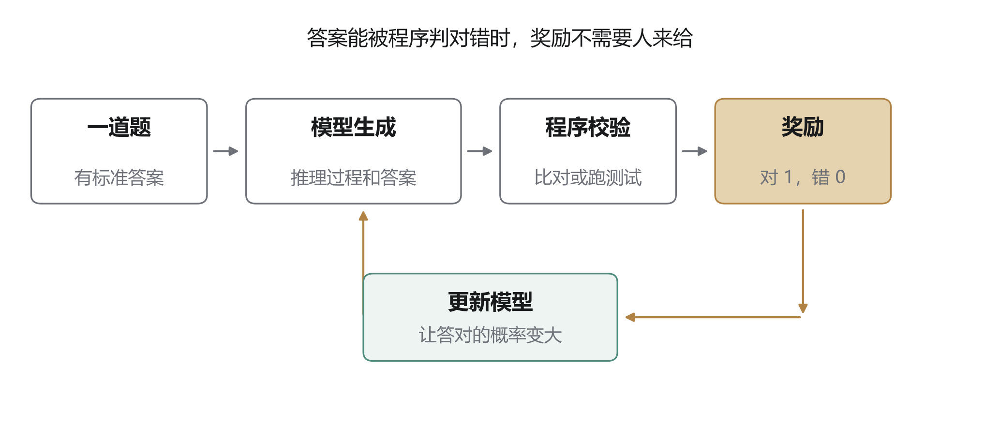

## 让模型自己检查答案：可验证奖励与推理模型

2024 年秋天，一类新的模型开始出现。它们在回答之前会先写一段很长的思考过程，把问题拆开，试几种思路，发现走错了就退回来。数学题和编程题的成绩明显提高，代价是回答变慢、变贵。

这类能力是怎么训练出来的？公开的资料指向同一条线索：当答案可以被自动检查时，强化学习就有了一个不会骗人的奖励来源。这一章讲这条线索，以及它为什么有效、在哪儿失效。

### 一个不会说谎的奖励

人类偏好有两个问题。第一贵，标注要花钱花时间。第二不可靠，不同标注者对同一个回答的判断可能相反，而且容易被表面特征带偏，比如更长的回答看起来更认真。

但如果任务是解一道数学题，答案对不对是可以自动判断的。模型输出一个数，和标准答案一比就知道。编程题更直接，跑一遍测试用例，通过就是通过。

这种奖励叫**可验证奖励**（verifiable reward）。它的好处很明显，不需要人，不会有偏见，不会疲劳，可以无限次给出判断。用它做强化学习，训练信号干净得多。

英文里这个过程常被写成 RLVR，意思是带可验证奖励的强化学习。它不是一种新算法，而是把已有的算法用在一个特殊设定的奖励上。

### 为什么数学和代码先突破

可验证奖励能用的任务有一个共同点，答案能被程序判断。数学题、代码题、逻辑推理、格式转换，都属于这一类。

这些任务恰好还有另一个特点，正确率可以随思考长度提高。一道难题，多想一会儿、多试几种解法，做对的概率会上升。这给了强化学习发挥的空间，模型可以通过调整“想多久、怎么想”来提高得分。

相比之下，写文章、做咨询、判断一段话是否得体，没有客观的对错，也没有“多想一会儿就更对”的保证。这些任务仍然要靠人类偏好，进步慢得多。

所以过去两年推理能力的提升，很大程度上是“可验证任务”这个窄领域的突破，不是所有任务一起变强。看清这一点，读新闻时就不会被“模型学会了推理”这种笼统说法带偏。

### 训练是怎么跑的

流程并不复杂。给模型一道题，它生成一段包含推理和最终答案的回答，程序提取答案，和标准答案比对，对就给正奖励，错就给零。然后用这些带奖励的样本更新模型。

图 13-1 是这条流程。

真正的难点在细节。

答案怎么提取。模型可能写了一大段推理，最后才给出答案，也可能中途改了好几次。程序要能稳定地找到“最终答案”是哪一段。格式不统一，校验就会出错，奖励信号就脏了。

题目怎么选。太简单的题，模型全对，没有学习信号；太难的题，模型全错，也没有信号。实践中会维护每道题的历史正确率，优先选那些正确率在中间地带的题。

长度怎么控。模型很快会发现，写得越长，碰巧答对的概率越高。如果不加约束，回答会越来越长，训练成本上升，实际使用也变慢。

组怎么采。同一个问题通常采样多个回答，用组内的相对好坏来估计优势。这就是 GRPO 的思路，后面会讲。

### 模型自己长出了什么

训练中观察到一些有意思的现象。

模型开始写更长的推理过程。它在解题前会把条件列出来，把中间步骤写清楚，有时还会检查一遍。

模型开始尝试多种解法。一条路走不通，它会退回来换一条。

模型开始自我纠正。写到一半发现矛盾，它会标记出来重新算。

这些行为在监督数据里不一定有，是从“答对得分”这个信号里自己长出来的。文献里把这类现象叫涌现。用词要谨慎，因为容易被过度解读。准确的说法是，这些行为在训练过程中出现了，而且和得分提高相关。至于它们是不是真的在“推理”，还是只是学会了某种更容易得分的文本模式，目前还有争论。

有一个细节值得注意。模型写出来的思考过程，未必等于它实际的计算过程。有研究通过干预实验发现，改掉推理过程里的某一步，最终答案不一定变。这说明“写出来的推理”和“答案怎么来的”可能是两回事。推理训练确实提高了正确率，但把它当成“模型真的在想”，证据还不够。

### GRPO：去掉价值网络

在大模型上做 PPO 有一个实际的困难。PPO 需要一个价值网络来估计当前状态值多少，在大模型上这等于再放一个同样大的模型，显存和计算都要翻倍。

**GRPO**（group relative policy optimization）的做法是把这个估计换掉。对同一个问题，让模型生成一组回答，比如八个或十六个，算出每个回答的奖励，然后用这一组的平均分作为基准，比平均好的加分，比平均差的减分。

这相当于用“同题的其他回答”代替了“价值网络的预测”。省掉一个模型，训练更省资源，实现也更简单。这个方法在 2024 年的一篇数学推理论文里被系统使用，之后被很多团队采纳。

图 13-2 是两种做法的对比。左边是 PPO 的结构，策略和价值两个网络；右边是 GRPO，一组采样互相比较，不需要价值网络。

组内比较有一个前提，同一组回答之间确实有差别。如果所有回答都对，或者都错，组内就没有区分度，这一组数据提供不了有效信号。这也是为什么题目难度要筛选。

### 验证器怎么写

可验证奖励的核心是验证器。它决定了什么算“对”，也就决定了模型会学成什么样。

数学题的验证器看起来简单，提取答案，和标准答案比对。实际有不少坑。答案可能有多种等价写法，分数、小数、带单位、带根号。模型可能在中途给出多个候选答案，最后又改口。提取规则写得太死，正确的答案会被判错；写得太松，错误的答案会被放过。

代码题的验证器是测试用例。要覆盖正常情况、边界情况、异常输入。测试用例太少，模型会写出只对样例有效的代码；测试用例太多太严，正确的实现也会因为细节差异被判错。

还有一种验证器是格式检查。比如要求答案放在特定的标记里。这种验证器很容易被钻空子，模型会学会只写标记不写内容。所以格式检查通常只作为辅助，真正的奖励还是看答案。

验证器写完之后，要拿一批人类做对的题去测。如果人类做对的题被验证器判错，说明验证器有问题，先修验证器，再训练。

### 一个公开的配方

2025 年初，一个公开的推理模型把这条路线完整地展示了一遍。它的训练分几步。

先用少量高质量的带推理过程的样本做冷启动，让模型知道“思考”该长什么样，格式是什么，大概多长。这一步相当于给搜索一个起点，避免一开始就胡写。

然后做大规模的可验证奖励训练，题目覆盖数学、代码、逻辑，用规则判断对错。训练中会定期让模型对同一批题生成多个回答，保留那些答对的，作为下一轮的高质量数据。这一步叫拒绝采样。

最后是蒸馏。把大模型训练出来的推理能力，转移到小模型上，让小模型也具备类似的思考习惯。这一步让这套方法的影响扩散得很快，因为大多数人没有资源训练大模型，但可以微调小模型。

这套配方里没有特别新的算法，关键在数据筛选和训练流程的设计。它说明了一件事，在大模型上，工程细节往往比算法创新更决定成败。

### 难度和长度怎么控

这两个因素直接决定训练能不能持续。

难度。太简单的题，一组回答全对，没有学习信号；太难的题，一组全错，也没有信号。做法是维护每道题的正确率，优先选正确率在中间地带的。正确率可以用最近的采样估计，定期更新。

这实际上是一种课程学习。模型变强之后，简单题自动被淘汰，难题逐渐进入训练集。课程不是人设计的，是数据统计出来的。

长度。模型有动力写得更长，因为长回答碰巧对的概率更高。控制办法有几种。设最大长度，超过就截断；在奖励里减掉长度项；按长度归一化，让长短回答的得分可比。

这几种办法各有副作用。硬截断会让模型在末尾草草收尾；长度惩罚可能让模型该详细的地方也写得很短；归一化会改变奖励的尺度。实践中往往组合使用，并且盯着平均长度这个指标。

### 它在哪里失效

可验证奖励的适用范围比想象中窄。

首先，答案必须能自动检验。数学题有唯一答案，代码有测试用例，这些可以。写一篇有说服力的文章、给一个有商业价值的建议、判断一段话是否得体，这些没法用程序判对错。

其次，模型会钻规则的空子。如果答案格式是填空，模型可能学会猜格式而不是真的解题。如果测试用例是公开的，模型可能记住用例而不是写出通用代码。这类问题和奖励黑客是同一类，只是发生在更具体的场景里。

第三，能力可能被窄化。在数学题上训练的模型，未必能把这套推理迁移到别的问题上。有研究观察到，某些在特定任务上提升明显的模型，换一个领域的题目就没有优势。这说明学到的东西可能比期望的更局部。

第四，训练不稳定。奖励只有对和错两种值时，组内所有回答都一样的情况很常见，这时候梯度几乎为零。需要靠采样策略、难度筛选、长度控制这些手段来维持信号。

### 想得更久一点

与这条训练路线同时出现的，是**测试时计算**（test-time compute）的思路。训练时让模型学会推理，使用时再给它更多时间思考。

最简单的做法是采样多个回答再投票，答案出现次数最多的那个更可能是对的。复杂一些的做法是让模型自己检查，写完一遍再读一遍，发现错误就重写。还有的做法是训练一个模型专门给推理过程打分，指导搜索往哪个方向走。

这条路的效果在数学和代码任务上很明显，多花几倍的计算，正确率能提高一截。但它也有上限，模型不知道的东西，想多久也想不出来；而且推理长度和正确率的关系并不总是正相关，写得越长不一定越对，有时反而更容易在中途跑偏。

### 这条线的意义

把这一章和前面几章放在一起看，会发现一条清晰的线索。强化学习最早用来玩游戏，后来用来下棋，再后来用来让模型听话，现在用来训练模型的推理能力。

每一次扩展，改变的都不是算法本身，而是三件事：状态怎么表示，奖励从哪来，以及允许试错的空间有多大。语言模型把状态变成了文本，把动作变成了词，把奖励变成了人类偏好或者自动检验的结果。底下的那套试错、评估、改进的逻辑，一直没有变。

这也是这本书想传达的核心。新的名词会不断出现，但只要抓住状态、动作、奖励、策略、价值这几个词，就能把新东西放回熟悉的框架里。

后面还有几章，把视角拉远，讲多智能体、模仿与离线、世界模型，最后回到实用，讲怎么读技术新闻。
