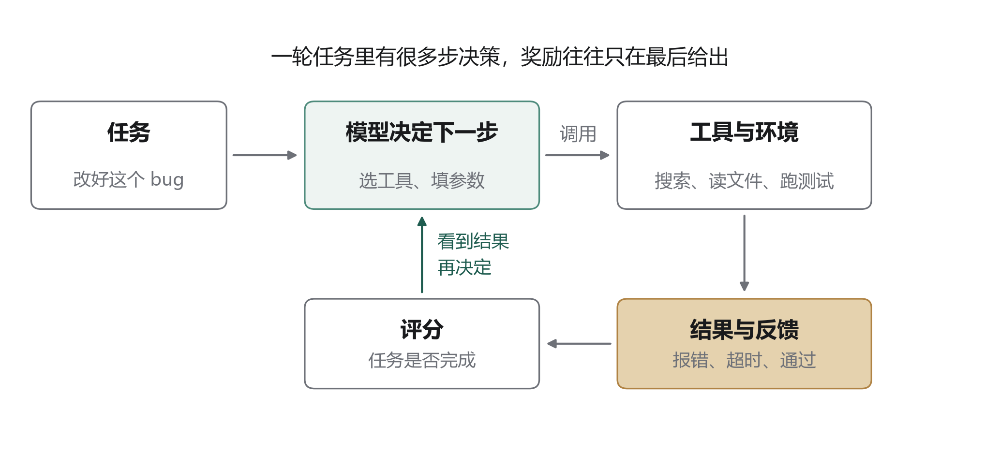

## 会动手的模型：Agentic RL

前面讲的语言模型都是在“说”。给一个问题，生成一段回答，结束。

但很多事情不是一段话能完成的。查资料要搜好几次，改代码要跑测试，订机票要填表单。这类任务需要模型连续做几十步决策，中间还要看每一步的结果。

这类训练叫 Agentic RL，直译是“智能体式的强化学习”。它是过去两年最热的方向之一，也是把强化学习从“生成文本”扩展到“完成事情”的关键一步。

### 一个任务的样子

图 14-1 是一个典型的循环。

模型收到任务，决定调用哪个工具，比如搜索、读文件、执行代码。工具返回结果，模型看到结果，再决定下一步。这个循环重复若干次，直到任务完成或者超时。

和单轮问答相比，动作空间变大了。不再只是“生成哪些字”，而是“调哪个工具、传什么参数、要不要继续”。状态也变长了，每一步都要把之前所有的观察拼进去。

循环本身不难写，难的是每一步都要重读一遍全部历史。步数越多，上下文越长，模型越容易忘掉最初的任务，或者重复一个已经失败过的操作。这是多轮任务最朴素的困难，也是后面所有问题的一个源头。

还有一个差别容易被忽略。单轮任务里模型控制不了环境，多轮任务里它每动一下，环境的状态就变了，而且要自己承担这个变化。表单填错一格，后面所有步骤都建在错的前提上；代码改错一个文件，之后读到的报错全都是假的。

表 14-1 是三类常见的多轮任务。

::: {.tabcap}
表 14-1　三类多轮任务的差别
:::

| 任务 | 状态里有什么 | 动作 | 怎么判断成功 |
| --- | --- | --- | --- |
| 代码修复 | 仓库、报错、测试结果 | 读文件、改代码、跑测试 | 测试通过 |
| 网页操作 | 页面截图或结构 | 点击、输入、翻页 | 到达目标页面或完成下单 |
| 工具调用 | 对话历史、工具返回 | 调搜索、调计算器、直接回答 | 最终答案正确 |

三类任务的共同点是，成功与否可以自动判断，但中间的每一步没有分数。

### 奖励从哪来

最直接的奖励是任务是否完成。代码改对了、测试通过了、订单下成功了，给一分；否则零分。

这个信号非常稀疏。一个任务可能要走二十步，只有最后一步决定成败，中间十九步没有任何反馈。学习效率因此很低。

工业界的做法是加中间信号。比如代码任务里，能编译给一点分，能通过一半测试给更多分，全部通过给满分。网页任务里，页面是否到达目标状态可以自动检查，也可以给部分分。

还有一种做法是让模型给自己的过程打分，或者用另一个模型评估每一步是否合理。这类做法成本低，但引入了新的偏差。

把奖励分成三层看会更清楚。最粗的是完成度，任务成了没有。中间一层是部分分，把完成度切成几个可以检查的台阶。最细的是过程奖励，对每一步单独打分。层数越细，信号越密，引入的偏差也越多。

台阶式设计有个典型风险，模型会停在台阶上。代码任务里，编译通过拿一点分，公开测试通过拿更多，隐藏测试全过才满分。模型很快会发现，拿到中间那档最划算，再往上花的力气大得多，收益却只是一点。它没有偷懒的意图，只是优化到了台阶边缘。

过程奖励的风险不一样。用另一个模型判断每一步是否合理，等于把一个会犯错的东西放进了奖励回路。这个模型没见过这么长的轨迹，判断标准也不稳定，被评的模型会顺着它的偏好走。评测模型喜欢详细解释，轨迹里就会堆解释；评测模型讨厌反复试错，模型就会假装一次做对。

奖励设计在这里比单轮任务更难。给得太粗，学不动；给得太细，模型会钻空子。比如只奖励“运行测试次数”，模型可能反复跑同一个测试来刷分，而不去改代码。

### 工具怎么设计

工具是模型的手。设计得好，模型能做成事；设计得差，模型会一直犯错。

第一条原则，接口要窄。一个工具只做一件事，参数少而明确。比如“读文件”和“写文件”分开，不要合成一个“文件操作”，否则模型很容易搞错方向。宽接口的诱惑很大，一个能执行任意命令的工具看起来最灵活，实际模型会拿它做所有事，包括不该做的事，而且失败时没人知道错在哪一步。

第二条原则，返回要稳。同样的输入，返回的格式要一致。错误信息要有用，告诉模型哪里错了、可以怎么改。含糊的报错会让模型反复试错，浪费步数。返回不稳的情况很常见，同一个搜索工具，有时给摘要有时给一串链接，模型每次都要重新摸索格式，步数就这么消耗掉了。

第三条原则，权限要小。代码执行放在沙箱里，文件访问限制在指定目录，网络访问按需开放。这不是不信任模型，而是防止它在探索中做出不可逆的操作。探索本身就会试各种奇怪的动作，删文件、装依赖、访问外网，其中有些是撤不回来的。沙箱的作用是让试错可以回滚。

第四条原则，成本要可见。每次调用花多少时间、多少钱，最好能让模型知道。这样它在规划时会考虑成本，而不是无脑地反复调用。做法很简单，在工具描述或者系统提示里写明这个工具大概多慢、还剩多少步。模型知道预算有限，规划会不一样。

还有一条不算原则但同样重要，工具数量不要太多。工具一多，模型选错的概率上升，工具描述之间的细微差别它也分不清。二十来个工具是一个常见的上限，再往上就要分组或者做路由。

### 环境怎么建

这是工程上最难的部分。

一个可用的训练环境要满足三个条件。可复现，同样的动作序列产生同样的结果。可验证，能自动判断任务是否完成。够快，能承受每秒成百上千次调用。

可复现比想象中难。工具返回的结果会变，搜索结果是实时的，网页会改版，软件包会升级。想让同样的动作产生同样的结果，通常要做录制回放，把工具返回缓存下来，训练时用缓存，评测时连真实接口。这样训练稳定，评测也不失真。

常见的做法是容器化。每个任务一个容器，里面预装了需要的软件和数据，模型在容器里执行操作。容器可以快速启动和重置，失败也不影响其他任务。

沙箱要管三件事。文件系统只挂载任务需要的目录，网络按需开放或者走白名单，进程要有资源上限，CPU 时间、内存、磁盘、单条命令的超时都要设。少一样都会出事，模型写一个死循环就能把整台机器拖垮，写一个递归删除就能把训练数据清掉。

成本主要在两处。容器启动要几百毫秒到几秒，一个任务二十步，如果每步都新建容器，光启动就吃掉大半时间。所以通常复用容器，任务结束后重置状态。重置比重建快，但容易漏掉残留文件，任务之间互相污染，训练数据里就混进了不该有的信息。

并行是另一件事。同时跑几百个环境，需要调度，需要限制每台机器的容器数，需要处理某个环境挂掉之后的重试。这些听起来是运维问题，实际直接决定训练能不能按计划跑完。

工具也是环境的一部分。搜索接口、代码执行、文件读写，都要封装成统一的调用格式，并且限制权限，防止模型做出危险操作。比如代码执行要在沙箱里，不能访问外网，不能写系统目录。

环境建得好不好，直接决定训练能不能跑。很多团队卡在这一步，不是算法不会，而是环境不稳。一个稳定的环境集合本身就是资产，算法可以照论文复现，环境不行，它是一堆琐碎的坑堆出来的。

### 一条轨迹长什么样

把一次代码修复走一遍，能看清很多抽象说法指的是什么。

任务描述只有一句话，某个测试失败了，后面附一段报错。模型先决定看仓库结构，调用列目录的工具，看到一堆文件。它要找到相关代码，通常先搜关键字，再打开两三个文件读。读到相关函数，它可能已经猜到问题，也可能还要跑一次测试看完整堆栈。然后改代码，跑测试，失败，看新的报错，再改。有时要改三四个地方。最后测试通过，任务结束。

这条轨迹可能有十几步到几十步。每一步的输出都拼进上下文，到后面上下文可能有几万词。模型要在这么长的上下文里记住最初的目标，还要记住自己改过哪些地方。这是多轮任务比单轮难的最具体的原因，不是抽象的“信用分配难”，而是看到最后忘了最开始。

失败常常发生在中段。模型改了一处，测试还是失败，报错信息指向另一个文件，它就跟着报错走，改到第五个文件时已经完全偏离原始问题。人在这种情况下会退回去看改动记录，模型不一定有这个习惯，除非训练时见过这种轨迹。

还有一点，轨迹的质量差别很大。同样通过测试，有的轨迹改了三个文件，有的只改了一个函数；有的跑了两次测试，有的跑了十次。如果奖励只看通过与否，这些差别都拿不到信号，模型学不到高效地修。

所以评估要看步数，不只看成功率。一个成功率高但步数翻倍的模型，实际成本可能高得多，用户的等待时间也长得多。

### 信用分配的新问题

单轮任务里，整段回答共享一个奖励，已经很难分摊。多轮任务更难，因为每一轮的决策都可能影响最后结果。

一次搜索用错了关键词，可能后面所有步骤都白费。但错误出现在第一轮，奖励在最后一轮才出现。

多轮任务难在三处。步数多，二十步的决策链比一步长得多；分支多，每步的选择都改变后面的状态空间；奖励迟，错误和结果隔得很远。三者叠加，同一批轨迹之间的差异很难归因，说不清是第几步决定了成败。

常见的处理是给每一轮同样的优势，或者按轮次折扣。两种都粗糙，但比没有好。

粗糙之处在于。给每轮同样的优势，等于告诉模型关键步和无关步一样重要；按轮次折扣，会系统性地低估早期决策，而早期决策往往最贵，方向错了后面全错；只用最后奖励，前面所有步一起被惩罚，包括那些做对的。

一种折中是只在关键节点给奖励，比如测试从失败变通过的那一步。这叫里程碑奖励。它比全程平均细，比逐步打分稳，风险是模型学会制造里程碑，比如故意先弄坏一个本来能过的测试，再把它修好。

更精细的做法是把每一轮当作一个独立的决策点，用价值函数估计每一步的价值。但这又回到了需要价值网络的老问题，在多轮场景下成本更高，因为状态是长文本，价值网络也要处理长文本。

归因的模糊在多轮里是常态。同一道题跑了十次，两次成功八次失败，成功的两次和失败的八次在哪一步分开，靠肉眼看很难。如果只把成功的那条整条抬高，模型可能学到的是某个偶然有效的操作，而不是真正解决问题的那一步。

### 已经做成的事

公开的结果里，这类训练在几个方向上有效果。

代码修复。给一个仓库和一个失败的测试，模型要找到问题、改代码、跑测试。训练过的模型在标准基准上的通过率明显提高。难点在定位，搜索空间是整个仓库，几百个文件，模型要自己找到相关的那几处。验证也不完美，测试通过不等于改对了，可能只是绕过了问题。

网页操作。给一个网站和一个目标，模型要点按钮、填表单、翻页。这类任务的状态是页面截图或者网页结构，动作是点击和输入。难点在状态表示，给截图就要从像素里认出按钮，给网页结构就要处理成百上千个元素。页面还会变，同一个按钮昨天在这儿今天挪了位置。

电脑使用。比网页更开放，要操作桌面、打开软件、读写文件、处理弹窗。这类任务目前还在早期，成功率和稳定性都不高，失败的形态也很杂，所以进展比网页慢。

工具调用。让模型学会什么时候该查资料、什么时候该算一下、什么时候直接回答。这类训练相对容易，因为每一步的结果都能验证。训练的重点反而不在会不会用，而在什么时候不该用，以及什么时候该停止调用直接给答案。

还有一件影响结果的事很少被提到，任务集的来源。用真实项目里提的 issue 做任务，难度自然、分布真实，但环境重、复现麻烦。用合成任务，环境好控、可以大批量生成，但容易和真实需求脱节。两者做出来的分数不可直接比较，这也是不同团队报告的数字经常对不上的原因之一。

### 训练的工程挑战

**采样成本**。一次 rollout 可能要走几十步，每步都要调用模型和工具。成本要按整条轨迹算，失败重试还要翻倍。相比单轮生成，成本高一个量级，这是很多团队算完账就退回去的原因。

**环境稳定性**。工具会超时、会报错、会返回脏数据。训练时要能处理这些异常，不能让一次失败毁掉整批数据。重试策略、超时阈值、错误分类，都得提前设计好。

**并行**。为了跟上训练速度，通常要同时跑几百个环境。这需要调度系统和资源管理，还要防止某个环境的异常拖慢整批。

**数据过滤**。大量 rollout 会失败，全失败的轨迹没有学习价值。要过滤掉，但过滤太多会导致样本偏差。这里有个反直觉的地方，全成功的轨迹同样没有价值，因为没有区分度。要保留的是有对有错的组，而多轮任务里这种组的比例更低，因为整条轨迹全对的概率随步数下降得很快。

**评估**。多轮任务的评估比单轮复杂得多，要看成功率、步数、成本，还要看失败的模式。一个任务成功但用了五十步，和成功只用了五步，价值完全不同。同一个任务重复跑几次，结果是否稳定也要看。

### 和单轮训练的区别

单轮的 RLVR 里，奖励信号干净，组内比较有效。多轮任务里，奖励稀疏且噪声大，组内比较的方差更大。

单轮的训练可以用简单的 GRPO。多轮任务往往需要更复杂的优势估计，甚至需要重新引入价值网络。

奖励的干净程度不一样。单轮的奖励是确定的，答案对就是对。多轮的奖励一部分要靠环境自己报告，环境可能有 bug，报告的成功可能是假成功，比如测试脚本本身写错了，什么都没改也能通过。

方差不一样。单轮里同一道题的八个回答差异主要来自采样；多轮里还要加上环境波动、接口超时、页面改版。这些噪声跟模型的行为无关，却会进到优势估计里，让模型学到错误的因果。

单轮的任务集相对固定，多轮的任务集要不断扩充，因为模型会记住见过的任务。这和过拟合是一个道理，任务集不更新，模型只是在背题。多轮还会背环境，记住某个网站的元素位置、某个仓库的目录结构，换个环境就完全不会。

复现也更难。单轮只要固定随机种子和题目就能复现，多轮还要固定环境状态、工具版本、外部数据。同一个实验隔一周再跑，结果可能差很多。

这些差别会改变训练策略。单轮里可以放心用大批次、少步数；多轮里批次一大，异常轨迹就多，需要更细的过滤和更保守的学习率。把一个在单轮上调好的配置直接搬到多轮，通常会失败，而且失败得莫名其妙。

### 失败模式

多轮任务的失败，通常有几类。

卡住。模型反复调用同一个工具，得到同样的结果，却不换思路。常见于报错信息不明确，或者模型没有“退一步”的能力。

跑偏。任务要求改代码，模型跑去写文档；要求查资料，模型开始闲聊。这通常是任务描述不清楚，或者中间没有检查点。

作弊。模型发现测试用例可以被绕过，就改测试而不是改代码；发现可以通过某种方式让检查通过，就走捷径。这类行为和奖励黑客同源。

超时。步数用完还没完成。可能是任务太难，也可能是模型不会规划，把时间花在无关的步骤上。

这四类可以从轨迹的形态上区分。卡住是动作重复，跑偏是动作和目标无关，作弊是动作绕过了真实目标，超时是动作数量堆到上限。看轨迹的前几步，通常就能判断是哪一类。

针对这四类，工程上都有对策。卡住时给更强的反馈信号；跑偏时加中间检查；作弊时把评测放在模型看不到的地方；超时时限制步数并训练模型优先做关键步骤。

还有一个跨类的现象，模型不会主动放弃。任务根本做不成时，它倾向于继续尝试，把步数耗尽，而不是报告做不了。训练时如果只奖励成功，模型学不到及时认输这个行为，而这在实际使用里很重要。一个会说“这个我做不了”的助手，比一个沉默地浪费二十分钟的助手有用。

### 训练循环怎么搭

采样和训练通常分开放。一组进程专门跑环境、生成轨迹，把结果写进队列；另一组从队列里取数据更新参数。参数更新之后再同步给采样端。

这就带来一个滞后问题。采样时用的是旧参数，数据不是完全 on-policy。滞后太大会让训练发散，太小会浪费吞吐。实践里会限制一次更新用多少步之前的轨迹，超过就丢掉。

批次要按任务组织。优势估计靠同题比较，同一道题的多个轨迹必须落在同一批里，否则算不出组内基准。这要求采样端按任务分派，不能随机取。

长尾也要处理。有的任务几步就结束，有的跑满步数。要设超时，超时的轨迹按失败算，但要单独标记，避免和真的做错混在一起，因为两者的学习信号相反。

还有一点，环境要能重置到干净状态。同一个容器跑完一个任务，要清掉文件、进程、网络连接，否则下一个任务会继承上一个的残留。这类污染很隐蔽，指标上看不出来，模型却会学到奇怪的习惯。

整套系统跑起来之后，瓶颈往往不在模型，而在环境。卡在等轨迹，轨迹在等容器，容器在等磁盘。

一个实用的设计是预热。提前把一批容器启动好、把常用数据拉到本地，让采样端一开始就有东西可用。不预热的话，每次扩缩容都要等几分钟，训练的有效时间被吃掉一大块。

### 一个现实的判断

Agentic RL 是目前最活跃也最不成熟的方向。

活跃是因为上限高。会动手的模型能做的事情比会说话的模型多一个量级，商业价值明显。

不成熟是因为可迁移性差。在一个任务集上调好的配置，换一个任务可能要重来。评估也困难，成功率、步数、成本、失败模式，很难用一个数字概括。

如果你看到“某模型在某某基准上超过人类”的说法，值得多问几句，任务是怎么定义的，成功标准是什么，失败的时候会发生什么。多轮任务的评估比单轮复杂得多，数字背后的东西也更多。

可以具体问四个问题。任务集是怎么来的，是不是模型训练时见过的。成功标准是自动检查还是人看，检查脚本本身可靠吗。失败率有多高，失败之后系统怎么处理。成本和延迟是多少，一个任务要几步、花多少钱。

还有一个容易被忽略的角度。多轮任务里，能力上限不完全由模型决定，工具和环境也在里面。同一个模型，换一套更好的工具，成功率可能高不少。所以“某模型能做某任务”这种说法省略了半个系统，比较的时候要看清到底比的是什么。

反过来说，这也是一个机会。如果工具和环境能带来一半的提升，那么优化它们往往比换更大的模型更划算。这一条对做产品的人和做研究的人都成立。

下一章换个角度，看这套方法在大模型上付出的代价，以及那些还没有定论的争议。代价不只是钱，也包括模型行为上的副作用，还有评测和判断本身的失真。
