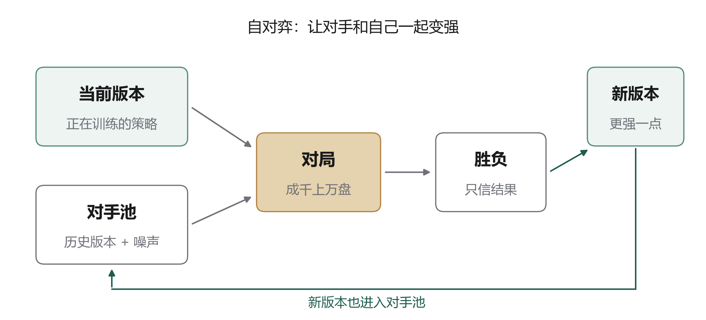

## 不止一个智能体：博弈与自对弈

到这里为止，环境都是“死”的。规则固定，不会因为你变强而变强。

现实里很多场景不是这样。你在下棋，对手也在学；你在竞价，别人也在调策略；你在谈判，对方的反应取决于你的态度。这类问题里，环境里包含别的智能体，它们和你一起变化。

### 环境变成了对手

单人强化学习假设环境是固定的，所以可以慢慢学，学到收敛为止。

多智能体的问题在于，这个假设不成立。你改进了策略，对手的最优应对也会变，你的旧策略可能立刻失效。

一个直观的例子是猜拳。如果你的策略是固定的，对手观察几次就能克制你。唯一的解法是保持随机。这个道理在前面讲策略时提过，多智能体把这个问题放大到了整个学习过程。

这种“策略互相追逐”的现象叫非平稳。它让收敛的保证失效，也让评估变得困难。你测出的胜率，只对当前这个对手成立。

### 自对弈

最成功的应对办法是自对弈。让智能体和自己下，对手和它一起进步。

图 16-1 是这个循环。

每一轮，当前版本和一批对手版本对局，赢了就更新，输了就保留旧的。对手可以是历史版本的存档，也可以是加了噪声的当前版本。

这个办法的好处是，对手永远和你在同一个水平线上，不会太难也不会太简单。而且不需要人类数据，规则本身就提供了答案。

AlphaGo Zero 用这个方法，从随机下起，三天自我对弈约五百万局，以一百比零战胜了击败李世石的版本。AlphaZero 把它推广到国际象棋和将棋，同样达到了顶尖水平。

### 博弈的几种类型

不是所有多智能体问题都是对抗的。

零和博弈，一方赢就是另一方输，比如棋类、竞技游戏。这类问题里，自对弈很自然。

合作博弈，大家一起把一个共同目标做好，比如多机器人协作搬运。这类问题里，难点在于协调和信用分配，谁该为成功负责。

混合动机，既有合作又有竞争，比如拍卖、谈判、交通。这类问题最接近现实，也最难。

不同的博弈类型，算法设计差别很大。零和可以用极小极大，合作需要设计共享奖励，混合动机往往没有唯一的“最优”，只有均衡。

### 大规模的例子

2019 年，一个系统在《星际争霸 II》上达到大师级水平，用的是多智能体训练加人类回放数据。游戏里有战争迷雾、有长期规划、有大量单位需要同时控制。

同年，另一个系统在 Dota 2 的五对五对局中战胜了世界冠军队伍。它的训练方式是自我对弈，五个智能体共享一个策略，通过大量对局学会配合。

这两个案例说明，多智能体强化学习可以处理非常复杂的问题。但它们的成本也高得惊人，训练用了成千上万的计算资源，跑了几个月。

### 大模型上的自对弈

最近两年，自对弈的思路被搬到了语言模型上。

一种做法是让模型扮演两个角色，一个出题一个解题，或者一个主张一个反驳，用对局的结果来改进。另一种做法是让模型生成多个候选，用某种方式评判优劣，把好的留下继续训练。

这类方法有效，但有一个前提，评判标准必须可靠。如果评判本身有偏，自对弈会把偏差放大，模型会越来越擅长讨好评判者，而不是变得更有用。

这也是自对弈在大模型上没有围棋上那么干净的原因。围棋的胜负不会骗人，语言的优劣没有唯一答案。

### 难点在哪

多智能体有几个绕不开的麻烦。

非平稳。前面说过，对手在变，环境就不是固定的，很多单智能体的收敛保证失效。

策略循环。石头剪刀布就是一个循环，没有哪个策略能稳定占优。学习过程可能一直在转圈。

信用分配。团队赢了，是哪个成员的功劳？团队输了，该怪谁？这个问题在合作场景里格外突出。

评估。胜率只对特定对手有意义，要评估一个策略的真实水平，需要一整个对手群体。

### 什么时候值得用

如果你的问题里确实有别的学习者，多智能体是必要的。比如交易策略、竞价、对抗训练。

如果对手是固定的人或者固定的规则，单智能体方法加一点随机化通常就够了，不必上多智能体。

如果只是想用自对弈来生成数据，那要特别小心评判标准。评测不可靠时，自对弈很容易变成自我强化。

下一章讲另一条路。它不靠试错，而是靠看别人怎么做。
