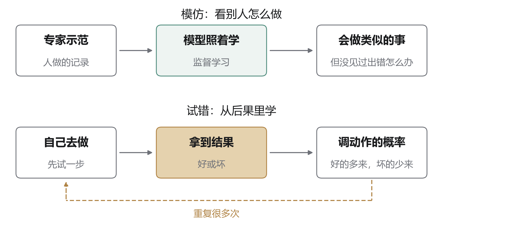

## 看别人怎么做：模仿学习与离线强化学习

强化学习的前提是能试错。但有些场景不能试。自动驾驶不能拿真车撞，医疗不能拿病人试，工业设备不能随便停机。

这些场景里，数据是现成的，只是没有“试错”的机会。这一章讲两类方法，一类从示范里学，一类从历史数据里学。

### 示范是最好的起点

最直接的想法是模仿。有人会做这件事，把他的操作录下来，让模型照着学。

自动驾驶里有大量人类驾驶数据，机器人操作有遥操作记录，游戏有高手录像。这些都是示范。

模仿学习的做法非常朴素，把“看到什么”当输入，“做了什么”当输出，用普通的监督学习训练。它不需要奖励，不需要试错，只要有足够多的好示范。

图 17-1 把这条路径和试错路径放在一起看。

它的优点很明显。稳定，因为就是监督学习；样本效率高，一条示范就是一条数据；不需要设计奖励，省掉了最难的一步。

它的问题也很明显，示范里没有的东西学不到。专家没遇到过的路况，模型也没见过；专家做得不对的地方，模型会照抄。

### 模仿的致命弱点

行为克隆有一个隐蔽的问题，叫分布漂移。

训练数据里的状态，都是专家会走到的状态。模型学会在这些状态下模仿专家。但部署之后，模型一旦犯一点小错，就会走到专家从没去过的状态，在那里它完全不知道该怎么做，于是错得更多，越偏越远。

开车是个典型例子。专家在车道中央开，模型学得很好。稍微偏一点，它就慌了，因为它没见过偏出去之后该怎么办。

这个问题会随着时间累积。一步错，后面步步错，最后完全失控。

用统计的话说，训练时看到的状态分布和部署时遇到的状态分布不一样。模型在自己造成的分布上表现很差，而它一旦表现差，就会把分布推得更偏。

### 让人纠正它

一个改进办法是让专家纠正模型的错误。

先让模型自己开，它偏离车道的时候，专家接手纠正，把这个“偏离状态下该怎么打方向”的样本记下来，加进训练集。反复几轮，模型就见过各种偏离状态了。

这个办法叫 DAgger，思路很简单，但需要专家在线参与，成本高。自动驾驶公司雇司机坐在方向盘后面随时接管，做的就是这个事。

还有一种折中，用仿真器生成“偏离状态”。让模型在仿真里乱开，专门收集它犯错时的场景，再请专家标注。成本比在线低，但仿真和现实的差距又回来了。

### 行为克隆的几个改进

朴素的模仿容易过拟合，工程上有几种常见改进。

数据增强。对图像做裁剪、颜色扰动，对动作加少量噪声。让模型见过更多“稍微不同”的状态，减少分布漂移的影响。

集成与不确定性。训练多个模型，看它们的预测分歧。分歧大的状态，说明模型没把握，可以交给专家处理，或者在训练时加权。

历史输入。不只给当前观测，把最近几帧拼起来。这样模型能推断速度、趋势，在偏离时更容易纠正。

动作分块。一次预测未来几步的动作，而不是一步。这让动作更连贯，也减少了单步误差的累积。

这些改进不能根治分布漂移，但能把问题推迟，给在线纠正留出时间。

### 从行为反推奖励

另一种思路是逆强化学习。

不问专家怎么做，而问专家为什么这么做。假设专家的行为是最优的，反推出他心里的奖励函数，然后用这个奖励函数去训练智能体。

这个想法很有吸引力，因为奖励往往比动作更难写。你很难说清“什么叫开得好”，但你可以指着一个老司机说“就照他这样开”。

难点在于，很多不同的奖励函数能解释同一套行为。比如“保持车道”和“远离路沿”，在很多情况下会产生一样的驾驶轨迹。逆强化学习通常需要额外的假设或者偏好数据来消除歧义。

这也是后来“从人类偏好里学奖励”这条线的源头。与其反推一个精确的奖励函数，不如让人比较两个行为哪个更好，用比较数据训练一个奖励模型。大模型的对齐训练走的就是这条路。

### 离线强化学习

如果连示范都没有，只有一批历史数据，能不能学？

可以，这就是离线强化学习。数据是一堆“当时做了什么、结果如何”的记录，不需要新的交互。

它和模仿学习的区别在于，数据不一定是专家产生的，可能包含大量平庸甚至糟糕的操作。学习的目标是从这些数据里提炼出一个比数据本身更好的策略。

难点在于高估。标准的强化学习会在更新时查询“如果做另一个动作会怎样”，但数据里没有那个动作，查询结果完全是猜的。猜出来的值可能很高，策略于是被引向数据之外的区域，部署时立刻失效。

这个现象叫外推误差。它是离线强化学习最核心的困难，也是它和在线方法最大的区别。

解决办法是保守。对没见过的动作压低估值，只在数据覆盖的范围内做优化。这类方法的代表是 CQL 和 IQL，它们在医疗、推荐、自动驾驶的离线数据上都有应用。

保守也有代价。如果数据质量很差，过度保守会让策略连数据里的好行为都不敢学。保守程度需要根据数据质量来调。

### 三条路的取舍

表 17-1 是一个粗略的对照。

::: {.tabcap}
表 17-1　三种学习方式的取舍
:::

| 方式 | 需要什么 | 优点 | 风险 |
| --- | --- | --- | --- |
| 模仿学习 | 专家示范 | 简单、稳定、不需要奖励 | 分布漂移，错误会累积 |
| 离线强化学习 | 历史数据 | 能超过数据本身的水平 | 容易高估未见动作 |
| 在线强化学习 | 可交互环境 | 上限最高 | 试错成本高，可能不安全 |

实际项目里，三者常常混用。先用示范做冷启动，再用离线数据扩大覆盖，最后在安全的环境里做少量在线微调。这个组合是今天工业界比较常见的做法。

比如训练一个机械臂抓取。先用遥操作数据做模仿，让机械臂学会基本的抓取动作；再用历史运行数据做离线强化，修正一些细节；最后在真机上做小规模的在线微调，适应具体的桌面和物体。

### 离线数据怎么评估

离线强化学习最难的不是训练，是评估。你不能让新策略去环境里跑，只能从数据里推断。

一个做法是用留出的轨迹做评估。把数据分成训练集和测试集，在测试集上算策略的预期回报。问题是测试集也是旧策略采的，新策略可能根本不会走到那些状态。

另一个做法是用模拟器。如果有一个可信的模拟器，可以把离线训练的策略放进去评估。但模拟器的偏差又回来了。

还有一个做法是看策略和数据的行为差异。如果新策略选择的动作在数据里很少出现，说明它在探索数据之外的区域，风险很高。这个指标不能告诉你策略有多好，但能告诉你它有多危险。

实践中，离线强化学习的结果往往要经过小规模在线验证才敢上线。完全离线的评估，只能作为筛选，不能作为结论。

### 一个判断

看到“用强化学习”的说法，不妨先问一句，数据从哪来。

如果数据是专家示范，那大概率是模仿学习，只是名字被换了个说法。如果数据是历史记录，那是离线方法，重点要看它怎么处理没见过的动作。如果数据是自己试出来的，那才是在线强化学习。

这个区分很重要，因为三者的成本、风险和适用场景完全不同。

下一章讲另一条提高效率的路，不在现实里试，而是在想象里试。
