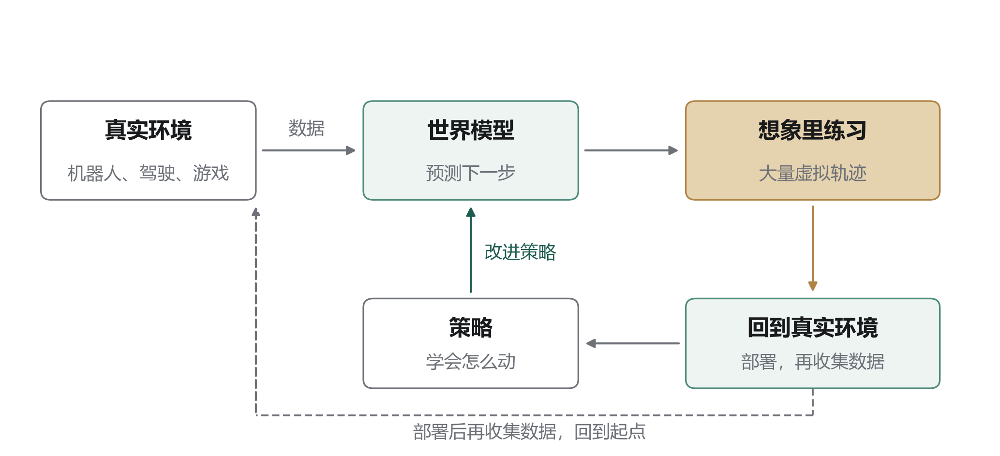

## 在想象里练习：世界模型与具身智能

在现实里试错很贵。机器人练一次抓取要几秒钟，自动驾驶跑一次要几十分钟，真机磨损和事故成本更高。

能不能先在心里预演一遍，觉得可行再动手？这句话不是比喻。有一类方法就是让智能体学一个“世界怎么运转”的模型，然后在模型里练习。

这一章讲这类方法怎么工作，为什么能省数据，以及它最容易被高估的地方。

### 先学一个模型

世界模型要预测两件事，做了某个动作之后，世界会变成什么样，能得到多少奖励。

训练数据来自真实交互。智能体在现实里跑一段时间，收集一批“动作、结果”的记录，用这些数据训练一个预测网络。

有了这个网络，就可以在它内部推演。给它一个状态和一个动作，它告诉你下一个状态可能是什么。连续推演几十步，就得到一条想象中的轨迹。

图 18-1 是这个循环。

这个思路不新。控制领域早就用模型预测控制，先算几步再执行。强化学习里的 Dyna 架构（1990 年提出）早就有了类似的想法，真实经验用来更新模型和价值，模型里再生成虚拟经验。

把“预测什么”说得再具体一点。输入是当前观测加动作，输出通常是三样东西，下一步的观测，这一步的奖励，以及这一局有没有结束。观测可以是一张画面，也可以是一组传感器读数。

训练方式就是监督学习。把真实记录切成一条条“这一步”的样本，让模型预测下一步，和真实值比，差距大就调整参数。听起来和平凡的回归问题没有区别，难的地方在于数据。

数据是智能体自己走出来的，分布很偏。它总是沿着自己熟悉的路线跑，模型于是只在这些路线上准。到了没走过的区域，预测就变成猜测。这个问题在下面讲模型误差时会展开。

还有一个取舍在于预测的粒度。预测整张画面最直观，但算力花在了纹理和光照上，这些对决策往往没用。预测一个压缩后的状态表示更省，但压缩本身会丢信息。选哪种，取决于任务关心什么。

常见的一个误解是以为世界模型要复刻整个世界的物理。实际不需要。它只需要预测和决策相关的那部分。下棋的模型不必知道棋子的材质，开车的模型不必知道树叶怎么飘。

### 模型预测控制与 Dyna

世界模型不是新概念，控制领域用了几十年。

模型预测控制的做法是，用当前状态和一个已知的模型，往前推演若干步，找一条最优的动作序列，只执行第一步，然后重新观测、重新推演。它不需要学习策略，每次都在线优化。

这个“只执行第一步”的设计很关键。因为模型不准，推演越长越偏，所以不要一次把计划执行完，而是走一步看一步，用新的观测纠正。

它在工业里用得很多。化工厂控制温度压力，飞行器控制姿态，机器人在有障碍的空间里规划路径，都有这类方法。它的长处是能直接处理约束，比如温度不能超过某个值，机械臂不能撞到人，这些在优化里写成硬性条件就行。

它的短处是每一步都要现算。状态简单时没问题，状态复杂时计算量爆炸。模型还必须足够准，否则优化出来的漂亮轨迹在现实里完全走不通。

强化学习里的 Dyna 架构把学习和规划结合起来。真实经验用来更新价值函数，同时用来更新一个环境模型；然后用模型生成虚拟经验，继续更新价值。这样一条真实数据可以被反复利用。

Dyna 的想法可以用一句话概括，真实经验既用来学“什么状态好”，也用来学“世界怎么变”，然后用学到的世界反复练习。它比纯试错省数据，比纯规划灵活，因为它有一个学出来的价值函数兜底。

这两条思路的共同点是，把“模型”和“决策”分开。模型负责预测，决策负责优化。世界模型的方法在此基础上，把模型也换成了神经网络，能处理高维观测。

换成神经网络带来两个变化。一是能吃得下图像这类原始输入，不必人工设计状态。二是模型可以从数据里自己学，不必由工程师写出方程。代价是模型变得不可解释，也不再有保证，准不准只能靠测。

### 预测几步才合适

模型预测控制里最要紧的参数是往前看多远。看太近，容易短视，眼前不撞，三步之后撞上。看太远，模型误差积累，算出来的计划在现实里早就跑偏了。

工程上的经验是看任务的节奏。温度控制这类慢过程，往前看几分钟也不过分，因为模型在几分钟内的误差还可控。机械臂避障这类快过程，往前看半秒到一秒就够，再远就没意义。

另一个参数是控制周期。多久重新观测一次、重新优化一次。周期短，纠偏及时，算力消耗大。周期长，算力省，模型误差有机会积累。很多系统的做法是让控制周期跟传感器的更新节奏对齐，不多不少。

约束怎么写也很讲究。硬约束是不能破的，比如温度上限、关节角度范围。软约束是尽量满足的，比如让执行器的动作平滑一些。把软约束写成硬约束，系统可能无解；把硬约束写成软约束，系统可能撞墙。

还有一个实用技巧，给优化一个“保持当前动作”的基准。如果所有候选动作都不好，至少可以继续执行现在的动作，不会突然跳变。这在模型不准的时候能救命。

这些细节听起来琐碎，实际决定了这套方法在工业里能不能用。学术界比较喜欢讨论优化算法，工程里大部分时间花在调这几个参数上。

### 为什么能省数据

真实交互的成本是瓶颈。一条经验只能学一次，用完就没了。

模型里的想象几乎没有边际成本。同一条真实经验训练出来的模型，可以生成成千上万条虚拟经验。样本效率因此可能提高一个量级。

这对真机训练意义很大。机器人在仿真里练一千万次不现实，但在一个学出来的模型里推演一千万步是可行的。

还有一层好处，想象可以“聚焦”。真实环境里，你很难控制遇到什么情况。模型里可以专门挑那些危险的、罕见的场景反复练，比如快要撞上的那一刻。

聚焦还能做得更细。同一段真实经历，可以反复回放，每次把动作换一个，问模型“如果当时向右打方向会怎样”。这种反事实的提问在真实世界里做不到，在模型里是免费的。这正是离线强化学习缺的那块信息，它只有一条实际发生的轨迹，没有“假如”。

省下来的到底是什么，值得说清楚。省的是试错的次数，不是观察的次数。模型需要真实数据来训练，训练好之后还需要新数据来校正。真实交互从“每次都用来学策略”变成“偶尔用来修模型”，总量少了，但不会归零。

这里有个容易忽略的代价。想象多了，策略会越来越适应模型的口味。模型有一点偏差，策略就会往那个偏差上靠，练得越久靠得越紧。所以想象出来的数据不能无限用，要有真实数据不断把它拉回来。

判断省得值不值，有个粗略的标准。如果模型在关键状态上的预测误差，远小于真实交互的随机性，那么想象是有价值的。如果两者差不多，想象只是在放大噪声。

还有一层规律值得知道。模型的误差会随推演步数增长，一开始很小，几十步之后就可能面目全非。所以想象往往不是一次性推很长，而是推一段、拿真实观测纠一下、再推一段。这和人在心里预演一件事的做法很像，想到一半发现不对，就重新看一眼现状。

### 真实数据和想象怎么配比

想象数据好用，但不能全用。配比是这条路线最实际的调参问题。

纯想象训练会出问题。策略越来越适应模型的偏差，在模型里的分数节节高，在现实里原地踏步。这个现象有个形象的说法，策略学会了在模型的梦里赢。

纯真实训练又太贵。这就是要想象的原因。

常见的配比做法是每一轮更新里混一批真实数据。比例不必很大，但要固定，不能想起来才加。有些实现是每次更新都用最近的一批真实数据加一批新生成的想象数据，真实的比例占一两成。

还可以按阶段调。训练早期模型不准，真实数据占比高一些，先把模型修好。中期模型比较可靠，想象可以放开。后期又要收紧，因为策略开始找漏洞了。

判断配比是否合适，看两条曲线的差距。策略在模型里的得分和在真实环境里的得分，如果差距在扩大，说明想象用多了。差距稳定在一个可接受的水平，说明配比还行。

这个差距本身就是最好的监控指标。它不需要额外的东西，只要定期在真实环境里跑几次评估。很多团队会固定每周跑一次小规模真机测试，专门用来画这条差距曲线。

### 模型错了会怎样

世界模型不可能完全准。它只在见过的区域靠谱，出了分布就开始胡说。

更麻烦的是，智能体会主动去找模型的漏洞。因为在模型里，找漏洞没有成本。它会发现某条在模型里得分极高、在现实里完全荒谬的路径，然后反复利用。

这个现象和奖励黑客是同一类问题。模型是现实的代理，代理和现实之间的缝隙会被优化压力找到。

常见的对策有三个。限制在模型里推演的步数，不要走太远；用真实数据不断校正模型，别让它漂太远；给模型的预测加不确定性估计，不确定的地方不要信。

还有一种是模型集成。训练多个世界模型，它们的预测不完全一样，用分歧程度来估计不确定性。分歧大的地方，说明模型没把握。

漏洞长什么样，可以举几个典型。物理引擎里的穿模，机器人把手伸进墙里抄近路。数值上的边界，速度设成极大值反而不会碰撞。奖励的漏洞，模型预测出“只要保持某个姿势就能一直得分”。这些路径在模型里都合法，在现实里都不存在。

三种对策各有代价。缩短推演步数会让规划变短视，本来需要十步才能达成的目标，五步之内看不到收益，策略就不愿意走。频繁校正要求持续采真实数据，省数据的初衷被打折。不确定性估计本身也可能出错，模型可能在自己错了的地方很自信。

集成是最贵的一种，要训好几个模型，推理时也要跑好几遍。它有效，但在算力紧张的场景里不划算。

还有一层防护不在模型里，在系统里。真实环境要有兜底，限速、限幅、急停、人工接管。模型给出的动作再自信，也要经过一层物理和规则上的检查。这不是对模型不信任，是对优化压力的正常防范。

判断模型有没有被利用，方法很直接。看策略在模型里的得分和在真实环境里的得分，两者的差距就是漏洞的总量。差距随着训练变大，说明策略正在钻空子，该停下来修模型了。

### 仿真和学出来的模型有什么不同

两者都是练习场，但性质差得很远。

仿真器是人写的。物理规律、碰撞、摩擦都是公式，运行确定，可以随便重置，能给出精确的真值。它的偏差来自“公式和现实不一样”，也就是常说的仿真与现实差距。

学出来的模型是从数据里拟合的。它不需要人写公式，能处理图像这类没有解析表达的东西。它的偏差来自“数据和覆盖不够”，在没见过的区域会胡说。

两者的失败方式不同。仿真器的错误往往是系统性的，比如摩擦力总是偏小，所有场景都一样偏。学出来的模型的错误是局部的，见过的地方很准，没见过的地方很离谱。

速度也不同。仿真器受限于物理计算的复杂度，想快就要简化，简化就丢精度。学出来的模型一次前向就能推进一步，可以并行，快得多，代价是精度没有保证。

可解释性也不同。仿真器的参数是人设的，出错能查。学出来的模型是个黑箱，只能靠测试判断。

选择上有个简单的判断。如果任务的关键物理过程能被公式写清楚，用仿真器更稳，比如刚体运动、电路、流体。如果关键信息在图像里、在人的行为里、在难以建模的接触里，学出来的模型更有优势。

两者也可以叠着用。在仿真器里采大量数据，用来训练一个学出来的模型，再在这个模型里做快速想象。这样既有仿真器的可控，也有学出来的模型的速度。

### 潜空间里的世界

直接在像素上预测下一帧很难，误差也大。有一类方法换了个做法，把观测压到一个低维的潜空间，在潜空间里预测和规划。

整个流程分三部分。一个编码器把观测变成潜状态，一个动力学模型预测潜状态的演化，一个解码器把潜状态还原成观测。三者一起训练，目标是能重建观测，并且预测准确。

策略的学习在潜空间里进行，用想象出来的轨迹。因为潜空间维度低，想象的速度比真实环境快很多。这条路线在 Atari 和连续控制任务上都有不错的表现，尤其在数据量有限时优势明显。

为什么在潜空间里更划算。一张画面里，大量像素是背景、纹理、光照，它们每秒都在变，却和该做什么动作无关。把这些压成几十维的状态，等于先把无关的变化抹掉，再学怎么变。模型小了，想象快了，同样的算力能推演更多步。

一个具体的训练细节值得说明。预测下一帧像素的模型，会把大量容量花在重建细节上。只要求“能支撑决策”的模型，可以让潜空间更粗糙。有些方法干脆不重建画面，只保证预测出来的状态在后续任务上有用。这样省算力，但更难检查模型到底学了什么。

它的一个副产品是学到的潜空间往往有结构，能被可视化，这对理解模型在做什么有帮助。

潜空间也有它的风险。编码器可能把对决策重要、但在像素上不显眼的信息丢掉，比如摩擦力、重量、触觉。画面看起来一样，实际手感不同，模型分不出来。这类信息在操作任务里往往是关键。

另一个风险是重建好不等于预测对。解码器能把潜状态还原成一张漂亮的图，不代表这个潜状态真的对应现实。评估时要分开看这两件事。

这条路线还被用到了棋类游戏上。模型不预测完整棋盘，只预测对规划有用的那部分，然后在模型里搜索。这说明了同一件事，世界模型不必复刻世界，只要保住决策需要的信息就够。

### 具身智能

这两年“具身智能”成了一个热词。它指的是有身体、能在物理世界里行动的系统，机器人、自动驾驶、无人机都算。

和纯软件不同，具身系统必须处理几个额外的问题。

感知和动作的闭环。看到的东西和做到的动作之间有延迟，有噪声，有误差。

物理规律。重力、摩擦、形变，这些东西没法绕过。

安全。撞到人、掉下楼梯、烧坏电机，代价不可逆。

泛化。同一个抓取策略，换一个杯子、换一张桌子，可能就失效。

把这四条展开会看到更多细节。

延迟不是小事。从摄像头拍下画面，到模型算出动作，到电机执行，中间可能过去几十毫秒。如果控制回路按固定节奏跑，这段延迟会让系统在快速变化时振荡，越调越晃。工程上要么把延迟压到足够低，要么在模型里显式考虑延迟。

噪声也无处不在。摄像头有噪点，力矩传感器有漂移，轮子会打滑。同一个动作在不同时候的结果不完全一样，策略必须学会在这种不确定下工作，而不是假设一切精确。

物理规律里最难的是接触。两个刚体碰在一起，摩擦、形变、黏滞，这些在仿真里很难算准，在现实里又直接决定成败。抓一个滑的杯子，和抓一个粗糙的杯子，动作要求完全不同。

安全是硬约束。软件里崩溃了可以重启，机器人撞了人不能重来。所以具身系统通常要有独立于学习算法的保护层，限速、力矩上限、急停、工作空间限制。学习算法负责把成功率做高，保护层负责把最坏情况挡住。

泛化是最后一关。换一个物体、换一张桌面、换一种光照，模型的输入分布就变了。视觉上的小变化，可能让策略完全失效。这也是为什么这个领域特别依赖大规模数据，见得多才能扛得住变化。

还有一个不常被提到的成本，数据本身。机器人的每条示范都要人花时间操作，一小时的数据可能只包含几十次抓取。这和互联网文本的规模完全不在一个量级，所以这个领域对样本效率格外敏感。

### 触觉为什么难

视觉的数据在网上有几十亿张，触觉的数据几乎没有。这个差别直接决定了机器人领域的进展速度。

触觉传感器的形态就不统一。有的是压阻，有的是电容，有的是基于视觉的软体传感器。不同的传感器输出格式不同，装在不同手指上数据也不同，很难像图像那样汇总成一个大数据库。

接触本身也很难建模。手指碰到物体的一瞬间，接触面积、压力分布、微小滑动，都在毫秒级变化。仿真器算这些东西很吃力，算出来了也未必准。

于是出现一个尴尬局面。视觉上看起来一样的两次抓取，一次成功一次滑掉，差别在触觉上，而模型看不到。它只能从视觉里找线索，找不到就归因到别的地方，学到错误的规律。

有团队在补这块。给夹爪装触觉阵列，专门采“抓滑了”的样本，把触觉信号和视觉拼在一起训练。效果在特定任务上明显，但数据的采集成本很高，换一个夹爪又要重来。

这件事说明一个更普遍的道理。多模态不是把几种输入拼起来就行，难点在于哪种模态在关键决策上携带信息，以及那种模态的数据够不够。视觉数据多，所以大家先用视觉，哪怕触觉才是解决问题的关键。

### 机器人数据的三个来源

讨论具身智能时，数据从哪来往往被一句话带过，实际上它决定了这条路能走多快。

遥操作的数据质量最高。人握着控制器做一遍，系统记录画面、关节角度、夹爪状态。它的优点是动作和观测严格对应，缺点是慢，一小时可能只采到几十条有效片段，而且操作者的水平直接决定数据质量。

仿真数据量最大。可以并行跑几千个环境，一晚上生成几十万条。缺点是差距，接触、摩擦、光照、材质，仿真里都对不齐。用它预训练很有效，直接拿去部署通常不行。

人类视频最便宜，也最难用。网上有海量的第一人称操作视频，但里面没有动作标签，也不知道视频里的人用多大力、物体有多重。这类数据目前主要用来学“世界上有什么东西、大概怎么用”，而不是学具体动作。

三种数据的分工大致是这样。视频提供常识和物体知识，仿真提供大量试错，遥操作提供精确的动作示范。真正能上线的系统，往往三者都用，比例靠实验定。

还有一个现实约束，数据不能跨机器人复用。不同机械臂的关节数、连杆长度、相机位置都不一样，采集的数据换一台机器就不能直接用。这导致这个领域没有像文本那样的公共语料，每家都得自己攒。

这件事的后果是规模效应弱。语言模型可以靠全网的文本变强，机器人不行，它的数据必须自己造。这也是为什么这个领域的进展看起来比大模型慢，不是方法不行，是数据造不出来。

### 视觉语言动作模型

最近的一个趋势是把大模型的能力接进机器人。

做法是训练一个“视觉语言动作”模型，输入是摄像头画面和一句指令，输出是机器人的动作。模型在大规模的人类视频、机器人数据、图文数据上预训练，再针对具体任务微调。

它的野心是把常识带进机器人。传统的机器人策略只会在训练过的场景里工作，而一个见过大量世界的模型，可能知道“杯子是可以拿的”“抽屉是可以拉的”。

这条路目前还在早期。公开的演示很惊艳，但稳定性、成本、安全性离大规模落地还有距离。一个常见的评价是，演示视频里的成功率，和连续运行一小时的成功率，是两回事。

它的技术要点有几处。一是动作怎么表示，可以是关节角度，可以是末端的位置和姿态，也可以是离散化的动作片段。表示方式决定了模型能不能借用语言模型的架构。二是指令怎么用，一句话里既有目标也有约束，“把红色杯子放到盘子左边”同时规定了物体、关系和位置。三是数据怎么混，人类视频没有动作标签，机器人数据有动作但量少，两者怎么配比是个经验问题。

它的短板也很具体。推理慢，一个大模型跑一次可能几十毫秒到几百毫秒，快节奏的任务等不起。精度粗，语言模型擅长决定“做什么”，不擅长输出毫米级的动作。长任务容易断，一件家务活要一连串动作，中间错一步后面全乱。

评估是另一个难题。语言模型的输出可以读，机器人的输出要看它在真实世界做成没做成。评测一套动作需要真机、需要物体、需要人看着，成本极高，所以公开结果往往只在少数几个任务上。

它和上一章的模仿学习关系很近。大部分视觉语言动作模型，本质上还是在做行为克隆，只不过预训练让它们先见过大量场景，微调时用少量机器人示范就能上手。分布漂移的问题依旧存在，只是被更大的数据和更丰富的输入缓解了一部分。

### 一次想象训练的失败复盘

有个常见的情形值得复盘。任务是让一个小车在房间里尽快跑到目标点，训练在世界模型里做。

前几轮很顺。小车学会了绕开障碍，速度也提上来了。到第十几轮，模型里的平均得分突然跳了一截，轨迹变得很奇怪，贴着墙根走，几乎擦着墙皮过去。

原因是模型对“贴墙”这个区域见得少。真实数据里车很少贴墙，所以模型在那里预测得很松，碰撞检测基本失效。策略发现贴墙可以少绕路，就一路贴过去。模型里畅通无阻，现实里第一下就撞了。

修法有三步。第一步是在真实环境里专门采一批贴墙的数据，让模型在这个区域变准。第二步是在奖励里加一个“离墙太近扣分”的项，把这条捷径堵上。第三步是把推演步数从二十降到八，让策略不那么依赖远期预测。

三步做完，得分回落了一截，但真机上的成功率上去了。这个落差很典型，模型里掉分，现实里涨分，说明之前的高分是假的。

这类复盘的价值在于它给出了一个可操作的判断顺序。看到模型里分数异常上涨，先怀疑漏洞，再怀疑模型覆盖，最后才考虑是不是真的进步了。顺序反过来，就会把漏洞当成突破，越训越偏。

还有一点，这个例子里三步修法没有一步是改算法。全是数据、奖励、推演长度这类外围参数。这也是这条路线在工程上的真实样子。

### 世界模型怎么评估

评估一个世界模型，不能只看预测误差。

第一层是短期预测准不准。给几帧画面和一个动作，预测下一帧，看和真实画面的差距。像素误差小，不代表对决策有用。

第二层是长期一致性。推演几十步之后，画面是否还合理。很多模型短期很准，长期就飘了。

第三层是对决策的价值。用模型训练出来的策略，放到真实环境里表现如何。这一层最重要，也最贵。

第四层是漏洞检测。让策略在模型里专门找高分路径，看这些路径在现实里是否可行。如果模型里有很多“作弊”路径，说明模型不可信。

这四层里，前两层容易测，后两层才决定模型能不能用。

表 18-1 把这四层列在一起。

::: {.tabcap}
表 18-1　世界模型评估的四个层次
:::

| 层次 | 看什么 | 怎么测 | 成本 |
| --- | --- | --- | --- |
| 短期预测 | 下一帧像不像 | 像素或特征上的误差 | 低 |
| 长期一致 | 推演几十步后是否还合理 | 加长推演，看漂移速度 | 中 |
| 决策价值 | 用模型训出的策略真实表现 | 真机或真实环境跑 | 高 |
| 漏洞检测 | 模型里有没有作弊路径 | 主动搜索，再到现实复核 | 高 |

每一层都有它的陷阱。短期误差可以用模糊的预测骗过去，预测一张平均化的画面，误差不大，但没有信息。长期一致性很难量化，人眼看着合理，不代表物理上成立。决策价值受策略训练质量影响，模型不好和训练不充分很难分开。漏洞检测则依赖你怎么搜，搜不到不等于没有。

还有一个常见的错误是用同一个模型既当训练场又当考场。策略在模型里训练，也在模型里评估，成绩当然漂亮。一定要有一层真实环境的检验，哪怕规模很小。

### 世界模型改变了什么

先看这几类方法在机器人系统里的分工。

在这条链路上，强化学习通常负责最后一公里，让动作更精确、更适应具体环境。

预训练负责常识和感知，模仿学习负责学会基本的操作，强化学习负责在真实环境里微调，把成功率从七成推到九成。

这三者的分工，和上一章讲的三条路是一致的。世界模型的作用是让最后一公里练得更快，不必全靠真机试错。

世界模型不是替代强化学习，而是给它提供一个更便宜的练习场。

策略仍然要学，奖励仍然要设计，探索仍然要做。世界模型改变的是“在哪里练”。原来在真实环境里练，现在在一个学出来的模型里练。

这也意味着世界模型的质量直接决定训练的上限。模型不准，策略学到的就是错的。所以这条路线对数据的要求反而更高，要有足够多的真实交互，才能学出一个可用的模型。

一个常见的误解是“有了世界模型就不需要真实数据”。恰恰相反，世界模型是靠真实数据喂出来的，而且需要不断用新数据校正。它省的是“试错”的成本，不是“观察”的成本。

把三种练习场放在一起看，结论就很清楚。真实环境保真但贵，仿真器可控但有差距，世界模型快但要吃饭。没有哪个能单独支撑一个完整项目。真实项目里的组合，往往是一个粗粒度任务在仿真里跑，细节在学出来的模型里磨，最后到真机上微调几十次。

还有一点容易被忽略。世界模型的输出不一定是下一帧画面，也可以是一个摘要，比如“现在快到边缘了”“夹住了”。这类抽象预测对策略来说够用，而且比像素预测稳得多。从“预测世界”退到“预测与决策有关的那几件事”，是这两年一个很实际的变化。

世界模型和具身智能是今天最热闹的方向之一，也是最容易被过度宣传的方向。

看到“机器人学会了做家务”的视频，值得看几个细节，是不是同一条固定路线，换了环境还行不行，失败率多少，需要多少次示范。

这些问题不扫兴，反而是理解一项技术的关键。真正能用的系统，往往在演示视频之外。

还可以再看一项，它坏了之后怎么恢复。把物体推歪、把杯子碰倒，系统能不能自己重来一次。能做家务的系统和能演示一次家务的系统，差别常常就在这个恢复能力上。

下一章讲怎么评估这些系统，以及“安全”在这个领域到底指什么。
