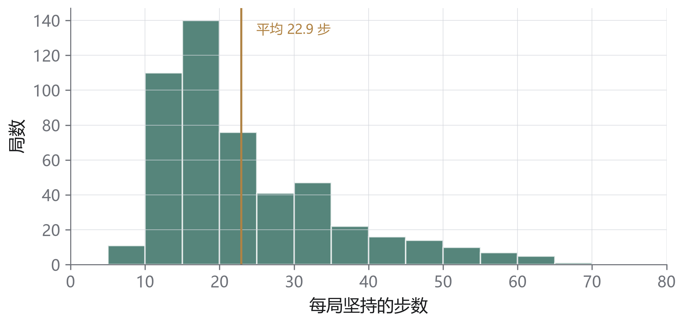

## 第一次和 CartPole 打交道

CartPole 是一个小游戏。一根杆子立在小车上，小车可以左右推，目标是不让杆子倒下来。它简单到可以在纸上算清楚，又足够难，需要一点策略才能坚持很久。几乎所有强化学习的入门教程都从它开始。

这一章不训练任何东西，只把环境跑起来，看清楚它给出的东西长什么样。

### 规则

小车在一条轨道上，只能左右移动。杆子通过一个铰链连在小车上，受重力影响会倒。每一时刻，你可以给小车一个向左或向右的力。

环境每一步返回四个数，构成观测。

第一个是小车的位置，范围大约在正负 4.8 之间。第二个是小车的速度。第三个是杆子偏离竖直方向的角度，单位是弧度，超过正负 0.2095 就算倒了。第四个是杆子的角速度。

当角度超过阈值，或者小车跑出轨道范围，回合结束。每坚持一步得一分，所以一局的分数就是坚持的步数。环境本身设了上限五百步，到了就自动截断。

这五百步的上限值得单独说一句。它不是任务本身的要求，而是为了避免无限循环加上的限制。但它会影响你对成绩的判断，一个能稳定到五百步的策略，和一个能稳定到四百八十步的策略，差别可能没有数字看上去那么大。

### CartPole 的物理参数

CartPole 的物理是真实算出来的，不是查表也不是近似。它的参数写在环境对象里，可以直接读出来。

```python
import gymnasium as gym

env = gym.make("CartPole-v1")
u = env.unwrapped
print("gravity", u.gravity)                  # 9.8
print("masscart", u.masscart)                # 1.0
print("masspole", u.masspole)                # 0.1
print("half length", u.length)               # 0.5
print("force", u.force_mag)                  # 10.0
print("tau", u.tau)                          # 0.02
print("theta limit", u.theta_threshold_radians)
print("x limit", u.x_threshold)
print("cap", env.spec.max_episode_steps)
```

这些数字的含义很直白。重力加速度九点八，单位是米每二次方秒。小车质量一千克，杆子质量零点一公斤，也就是一百克。`length` 这个名字有点误导，它存的是杆子长度的一半，零点五米，真实杆长一米。推力十牛顿，左右各十牛顿。`tau` 是时间步，零点零二秒，也就是每秒推进五十次。

由此可以推出一件事。每推一步，物理世界只前进了二十毫秒，所以一个五百步的回合在真实世界里是十秒。你在屏幕上看到杆子慢慢歪倒，那是放慢之后的效果，真实的十秒里它要晃很多次。

这些参数决定了任务的手感。质量比和推力比说明一件事，杆子倒得比小车动得快。十牛顿推一千克的小车，加速度是十米每二次方秒，二十毫秒里速度变化零点二。同一时刻杆子因为重力产生的角加速度要更大，所以你不能等看到杆子歪了再去推，必须提前一点。

对比一下真实世界。真正的倒立摆实验装置里，杆长通常在半米到一米，小车质量几公斤，推力几十牛顿，参数和这里不完全一样。所以在这个环境里学到的东西，不能直接搬到真实装置上，需要重新调。这也是仿真强化学习的一个老问题，物理参数的小偏差会在长时间运行后放大。本书不追这个问题，但你应该知道它的存在。

`theta_threshold_radians` 的精确值是零点二零九四四，也就是十二度。`x_threshold` 是二点四米。这两个数决定回合什么时候结束。

物理步进的代码可以直接读，环境的源码就几十行。核心是一组古典力学公式。

```python
total_mass = masscart + masspole              # 1.1 kg
force = force_mag if action == 1 else -force_mag
costheta = math.cos(theta)
sintheta = math.sin(theta)
temp = (force + masspole * length * omega ** 2 * sintheta) / total_mass
thetaacc = (gravity * sintheta - costheta * temp) / (
    length * (4.0 / 3.0 - masspole * costheta ** 2 / total_mass))
xacc = temp - masspole * length * thetaacc * costheta / total_mass
x = x + tau * x_dot
x_dot = x_dot + tau * xacc
theta = theta + tau * theta_dot
theta_dot = theta_dot + tau * thetaacc
```

这段代码值得看两眼。`temp` 那一行里有一项 `masspole * length * omega ** 2 * sintheta`，它代表杆子转动带来的离心效应，杆子转得越快这一项越大。`thetaacc` 被 `4/3 - masspole * costheta ** 2 / total_mass` 除，分母里有 `4/3`，那是一个均匀细杆的转动惯量系数，不是随便填的常数。这两个细节说明它写的是严格的刚体动力学，不是一个“看起来像倒立摆”的玩具。

最后四行是欧拉积分，用当前加速度去更新速度和位置，步长 `tau`。欧拉积分在步长很大时会失真，所以 `tau` 只能是零点零二秒，不能再粗。这也解释了为什么每步奖励都是一，它量的是时间，不是在量“做对了什么”。

### 四个观测值的量纲

四个数看起来是同一种东西，其实量纲差得远。跑五百局随机策略，把每一步的观测都记下来，能得到它们的实际范围。

```text
          最大绝对值    标准差
位置          0.866      0.080
速度          2.677      0.519
角度          0.258      0.094
角速度        3.070      0.777
```

位置最大只到零点八七，离二点四米的边界还很远。这符合直觉，随机推的小车在倒之前根本走不远。速度能到二点七，角速度能到三点一，都比位置大一个数量级。标准差也是同样的比例，位置零点零八，角速度零点七八，差了十倍。

角度那一列的最大值零点二五八比阈值零点二零九四还大，这是正常的。环境在判定失败之后才返回观测，返回的这一帧已经越界了。写评估代码时如果假设“返回的观测一定在阈值内”，会在边界上出错。

顺序也容易记错。四个量的顺序是位置、速度、角度、角速度，位置和速度在前，角度和角速度在后。人的直觉容易想成“位置、角度、速度、角速度”或者把角度放在第一位。记错的后果不明显，程序不报错，只是策略学不会。排查这类问题时，把一局的四列数打出来，看哪一列的取值范围不对，比读代码快。位置基本在零点几以内，速度能到两三，角度不超过零点二一，角速度能到三。四列的量级本身就是一个记号。

这种量纲差异对神经网络不友好。想象一个只用一次加权的线性层，输入里角速度的尺度是位置的四倍，那它对输出的影响天然就大四倍。网络得先学会把角速度的权重调小，才谈得上学习控制。这一步会消耗训练时间，有时还会把优化带进一个坏区域。

实践中有三种处理方式。最省事的是不管它，CartPole 的数值范围还算温和，很多教程直接喂进去也能学。稍微讲究一点的是手工缩放，把每一维除以一个常数，让它们的标准差接近一。最彻底的是用运行均值方差做在线归一化，这也是本书后面处理连续控制任务时的做法。

手工缩放的代码很短。

```python
scale = np.array([2.4, 3.0, 0.21, 3.2])

def normalize(obs):
    return obs / scale
```

这几个除数是照着上表的范围挑的，不精确，但够用。挑的时候宁可略大一点，让归一化后的值落在正负一以内，不要压得太狠。

### 动作到底做了什么

动作只有两个，零和一是推的方向。看一步之后观测怎么变，比看文字描述直观。

固定种子，从同一个初始状态出发，分别推左和推右。

```python
env = gym.make("CartPole-v1")

for a in (0, 1):
    obs, _ = env.reset(seed=0)
    new, reward, *_ = env.step(a)
    print("action", a)
    print("  before", np.round(obs, 4))
    print("  after ", np.round(new, 4))
    print("  delta ", np.round(new - obs, 4))
```

跑出来是这样。

```text
action 0
  before [ 0.0137 -0.023  -0.0459 -0.0483]
  after  [ 0.0132 -0.2175 -0.0469  0.2295]
  delta  [-0.0005 -0.1944 -0.001   0.2779]
action 1
  before [ 0.0137 -0.023  -0.0459 -0.0483]
  after  [ 0.0132  0.1727 -0.0469 -0.3552]
  delta  [-0.0005  0.1957 -0.001  -0.3068]
```

一步之后，位置几乎没动，只变了零点零零零五。速度变了约零点二，方向取决于推哪边。角度只变了零点零零一，角速度变了零点三左右。

这组数字说明三件事。

力是通过加速度起作用的，一步之内只改变速度，不直接改变位置。位置的变化是速度乘以二十毫秒，所以慢一个数量级。

改变速度的幅度和改角速度的幅度不同。推一下速度变化零点二，角速度变化零点三，后者更大。杆子比小车更敏感。

两个动作的效果方向相反，幅度不同。这个不对称来自当前状态的差异，不是环境本身的偏置。初始角度是负的，杆子已经往左偏，往左推时修正量小一些，往右推时把杆子推得更歪，所以角速度的变化更大。

把这几条合起来看，就知道为什么单一方向的策略一定失败。一直往右推，速度会累加到把小车推出边界，杆子也因为一直被甩向一侧而倒。实测量一下，一直推左平均撑九点四步，一直推右平均九点三步。这比随机策略的二十二点九步还差，说明方向固定比乱推更糟，因为乱推至少有一半时间在纠正。

### 观测空间的边界不等于终止边界

打印 `env.observation_space` 会看到这样的上下界。

```text
Box([-4.8               -inf -0.41887903        -inf],
    [ 4.8                inf  0.41887903         inf], (4,), float32)
```

位置的边界是正负四点八，而任务在正负二点四就判定失败。角度的边界是正负零点四一八八，正好是失败阈值的两倍。速度和角速度没有边界，直接写成了无穷。

这两套数不一样，经常让人困惑。空间边界描述的是“这个环境可能产出什么样的观测”，是一个宽松的声明，采样器拿它来生成有意义的输入。终止边界描述的是“任务在什么时候算失败”，是规则的一部分。

后果是，你永远观测不到位置在二点五以上的状态。空间里那一半是宣言意义上的，实际不可达。如果有人拿 `observation_space.sample()` 造数据做预训练或做归一化统计，会得到一批现实中不会出现的状态，统计出来的均值方差都是偏的。

稳妥的做法是把归一化的尺度用手写常数或者真实轨迹上统计出来的量，不要用空间的上下界。空间边界适合做断言检查，不适合做数据统计。

### 回合上限从哪来

五百步的上限不在 CartPole 的物理里，而在包装器里。gymnasium 有一个叫 `TimeLimit` 的包装器，注册环境时挂上去，超过步数就返回 `truncated=True`。

```python
env = gym.make("CartPole-v1")
print(env.spec.max_episode_steps)     # 500
print(env._max_episode_steps)         # 500, injected by TimeLimit
```

这个数字可以在创建时改掉。

```python
env = gym.make("CartPole-v1", max_episode_steps=1000)
```

改它会有两个后果。一是评分标准变了，五百步的上限下一局最多五百分，一千步的上限下能到一千分，曲线不可比。二是很多算法对回合长度敏感，经验回放里长回合会占更多样本，训练分布会变。

上限存在的理由很实际。有些策略会让小车在中间来回晃，永远不倒，如果没有上限，一局可以跑到天亮。加上限等于给了一个“这一局算结束”的兜底。这也意味着一个能稳定跑满五百步的策略，其实已经无法再提高了，它的分数上限就是五百。

判断一个结果好不好时，要看它是不是撞到了上限。如果评估的平均分是四百九十八，标准差很小，那说明策略已经稳到打满，再训练也没有意义。如果平均分是四百二，分布从三百到五百都有，那说明还有提升空间。

### 创建与重置

```python
import gymnasium as gym

env = gym.make("CartPole-v1")
obs, info = env.reset(seed=0)
print(obs)
```

`reset` 返回两个东西。第一个是初始观测，四个浮点数。第二个是附加信息，多数环境里是空字典，有些环境会放诊断数据。

`seed` 参数决定随机的起点。同一个种子，同样的动作序列，会得到完全一样的结果。这一点在做实验时非常重要，后面会反复用到。

初始状态本身也是随机的，每一维都在正负零点零五之间均匀取值。跑一千次 reset 统计一下，四维的最大最小值都贴着这个范围。

```text
位置   [-0.0499, 0.0498]
速度   [-0.0500, 0.0500]
角度   [-0.0500, 0.0499]
角速度 [-0.0499, 0.0499]
```

这个范围很小，对应角度不到三度，位置不到五厘米。也就是说每一局的开局几乎是竖直的，难度差异来自后面几十步的累积，不来自开局。这一点和其他环境不同，有些环境开局就是随机的混乱状态，难度波动很大。

### 走一步

```python
action = 1                      # 0 向左，1 向右
obs, reward, terminated, truncated, info = env.step(action)
```

五个返回值。新的观测，这一步的奖励，是否因为任务失败而结束，是否因为达到上限而结束，以及附加信息。

`terminated` 和 `truncated` 分开，是 gymnasium 相对老版本的一个重要改动。前者表示任务真的结束了，比如杆子倒了；后者表示时间到了，任务本身没结束。这个区别在后面计算回报时会影响结果，第三章会详细讲。

奖励这一项在这个环境里是常数。五百局随机策略里出现的奖励值只有一个，就是一。所以一局的回报等于步数，两个指标是同一件事。换成别的环境就未必，比如 LunarLander 的奖励有上百种取值，步数和回报完全是两个量。

### 随机策略的基线

在训练任何东西之前，先看看什么都不学能拿多少分。这一步经常被跳过，但它其实是所有实验的参照物。没有基线，你不知道一个算法是真的学到了东西，还是碰巧比零好。

下面这段跑五百局，每局都随机选动作。

```python
import numpy as np

rng = np.random.default_rng(0)
total_returns = []

for episode in range(500):
    obs, _ = env.reset(seed=episode)
    done = False
    total = 0.0
    while not done:
        action = int(rng.integers(2))
        obs, reward, terminated, truncated, _ = env.step(action)
        total += reward
        done = terminated or truncated
    total_returns.append(total)

print("mean", np.mean(total_returns))
```

跑出来的平均是 22.9 步。图 2-1 是这五百局的分布。多数局在十到二十五步之间，偶尔有一局能撑到六十步，那是运气好，杆子刚好在合适的角度被推了一下。



这个数字就是基线。后面任何一个算法，如果最终只能做到二十几步，那它等于什么都没学到。如果做到了两三百步，才值得说“学会了”。如果做到五百步，说明它在大部分情况下都能撑到上限。

分布的形状也值得看一眼。它不是正态分布，右边有一条长尾。这说明随机的成功是有偶然性的，偶尔能连对很多次。这也解释了为什么只看几局的结果不可靠，必须跑很多局取平均。

### 随机基线的完整统计

只看一个平均值会丢掉很多信息。同一个脚本把其他几个统计量也打出来，能得到一张更有用的表。

::: {.tabcap}
表 2-1　随机策略在 CartPole 上跑五百局的统计
:::

| 指标 | 数值 | 说明 |
| --- | --- | --- |
| 平均步数 | 22.94 | 常被引用的那个基线 |
| 中位数 | 19 | 比平均低，说明分布右偏 |
| 标准差 | 11.74 | 波动接近平均值的一半 |
| 百分之十分位 | 12 | 最差的一成局数 |
| 百分之九十分位 | 40 | 最好的一成局数 |
| 最大值 | 69 | 五百局里的运气最好的一次 |
| 最小值 | 9 | 撑着不倒的下限 |
| 超过五十步的比例 | 3.8% | 长尾的厚度 |
| 被截断的局数 | 0 | 全是真倒，没有一局跑到上限 |

中位数比平均低将近四步，这个差距就是长尾的贡献。如果只看平均，会高估典型表现。报结果时把中位数也写上，读者能立刻知道分布的偏斜方向。

最小值是九，这个数字有规律。前面测过，一直推一个方向能撑九点三步。也就是说即使什么都不做对，杆子也要花八到九步才彻底倒下来。九步是物理决定的，不是运气。任何策略的下限都是它。

被截断的局数是零，这一行看着平淡，其实很重要。它说明随机策略的失败全是真失败，杆子真倒了，不是时间到了。如果有个环境里截断占多数，那平均分就不能直接当能力指标，因为它在量的是另一个东西。

标准差接近平均值的一半，意味着单局的成绩几乎不能说明问题。想比较两个策略，几局的差距完全可能是噪声。后面评估时我一般用一百局，差距小于百分之十就当没有差别。

### 看一眼你的策略在做什么

光看数字很难有感觉，可以把这个过程打印出来。每十步输出一次小车位置和杆子角度。

```python
for step in range(30):
    action = 1
    obs, reward, terminated, truncated, _ = env.step(action)
    if step % 10 == 0:
        print("step %2d  x=%+.2f  angle=%+.3f" % (step, obs[0], obs[2]))
    if terminated:
        print("fell at step", step)
        break
```

一直往右推，小车会跑到轨道边缘，杆子会被惯性带倒。一直往左也一样。这说明单一方向的策略一定失败，必须根据当前状态来回调整。策略的意义就在这里，它不是固定的动作，而是从状态到动作的映射。

### 一个不用学的手写控制器

在训练之前，先手写一个控制器，会改变你对这个任务的判断。

思路很简单。杆子往右歪就往右推，把小车挪到杆子下面。只看角度不够，因为杆子歪的时候已经在加速，等推的时候可能晚了。所以把角速度和角度加起来一起判断。

```python
def hand_policy(obs):
    x, v, theta, omega = obs
    return 1 if theta + 0.5 * omega > 0 else 0
```

跑一百局，每局都是五百步，全部跑到上限，一局都没倒。

这个结果值得停下来想一想。一个三行的规则就能打满，说明这个任务的难点不在“能不能解”，而在“能不能从零学出来”。强化学习研究的问题从来不是“这个任务有没有解”，而是“在没有答案的情况下，能不能靠试错找到解”。

系数零点五也不是随便挑的。试几个不同的值，差别很明显。

```text
theta + 0.5 * omega   500.0 步
theta + 1.0 * omega   493.1 步
theta + 2.0 * omega   414.1 步
只用 theta             41.0 步
```

只用角度只能撑四十一步，加上角速度立刻打满。角速度的权重从零点五加到二，性能反而下降，因为权重太大时控制器会对角速度的抖动过度反应，来回推，把小车推出边界。

这个小实验还顺带说明了另一件事。这个任务的最优策略不需要记忆，当前状态足够决定动作，是一个马尔可夫决策过程。手写规则能打满，就是因为状态里已经包含了做决定需要的一切。

顺便预告一下，这个控制器的一百局全部是被截断的，没有一局是真倒。第三章讲截断和终止的区别时，会再回到这里。

### 把环境封装起来

真实项目里，环境通常会被包一层，加上记录、裁剪、归一化这些处理。gymnasium 提供了包装器机制。

```python
from gymnasium.wrappers import TimeLimit, RecordEpisodeStatistics

env = gym.make("CartPole-v1")
env = RecordEpisodeStatistics(env)
env = TimeLimit(env, max_episode_steps=500)
```

`RecordEpisodeStatistics` 会在回合结束时把回报和长度写进 `info`，省得自己统计。`TimeLimit` 控制最大步数，避免某些环境无限跑下去。

包装器是可以叠的，从里往外依次生效。顺序有讲究，比如先裁剪观测再统计，和先统计再裁剪，得到的数不一样。叠得多的时候，打印一下 `env`，会看到一层套一层的结构，能帮你确认顺序。

包装器有一个副作用值得提前知道。包装之后的 `env` 不是原来的类，`isinstance` 检查会失败，`env.unwrapped` 才是里面那一层。要读物理参数、要改内部状态时，都得先 `unwrapped`。忘了这一步，会得到 `AttributeError`，报错信息还指向一个你没见过的类名，很容易让人以为装错了包。

本书的代码基本不用包装器，因为想看清楚的正是最裸的接口。等你熟悉之后再回来用它们，会明白它们省掉了什么。

下一章把一次交互拆得更细，看看每一步的数据怎么组织，以及“回报”这个后面反复出现的量到底怎么算。
