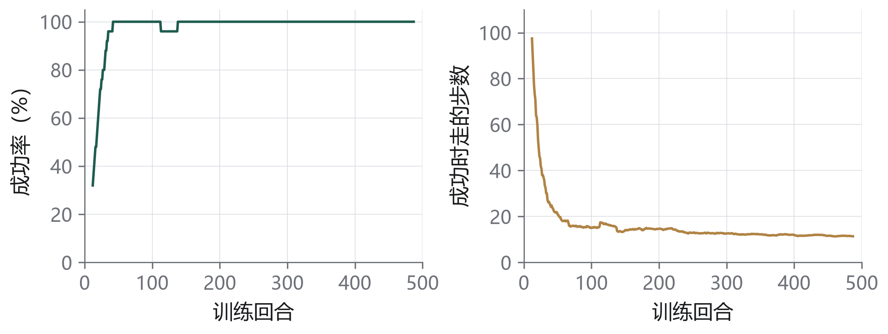

## 表格 Q 学习：在小世界里学会走路

强化学习的第一个能用的算法，比想象中简单。它不需要神经网络，不需要梯度，只用一张表和一个循环。

这一章把它跑起来，看看四十个格子的世界里会发生什么。跑完之后，你会得到一个能走最短路的小程序，也会明白为什么这个方法到了复杂问题上就不够用了。

### 算法的骨架

Q 学习维护一张表，行是状态，列是动作，格子里存的是“在这个状态下做这个动作，之后大概能拿多少分”。

每一步做四件事。

看到当前状态，按一定概率选一个动作。大部分时候选当前 Q 值最大的，偶尔随机。执行动作，得到奖励和新状态。用奖励和新状态算一个目标值。把原来的 Q 值往目标值挪一点。

目标值的算法是这一章的核心。

```text
target = reward + gamma * max(Q[next_state])
```

意思是，这一步的价值等于“立刻拿到的奖励”加上“打折后的未来最好情况”。折扣因子取零点九五，代表未来还算重要，但不如现在。

然后用学习率控制挪多少。

```text
Q[state][action] += alpha * (target - Q[state][action])
```

`alpha` 取零点一，意思是每次只挪向目标的一成。挪得太猛会震荡，挪得太慢学得慢。

### 完整代码

下面是实际跑的版本，去掉了解释用的行。

```python
for episode in range(500):
    state, _ = env.reset()
    done = False
    while not done:
        eps = epsilon_at(episode * 200, 500 * 200)
        if rng.random() < eps:
            action = int(rng.integers(4))
        else:
            action = int(np.argmax(Q[state]))

        next_state, reward, terminated, truncated, _ = env.step(action)
        target = reward
        if not terminated:
            target += 0.95 * np.max(Q[next_state])
        Q[state, action] += 0.1 * (target - Q[state, action])

        state = next_state
        done = terminated or truncated
```

`epsilon_at` 让探索率从零点三慢慢降到零点零二。开局多乱走，后面多利用。这个衰减很重要，不衰减的话，学到最后还在乱走；衰减太快，早期还没探索完就开始利用，容易卡在一条烂路上。

注意 `if not terminated` 这一行。如果任务是终止的，未来价值要按零算，所以只加奖励本身。少了这个判断，算法会以为掉进陷阱之后还有未来，学出来的策略会低估陷阱的危险。

### 跑出来的结果

训练五百回合之后，用贪心策略单独测一百局。表 5-1 是两个对照组的结果。

::: {.tabcap}
表 5-1　网格世界上的成功率和步数
:::

| 策略 | 成功率 | 成功时平均步数 |
| --- | --- | --- |
| 随机走 | 2.5% | 未统计 |
| 训练后的 Q 表 | 100% | 11 |

随机走的成功率只有百分之二点五，因为从起点到终点要绕过好几道墙，蒙对的概率很低。训练之后一百局全部成功，而且平均只用十一步。地图上最短路正好是十一步，说明它学到的不只是“能到”，而是“走最短”。

这个结果值得高兴一下，但也别高估。它是在一张固定的、只有四十个格子的地图上学出来的。换一张地图，Q 表要重来。

### 学习曲线

图 5-1 是训练过程中的两个指标。左边是成功率，每二十五局算一次；右边是每局走的步数。



两张图放在一起看，会发现一件有意思的事。成功率涨得极快，三十局就接近一百，之后基本是一条平线。但步数一直在降，从接近一百降到二十，再慢慢降到十一。

这说明成功率这个指标太粗了。走十一步到终点和走一百步到终点，在成功率上是同一个结果，可后者的策略明显更差。如果只看成功率，你会以为算法在第三十局就学完了，实际上它又优化了两百多局。

这个现象在后面会反复出现。任务越复杂，单一指标越容易饱和，需要几个指标一起看。有时还要看策略的稳定性、行为的合理性，甚至直接看它跑起来的样子。

### 学到的策略长什么样

把 Q 表里每个格子最大的动作画成箭头，就得到图 5-2。


这张图能看出几件事。

主路径很清晰，从左上往右、往下，再往右到终点。颜色深浅表示价值，越靠近终点越深。

有些格子里的箭头看着奇怪，比如对着墙指。那是因为在这些格子里，四个动作的 Q 值差别很小，学出来的最大值带了点随机性。这些格子不在通往终点的路上，即使策略不完美也不影响结果。

还有几个格子指向左侧的死胡同，因为从那里绕一圈也能到终点，只是更远。价值函数把这段绕路算进了代价里，所以那些格子的颜色明显更浅。

### 为什么它不够用

Q 学习的问题不在于算法，而在于那张表。

第一个问题是装不下。四十个格子可以列一张表，CartPole 的观测是四个连续值，理论上无穷多种状态，表根本没有地方放。

第二个问题是不会泛化。表把每个状态当成独立的，学到“这个格子往右走”，不会自动知道“旁边那个格子也往右走”。每学一个新地方都要从头试。

第三个问题是维度。如果状态是二十乘二十的图片，表的大小是天文数字，永远不会被填满。

所以下一步很自然，把表换成一个函数。函数可以接受连续输入，也能把相似的状态映射到相似的价值。这个函数通常是一个神经网络。

不过在换之前，先花一章时间讲怎么把训练过程画出来。因为从这一章开始，你会反复面对“它到底学没学会”这个问题，而答案只能从曲线上读。
