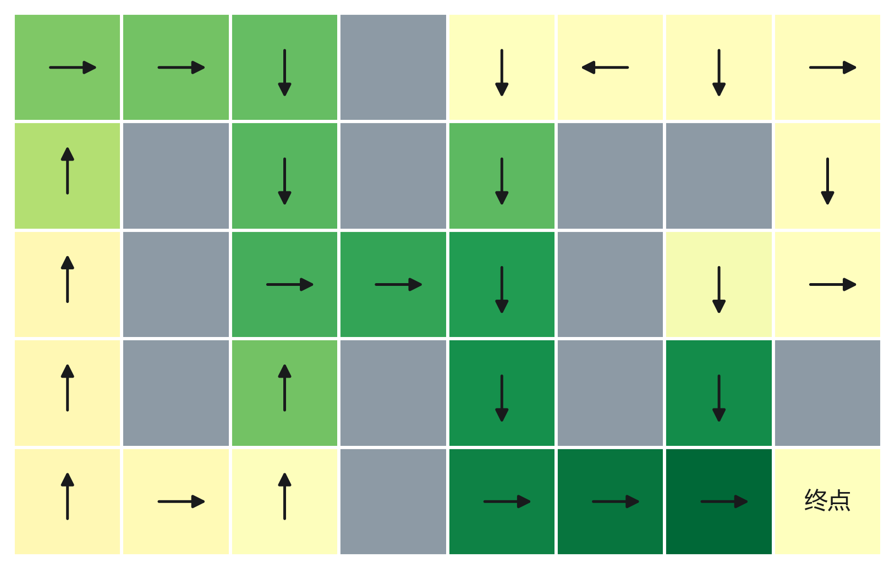
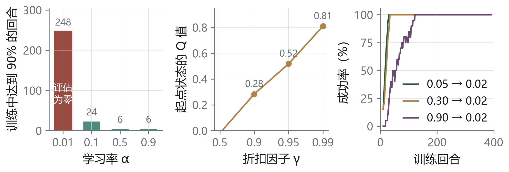

## 表格 Q 学习：在小世界里学会走路

强化学习的第一个能用的算法，比想象中简单。它不需要神经网络，不需要梯度，只用一张表和一个循环。

这一章把它跑起来，看看四十个格子的世界里会发生什么。跑完之后，你会得到一个能走最短路的小程序，也会明白为什么这个方法到了复杂问题上就不够用了。

### 算法的骨架

Q 学习维护一张表，行是状态，列是动作，格子里存的是“在这个状态下做这个动作，之后大概能拿多少分”。

每一步做四件事。

看到当前状态，按一定概率选一个动作。大部分时候选当前 Q 值最大的，偶尔随机。执行动作，得到奖励和新状态。用奖励和新状态算一个目标值。把原来的 Q 值往目标值挪一点。

目标值的算法是这一章的核心。

```text
target = reward + gamma * max(Q[next_state])
```

意思是，这一步的价值等于“立刻拿到的奖励”加上“打折后的未来最好情况”。折扣因子取零点九五，代表未来还算重要，但不如现在。

然后用学习率控制挪多少。

```text
Q[state][action] += alpha * (target - Q[state][action])
```

`alpha` 取零点一，意思是每次只挪向目标的一成。挪得太猛会震荡，挪得太慢学得慢。

### 一个能手算的例子

公式只有两行，但里面的两个系数到底起什么作用，手算一遍最清楚。

造一条三个格子的直线，零号是起点，二号是终点。从零走到一，奖励零；从一走到二，奖励一，回合结束。折扣因子零点九，学习率零点五，Q 表全部初始化为零。

第一轮，从零开始。目标值是零加上零点九乘以后面那一格的最大 Q 值，也就是零。旧值是零，所以更新之后还是零。走到一格，目标值是一，旧值是零，新的 Q 变成零点五。

第二轮，起点那一格的目标值变成零点九乘零点五，等于零点四五。旧值是零，新值零点二二五。中间那一格的目标值还是一，旧值零点五，新值零点七五。

把六轮全列出来。

```text
轮次   Q(起点)   Q(中间)
   1    0.0000    0.5000
   2    0.2250    0.7500
   3    0.4500    0.8750
   4    0.6188    0.9375
   5    0.7313    0.9688
   6    0.8016    0.9844
   极限  0.9000    1.0000
```

中间那一格每轮往一靠一半，起点那一格跟着中间那一格走，每轮也被拉一把。六轮之后起点已经到零点八，最后一行的极限是零点九，正好等于折扣因子。

这组数里有三件事值得记。

学习率决定的是速度。零点五的时候三轮就过了一半，零点一的时候六轮才到零点一。收敛的快慢差不多是学习率的倒数。

折扣因子决定的是上限。起点离奖励一步，所以它的价值上限是一乘以零点九。如果折扣因子是零点九九，上限就是零点九九，差一点点；如果是零点五，上限就是零点五，掉一半。折扣因子在这里的作用不是“重视未来”，而是把远处的奖励打了折，离得越远折得越狠。

初始值也有影响。这里从零开始，如果从一百开始，前几轮会往下掉，而不是往上爬。往下掉的过程看着像学坏了，其实是它在纠正一个乐观的起点。这一点在深度方法里会被放大成“初期价值爆炸”，第七章会讲。

### 完整代码

下面是实际跑的版本，去掉了解释用的行。

```python
for episode in range(500):
    state, _ = env.reset()
    done = False
    while not done:
        eps = epsilon_at(episode * 200, 500 * 200)
        if rng.random() < eps:
            action = int(rng.integers(4))
        else:
            action = int(np.argmax(Q[state]))

        next_state, reward, terminated, truncated, _ = env.step(action)
        target = reward
        if not terminated:
            target += 0.95 * np.max(Q[next_state])
        Q[state, action] += 0.1 * (target - Q[state, action])

        state = next_state
        done = terminated or truncated
```

`epsilon_at` 让探索率从零点三慢慢降到零点零二。开局多乱走，后面多利用。这个衰减很重要，不衰减的话，学到最后还在乱走；衰减太快，早期还没探索完就开始利用，容易卡在一条烂路上。

注意 `if not terminated` 这一行。如果任务是终止的，未来价值要按零算，所以只加奖励本身。少了这个判断，算法会以为掉进陷阱之后还有未来，学出来的策略会低估陷阱的危险。

### 学习率的选择

学习率是三个超参数里最容易调坏的一个。四个值各跑三次取平均，回合数固定四百，探索率从零点三退到零点零二，看达到九成成功率需要多少回合。

```text
学习率    达到九成    最终成功率    起点 Q 值
0.01        248          0%        -0.044
0.1          24        100%         0.518
0.5           6        100%         0.518
0.9           6        100%         0.518
```

学习率零点零一时，四百回合之内根本没学会，最终成功率是零。这个零很值得追一层，因为它不是“学得慢”那种零。把那张表打出来看，起点那一行四个动作的值是这样的。

```text
Q(起点) = [-0.0435  -0.0435  -0.0435  -0.0435]
```

四个值一模一样，`argmax` 挑不出差别，只能按顺序选第零个，也就是往上。往上是一面墙，环境让它留在原地，下一个决策还是同一个状态、同一个选择，于是它在起点转到两百步被截断。一百局评估全部失败，一步进度都没有。

奇怪的是这张表并不是空的。非终点格子里最大的值到了零点九七七，说明它大部分地方其实已经快学会了，只有起点那一行没拉开。同一个状态下四个动作值的极差，整张表的中位数只有零点零零零一四，而学习率零点一的版本是零点二〇七，差了一千四百倍。学习率太小，每个格子都处在一个“好像知道但不知道怎么选”的状态。

训练曲线还会骗人。同一个实验里，训练期间的成功率在两百回合附近就到了一百，因为探索率还有百分之二，每一步都有小概率随机走一步，两百步里几乎必然会随机逃出起点那个死循环，之后顺着已经学好的部分走到终点。所以训练看着很完美，一评估就零。这也是为什么所有报告都要用关探索的评估成绩，不能拿训练时的数字充数。

零点一时二十四回合达标。零点五和零点九都在六回合之内达标，几乎一样快。

后两档看不出差别，原因在状态数。这张地图只有四十个状态，每个状态被访问的次数很快上百，学习率大一点和小一点，差别被访问次数掩盖了。等状态多到几千个，情况就不同，学习率零点九会让 Q 值来回震荡，因为每次更新都直接跳到目标附近，而目标本身还在变。

实践中的经验是这样的。表格方法用零点一到零点五，不用太小心。函数逼近用零点零零一到零点零一，差一个数量级就学不会或者爆炸。判断标准不是别人的推荐值，而是你自己的 Q 值有没有在合理范围里增长。

还有一个小技巧，学习率可以随访问次数衰减。第一次访问某个状态时用大的学习率，访问多了之后用小的，这样早期的粗估计能被快速覆盖，后期的精细估计不会被新的噪声拉走。

```python
count = np.zeros_like(Q)
count[state, action] += 1
alpha = 1.0 / (1.0 + 0.1 * count[state, action])
Q[state, action] += alpha * (target - Q[state, action])
```

这种写法叫样本平均，理论上保证收敛，代价是后期几乎不再更新，环境一变就跟不上。多数实验里固定学习率更实用。

### 折扣因子改变的是什么

折扣因子常被说成“有多重视未来”，这个说法不准确。它实际改变的是价值尺度和有效视界。

四个值各跑三次，同样的四百回合。

```text
折扣因子    起点 Q 值    达到九成
0.5          -0.019        43
0.9           0.283        27
0.95          0.518        24
0.99          0.809        22
```

起点 Q 值几乎是一条直线往上走。原因可以用公式算出来。最短路是十一步，终点奖励一，每步扣零点零一，所以起点的最优价值大约是折扣因子的十一次方。零点九五的十一次方是零点五六九，减去步数惩罚，正好落在零点五附近。零点九九的十一次方是零点八九五，实测零点八零九，接近。

也就是说，起点 Q 值这个数不反映策略好坏，它反映的是折扣因子乘出来的尺度。同一个策略，换个折扣因子，值就变了。看到两条曲线的 Q 值差一倍，先确认它们用的是不是同一个折扣因子，否则比较没有意义。

真正有意思的是策略没变。四个折扣因子的最终成功率都是一百，平均步数都是十一。原因是这张地图只有一条通路，无论怎么打折，唯一的正奖励都在终点，走过去永远比不走好。

那折扣因子的作用在哪。在上面那张表的第三列。零点五的时候要四十三回合才学会，零点九九只要二十二回合。折扣因子越大，远处的奖励在目标值里占比越大，梯度信号越清楚，学得越快。折扣因子太小，远处奖励被折到接近零，目标值里几乎只剩步数惩罚，学习信号变成了一片噪声。

这解释了一个常见的现象。有人用零点九跑得好好的，换成零点九九反而变慢甚至学崩。那不是折扣因子错了，是学习率没跟着调。折扣因子变大，目标值的尺度变大，同样的学习率会迈得太大。

### 探索率的衰减表

探索率决定早期花多少时间乱走。四种计划各跑三次，其余参数不变。

```text
探索计划        达到九成    最终成功率
0.05 → 0.02       20         100%
0.30 → 0.02       24         100%
0.30 → 0.30       23         100%
0.90 → 0.02       95         100%
```

第一行最快，只用二十回合。它一开始就很少乱走，几乎全靠贪心。在这张只有四十个格子、通路很宽的地图上下得去，因为从起点往右往下走几步就能碰到主路。

第二行和第三行差不多。这一组数据里，衰减和不衰减没有区别，因为地图太小，探索需求低。这也是一个提醒，很多“衰减很重要”的说法来自更复杂的任务，在小任务上验证不出来。

第四行慢了四倍。起步就是零点九的乱走，前几十回合基本在随机漫步，学到的有效样本很少。乱走本身不是坏事，但它要有节制。

衰减的形状有两种常见写法。

```python
def linear(step, total, start=0.3, end=0.02):
    return max(end, start - (start - end) * step / total)

def exponential(episode, start=0.3, end=0.02, half_life=150):
    return end + (start - end) * 0.5 ** (episode / half_life)
```

线性衰减简单，参数直观，什么时候退到底能算出来。指数衰减前段退得快，后段拖着一条长尾，适合那些“早期必须多探索、后期偶尔也要试新路”的任务。

第三个参数是总步数怎么算。上面代码里用的是回合数乘每回合估计步数，这个估计一旦偏了，衰减就会提前或拖后。更稳的做法是按实际交互步数记，每走一步加一，用真实步数去除总数。

这一点在小任务上看不出差别，在长任务上很明显。回合长度从十步变到一千步时，按回合数写的衰减表会让探索率在训练刚开始就退到底，因为步数早就超过了估计值。

### 跑出来的结果

训练五百回合之后，用贪心策略单独测一百局。表 5-1 是两个对照组的结果。

::: {.tabcap}
表 5-1　网格世界上的成功率和步数
:::

| 策略 | 成功率 | 成功时平均步数 |
| --- | --- | --- |
| 随机走 | 2.5% | 未统计 |
| 训练后的 Q 表 | 100% | 11 |

随机走的成功率只有百分之二点五，因为从起点到终点要绕过好几道墙，蒙对的概率很低。训练之后一百局全部成功，而且平均只用十一步。地图上最短路正好是十一步，说明它学到的不只是“能到”，而是“走最短”。

这个结果值得高兴一下，但也别高估。它是在一张固定的、只有四十个格子的地图上学出来的。换一张地图，Q 表要重来。

随机走的那个数字值得多说一句，它非常依赖回合上限。上限五十步时成功率只有百分之二左右，放到两百步就升到四分之一，因为走得越久越可能撞上终点。所以报基线时一定要写清楚上限，不然这个数没有意义。

### 学习曲线

图 5-1 是训练过程中的两个指标。左边是成功率，每二十五局算一次；右边是每局走的步数。


两张图放在一起看，会发现一件有意思的事。成功率涨得极快，三十局就接近一百，之后基本是一条平线。但步数一直在降，从接近一百降到二十，再慢慢降到十一。

这说明成功率这个指标太粗了。走十一步到终点和走一百步到终点，在成功率上是同一个结果，可后者的策略明显更差。如果只看成功率，你会以为算法在第三十局就学完了，实际上它又优化了两百多局。

这个现象在后面会反复出现。任务越复杂，单一指标越容易饱和，需要几个指标一起看。有时还要看策略的稳定性、行为的合理性，甚至直接看它跑起来的样子。

### 学到的策略长什么样

把 Q 表里每个格子最大的动作画成箭头，就得到图 5-2。



这张图能看出几件事。

主路径很清晰，从左上往右、往下，再往右到终点。颜色深浅表示价值，越靠近终点越深。

有些格子里的箭头看着奇怪，比如对着墙指。那是因为在这些格子里，四个动作的 Q 值差别很小，学出来的最大值带了点随机性。这些格子不在通往终点的路上，即使策略不完美也不影响结果。

还有几个格子指向左侧的死胡同，因为从那里绕一圈也能到终点，只是更远。价值函数把这段绕路算进了代价里，所以那些格子的颜色明显更浅。

### 三个旋钮一起看

前面几节把学习率、折扣因子、探索计划分开看了。把三组扫描的结果画在一起，能看出它们各自管什么。



左图是学习率，纵轴是训练中达到九成成功率所需回合。零点零一那一根柱子高得离谱，因为训练期间的成功率确实在两百回合左右就上去了，但评估是零。这根柱子在报一个假消息，也提醒你评估和训练成功率不是一回事。零点五和零点九几乎一样高，说明在这张地图上学习率的余地很大。

中图是折扣因子，纵轴是起点状态的 Q 值。四个点几乎连成一条直线，这就是前面说的尺度效应。把这根线当成“学得好不好”去读，会得出“折扣因子越大越好”的错误结论。

右图是探索计划，三条曲线在十回合之内就冲到顶。紫色那条起步零点九，前五十回合在二十到八十之间来回跳，说明那段时间它还在乱走，成功率不稳定。绿色和金色几乎重合，又一次说明这张地图对探索需求不高。

### Q 表怎么看

图好看，但真正的信息在数字里。看 Q 表要按顺序看四件事。

先看最大值。起点那一行最大的 Q 值应该接近最优回报减去步数惩罚。这张地图上最短路十一步，每步扣零点零一，终点加一，折扣零点九五，算下来是零点五出头。实测零点五一八，对得上。如果这个数明显偏高，说明有状态没被充分更新，值还在往上飘；明显偏低，说明学习率太小或者回合数不够。

再看同一个状态里四个动作的差值。差值大说明这个状态的方向是明确的，差值小说明四个方向差不多。

```python
state = 0
q = Q[state]
print("values", np.round(q, 3))
print("best", int(np.argmax(q)), "gap", round(float(q.max() - q.min()), 3))
```

起点的四个值是这样的。

```text
values [ 0.380  0.139  0.234  0.518]
best 3  gap 0.379
```

第四个动作是往右，值零点五二，比其他的高出一截。这个“一高一低”的形状就是学会了的标志。

但第一个和第三个值需要解释一下。第一个是往上，第三个是往左，从起点往这两个方向都是墙，环境会让它留在原地。它们的值不低，一个零点三八一个零点二三，原因是撞墙之后下一状态还是自己，而目标值里带的是这个状态自己的最大值，于是撞墙相当于“多花一步重新选”。理论上它会停在“零点九五乘以最大 Q 再减零点零一”附近，也就是零点四八，实测零点三八，还没完全收敛。这也解释了原始文本里那句“在墙边的格子看不出方向”，因为不罚撞墙时，墙边的动作都不算差。

差值最小的几个格子，直接对上了图 5-2 里那些奇怪的箭头。

```text
状态  位置    箭头  最大差值
  6  (0, 6)  下     0.001
  7  (0, 7)  右     0.001
 23  (2, 7)  右     0.001
 39  (4, 7)  上     0.000
```

这四个格子的箭头都指向墙，而它们的四个 Q 值几乎完全相等，差别在千分之一以内。其中状态 39 就是终点自己，作为一个永远不会被站上去的格子，四个值都是零，`argmax` 随便挑了一个。这种格子画出来难看，但它不在任何路径上，不影响成绩。

第三看死胡同里的值。那些格子应该明显偏低，因为它们到终点要多绕几步。如果某个死角的值和主路一样高，说明它没被充分访问，Q 表在那里还是初始值或者噪声。

第四看有没有整行是零。整行零说明这个状态从没被访问过。地图上如果有不可达的区域，那一块会一直是零，画图时会显示成一块奇怪的颜色。终点那一行也是全零，因为它不是“从这里开始做选择”的状态，而是“到了就结束”。把它当成异常去查会白花时间。

顺便看一眼最大价值落在哪个格子上。这张表里是状态 38，位置在第四行第六列，值是整整一分，因为从它往右一步就到终点，而到达终点那一步的环境会把奖励直接写成一分，不再扣步数惩罚。这个数比终点自己的零更接近“正确答案”，也是一个容易混淆的地方。价值属于状态，不属于终点，终点的价值定义为零，而一个一步就能到达终点的状态，价值接近奖励本身。

还有一个小坑。这张地图的 Q 表有四十行，其中十二行对应墙，那些行永远是零，因为从来不会有人站在墙里。统计的时候要把它们排除掉，否则平均值会被拉低，看起来像没学好。

```python
free = [s for s in range(40) if MAP[s // 8][s % 8] != "#"]
print("mean V over free cells", round(float(Q[free].max(axis=1).mean()), 3))
```

### 什么时候算收敛了

训练多久算够，这个问题没有统一的答案，但有三个可以看的信号。

第一个信号是 Q 表的变化量。每一轮更新时记下最大改动，改动量掉到千分之一以下，说明表基本不动了。

```python
delta = abs(alpha * (target - Q[state, action]))
max_delta = max(max_delta, delta)
```

第二个信号是评估成绩。每二十五回合用贪心策略跑十局，成功率和步数都稳定了，再看训练曲线意义不大。

第三个信号是策略不再变化。把当前贪心策略存成一张动作表，每隔一段比一次，连续几次完全一样，说明策略定型了。这个信号比前两个更严格，因为价值可能还在微调，但动作已经不变。策略不变之后继续训练，通常不会让成绩更好。

三个信号里我一般只看第二个和第三个。第一个容易被学习率影响，学习率大时改动量永远不小，学习率小时很早就掉下去了，两种情况都不说明问题。

反过来，什么情况是“看起来收敛了其实没有”。成功率一直在一百，但步数在慢慢涨，说明策略在退化，它找到了一条能到但越来越长的路。这种情况在探索率不退的时候会出现，因为一直有随机动作，Q 表被随机样本带着飘。看到这种曲线，先查探索率。

### 为什么它不够用

Q 学习的问题不在于算法，而在于那张表。

第一个问题是装不下。四十个格子可以列一张表，CartPole 的观测是四个连续值，理论上无穷多种状态，表根本没有地方放。

第二个问题是不会泛化。表把每个状态当成独立的，学到“这个格子往右走”，不会自动知道“旁边那个格子也往右走”。每学一个新地方都要从头试。

第三个问题是维度。如果状态是二十乘二十的图片，表的大小是天文数字，永远不会被填满。

所以下一步很自然，把表换成一个函数。函数可以接受连续输入，也能把相似的状态映射到相似的价值。这个函数通常是一个神经网络。

不过在换之前，先花一章时间讲怎么把训练过程画出来。因为从这一章开始，你会反复面对“它到底学没学会”这个问题，而答案只能从曲线上读。
