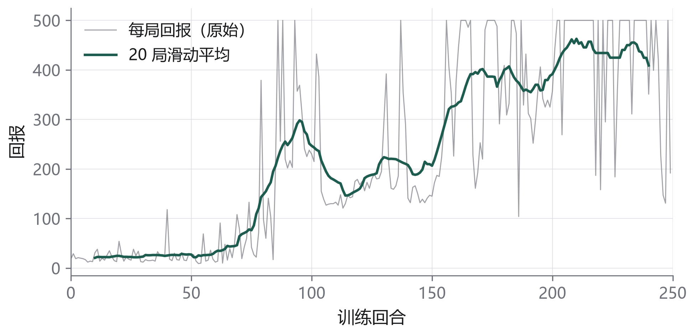

## 把训练过程画出来

一个实验跑完，你会拿到一串数字。每局的回报，每局的步数，可能还有损失值和探索率。这些数字直接看是看不出东西的，必须画成曲线。

画曲线本身不难，难的是读。同一组数据，用不同的窗口平滑，讲出来的故事可能完全相反。这一章讲怎么画、怎么读，以及几个常见的坑。

### 原始曲线先看一遍

图 6-1 是 DQN 在 CartPole 上训练两百五十局的真实数据。灰线是每局的回报，绿线是二十局的滑动平均。



灰线的抖动幅度很大。相邻两局可能一个五十步一个三百步，因为环境的初始状态随机，策略一点点不同就会导致结果差很远。如果只看某一段灰线，很容易得出错误结论，比如“第一百八十局性能崩了”，其实那只是正常的波动。

绿线把抖动压下去了，趋势清楚很多。它在一百局之前接近零，一百到一百五十局之间抬起来，之后在一百五到四百之间来回，最后稳定在四百以上。

### 平滑的代价

滑动平均好用，但有代价。

第一是延迟。窗口二十，曲线会滞后十局左右。真实性能在第一百局开始提升，平滑曲线要到第一百一十局才明显抬起来。窗口越大，滞后越严重。

第二是掩盖细节。如果性能在第两百局有一个短暂的高峰然后掉下去，窗口二十可能把它抹成一个小鼓包，容易被忽略。图 6-1 的灰线里，第一百六十局附近有一个跳到三百的时刻，平滑之后只剩一个浅浅的凸起。

第三是边界效应。序列开头和结尾没有足够的邻居，常见的做法是丢掉，或者用特殊方式填充。如果处理得不好，曲线两端的形状会骗人。

所以比较稳妥的做法是两个都画。灰线看有没有异常，绿线看趋势。只看一个都不够。

### 三个常用的指标

回报是最直接的指标。CartPole 里它等于坚持的步数，越高越好。有些任务的回报需要标准化，否则不同任务之间没法比较。

回合长度是回报的补充。有些环境里，活得更久本身就有意义，即使奖励没有增加。回合长度突然变短，往往意味着策略学坏了，开始主动结束回合。

成功率适合分对错的任务。网格世界里走到终点算成功，掉陷阱算失败。成功率的好处是直观，坏处是它太粗，前面已经看到过，三十局就饱和，看不出后面的改进。

还有一个指标值得看，动作分布。如果策略学会了总是选同一个动作，即使回报暂时还行，也预示着它可能卡住了。这个信息在回报曲线上完全看不出来。

### 训练回报和评估回报

这是最容易搞混的一点。

训练时智能体在探索，会故意做一些看起来糟糕的动作。所以训练回报天然偏低，不能代表真实水平。评估时关掉探索，选最优动作，得到的数字才是策略的真实表现。

两者可能差很多。第九章的 PPO（proximal policy optimization，近端策略优化，2017 年提出）实验里，训练回报的滑动平均在六百局左右只有一百七十上下，而同一时刻用贪心策略评估，能拿到接近五百。原因是策略还带着不小的随机性，采样时的表现远低于它最好的一面。

所以报告结果时要说清楚是哪一个。只报训练回报，会低估自己；只报评估回报，别人不知道训练有多稳。比较规范的做法是都给，并且说明评估用了多少局、是否固定种子。

### 画图的代码

画图本身只有几行。

```python
import matplotlib.pyplot as plt
import numpy as np

def moving(values, window=20):
    kernel = np.ones(window) / window
    return np.convolve(values, kernel, mode="valid")

returns = np.asarray(result["returns"])
plt.plot(returns, color="0.65", lw=0.7, label="raw")
plt.plot(moving(returns), color="#1E5C4F", lw=1.6, label="smoothed")
plt.xlabel("episode")
plt.ylabel("return")
plt.legend()
plt.savefig("curve.png", dpi=200, bbox_inches="tight")
```

注意 `mode="valid"` 会让曲线短一截，横坐标要相应偏移，否则曲线会整体左移一点。这个细节不影响趋势，但会让图对不齐数据。

如果要比较几个算法，每个算法跑几个种子，画中位数曲线加四分位区间，比只画一条线更可信。第十一章会做这件事。

### 图要能自己说话

最后说一个习惯。每张图都要能回答三个问题：横轴是什么，纵轴是什么，几条线分别是谁。

坐标轴要写单位。窗口大小要写在图例或说明里。种子数要标出来。如果有基准线，比如 CartPole 的五百步上限，画一条虚线，读者一眼就知道离上限还有多远。

这些细节看起来琐碎，但它们决定了别人能不能看懂你的图，也决定了三个月后的你自己能不能看懂。

下一章把神经网络请进来，解决表格装不下的问题。
