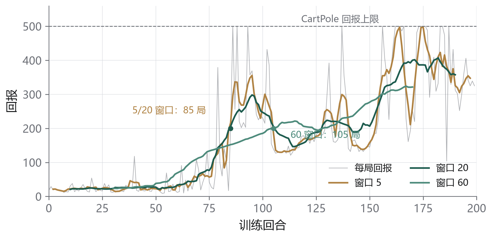

## 把训练过程画出来

一个实验跑完，你会拿到一串数字。每局的回报，每局的步数，可能还有损失值和探索率。这些数字直接看是看不出东西的，必须画成曲线。

画曲线本身不难，难的是读。同一组数据，用不同的窗口平滑，讲出来的故事可能完全相反。这一章讲怎么画、怎么读，以及几个常见的坑。

### 原始曲线先看一遍

图 6-1 是 DQN 在 CartPole 上训练两百五十局的真实数据。灰线是每局的回报，绿线是二十局的滑动平均。


灰线的抖动幅度很大。相邻两局可能一个五十步一个三百步，因为环境的初始状态随机，策略一点点不同就会导致结果差很远。如果只看某一段灰线，很容易得出错误结论，比如“第一百八十局性能崩了”，其实那只是正常的波动。

绿线把抖动压下去了，趋势清楚很多。它在一百局之前接近零，一百到一百五十局之间抬起来，之后在一百五到四百之间来回，最后稳定在四百以上。

抖动不是噪声，它带着信息。CartPole 每局开始时小车位置、速度、杆子角度、角速度都在一个小区间里随机，有的开局几乎竖直，有的开局已经歪了零点零四弧度。同一个策略碰上难开局可能只撑五十步，碰上好开局能撑四百步。所以灰线的起伏里有相当一部分是环境发的牌，不是策略在变。把这一层想清楚，才不会对着一个低谷下结论说模型崩了。

### 平滑窗口怎么选

图 6-2 用同一个种子（第零号）的数据画了三个窗口。灰线是每局回报，另外三条分别是窗口五、二十、六十。



三条曲线来自同一份数据，读出来的结论却不一样。窗口五几乎贴着原始曲线，抖动还在，只是尖刺被削掉一点。窗口二十把趋势压得比较平，能看出八十局附近抬起、一百八十局附近到顶。窗口六十最平滑，代价是整条线向右拖，一百零五局才越过两百，而窗口五和二十在八十五局就过了。

越过同一个门槛的时间差，就是平滑带来的延迟。滑动平均相当于一个低通滤波器，窗口越长，能通过的频率越低，相位滞后越大。经验上一半窗口就是滞后，窗口六十大约滞后三十局，图里实测的二十局差也在这个量级。

窗口大还会削峰。同样一条曲线，窗口五的峰值是四百九十七，窗口二十是四百零七，窗口六十只有三百二十四。真实数据里那一局确实到了五百，可是窗口六十给出的印象是“一直没学会”。如果有人只看到窗口六十的图，会以为训练停滞，其实只是峰被平均掉了。

我的习惯是窗口取训练局数的十分之一到二十分之一，两百局就用十到二十。这个比例保证一条曲线里至少有十个窗口宽度，趋势看得出来，峰谷也不至于被抹平。局数上千的 PPO 实验，窗口三十到五十比较合适，第九章的图用的是三十。

滑动平均给每个点同样的权重，指数加权让近的点权重大，滞后又小一些。它的实现只要几行。

```python
def ewma(values, alpha=0.05):
    out = []
    last = values[0]
    for v in values:
        last = alpha * v + (1 - alpha) * last
        out.append(last)
    return out
```

alpha 越小越平滑，滞后也越大。它不需要丢掉开头，代价是开头那段被初值带偏，读图时要忽略前几十局。两种平滑各有各的毛病，选一个自己说得清的就够了，别在同一张图里混着用。

### 平滑的代价

滑动平均好用，但有代价。

第一是延迟。窗口二十，曲线会滞后十局左右。真实性能在第一百局开始提升，平滑曲线要到第一百一十局才明显抬起来。窗口越大，滞后越严重。

第二是掩盖细节。如果性能在第两百局有一个短暂的高峰然后掉下去，窗口二十可能把它抹成一个小鼓包，容易被忽略。图 6-1 的灰线里，第一百六十局附近有一个跳到三百的时刻，平滑之后只剩一个浅浅的凸起。

第三是边界效应。序列开头和结尾没有足够的邻居，常见的做法是丢掉，或者用特殊方式填充。如果处理得不好，曲线两端的形状会骗人。

所以比较稳妥的做法是两个都画。灰线看有没有异常，绿线看趋势。只看一个都不够。

### 平滑之外的几种做法

滑动平均是最省事的一种，但它不是唯一的选择，也不总是最合适的。

中位数滤波对尖刺更狠。窗口二十的滑动平均会把一个两百步的低谷拖成一条缓慢的下坡，中位数滤波则直接忽略它。好处是趋势更干净，坏处是真正的性能下滑也会被一起忽略。如果关心的是“有没有突然崩”，中位数滤波不适合，它天生就在删掉突变。

更稳的做法是先按种子平滑，再跨种子取中位数。顺序颠倒过来，先算所有种子的平均再平滑，等于把运气好的种子和运气差的种子混成一条不存在的曲线，任何一条真实实验都不会走出那个形状。第十一章会详细讲这件事，这里先记住原则，汇总永远放在平滑之后。

有时候干脆不平滑。报告最终成绩的时候，一张表里列每个种子的评估回报，比一条漂亮的曲线更有说服力，因为读者能自己判断离散程度。曲线用来讲过程，表格用来报结果，两件事不要互相替代。

还有一种半平滑的做法，保留原始曲线但把评估点标上去。评估点是用固定种子跑的，噪声比训练回报小得多，把它们画成单独的散点，既能看清真实水平，又不会被平滑的滞后误导。后面画图那节会给代码。

### 三个常用的指标

回报是最直接的指标。CartPole 里它等于坚持的步数，越高越好。有些任务的回报需要标准化，否则不同任务之间没法比较。

回合长度是回报的补充。有些环境里，活得更久本身就有意义，即使奖励没有增加。回合长度突然变短，往往意味着策略学坏了，开始主动结束回合。

成功率适合分对错的任务。网格世界里走到终点算成功，掉陷阱算失败。成功率的好处是直观，坏处是它太粗，前面已经看到过，三十局就饱和，看不出后面的改进。

还有一个指标值得看，动作分布。如果策略学会了总是选同一个动作，即使回报暂时还行，也预示着它可能卡住了。这个信息在回报曲线上完全看不出来。

### 把三个指标放在一起

光说“回报、长度、成功率”还不够，得知道它们各自能分辨出什么。第零到第二号种子各跑两百局，每局记录回报和长度，同时统计长度达到四百七十五局的局数占比，当作成功率。

三个种子的平均回合长度分别是一百七十五、九十六、一百零六局。这个差距在回报上看是三百五十七、一百五十五、一百六十。两个指标说的是同一件事，回合长度更好读，因为它有物理单位，一看就知道平均撑了多久。

成功率就没这么细了。三个种子分别是百分之十、百分之一和零。种子零在一百七十五局之后连续到了五百，成功率被拉到一成；种子一和二从头到尾没有一局接近上限，成功率接近零。这个指标把“快要学会”和“完全没学会”压成了同一个数字，中间过程全部丢失。它适合最终验收，不适合盯训练。

这也解释了为什么分对错的任务里成功率会显得那么好用。网格世界只有走到终点和没走到两种结局，成功率就是全部信息。CartPole 的回报是连续的，硬切一个阈值反而丢信息。指标要和任务的奖励结构匹配，不能照搬。

### 动作分布要看条件

动作分布这个指标，用错了地方会得出相反的结论。

上面三个种子，整个训练过程中向右推的动作占比分别是零点四九、零点五零和零点五零，最后五十局是零点四九、零点五三和零点四八。看上去策略什么都没学到，一直在左右乱按。

可是把训练好的网络拿去跑贪心策略，按杆子倾角分桶统计，事情就清楚了。倾角在负零点一六弧度附近时，向右推的比例是零点二四；负零点一二时是零点四二；接近零时是零点七六；正零点零四时是一。也就是说，杆子往右倒，策略就更倾向于往右推，正好是平衡杆子该做的事。

```python
bins = np.linspace(-0.22, 0.22, 12)
k = np.digitize(obs[2], bins) - 1        # obs[2] is the pole angle
total[k] += 1
right[k] += action                       # action 1 pushes right
```

总体比例接近一半，是因为这条规则本身对称。杆子左倒和右倒的机会差不多，往左推和往右推的次数自然差不多。只看总数，等于把一条有结构的策略平均成了一条没有结构的策略。

所以动作分布要按状态条件化。离散状态的任务可以每个状态画一张动作直方图，连续状态的任务按关键维度分桶，或者干脆算动作与某一维观测的相关系数。回报曲线告诉你学得好不好，条件动作分布告诉你学到的规则对不对，两个问题不一样。

### 训练回报和评估回报

这是最容易搞混的一点。

训练时智能体在探索，会故意做一些看起来糟糕的动作。所以训练回报天然偏低，不能代表真实水平。评估时关掉探索，选最优动作，得到的数字才是策略的真实表现。

两者可能差很多。第九章的 PPO（proximal policy optimization，近端策略优化，2017 年提出）实验里，训练回报的滑动平均在六百局左右只有一百七十上下，而同一时刻用贪心策略评估，能拿到接近五百。原因是策略还带着不小的随机性，采样时的表现远低于它最好的一面。

所以报告结果时要说清楚是哪一个。只报训练回报，会低估自己；只报评估回报，别人不知道训练有多稳。比较规范的做法是都给，并且说明评估用了多少局、是否固定种子。

### 差距有多大

前面那组 DQN 实验里，三个种子在第一百七十五局和第二百局各做了一次十局的贪心评估。

种子零最后五十局的训练回报是三百五十七，第一百七十五局和二百局的评估都是五百，差了将近一百五。种子一最后五十局是一百五十五，两次评估分别是一百六十四和一百四十，几乎一样。种子二最后五十局是一百六十，评估是一百四十九。

差距的方向并不统一，原因有两个。一是种子零的训练回报里还混着百分之二的随机动作，偶尔按错一下就会掉几十步；二是评估只有十局，十局的平均本身就有几十的波动。种子一和二在后期已经卡在一百五附近，随机动作的影响反而小了。

第九章的 PPO 差距更大，训练回报的滑动平均一百七十，评估接近五百，因为它的策略熵还很高，采样时的随机性远大于 DQN 的百分之二。同样是“训练回报”，在不同算法里含义完全不同，跨算法比较训练回报是没有意义的。

### 评估协议怎么写

评估不是跑一遍取个平均就完事，它需要一份写下来的协议，否则下次自己都对不上。

第一条，评估时用贪心还是采样。贪心给出策略的上限，采样给出策略的平均表现。做部署关心前者，做理论分析关心后者。写清楚用的是哪个，别只写“评估回报”。

第二条，局数。十局的均值标准误大约是标准差除以根号十，CartPole 上标准差能有八十，标准误就有二十五。两个算法差二十，十局评估根本分不出来。至少三十局，最好是五十局，或者干脆报置信区间。

```python
import numpy as np

def bootstrap_ci(scores, n_boot=2000, seed=0):
    rng = np.random.default_rng(seed)
    scores = np.asarray(scores, dtype=float)
    means = [rng.choice(scores, size=len(scores), replace=True).mean()
             for _ in range(n_boot)]
    return float(np.percentile(means, 2.5)), float(np.percentile(means, 97.5))
```

第三条，种子。评估局面要固定，而且不能和训练用过的局面重叠。训练时如果每局都用 `reset(seed=seed * 10000 + ep)`，评估就用另一个区间，比如从九千开始。重叠会让评估偏乐观，因为模型见过这些开局。

第四条，环境实例。评估单独开一个环境，不要复用训练环境。训练环境里可能还有没结束的一局，内部计数器带着残留状态，拿它评估会莫名其妙地漂。

### 多个种子怎么汇总

一个种子跑出来的曲线，只能说明这条路走得通，不能说明这条路好走。

第七章的 DQN 完整版，三个种子的最终评估是五百、一百七十六点七和一百四十四点二。均值是二百七十三点六，中位数是一百七十六点七。均值比中位数高出一百，因为种子零那一个五百把整体抬了起来。如果只报均值，读者会以为典型表现是两百七，实际上三个种子里有两个停在一百五附近。

所以汇总用中位数加四分位区间。三个种子算四分位有点勉强，五个种子才像样。条件允许就跑五个，报告里写清楚跑了几个。

画图时把每个种子的细线也画上，透明度调低。读者既能看到中位趋势，也能看到最差的那个种子烂到什么程度。只画中位数的图会让人误以为实验很稳，这是强化学习论文里最常见的过度美化。

### 画图的代码

画图本身只有几行。

```python
import matplotlib.pyplot as plt
import numpy as np

def moving(values, window=20):
    kernel = np.ones(window) / window
    return np.convolve(values, kernel, mode="valid")

returns = np.asarray(result["returns"])
plt.plot(returns, color="0.65", lw=0.7, label="raw")
plt.plot(moving(returns), color="#1E5C4F", lw=1.6, label="smoothed")
plt.xlabel("episode")
plt.ylabel("return")
plt.legend()
plt.savefig("curve.png", dpi=200, bbox_inches="tight")
```

注意 `mode="valid"` 会让曲线短一截，横坐标要相应偏移，否则曲线会整体左移一点。这个细节不影响趋势，但会让图对不齐数据。

如果要比较几个算法，每个算法跑几个种子，画中位数曲线加四分位区间，比只画一条线更可信。第十一章会做这件事。

分位带的代码和单条曲线差不多，多两步。

```python
def band(ax, runs, color, label, window=20):
    curves = np.array([moving(r["returns"], window) for r in runs])
    n = curves.shape[1]
    x = np.arange(n) + window // 2
    mid = np.median(curves, axis=0)
    lo = np.percentile(curves, 25, axis=0)
    hi = np.percentile(curves, 75, axis=0)
    ax.plot(x, mid, color=color, lw=1.6, label=label)
    ax.fill_between(x, lo, hi, color=color, alpha=0.16, linewidth=0)
```

`fill_between` 的 `linewidth=0` 很重要，不设的话边界会多出一圈深色描边，两条带子叠在一起时显得很脏。透明度零点一五到零点二之间比较合适，再深就盖住后面的线。

如果要把评估点叠在训练曲线上，横坐标用局号，纵坐标用评估回报，画成小圆点。评估点不参与平滑，它本身就是低噪声的估计，叠上去能让读者看到“曲线抬高”和“真实水平提高”是不是同步。图 6-2 里那三个圈就是门槛穿越点，同样的做法可以用在评估点上。

### 四种常见的图骗术

有些图画得很好看，但它讲的故事是假的。下面四种不需要造假数据，只要在画法上动点手脚。

只画最好的种子。三个种子里挑一个五百的，曲线漂亮得像教科书。读者不知道另外两个停在一百五。这种图在非正式交流里很常见，在正式报告里等于撒谎。

截断纵轴。把纵轴从三百开始，两条差二十的曲线看起来差一倍。纵轴从零开始是默认礼貌，除非数据本身远离零，那时要在图注里说明截断的理由。

事后挑窗口。先跑十种窗口，挑一个让结论最明显的画出来。窗口是超参数，挑它和挑学习率一样需要原则，不能看着结果挑。

混着比。A 算法画训练回报，B 算法画评估回报，B 自然好看。或者 A 用十个种子取中位，B 用一个种子。比较的前提是评估方式一致，这一点比算法本身更容易出错。

还有一种不算是骗，但同样误导，就是拿对数纵轴画本来线性的量。对数轴会把早期的缓慢上升放大成陡峭的起飞，看起来学得很快，其实前一百局都在原地。用对数轴要有明确理由，比如跨四个数量级的损失值。

### 图要能自己说话

最后说一个习惯。每张图都要能回答三个问题：横轴是什么，纵轴是什么，几条线分别是谁。

坐标轴要写单位。窗口大小要写在图例或说明里。种子数要标出来。如果有基准线，比如 CartPole 的五百步上限，画一条虚线，读者一眼就知道离上限还有多远。

这些细节看起来琐碎，但它们决定了别人能不能看懂你的图，也决定了三个月后的你自己能不能看懂。

我现在画完一张图会做一遍三行自检。第一行，把图缩小到手机屏幕的宽度，还认得出哪条线是哪条吗。第二行，把图注遮住，能说出纵轴的单位吗。第三行，如果我是审稿人，会问“种子几个”“评估几局”吗，答案有没有写在图上。三行都过了，这张图才算能发出去。

还有一个习惯值得养成，把画图的脚本和结果文件一起留着。图表是从数据来的，数据是从脚本来的，脚本里写着随机种子。三个月后想复现一张图，靠的不是记性，是这条链子还完整。

### 一次完整的读图流程

拿到一条曲线，我一般从右往左看。先看最后一段稳在什么地方，这是结果。再看它是什么时候抬起来的，这是速度。然后看抬起来之前有没有长时间趴在地上，如果有，可能是探索没退完，或者学习率太小。最后回头看中间有没有掉下去又起来，这种反复往往意味着目标网络同步太慢，或者回放池太小。

接着看抖动。同一个阶段的灰线如果宽度超过平滑线高度的一半，说明单局回报的方差很大，任何一个局部的结论都不可靠。这时候要么多跑几百局，要么加评估点，不要直接对某一段下判断。

最后看拐点。拐点出现的位置应该和某个超参数对得上，比如探索率退火的步数、目标网络第一次同步的步数。如果拐点出现得完全没道理，先怀疑数据，再怀疑算法。

这套顺序不需要额外工具，但能挡掉大部分误读。曲线是给人看的，读它的人得知道自己先看什么后看什么，否则眼睛会先被最高的那个尖刺吸引，然后得出一个关于整条曲线的错误结论。

下一章把神经网络请进来，解决表格装不下的问题。
