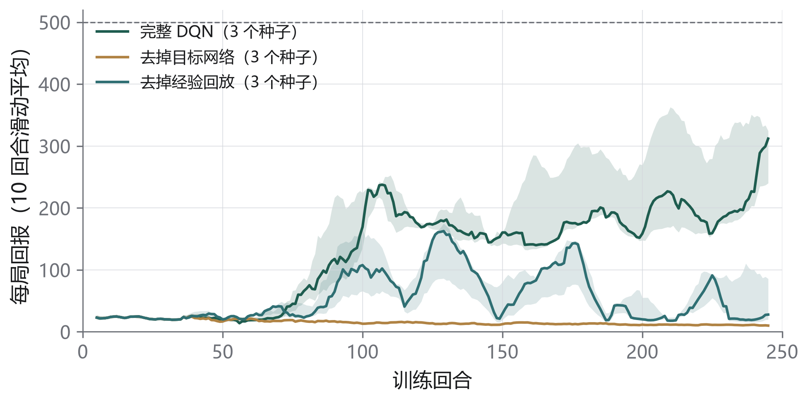

## 经验回放与目标网络：DQN 在 CartPole 上

表格方法装不下连续状态。换成神经网络是对的方向，但直接把表替换成网络，训练几乎一定会崩。

这一章做两件事。先把 DQN 跑起来，让它真的学会 CartPole；再把它的两个关键部件拆掉，看会发生什么。消融实验比任何解释都能说明这两个部件为什么必要。

### 网络长什么样

输入四个观测值，输出两个动作的 Q 值。两层隐藏层，每层一百二十八个单元。

```python
class QNet(nn.Module):
    def __init__(self, obs_dim, n_actions, hidden=128):
        super().__init__()
        self.net = nn.Sequential(
            nn.Linear(obs_dim, hidden), nn.ReLU(),
            nn.Linear(hidden, hidden), nn.ReLU(),
            nn.Linear(hidden, n_actions),
        )

    def forward(self, x):
        return self.net(x)
```

它不输出一个动作，而是输出每个动作的分数。选动作时取分数最大的那个。这样做的好处是，网络同时学到了每个动作的价值，更新时用到的信息更多。

### 经验回放

每走一步，把经历存进一个定长队列。

```python
class Replay:
    def __init__(self, capacity=50000):
        self.buf = deque(maxlen=capacity)

    def add(self, s, a, r, s2, done):
        self.buf.append((s, a, r, s2, done))

    def sample(self, batch, rng):
        idx = rng.integers(0, len(self.buf), size=batch)
        return _stack([self.buf[i] for i in idx])
```

训练时从里面随机抽一批，而不是用刚发生的几十步。这个做法解决两个问题。

一是相关性。连续几步的观测几乎一样，按顺序学会把参数往一个方向推很多次。随机抽样打散了这种连续性。

二是复用。一条经验可以被抽到很多次，样本效率提高。在 CartPole 这种交互便宜的任务上不明显，在真实机器人上这一点非常关键。

### 目标网络

算目标值时需要下一状态的 Q 值。如果这个值也用正在训练的网络算，目标会跟着参数一起动，训练就像追自己的影子。

做法是复制一份网络，隔一段时间同步一次。

```python
target = QNet(obs_dim, n_actions).to(device)
target.load_state_dict(q.state_dict())

# 每 200 步同步一次
if step % 200 == 0:
    target.load_state_dict(q.state_dict())
```

同步太频繁，等于没有目标网络；太慢，目标过时，学得慢。这个数没有通用答案，CartPole 上两百步左右比较合适。

### 还加了一个小改动

标准 DQN 在算目标时用目标网络取最大值。这个操作有一个偏差，它倾向于高估。

```python
with torch.no_grad():
    best = q(s2).argmax(dim=1, keepdim=True)      # 在线网络选动作
    q_next = target(s2).gather(1, best).squeeze(1)  # 目标网络打分
    y = r + gamma * (1.0 - d) * q_next
```

选动作和打分用两个网络，这个改动叫 double DQN，代码只多了两行，稳定性提升明显。它的原理只用一句话说，选动作和打分分开，能压住高估。这里先用上。

### 训练循环

主体和其他算法差不多，多了几个细节。

```python
nxt, reward, term, trunc, _ = env.step(action)
done = term or trunc
buffer.add(obs, action, reward, nxt, float(term))

if len(buffer) >= 1000:            # 先攒一点数据再开始学
    s, a, r, s2, d = buffer.sample(64, rng)
    ...
    loss = smooth_l1_loss(pred, y)
    opt.zero_grad()
    loss.backward()
    clip_grad_norm_(q.parameters(), 5.0)
    opt.step()
```

三个地方值得注意。

存进去的是 `term` 不是 `done`，因为截断不等于终止，计算目标时不该把截断后的未来抹掉。

缓冲区要攒到一千条才开始学。太早学，样本太少，网络会过拟合最初那点经历。

梯度要裁剪。Q 学习的目标值本身就在变，偶尔会出现很大的梯度，裁一下能防止一次更新把网络带飞。

### 结果

三组实验各跑三个种子，每个种子训练两百五十局，最后用贪心策略评估二十局。表 7-1 是结果。

::: {.tabcap}
表 7-1　DQN 与两组消融的最终评估
:::

| 配置 | 种子 0 | 种子 1 | 种子 2 |
| --- | --- | --- | --- |
| 完整 DQN | 500.0 | 176.7 | 144.2 |
| 去掉目标网络 | 9.3 | 9.2 | 9.2 |
| 去掉经验回放 | 29.2 | 12.5 | 117.6 |

图 7-1 是三条中位数曲线，阴影是四分位区间。



读这张图要注意三件事。

第一，去掉目标网络之后，曲线一直贴着底部。评估只有九步左右，比随机策略还差。原因是目标一直在动，网络的输出被自己拖着跑，学不到任何稳定的东西。这个结果非常干脆，几乎不受种子影响。

第二，去掉经验回放之后，曲线能抬起来，但极不稳定，有的种子冲到三百又掉回二十。连续样本让网络在最近这段经历上过拟合，一旦环境稍有变化就崩。

第三，完整版的三个种子差别很大。种子零能到五百，种子一和种子二在一百五附近。这是强化学习的常态，不是实现有 bug。它的根源是随机初始化、探索路径、数据顺序都会累积影响，最后收敛到不同的策略。

### 结果怎么解读

有人会问，既然完整版有两个种子只到一百五，是不是说明 DQN 不行？

不是。它说明这个任务在这个训练预算下，对初始条件敏感。多训练一些局，或者调一下学习率，结果会变。反过来，如果三个种子都完美收敛，反而要怀疑测试有没有问题，比如评估时用了训练种子。

更值得关注的是消融的对比。去掉一个部件就彻底学不动，说明这个部件不是可选项，而是必要条件。这类对比比“我们的方法达到五百”更有信息量。

### 什么时候算学会

判断一个实验成功，不要只看最后一次评估。

先看曲线有没有抬起来。抬起来之后有没有稳住。再看多个种子是否一致。最后用单独的评估跑一遍，确认不是训练时的偶然。

如果一个算法在某一个种子上表现惊艳，其他种子都很差，那它大概率不稳定，不适合直接用在需要可靠性的场景。

下一章换一条完全不同的路。前面所有方法都在学价值，再根据价值选动作；策略梯度直接学动作的概率，不绕这个弯。
