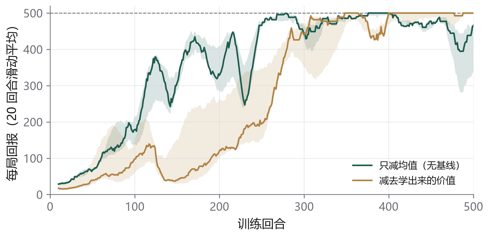

## 策略梯度：REINFORCE 的另一条路

前面所有方法都在做同一件事，先学价值，再按价值选动作。这条路清楚，但绕了一圈。

换一个思路。能不能直接学一个策略，输入状态，输出每个动作的概率，然后用结果的好坏去调整这些概率？做得好的动作以后概率大一点，做得差的以后小一点。这就是策略梯度。

这一章用最朴素的版本跑通 CartPole，然后看看它在哪个地方最脆弱。

### 策略网络

网络结构和 Q 网络几乎一样，区别在最后输出的是每个动作的分数，经过 softmax 变成概率。

```python
class Policy(nn.Module):
    def __init__(self, obs_dim, n_actions, hidden=128):
        super().__init__()
        self.body = nn.Sequential(nn.Linear(obs_dim, hidden), nn.ReLU())
        self.logits = nn.Linear(hidden, n_actions)

    def forward(self, x):
        return self.logits(self.body(x))
```

选动作时按概率采样，不是取最大。这一步很关键，随机性是探索的来源。

```python
dist = torch.distributions.Categorical(logits=policy(x))
action = dist.sample()
logp = dist.log_prob(action)
```

### 学什么

走完一局，把每一步的奖励按折扣加起来，得到每一步之后的回报。然后算一个损失。

```python
returns = discounted_returns(rewards, gamma=0.99)
advantage = (returns - returns.mean()) / (returns.std() + 1e-8)
loss = -(logp * advantage).mean()
```

`logp` 是所选动作的对数概率。`advantage` 是这一步相对这一局平均水平好多少。

这个损失的含义需要想清楚。如果某一步的回报高于平均，`advantage` 是正的，最小化负的乘积等于增大这一步的概率。如果低于平均，概率减小。整个动作是靠“这条路整体比平时好还是差”来评价，而不是每一步单独评价。

减去均值这一步很重要。它不改变方向，只改变尺度，让梯度更稳。不减的话，回报都是正数，所有动作的概率都会被推高，只是推高的幅度不同。虽然方向大体正确，但方差大得多。

### 对数概率到底是什么

`dist.log_prob(action)` 算的是“模型给这个动作的概率，取对数”。概率是 softmax 出来的那个数，比如向左 0.7、向右 0.3；取对数后，0.7 变成负零点三六，0.3 变成负一点二。两个数都是负数，概率越小，负得越多。

为什么不用概率本身，要用对数。两个原因。

一是数值。一整条轨迹的概率是每一步相乘，几十步之后小到计算机存不下；取对数后变成相加，数值稳定。这也是语言模型里“对数概率”到处出现的原因，一段几百个 token 的回答，概率小得无法直接表示。

二是梯度。损失里写的是 `-(logp * advantage)`。当 advantage 为正，最小化损失等于让 logp 变大，也就是让这个动作的概率变大；当 advantage 为负，等于让概率变小。对数把“按比例调整概率”变成了“加减一个数”，更新更平稳，不会因为概率接近零或接近一而失控。

举个具体数字。某个动作概率 0.7，对数约负零点三六；另一个动作概率 0.1，对数约负二点三。两者相差约一点九五。这个差不是“概率差零点六”，而是“概率相差约七倍”。对数概率的差，衡量的是倍数关系，这正是策略梯度需要的尺度。

连续动作里，`dist` 换成高斯分布，`log_prob` 算的是概率密度的对数。密度可以大于一，所以对数值可能为正，这和离散动作的直觉不同，但用途一样，都是衡量“当前策略有多倾向这个动作”。


### 跑出来的结果

八百局，三个种子，每个种子都能稳定到五百。评估回报分别是五百、五百、五百，没有悬念。

图 8-1 显示了学习过程。两条线分别是只减均值的版本，和减一个学出来的价值的版本。



结果有点出乎意料。教科书上说，减去一个学出来的基线能降低方差，学得更快。但在我们的设置里，加上价值网络之后反而慢了一点。

原因可能是这个任务太短。CartPole 一局只有几十到几百步，回报本身的波动不算大，减均值的版本已经足够稳。多一个网络要学，早期的估计很差，反而引入了额外的噪声。

这个结果值得记住。理论上的改进不总是立刻在实验里显现，尤其是在任务很简单的时候。价值基线在长回合、稀疏奖励的任务上优势更明显，因为那时候回报的方差大得多。

### 它最脆弱的地方

REINFORCE（1992 年提出的策略梯度算法）有一个致命弱点，方差大。

同一局里，每一步的动作都被同一个回报加权。如果这一局最终得分很高，即使是里面几步糟糕的动作，也会被奖励。反过来，一局失败，里面几步正确的动作也会被惩罚。局数多了，平均下来方向是对的，但每一次更新的噪声很大。

第二个弱点是样本效率低。每条轨迹用完就扔，不能重复利用。跑八百局才能学会，DQN 在两百多局就有起色。

第三个弱点是策略更新没有约束。一次更新可能把策略推得很远，新策略再也不会产生旧策略那样的行为，之前积累的经验全部作废。

### 三个改进方向

针对这三个弱点，后来出现了很多改进。

降低方差。减去基线是最基本的做法，再进一步是优势函数、广义优势估计，用价值网络估计每一步比平均好多少，而不是用整局的回报。

提高样本效率。让一条轨迹可以被多次使用，用重要性采样修正新旧策略的差异。这会引入新的不稳定，需要额外的技巧控制。

约束更新幅度。限制新策略和旧策略的差距，不让一次更新走太远。这个思路的代表是 TRPO（trust region policy optimization，信赖域策略优化，2015 年提出）和 PPO。

下一章讲 PPO。它把这三点合在一起，成了这几年最常用的算法，从游戏到机器人再到大模型的对齐训练，到处都能看到它。
