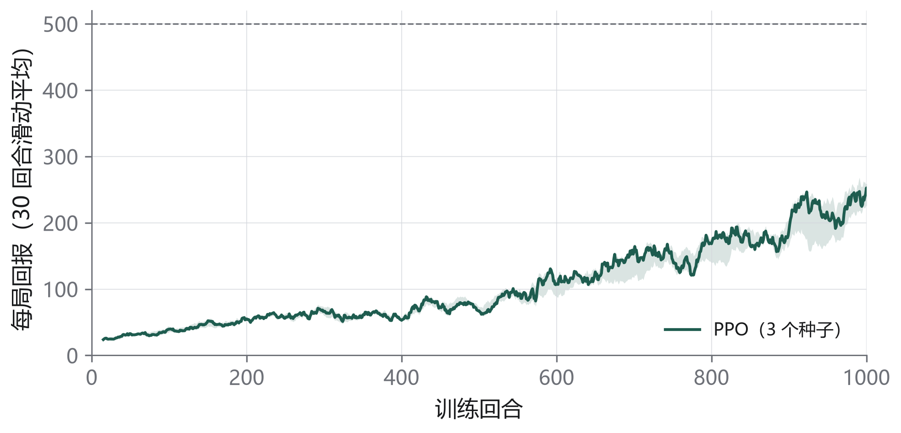

## PPO：让训练稳下来

REINFORCE 能学会，但不稳。样本用完就扔，一次更新可能把策略推到很远的地方，之后就再也学不动了。

PPO 是这几年最常用的解决方案。它加了三个东西：用优势函数代替整局回报，用重要性采样让同一批数据多用几次，用裁剪限制每次更新的幅度。三个改动都不复杂，组合起来效果很好。

### 同一批数据用多次

策略梯度的公式里，梯度是对当前策略的期望。如果你手上有一批旧策略产生的数据，想用它更新新策略，就需要修正两者的差异。

```text
ratio = new_prob(action | state) / old_prob(action | state)
```

这个比值叫重要性采样比。等于一，说明新旧策略在这个动作上一致；大于一，说明新策略更倾向于这个动作。

用它乘上优势，就得到修正后的梯度估计。理论上没问题，实际上很危险。如果比值偏离一太远，估计的方差会爆炸，一次更新就可能毁掉策略。

### 比值能偏多远

比值本身不是问题，问题是它的分布。同一个状态，新旧策略的概率比接近一，说明两个策略在这个状态下想法一致。如果差得多，同一个动作在新策略下可能被采到的概率只有旧策略的十分之一，权重就变成十，再大就是一百。这种样本会把梯度拉向一个方向。

有两种情况会造成极端比值。第一种是某个动作在旧策略下概率极小但恰好被采到，新策略又把它抬高了。第二种是一批数据被反复训练很多轮，策略已经走远，旧概率还停在那里。前者靠提高采样量缓解，后者靠限制训练轮数和裁剪。

我们记录了一个间接指标，近似 KL 散度，它衡量新旧策略差多少。学习率万分之三时，一百二十轮更新里 KL 的均值是零点零零四五，最大不到零点零一。这个量级下，比值几乎都落在正负百分之十以内，裁剪基本不起作用，裁剪比例只有百分之三点五。

把学习率提到百分之一，KL 均值变成零点零一五到零点零二二，最大的一次冲到零点三六，裁剪比例均值百分之十三到十七，最大的一次有六成样本被裁。KL 零点三六意味着新旧策略已经基本不是同一个策略了，这时候重要性采样的修正已经不成立，是裁剪硬把更新拉住。

### 裁剪

PPO 的做法很直接，把比值限制在一个区间里。

```python
ratio = (new_logp - old_logp).exp()
surr1 = ratio * advantage
surr2 = torch.clamp(ratio, 1 - clip, 1 + clip) * advantage
actor_loss = -torch.min(surr1, surr2).mean()
```

`clip` 通常取零点二，意思是比值被限制在零点八到一点二之间。

这个损失的行为需要想一下。当优势为正，也就是这个动作比平均好，损失希望比值越大越好，但裁剪把它卡在一点二，超过就不再有收益。当优势为负，损失希望比值越小越好，同样被卡在零点八。

效果是，策略可以往好的方向走，但每一步有上限。走得太多不会得到额外奖励，也就没有动力走太远。

### min 为什么是悲观的

只看裁剪那一行，会以为这是个“截断梯度”的操作。加上 `min` 之后它的含义变了，它取的是两个替代目标里更小的那个，所以给出的是真实目标的一个下界。

优势为正时，`ratio * A` 随比值上升，裁剪把它卡在一点二，`min` 取小的那个，所以超过一点二之后不再给奖励。优势为负时，`ratio * A` 随比值下降（因为乘的是负数），裁剪卡在零点八，`min` 取更小的那个，所以比值低于零点八之后也不再给奖励。两边都封顶，而且封的是“再往好处走”的收益。

这个设计有一个代价。如果新策略真的比旧策略好很多，比如比值该到二，PPO 也只给一点二的奖励，学习信号被低估了。它宁愿保守，也不愿意因为一次大更新把策略弄坏。在工程上这个取舍很划算。

还有一个细节常被忽略。裁剪只在“往有利方向走太远”时生效，往不利方向走是不裁的。优势为正而比值小于零点八，损失会照常惩罚；优势为负而比值大于一点二，也照常惩罚。换句话说，它允许策略快速远离坏动作，只阻止它过快靠近好动作。

`clip` 取零点二是一个经验值。我们做了三组对照，零点零二、零点二、零点五，两个种子。零点零二的两个种子最终评估是五百和四百九十六，零点二是四百九十六和五百，零点五降到四百六十和三百三十。裁剪太松，一次更新走得太远，后期开始掉；裁剪太紧，更新变慢，但在这个任务上还能跑完。

### 优势怎么算

PPO 通常配广义优势估计，简称 GAE（generalized advantage estimation，广义优势估计，2016 年提出）。

它的想法介于两种极端之间。一种只看一步的奖励减去当前价值，偏差小但方差大；一种看整局的回报减去当前价值，方差小但偏差大。GAE 用参数 lambda 在两者之间插值，通常取零点九五，偏向方差小的那一端。

```python
def gae(rewards, values, dones, gamma=0.99, lam=0.95):
    adv = np.zeros(len(rewards), dtype=np.float32)
    last = 0.0
    for t in reversed(range(len(rewards))):
        next_value = values[t + 1] if t + 1 < len(values) else 0.0
        nonterminal = 1.0 - dones[t]
        delta = rewards[t] + gamma * next_value * nonterminal - values[t]
        last = delta + gamma * lam * nonterminal * last
        adv[t] = last
    return adv + np.asarray(values[:len(rewards)])
```

从后往前扫一遍，每一步把当前的时序差分误差和后面累积的优势按折扣混合。这段代码不长，但它是 PPO 效果好的关键之一，背后的推导可以查 GAE 的原始论文。

### 从后往前扫的直觉

递归那一行值得拆开看。`delta` 是一步的时序差分误差，它衡量“这一步实际拿到的比预期好多少”。`last` 是后面所有步累积下来的优势。把两者按 gamma 和 lambda 混合，相当于把“后面的好消息”折现回当前步。

lambda 等于零时，后面的项全部被乘掉，优势退化成一步的时序差分误差。偏差大，因为一步的奖励不能代表这一步的真正价值；方差小，因为只用一个随机量。

lambda 等于一时，递归不再衰减，优势变成从当前步到回合结束的所有奖励减去当前价值，等价于蒙特卡洛回报减基线。方差大，偏差小。

零点九五就在两者之间，偏向方差小的那一端。它把后面几十步的信息折回来，但折扣让更远的步权重很小，所以不会把一整局的噪声全搬过来。

这一组对照我们也跑了。lambda 取零时两个种子是四百零九和一百五十九，方差大的问题很明显，一个种子学得动，另一个卡住。取零点九五时是四百九十六和五百。取一时是四百九十三和四百九十二，也能学会，但曲线前期的抖动更大。三个值里零点九五最稳。

### 完整的更新

PPO 每轮先收集固定步数的数据，比如一千零二十四步，然后在这一批数据上反复训练几遍。

```python
for epoch in range(10):
    order = torch.randperm(n)
    for start in range(0, n, minibatch):
        idx = order[start:start + minibatch]
        logits, value = model(obs[idx])
        dist = Categorical(logits=logits)
        new_logp = dist.log_prob(act[idx])
        ratio = (new_logp - logp[idx]).exp()
        ...
        loss = actor_loss + 0.5 * critic_loss - 0.01 * entropy
        loss.backward()
```

十遍是常见的设置，批大小一百二十八。损失里还有两项，一个是价值网络的均方误差，一个是熵奖励。熵奖励鼓励策略保持一定的随机性，防止过早收敛到一个确定性策略。

### 一轮更新的完整顺序

把一轮更新写成明确的步骤，比对着一大块代码读更容易发现问题。

先用当前策略跑固定步数，把状态、动作、旧对数概率、奖励、终止标志、价值估计全部存下来。跑的过程中如果一局结束，记下这一局的回报和长度，然后重置环境继续，不要把一局截断在一轮边界上。

再用存下来的价值和奖励算 GAE，得到每一步的优势和目标回报。优势要做归一化，减均值除标准差，这一步对稳定性影响很大，不做的话不同任务的梯度尺度差很多。

然后在内层循环里反复训练。每个小批次重新算一遍对数概率和价值，比值用新对数概率减旧对数概率再取指数，损失是裁剪的演员损失加零点五倍评论家损失减零点零一倍熵。梯度裁剪之后更新参数。

```python
adv = (adv - adv.mean()) / (adv.std() + 1e-8)
for epoch in range(10):
    order = torch.randperm(n)
    for start in range(0, n, minibatch):
        idx = order[start:start + minibatch]
        logits, value = model(obs[idx])
        dist = Categorical(logits=logits)
        new_logp = dist.log_prob(act[idx])
        ratio = (new_logp - old_logp[idx]).exp()
        actor_loss = -torch.min(ratio * adv[idx],
                                torch.clamp(ratio, 0.8, 1.2) * adv[idx]).mean()
        critic_loss = (value - ret[idx]).pow(2).mean()
        loss = actor_loss + 0.5 * critic_loss - 0.01 * dist.entropy().mean()
        opt.zero_grad()
        loss.backward()
        clip_grad_norm_(model.parameters(), 0.5)
        opt.step()
```

顺序里有两个容易错的地方。旧对数概率必须是采样时算的那一份，不能到了训练时再算一遍，否则比值永远等于一，裁剪就失效了。目标回报用的是 GAE 返回的那一份，不是训练中重新估的价值，后者会跟着参数动。

### 还可以提前停

训练遍数是个上限，不是必须跑满。很多实现会在每一轮之后看一次近似 KL，如果超过一个阈值就提前结束这一轮。常见阈值是零点零一五到零点零三。

```python
approx_kl = ((ratio - 1.0) - (new_logp - old_logp[idx])).mean()
if approx_kl > 0.03:
    break
```

这个指标比裁剪比例更直接，它告诉你策略到底走了多远。跑满十遍和提前停的差别在小任务上不明显，在大模型上能省下不少计算，也能避免后期那几轮把策略推坏。

### 结果

三个种子，每个跑一百二十轮更新，大约十万步交互。最终评估回报是 496.3、499.9、477.8。图 9-1 是学习曲线。



曲线上升得比 REINFORCE 慢，但更平滑。两百局时中位数在五十上下，五百局七十左右，七百局一百五十，九百五十局以后到二百一十。最终的评估接近五百，说明策略本身已经很好，只是采样时还带着随机性。

这个差距值得解释一下。训练时的回报来自按概率采样，策略还有不小的熵，所以平均表现偏低。评估时取概率最大的动作，表现自然更好。这两个数字都对，只是衡量的东西不同。

### 三种崩溃与对应的指标

PPO 很少直接发散，但会以几种温和的方式坏掉。它们的共同点是曲线还在跑，只是不再变好，所以靠肉眼很难分辨，得看诊断指标。

第一种是策略熵崩掉。熵奖励的系数是零点零一，学习率又大时，策略会快速变确定，熵从零点六掉到零点三以下，其中一个种子掉破了零点二。表 9-1 里学习率百分之一的两组就是这种情况，最终评估仍然是五百，但采样时几乎不探索了。在简单任务上这不算失败，到了需要探索的任务上就是死局。

第二种是裁剪比例过高。正常情况下裁剪比例在百分之五左右，说明大部分样本的比值都在区间内。一旦长期超过百分之二十，说明每轮更新都把策略推得太远，这时候要考虑降学习率或者减少训练遍数。

第三种是 KL 尖峰。平均值很稳不代表安全，某一次更新可能突然冲到零点三。表 9-1 里学习率百分之一的第二组种子就出现过这种情况，那一次有六成样本被裁。它没把训练弄崩，但那一轮的更新基本无效。看到尖峰就该查那几轮的批次构成，往往是某一局特别长或者奖励特别大。

::: {.tabcap}
表 9-1　学习率对 PPO 健康指标的影响（一百二十轮更新，两个种子）
:::

| 学习率 | 近似 KL 均值 | 裁剪比例均值 | 末轮熵 | 最终评估 |
| --- | --- | --- | --- | --- |
| 万分之三 | 0.0045 | 0.035 | 0.57 | 500.0 |
| 百分之一 | 0.019 | 0.155 | 0.24 | 500.0 |

表里最值得看的是最后一列。两个学习率都到了五百，只看结果会得出“学习率不重要”的结论。看中间三列才知道它们走的是两条路，一条稳，一条靠裁剪硬拉着。如果换一个更难的任务，后者很可能就掉下去了。

### 超参数怎么起手

PPO 的超参数比 DQN 多，但敏感度没那么高，这是它流行的原因之一。下面是我现在用的起手值。

裁剪系数零点二，这是原论文的值，几乎不用改。学习率万分之三，连续动作可以降到万分之一。每次更新收集的步数一两千，环境便宜就多一点。训练遍数十，小批次一百二十八到二百五十六。折扣因子看任务的回合长度，CartPole 用零点九九，LunarLander 用零点九九九。GAE 的 lambda 零点九五。熵系数零点零一到零点零二，任务越需要探索越大。价值损失系数零点五，梯度裁剪零点五。

调参的顺序和学习率的关系最大。先固定其他值，学习率上下各试三倍，看 KL 是否稳定在零点零一附近。KL 太小说明学得慢，可以加大学习率；KL 经常超过零点零三说明太大。这个判据比看回报曲线快得多，几轮更新就能看出来。

然后调训练遍数和批次。两者一起决定同一批数据被利用得多充分。遍数多、批次小，样本效率高但容易过拟合到这批数据上；反过来则稳但浪费数据。

### 和 TRPO 的关系

PPO 常被说成 TRPO 的简化版，这个说法基本准确。

TRPO 把“新策略不能离旧策略太远”写成一个约束，用二阶信息求解，每一步都要算费雪信息矩阵和共轭梯度。理论上更严谨，实际上实现复杂，和现代框架的自动微分配合得也不好。

PPO 把约束换成了裁剪，用一阶梯度就能跑。代价是它没有真正的信赖域保证，只能靠裁剪比例和 KL 监控来事后判断。工程上这个代价可以接受，因为出问题时指标看得见，调一调就能恢复。

理解了这层关系，就能明白 PPO 的裁剪系数和 TRPO 的信赖域半径是一回事，都是控制单次更新的距离。前者粗糙但便宜，后者精确但贵。

### 采样预算怎么分

PPO 的超参数里有一组是绑在一起的，每次收集多少步、更新多少轮、内层训练几遍。它们共同决定了总交互量和每批数据的利用程度。

我们这组实验是一百二十轮更新，每轮一千零二十四步，总共十二万步出头。CartPole 后期一局五百步，前期几十步，平均下来一局大约一百一十多步，所以十二万步对应一千局左右。图 9-1 的横轴是一千局，对得上。

理解这三个数的关系，就能估算训练时间。总步数除以每轮步数得到轮数，轮数乘上每轮的计算量得到时间。每轮的计算量主要由内层训练决定，十遍乘上八个小批次就是八十次反向传播。采集一千步大约半秒，八十次小批次反向传播大约零点三秒，两者差不多，所以采集和训练的时间是平衡的。如果每轮改成四千步，采集占比上升，训练占比下降，整体反而更快，因为大矩阵乘法的效率更高。

预算不足时先加轮数还是先加每轮步数，要看瓶颈在哪。曲线已经抬高但还在上升，加轮数。曲线一直在底部打转，加每轮步数，让每批数据覆盖更多状态。

### 连续动作怎么改

CartPole 是离散动作，PPO 在这里的写法到了连续控制上要换一个分布，其他部分几乎不动。

策略网络输出一个均值向量和一个标准差向量，动作从高斯分布里采样。标准差可以是一个和状态无关的可学习参数，也可以由网络输出，后者更灵活但更难训。

```python
mu, value = model(x)
std = torch.exp(log_std).expand_as(mu)
dist = torch.distributions.Normal(mu, std)
action = dist.sample()
logp = dist.log_prob(action).sum(-1)     # sum over action dimensions
```

三个细节要注意。多维动作的 `log_prob` 要对维度求和，得到一个标量，不然比值的形状会不对。动作要限制在合法范围内，常见做法是用 tanh 压缩，但压缩之后概率密度变了，严格来说要加一个雅可比修正项，很多开源实现省略了它，在小动作范围上影响不大。标准差要有下限，不然训练中期它会塌到零，采样退化成确定性，探索就没了。

熵的计算也不同。离散动作的熵有上界 log(动作数)，高斯分布的熵可以无限大，所以熵系数的绝对大小不能照搬。常见做法是给 log_std 一个小的正则，让它别掉太快，而不是直接加熵奖励。

### 一条曲线不够

PPO 的实验最好同时画三张图，回报、熵、裁剪比例。只画回报，你只知道结果，不知道过程。

回报曲线看学习速度。熵曲线看探索是否还在，它应该缓慢下降，前期不掉得太快，后期也不该完全贴地。裁剪比例看更新幅度，正常值在百分之五上下，长期超过百分之二十就要查学习率。

三张图并排看，很多问题一眼就能定位。回报不涨而熵掉到零，是探索死了；回报震荡而裁剪比例很高，是学习率太大；回报涨得很慢而熵一直很高，是熵系数太大，策略学不尖。

这三张图不用额外代码，训练循环里把每个值记进列表，最后一起画。第六章讲过的平滑、坐标轴、图例规矩照样适用，只是横轴换成更新轮数而不是局数。

### 训练日志要记什么

跑一次 PPO 几十分钟到几小时，事后能拿到什么，取决于跑的时候记了什么。

最起码要记四组数。每局的回报和长度，用来画学习曲线。每轮的近似 KL 和裁剪比例，用来判断更新幅度。每轮的策略熵和价值损失，用来判断探索和拟合状态。每轮的总步数，用来把横轴换算成交互量。

这四组都不贵，内存里存几万个数字不占什么。真正贵的是事后想查却查不到。我曾碰到过一次曲线在两百轮之后缓慢下滑，如果当时记了熵，就能一眼看出是探索死掉，可是只记了回报，只能重新跑一遍复现。

记录方式用追加写的一行一个 JSON，每轮刷一次盘。训练崩了或者手动停了，已经跑的部分还在。这一点在第十一章会再提。

### 为什么 PPO 这么流行

第一是稳。裁剪限制了每次更新的幅度，很少出现训练崩溃。这一点在工程上非常值钱，因为大模型的训练一次要几天，崩了重来代价太大。

第二是通用。离散动作能用，连续动作也能用，只需要把概率分布从类别分布换成高斯分布。连续动作的版本只要把类别分布换成高斯分布，其余部分不变。

第三是实现简单。相比 TRPO 的二阶优化，PPO 只用一阶梯度，代码短，容易调。

缺点也有。样本效率仍然不高，它是在轨算法，数据用完就得重新采样。超参数不少，裁剪系数、学习率、批大小、训练遍数，任何一个调不好都会影响结果。训练大模型时，这些参数往往要花很多时间试。

### 什么时候用它

如果你要解决一个新问题，不确定用哪个算法，PPO 通常是一个合理的起点。它能处理离散和连续动作，对超参数不算特别敏感，社区里的实现也最多。

如果你需要极高的样本效率，比如真机训练，PPO 就不合适了，要看离线方法或者基于模型的方法。如果你的动作空间很小、状态可以枚举，表格方法或者 DQN 更简单。

下一章把环境换掉。同一个算法换一个游戏，会遇到哪些新问题，这一章给出一份检查清单。
