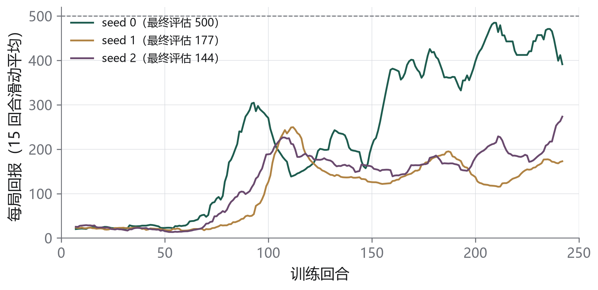

## 把实验写成能重复的样子

强化学习的实验有一个特点，同样的代码跑两次，结果可能差一倍。这不是 bug，是随机性。初始化、探索、环境采样、数据顺序，每一处都在掷骰子。

所以一个实验的价值，很大程度上取决于它能不能被复现。这一章讲怎么把随机性管住，让结果至少在自己机器上是稳定的。

### 随机性从五个地方进来

多数人以为固定一个种子就完事。实际跑起来，随机性至少有五个入口，漏掉一个，复现就会失败。

第一个是环境的初始状态。同一个任务，reset 给出的初始位置、初始速度、初始角度都不一样。CartPole 的杆子初始倾斜在正负零点零五弧度之间随机，小车位置在正负零点零五之间随机，速度也是。这些数字决定了这一局是“好开局”还是“难开局”，而好开局和难开局的学习价值完全不同。

第二个是环境的转移。有些环境在 step 里带噪声，比如风力、地面摩擦的抖动、传感器读数的扰动。CartPole 和 MountainCar 都是确定性的，你给同样的状态和动作，得到的下一状态永远一样。MuJoCo 系列和大多数真实仿真器不是这样，它们的物理步进里嵌着自己的随机数发生器，Python 的 seed 管不到它，要靠 `reset(seed=...)` 或者环境自己的配置项。

第三个是参数初始化。网络权重默认随机初始化，层数一多，初始权重的小差异会放大成完全不同的训练轨迹。强化学习里这比监督学习更严重，因为初期策略决定了采到什么数据，数据的差异又反过来改变梯度，两件事互相加强。

第四个是探索。epsilon 贪婪里那次掷骰子，策略梯度里从高斯分布采动作，都是随机。同一个状态，两次调用可能给出不同动作，之后就走上不同的路。

第五个是数据的组织。经验回放抽哪些样本、一个批由哪几条组成、并行环境里哪个环境先返回，都带随机。前面的四个是“算法语义里的随机”，这一个是“工程实现里的随机”，最容易被忽略，因为它不在任何一篇论文的伪代码里。

::: {.tabcap}
表 11-1　五类随机源与对应的控制点
:::

| 随机源 | 由谁产生 | 固定方法 | 漏掉的后果 |
| --- | --- | --- | --- |
| 环境初始状态 | 环境内部 RNG | `reset(seed=...)` | 每局开局不同，曲线抖动 |
| 环境转移噪声 | 环境物理步进 | `reset(seed=...)`、环境参数 | 同策略回报不可比 |
| 参数初始化 | torch 全局 RNG | `torch.manual_seed` | 曲线形状完全不同 |
| 探索动作 | numpy 或 torch RNG | 两个都设，或专用 Generator | 探索路径分叉 |
| 样本顺序 | 采样器自己的 RNG | 采样器持有独立 Generator | 批组成不同，梯度有差 |

这张表可以当检查清单用。写一个实验脚本，从上往下过一遍，每一行都能回答“我在这里设了什么”，复现性就有了基本保障。

再看一眼这五项，会发现它们分属三层。头两项属于环境，中间两项属于模型和算法，最后一项属于采样器。多数人只固定中间那两项，因为它们在训练脚本里看得见。头两项藏在环境内部，最后一项藏在采样器的实现里，出问题时显得神秘，其实只是没人管。

### 先把种子固定

三个随机源都要管：Python 的随机数、numpy、torch。

```python
def set_seed(seed):
    random.seed(seed)
    np.random.seed(seed)
    torch.manual_seed(seed)
    torch.cuda.manual_seed_all(seed)
```

环境也要给种子。gymnasium 的 `reset(seed=...)` 会初始化环境自己的随机状态。

```python
obs, _ = env.reset(seed=seed * 10000 + episode)
```

如果把每一局都设成同一个种子，环境会重复同一个初始状态，学习会偏。用种子乘一个大数再加局号，可以让每局不同，同时整条实验序列可复现。

GPU 上还有一些非确定性操作，比如某些卷积和矩阵乘法的实现。要求完全一致时，要设置 `torch.use_deterministic_algorithms(True)`，代价是变慢。多数实验不需要这么严格，固定种子就够了。

### 种子给了，结果还是不一样

固定种子之后仍然对不上，通常有三种原因，每一种都值得知道，因为它们会消耗掉排查的大半天。

最常见的是线程数。CPU 上的矩阵乘法会把一次求和拆给多个线程，各自的加法顺序不同，浮点结果的末位就有差别。这个差别小到看不见，但强化学习是自举的，目标值里带着上一次的估计，末位误差经过几千次更新会被放大成可见的分叉。同一台机器上跑两遍，如果线程数由系统按负载决定，就可能出现两遍不一样的情况。

```python
import os
import random
import numpy as np
import torch

def set_seed(seed):
    random.seed(seed)
    np.random.seed(seed)
    torch.manual_seed(seed)
    torch.cuda.manual_seed_all(seed)
    torch.set_num_threads(1)          # stable float reduction order
    torch.backends.cudnn.deterministic = True
    torch.backends.cudnn.benchmark = False
    os.environ["CUBLAS_WORKSPACE_CONFIG"] = ":4096:8"
```

`set_num_threads(1)` 会让训练慢一些，单线程跑 CartPole 的 DQN 差别不大，图像任务上可能慢两三成。要不要付这个代价，看你的目的。如果只是想让自己的曲线能重复，设一位就够了；如果要交给别人逐位核对，才需要把线程数也锁死。

第二种是版本。同一个 `seed` 在 numpy 一点二四和一点二六上，`default_rng` 产生的序列是一样的，但 `np.random.rand` 走的旧接口在不同小版本之间有过改动。环境包更明显，gymnasium 从零点二八到一点零，`reset` 的返回值、`step` 的截断语义都变过。所以真正可复现的不是“种子”，而是“种子加版本号”。记录版本比记录种子更重要，因为种子只有几个字符，版本号一旦忘了就再也找不回来。

第三种是隐含状态。评估环境如果被训练循环复用，它的内部状态会带着上一局的残留。`env.reset()` 不带种子时，用的是环境内部计数器的下一个值，这个值取决于之前 reset 过多少次。所以哪怕训练完全一样，评估结果也会漂。这类问题不看代码很难发现，因为每一行都“看起来对”。

### 种子怎么分工

一个实验里通常要三套种子。训练种子决定初始化、探索、样本顺序；环境种子决定每局的初始状态；评估种子决定评估用的那些局。

把三套分开，好处是能做对照。比如想知道“是初始化运气好还是探索路径好”，就固定环境种子只变训练种子；想知道“策略在不同初始局面上稳不稳”，就固定训练种子只变评估种子。全用同一个数字，任何差异都说不清来源。

实现上最简单的做法是让主种子派生出三套。

```python
seed = 0
set_seed(seed)
env_seed = seed * 10000 + episode     # per-episode initial state
eval_seed = 900000 + seed             # never overlaps training
eval_env.reset(seed=eval_seed + i)    # i is the episode index in eval
```

乘法加法这种派生方式很土，但够用。唯一的要求是两套种子不要撞上，评估集的局面不要出现在训练集里，否则评估会偏乐观。

### 训练日志：跑的时候就留

结果文件是跑完之后一次性写出来的，这有一个隐患。训练跑到一半崩了，或者被你手动停掉，内存里的曲线就没了。日志能把这一段救回来。

日志的粒度是一局一行，追加写，每行立即刷盘。

```python
import json
import time

log = open(root / (name + ".jsonl"), "a", encoding="utf-8")
t0 = time.time()

for ep in range(episodes):
    # ... one episode of interaction and updates ...
    log.write(json.dumps({
        "ep": ep, "ret": total, "len": length,
        "eps": round(eps, 4), "loss": round(float(loss_v), 4),
        "step": step, "wall": round(time.time() - t0, 1),
    }) + "\n")
    log.flush()
```

除了回报和长度，这里面还有三个字段特别有用。`eps` 记下当时的探索率，看到曲线不动时可以立刻判断是探索还没退够还是策略真的没学会。`loss` 记下损失，损失发散往往比回报崩掉早出现几十局，是早期警报。`wall` 记下墙钟时间，能算出还剩多久，也能发现某一段突然变慢，比如经验池满了之后内存压力变大，或者环境开始频繁超时。

日志用 jsonl 而不是 csv，是因为字段会随手加。今天想加一个 q 值的均值，明天想加一个梯度范数，jsonl 直接多一个键就行，csv 要改表头，改完之后旧文件就和新文件对不上了。

### 配置从哪来

写实验脚本最省事的做法是把超参数写成文件顶部的常量，改一次跑一次。这个做法在跑两三组时没问题，跑到二十组就乱了，因为修改历史只存在于你的记忆里。

干净一点的做法是命令行参数，脚本只负责把参数收进一个字典，然后原样写进结果文件。

```python
import argparse

ap = argparse.ArgumentParser()
ap.add_argument("--algo", default="dqn")
ap.add_argument("--lr", type=float, default=5e-4)
ap.add_argument("--batch", type=int, default=64)
ap.add_argument("--seed", type=int, default=0)
ap.add_argument("--episodes", type=int, default=250)
cfg = vars(ap.parse_args())
```

`vars()` 把命名空间直接变字典，省掉手写映射。这个字典原样进 `Result.config`，三个月后打开结果文件，参数就在里面，不用去翻命令行历史。

再加一行代码版本，就基本完整了。

```python
import subprocess

try:
    commit = subprocess.check_output(
        ["git", "rev-parse", "--short", "HEAD"], text=True).strip()
except Exception:
    commit = "unknown"
cfg["commit"] = commit
```

这一行在论文复现里几乎是必须的，因为“同一个仓库”这句话在三个月后没有任何约束力。

### 目录的三条规矩

结果目录的规矩只有三条，做到了就能省掉后面所有的找文件时间。

第一条，原始结果只写一次。跑完写进去，之后只读。想换一种平滑方式、换一种聚合方式，都从原始文件重新算，不要改原文件。这样任何时候都能回到最初的数据。

第二条，文件名要能被模式匹配。`dqn_full_s0.json` 这种三段式，算法、配置、种子各占一段，用通配符 `dqn_full_s*.json` 就能选中一组。不要用 `run1.json`、`final_v2.json`、`新建文件夹` 这类名字，它们只在写下的那半天里可读。

第三条，派生文件另放一处。图片、表格、中间统计量放到 `figures/`、`tables/` 下，不要塞进 `results/`。混在一起之后，画图脚本的通配符会误抓派生文件，出现“多了一条莫名其妙的曲线”这种怪事。

### 一次复现失败的复盘

一个常见的场景值得记下来。三个月前的一组实验，现在重跑，脚本没改，种子没改，结果差了很多。

第一次查，怀疑是随机性，重跑三遍，三遍之间一致，说明随机性控制住了。这一步把问题从“随机”缩小到“环境不同”。

第二次查版本。`pip list` 一看，gymnasium 已经从零点二九升到一点零，`max_episode_steps` 的默认行为没变，但 `reset` 的 `options` 参数有了新的默认值，某个包装器的行为跟着变了。回退版本，重跑，结果对上了。

这类事情不罕见。它说明“复现”不是“跑同一个脚本”，而是“跑同一个脚本加同一套依赖”。所以环境本身也要记，`pip freeze > requirements.txt` 这一行值得成为习惯，哪怕只是给自己看。

还有一种更隐蔽的情况，脚本和依赖都没变，结果还是不同。这时候要怀疑评估环境被复用、`torch` 的线程数由外部环境变量决定、或者某处用了 `time.time()` 做种子。第三种最糟，因为它让实验在原理上不可复现，只能靠重跑统计。

避免这类复盘的办法没有技巧，就是当场留证据。跑实验时把 `pip freeze` 的结果、命令行、配置字典、日志一起放进结果目录。事后不靠回忆，靠文件。

### 把配置存下来

一次实验跑完，最怕的是忘了当时用的什么参数。三个月后回来看曲线，想调一调，发现不知道从哪改起。

解决方法是让结果文件自带配置。

```python
@dataclass
class Result:
    name: str
    returns: list = field(default_factory=list)
    lengths: list = field(default_factory=list)
    config: dict = field(default_factory=dict)
    extra: dict = field(default_factory=dict)

    def save(self, root):
        payload = {
            "name": self.name,
            "returns": self.returns,
            "lengths": self.lengths,
            "config": self.config,
            "extra": self.extra,
        }
        (root / (self.name + ".json")).write_text(
            json.dumps(payload, ensure_ascii=False), encoding="utf-8")
```

文件名里带上实验名和种子，比如 `dqn_full_s0.json`。这样一堆结果放在一起，一眼能看出哪些是同一组。

### 多跑几个种子

一个种子只能说明“这次能行”，不能说明“这个方法行”。

图 11-1 是同一个 DQN 配置在三个种子上的曲线。



三条线的形状差别很大。种子零在一百多局就冲到上限并稳住；种子一和种子二一直在中间波动，偶尔上去又下来。它们的配置完全一样，代码完全一样，只有种子不同。

这不是实现有问题。CartPole 的初始状态、网络的初始权重、探索的随机路径，每一个都会影响最终落在哪个局部最优。强化学习的损失面比监督学习复杂得多，不同起点走到不同的地方是常态。

面对这种结果，正确的做法是报告分布。比如“三个种子的最终评估是 500、177、144，中位数 177”。而不是挑一个最好看的说“我们的方法达到 500”。

三个种子其实也不够。它只能让你看到“存在很大方差”这个事实，不足以给方差一个可靠的估计。想比较两种方法，五到十个种子比较常见，十个以上才谈得上“稳定地更好”。代价是时间成倍增加，所以实际做法是两阶段。先用两个种子快速筛，确认代码能跑通、方向是对的；选定配置后，再用十个种子跑一次确认。两阶段的好处是失败得早，坏配置不会浪费十份算力。

还有一种常被忽略的差异来源，同一组种子下的不同算法，最好用同一批环境种子。这样两组实验面对的局面是同一套，差异就只能来自算法本身，而不是“A 抽到了好开局”。这一点在多环境对比时尤其重要，否则你永远说不清是方法好还是运气好。

### 种子多一点还是环境多一点

算力有限时，一个常见的纠结点是把预算花在更多种子上，还是花在更多环境步数上。

如果曲线还在上升，说明训练没跑完，这时候加步数。曲线已经完全平了、只是在上下抖，加步数没用，应该加种子。判断方法很简单，把一条曲线的后半段放大看，如果趋势是水平线，就是收敛了。

另一个判断依据是方差。同一个配置的多个种子如果在同一个区间内交织，说明差异主要是噪声，加种子能把均值估准；如果分成两拨，一拨学会一拨没学会，说明存在双峰，这时候均值没有意义，应该去查那拨没学会的为什么失败。

### 报告时写清楚

一份能被复现的实验记录，至少包含这几样。

用了几个种子，种子编号是什么。每条曲线是单次结果还是多次平均，平均是怎么算的。滑动窗口多大。评估用了多少局，评估时是否关掉了探索。训练用了多少步或者多少局。

这几项看起来是细节，但少了任何一项，别人就没法判断你的结论有多可靠。

还可以再补三样。环境版本和库版本，因为行为会随版本变。评估的频率和位置，是每十局评一次还是只在最后评一次，这两种做法的曲线形状完全不同。代码的提交号，如果代码在跑实验的过程中改过，那批结果就不能算同一组。

报告里最容易缺的是“失败的那几个种子”。只报成功的种子，读者会高估方法的稳定性；把失败一并列出，反而显得可信，因为读者知道你不会藏。

### 把一次实验打包交给别人

要让别人能重跑，光给代码不够，还需要四个东西放一起。

一个是入口脚本，一行命令就能跑完一组实验，不靠口头交代“先跑这个再跑那个”。一个是配置文件或命令行例子，把关键参数写在里面。一个是结果目录，原始 json 都在，别人可以自己重算图和表。最后是一页说明，写清楚跑多久、需要什么版本、输出在哪里。

这四样加起来不到一小时的工作量，但它把“你帮我看看”从一次配合变成一次自助。作者省时间，读者也省时间。

### 一个容易忽略的地方

很多人会在训练结束后用同一个环境做评估，而且不重置种子。这样评估的结果会受到训练最后几局状态的影响，不同实验之间的比较就不公平。

正确做法是新建一个评估环境，用固定的、与训练无关的种子。

```python
eval_env = gym.make("CartPole-v1")
score = evaluate(eval_env, greedy_policy, episodes=20, seed=1234)
```

评估局数也不能太少。二十局在 CartPole 上够用，因为每局最长五百步，方差相对可控。在奖励稀疏的任务上，可能要一百局甚至更多。

评估还有一个细节，策略在评估时用贪心还是按分布采样。这两件事回答问题不一样。贪心评估回答“它最好能做到多好”，采样评估回答“它平均能拿多少”。论文里常见的是贪心加一个采样版本并排报，因为两者差距大时，说明策略内部很不确定，也可能说明它只会走一条固定路线。

评估频率也要提前定。只在最后评一次，你看不到中途发生了什么；每十局评一次，评估开销会变成训练开销的一成到三成。平衡的做法是每二十到五十局评一次，用三到五局快速看趋势，最后用完整局数做一次正式评估。快速评估的数字只用来判断“有没有起来”，不用来写进结论，因为它自己的噪声就不小。

### 先写一句预判再跑

一个很便宜的习惯，开跑前在笔记里写三行。我想验证什么，我预期曲线会长成什么样，如果没长成这样我准备怎么解释。

写完再跑，好处是事后不容易自欺。曲线不涨的时候，人很容易找一个“反正就是这个原因”的说法，而先写下的预判会提醒你，原来你期待的不是这个。如果实际和预判差很多，那才是真正值得记下来的信息。

三行字不到一分钟，但它把一次实验从“跑了一下”变成“做了一次验证”。长期看，这比多跑十个种子有用。

### 目录怎么放

本书的目录很简单，跑出来的结果都放在 `results/` 下，一个实验一个文件。

```text
books/code/hands-on/results/
├── dqn_full_s0.json
├── dqn_full_s1.json
├── dqn_no_target_s0.json
├── ppo_s0.json
└── ...
```

画图脚本按文件名模式读取，比如 `dqn_full_s*.json`。这样新增一个种子，图片自动把它算进去，不用改代码。

一个小技巧是让跑实验的脚本可恢复。开跑前先检查目标文件存不存在，存在就跳过。这样一组实验跑到一半断了，重新执行同一条命令，只会补上缺的那几个。代价只有一个 `exists()`，省下的是盯屏幕重跑的时间。

```python
out = RESULTS / ("dqn_full_s%d.json" % seed)
if out.exists():
    print("skip", out.name)
    continue
```

这段逻辑在并行环境不稳定的时候尤其有用。八个环境里挂了一个，整组实验就中断了，如果没有跳过机制，你要从头再来一遍。

```bash
for s in 0 1 2 3 4; do
  RLKIT_DEVICE=cpu python run_dqn_cartpole.py --seed "$s"
done
```

命令行里把设备写死成 CPU，是为了让同一组数字来自同一种硬件。显卡和非显卡上的浮点行为不完全一样，混着跑会让对比多一层不必要的噪声。

跑完之后，回头看一眼结果目录。如果文件名需要打开才知道是什么，说明命名没到位；如果同一组实验散在三个地方，说明目录没到位。这两件小事修好了，三个月后的自己会感谢现在的你。

这套做法不复杂，但能省掉大量重复劳动。下一章讲更麻烦的一件事，训练不收敛时怎么办。
