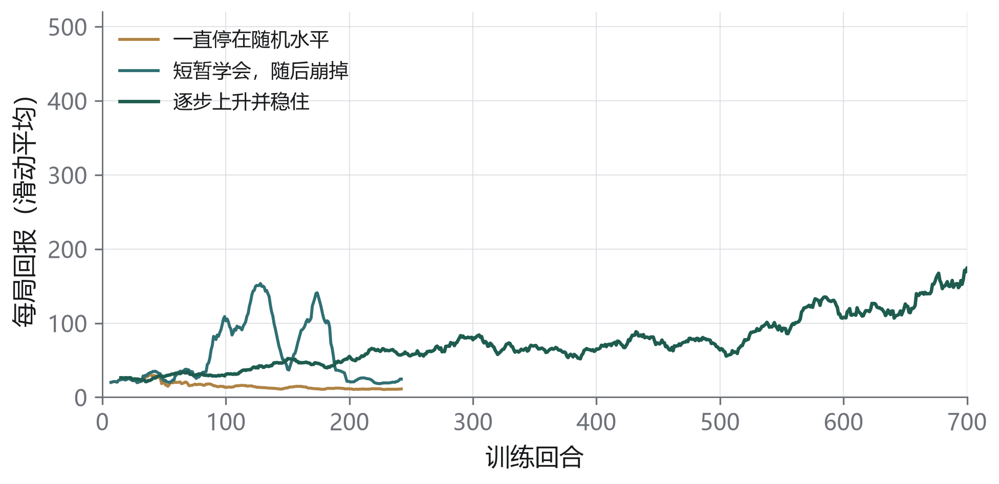

## 奖励不涨时先查什么

训练不涨是常态。多数实验第一次跑都不成，区别在于有人能在半小时内找到原因，有人改了一个星期。

这一章给一份排查顺序。它不是万能清单，但按它走，能排除掉大部分常见问题。

### 为什么要有顺序

排查最容易变成乱试。改学习率，改网络，加个归一化，重启一次，运气好碰对了，也不知道是哪一步起的作用。有顺序的意思是，每一步的结论能排除掉一部分可能，剩下的范围越来越小。

排顺序有两个原则。先查便宜的，能用一个十行脚本验证的，不要用一次三分钟的训练去试。先查能一刀切的，也就是能给出“是”或“否”的检查，而不是“好像有点关系”。

按这两个原则排下来是，接口，奖励，探索，学习率与优化器，网络与目标值，评估。

这个顺序不是因为它符合某种理论，而是因为前面的错了，后面的检查全部白做。接口错了，你看到的任何曲线都是假的。奖励尺度错了，你会误判学习率。评估错了，你会去追一个根本不存在的问题，而且越追越远。

### 先看曲线是什么形状

同样是“不涨”，不同的形状指向不同的原因。图 12-1 是三种真实情况。



一直贴着底部的金色线，是去掉目标网络的 DQN。它从头到尾在十步左右，说明网络根本没学到有价值的东西。

冲高又掉下来的青色线，是去掉经验回放的一个种子。它在第一百五十局左右冲到一百五，然后掉回二十。这说明学到的东西不稳定，一旦数据分布变了就失效。

稳步上升的深绿线，是 PPO。它起步慢，但一直在涨，最后接近上限。

先判断自己属于哪一种，再往下查。

还有两种形状不常被提到，但同样常见。一种是锯齿状的稳步上升，均值在涨，但每几局就掉回来，这通常是学习率偏大加上探索偏强。另一种是台阶状，长时间平，突然跳一段，再长时间平，这多半是探索终于碰到了一个好区域，说明任务对探索的依赖很重。

看形状的时候别忘了看长度。回报低可能是因为策略差，也可能是因为它学会了快速结束，在每步有惩罚的任务上，这两件事很难从回报一个数字上分开。把每局的步数一起画出来，就能分开。

### 一直不动

如果曲线完全没有动静，问题通常在最基础的地方。

奖励有没有传进来。打印几步的 reward，看看是不是全零或者全是常数。有些环境的奖励在 `info` 里，不在返回值里。

动作有没有生效。固定输出同一个动作，看状态是否按预期变化。如果状态不变，说明动作空间或接口用错了。

观测有没有问题。打印观测的均值和范围。如果某一维恒为零，可能是版本不对或者环境配置错了。

损失有没有梯度。打印损失值，看看是不是一直是 NaN 或者常数。如果损失很快变成 NaN，学习率太大，或者目标值爆炸了。

### 环境层：一个十几行的脚本

上面四条可以写成一个十几行的脚本，一次跑完，不用训练也能确认环境层是干净的。

```python
import numpy as np

obs, info = env.reset(seed=0)
print(env.observation_space, env.action_space)
print(obs.dtype, obs.shape, np.round(obs, 3))

total = 0.0
for t in range(20):
    a = env.action_space.sample()
    nxt, r, term, trunc, info = env.step(a)
    total += r
    print(t, "a", a, "r", round(float(r), 3),
          "term", term, "trunc", trunc, "obs", np.round(nxt, 3))
    obs = nxt
print("20 steps, return", total)
```

打印出来看四件事。

奖励是不是常数。如果二十步的奖励全是零，要么这个环境本来如此（稀疏奖励），要么你拿错了字段，有些老环境的奖励藏在 `info` 里。

动作是不是真的生效。随机动二十下，观测应该一直在动。如果观测一动不动，说明动作空间对不上，比如环境要数组你给了整数，或者要整数你给了数组。

终止和截断有没有分开。`term` 为真表示任务真的结束了，`trunc` 为真表示到了步数上限。两者混成一件事，算目标值时会把“被时间切断”当成“真的结束”，学出来的价值偏低。

观测的取值范围是否合理。CartPole 的四维分别对应小车位置、小车速度、杆角度、杆角速度。位置大约在正负二点四之间，角度在正负零点二弧度之间，速度没有硬边界。如果打印出来某一维恒为零，多半是 reset 之后没有走 step，或者你在读缓存。

这四件事查完，环境层就基本干净了。花的时间不到五分钟，但它能排除掉后面一半的误判。

### 奖励层：先手算一个上限

很多“不涨”其实是奖励本身的问题，而奖励最容易被当成“环境给的东西”不去看。

先手算一个数字。CartPole 每走一步给一分，最长五百步，所以一局的回报不可能超过五百。知道这个上限，你看曲线时就有参照，五百就是满分，二十就是平均活二十步。LunarLander 的成功线是两百，Pendulum 的满分差不多是零，随机乱推大约在负一千二。几个常用环境的量级记住了，读数字的速度会快很多。

再看尺度。奖励的形状决定了学习信号的形状，而学习信号会乘到梯度上。奖励乘一百，等价于学习率乘一百。所以同一个学习率在 CartPole 上合适，换到一个奖励以千为单位的任务上就会飞。常见做法是把奖励除以一个估计的标准差，或者把总回报截到一个区间里。这两种做法都会让奖励失去原本的物理意义，所以只在调试时用，做正式实验前要回去确认它没把任务改坏。

还要看符号。每步一个负惩罚，听起来是在鼓励快点结束，实际上确实会。如果任务允许失败终止，智能体会发现“早点死”比“活着被扣分”更划算，于是学会一种很奇怪的策略，往危险的地方走。这类现象在早期文献里被叫作自杀倾向。判断方法很简单，看学会之后的平均步数，如果它明显偏短而且回报不差，就要怀疑奖励设计。

最后一件事，奖励有没有被裁。有些实现会把奖励裁到正负一，这在多任务混合训练时有用，单任务上只会丢掉尺度信息。查一下代码里有没有 `np.clip(reward, -1, 1)` 这类行，有的话就知道你的曲线为什么那么平。

### 探索层：看得到才算探索对

探索的问题不看数据是发现不了的。

第一件事是打印 epsilon 的实际值。如果衰减按步数算，而每局只有二十步，五千步的衰减意味着前两百五十局几乎全是随机。这两百多局里曲线不动是正常的，不是 bug。反过来，如果 epsilon 从第一局就已经很小，那么前期数据全来自一个未训练的网络，学不到东西。

第二件事是数动作。跑一百局，统计每个动作被选了多少次。两个动作的分布如果是一九九比一，说明策略已经死了，探索不够。连续动作上可以看动作的直方图，如果全部堆在边界上，说明输出层的缩放写错了，或者 tanh 一直处于饱和区。

第三件事是比较贪心评估和采样评估。两者差距很大时，说明策略内部很不确定，分布很宽。这本身不是错，但如果贪心评估也差，那就不是不确定，是真的没学会。

### 冲高后崩

曲线能上去，说明学习机制基本正确，问题在稳定性。

最常见的原因是目标值不稳定。检查目标网络有没有正确同步。如果同步太频繁，等于没有目标网络，训练会在某个时刻突然崩。

第二个原因是学习率太大。前期数据少，梯度方向碰巧对，能推上去；数据变多之后，同一个学习率就会产生过大的更新，把参数推飞。把学习率降一半试试。

第三个原因是探索衰减太快。策略过早收敛到一种行为，之后再也出不来。把探索率的衰减拉长，或者提高最终保留的探索比例。

第四个原因是过拟合最近的数据。经验回放池太小，或者批次抽样有问题，网络会记住最近几百步的经历。把池子加大，或者检查抽样是不是均匀的。

还有一种崩法值得单独说，它不属于上面四条。曲线冲上去，然后缓慢地、几乎直线地往下滑，滑到底部。这种形状通常是策略已经把探索退完了，而学到的策略本身有缺陷，一旦没有随机动作救场，就开始稳定地失败。查办法是把 epsilon 的最终值从零点零二提到零点一，看曲线是不是就不滑了。如果不滑了，说明确实是探索退得太干净。

### 学习率与优化器的几个细节

学习率是排查里最容易被乱改的一项，因为改它最方便。但它的作用方式值得弄清楚。

参数的一次更新大约等于学习率乘梯度。梯度的大小由损失决定，损失的大小又由奖励和目标值的量级决定。所以学习率不是一个独立的旋钮，它和奖励尺度、网络初始化、损失函数绑在一起。这解释了为什么论文里的学习率不能照搬。

Adam 多了一层自适应，它会按每个参数的历史梯度缩放步长。好处是对尺度不敏感，坏处是当梯度一直很小时，它仍然会给出一个不小的步长，因为分母里有那个极小的 eps。所以损失看着很小、参数却在飘的情况是存在的。

梯度裁剪要点名。`clip_grad_norm_(params, 5.0)` 在几乎所有 DQN 实现里都出现，它能在目标值突然变大时救一次。但它也会掩盖问题。排查时先把裁剪前的梯度范数打印出来，看它是不是经常超过阈值。如果经常超，说明目标值不稳，裁剪只是在圧症状。

还有一个常见错误，两个网络用了同一个优化器。actor 和 critic 的学习率往往需要差一个量级，共用优化器就只能取一个折中值，两边都不舒服。

### 能上去但很慢

这种最让人犹豫，因为不知道是该继续等还是该改。

先看学习率。慢了通常是因为步子太小。试着把学习率乘三，看曲线是否明显变快。如果变快但仍然不稳，说明原值附近是对的，微调即可。

再看网络容量。一百二十八可能不够，试试两百五十六。如果加大之后没有变化，说明瓶颈不在容量。

第三看奖励设计。如果大部分步的奖励是零，只有终点有分，学习会很慢，因为中间没有任何信号。这时候需要塑形，或者换一个更密集的奖励。

第四看折扣因子。如果任务需要长期规划，gamma 太小会让智能体看不到远处的奖励。试着把它调大，比如从零点九九到零点九九五。

这四个都是“可能有用”的方向，不是“必然有用”。怎么决定先试哪个，看一个东西，回报与步数的比例。如果每步回报不高但局很长，瓶颈在长期信用分配，先调 gamma。如果局很短且回报很低，瓶颈在信号密度，先调奖励。如果两者都正常但就是慢，先调学习率。

### 网络与目标值的检查

网络层的问题不会让曲线直接贴底，但会让它学得别扭。

先看输出层。Q 网络的最后一层如果初始化得很大，一开始的 Q 值就会很大，目标值也跟着大，梯度也跟着大。把最后一层的权重乘上零点零一，许多“开局就飞”的问题会消失。这个技巧在演员评论家类方法里几乎必用，DQN 里用不用都可以试一下。

再看 ReLU 死没死。打印每一层输出为零的比例，如果某一层几乎全是零，说明它已经不工作了，梯度回不去。换成 LeakyReLU 或者调整初始化能缓解。

然后看目标值的量级。打印一个批的 `y` 的均值和最大值。在 CartPole 上，目标值不应该超过几百，因为回报上限就五百。如果看到上万，说明自举发散了。发散往往有两个原因，一是没有目标网络，二是目标网络同步得太慢，用了一个严重过时的估计。

最后看同步频率。把同步周期从两百步改成十步，曲线从稳变震；改成五千步，从头到尾学不动。两个极端都能快速确认你的同步代码有没有接错。这种“拉到极端看反应”的技巧，在调试任何超参时都好用，因为两极的表现差异大，容易分辨。

### 评估层：最常见的假问题

有一类“不收敛”其实是评估错了，训练本身正常。它的特征是训练曲线正常，但报出来的数字难看。

第一个错法，用训练回报当评估。训练时有探索，随机动作会把好局拆掉，所以训练回报永远比真实水平低。拿它下结论，会低估自己的方法。

第二个错法，评估时没关探索。很多人写了一个 `act()` 函数，训练和评估都用它，结果评估时也在随机。这种错误尤其阴，因为差距不大，只是低一点，你很容易以为“就是这个水平”。

第三个错法，评估环境被复用。前面一章讲过，这里再提一次，因为它在排查时最容易被忽略。环境内部有计数器，复用的环境会把上一局的状态带进来。

第四个错法，评估局数太少。五局评估在 CartPole 上的标准差可以到几十，用它区分两个方法，等于抛硬币。想分辨百分之五的差距，得几十局起步。

判断自己是不是遇到了假问题，有一个很快的办法。把训练曲线最后一段的平均值和评估值放一起看。两者差距在百分之十以内，评估可信；差距很大，先查评估流程。

### 一次真实的失败记录

拿一个具体例子走一遍排查。

现象，DQN 跑两百五十局，回报从前十局的 18 到 29 开始，慢慢滑到最后十局的 9 到 13，贪心评估 9.3。曲线是一直贴着底部的金色线。

第一步，环境层。奖励每步一分，正常；随机动作能让杆子晃动，正常；观测四维都在动，正常。排除。

第二步，奖励层。上限五百，实际最高一百一十八，说明偶尔有几步能撑住，不是完全无信号。排除奖励缺失。

第三步，探索层。epsilon 从一降到零点零二，前两百多局探索充分。但既然探索充分还学不会，问题应该在更新上。

第四步，学习率与目标。把目标值的均值打印出来，这类情况通常能看到它一边训练一边往上爬，而真实回报在往下掉。两个方向相反，就基本可以定性，价值估计在自我放大。

原因就在这。去掉目标网络之后，目标里那个取最大值的动作，用的是正在变化的网络自己。参数一变，目标跟着变，网络在追一个自己拉高的靶子。修改办法是加回目标网络，每两百步同步一次，同一个种子重跑，评估从 9.3 变成 500。

另一个例子是去掉经验回放。它的表现完全不同，三个种子的最高回报分别是 355、321、500，但最后十局又掉回十几，评估分别是 29.2、12.5、117.6。这种“尖峰”很容易骗人，因为图上看得到一条很高的线。要学会分辨，尖峰只有一两局宽就是运气，连续几十局保持在高位才算学会。

::: {.tabcap}
表 12-1　常见症状与第一步验证
:::

| 症状 | 最可能的原因 | 第一步验证 |
| --- | --- | --- |
| 从头到尾贴底 | 奖励或接口错 | 打印 reward 与 obs |
| 目标值单调上涨、回报下降 | 自举发散 | 打印目标值最大值 |
| 冲高后平行下滑 | 探索退得太干净 | 把 epsilon 终值调到 0.1 |
| 锯齿状上升 | 学习率偏大 | 学习率除以三 |
| 学会又忘 | 回放池太小 | 池子加到十倍 |
| 训练高评估低 | 评估时仍在探索 | 打印评估用的动作 |
| 评估数字忽高忽低 | 评估局数太少 | 局数加到五十 |

这张表不替代思考，但它能在你毫无头绪的时候给一个起点。用的时候从最像的一行开始，验证完再往下走。

### 排查笔记怎么写

排查过程本身要留记录，不然你会在同一个地方摔倒两次。

格式可以极简，一行一次。改了什么，结果如何，结论是什么。比如“学习率 1e-3 改为 5e-4，曲线不再崩，但慢了一倍，暂定 5e-4”。三列信息，不缺任何一项。

一周之后回头看，这份笔记比任何回忆都可靠。而且它有一个副作用，你会发现自己反复在同一个参数上折腾，那说明问题根本不在那里。

### 关于改代码的纪律

排查时最容易犯的错是一次改三个地方。改完发现好了，也不知道是哪个改动起作用；改完更差，也不知道该退哪个。

一次只改一个，改完跑一次，记录结果。这个习惯听起来笨，但能省下大量时间。

还有一点，改动之后要跑至少两个种子。单个种子的结果可能只是运气，尤其是接近成功的配置，好坏种子之间差别很大。

### 用 AI 帮忙的方式

把曲线形状、关键数字、配置一起交给 AI，比只说“不收敛”有用得多。

可以这样描述。算法是 DQN，环境是 CartPole，缓冲区五万，批量六十四，学习率千分之一，gamma 零点九九，目标网络每两百步同步。训练两百五十局，回报一直停在二十左右，损失从二点一降到一点八就不再动。

这样的描述能让对方直接定位到几个可能的原因，而不是从“强化学习不收敛怎么办”这种大问题开始猜。

反过来，AI 给出的建议要验证。它可能会说“试试把学习率降到万分之一”，这个建议本身没错，但如果你的问题在奖励设计，降学习率只会让训练更慢。判断依据还是曲线。

### 一个心态问题

强化学习的实验周期比监督学习长，一次几分钟到几小时。这意味着试错成本高，也意味着不要在小事上纠结太久。

如果一个问题查了两小时还没头绪，换一个更简单的环境验证想法。CartPole 上能跑通的机制，搬到复杂环境上未必行，但跑不通的机制，在复杂环境上一定不行。用小环境做筛子，是这个领域里最实用的策略之一。

最后一部分再补几个工程上的问题，讲完这些，再回到表达，说怎么把结果讲清楚。
