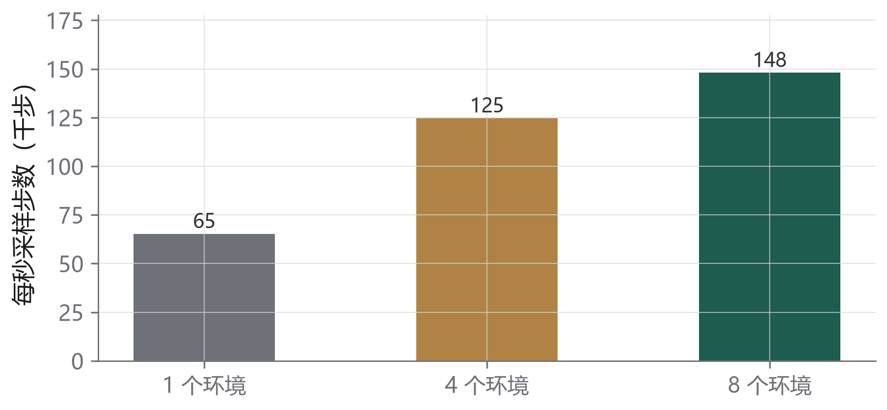

## 并行环境：让采样快起来

训练一个策略，时间大多花在两件事上，和环境交互，更新参数。在 CartPole 这种小任务上，更新参数的开销可以忽略，时间全在采样。

一次只能走一个环境，采样速度就被单线程的循环卡住了。开几个环境同时跑，是最直接的加速办法。

### 慢在哪

跑一段计时就清楚了。单个 CartPole 环境，随机策略一秒能走六万多步。这个数字听起来不低，但一个 DQN 训练要几十万步，加起来就是十几秒到几分钟。

如果是图像输入的环境，一步要渲染一帧几十万像素，速度会掉到每秒几百步，训练一次要几个小时。

采样慢还有一层浪费。更新参数时显卡在算，采样时显卡在等。两者不能重叠，硬件利用率很低。

算一算就知道了。一次训练要五十万步，采样每秒五万步，光采样就是十秒。这个量级还能忍。换成每秒三百步的图像环境，同样五十万步要接近半小时，而这半小时里显卡大部分时间在空转。浪费的不是时间，是你本来可以用来试下一组配置的算力。

所以并行环境的真正价值不在于把一个实验变快，而在于让你一天能试的配置从三个变成十个。这件事对调参的影响比单次提速大得多。

### 一步到底花在哪

要把采样加快，得先知道那一步里发生了什么。

调用 `env.step(a)`，实际经过的不是一个函数，而是一条链。最外层是 user 自己包的 `TimeLimit`、`RecordEpisodeStatistics`，里面是环境的 wrapper，再里面才是真正的物理。每过一层，都要做一次类型检查、一次字典构造、一次参数传递。

CartPole 的物理本身非常短，四个状态变量的积分，不到十行。它跑一次大约几个微秒。但在 Python 里把这次调用从外层送到里层、把返回值包成五元组、再把 terminated 和 truncated 合成一个 done，这一圈下来要十几微秒。

所以小环境的采样速度不取决于物理，而取决于 Python 的函数调用开销。这个结论很重要，它解释了为什么后面那些并行方案在 CartPole 上收益有限。

想验证可以去跑一次 profile。

```python
import cProfile
import gymnasium as gym

env = gym.make("CartPole-v1")
env.reset(seed=0)

def loop(n=5000):
    for i in range(n):
        env.step(i % 2)

cProfile.run("loop()", sort="tottime")
```

排序结果里，`step` 自身的耗时往往排在前面，`np.asarray`、字典创建这些紧跟在后。物理计算的函数可能排在很后面。看到这个分布，就知道该优化哪里了。

### 向量化环境

gymnasium 提供了向量化包装器，把多个环境合成一个，一次 step 返回一批观测。

```python
import gymnasium as gym

env = gym.vector.SyncVectorEnv(
    [lambda: gym.make("CartPole-v1") for _ in range(8)]
)
obs, info = env.reset(seed=0)      # obs has shape (8, 4)
actions = [0, 1, 0, 1, 1, 0, 1, 0]
obs, rewards, terms, truncs, infos = env.step(actions)
```

用法和单环境几乎一样，区别是所有的量都多了一个批次维度。环境自动结束后，`infos` 里会带一个掩码，告诉你哪些位置刚刚重置过。

`SyncVectorEnv` 是同步的，主进程依次调用每个环境的 step。它省不掉 Python 循环，但省掉了环境创建和重置的一部分开销，而且让数据以批的形式返回，方便直接喂给网络。

异步版本 `AsyncVectorEnv` 把每个环境放到单独进程，真正并行。代价是进程间通信有开销，环境很轻的时候反而更慢。

### 同步并行的真实收益

`SyncVectorEnv` 常被误解成“同时跑多个环境”。它并不是。它内部还是一个 for 循环，依次调用每个环境的 step。

那它省了什么。省了三件事。一是你在自己代码里写循环、拼批次、拼掩码的那部分工作，它内部做了。二是自动重置，某个环境结束时它自己接上下一局，你不用写判断。三是接口统一，观测、奖励、终止都多一个批次维度，能直接喂给网络。

它没有省的是 Python 函数调用。所以轻环境上，它不会比你自己写循环快多少，有时还慢一点，因为多了一层包装。

这一点值得记住，因为它影响了后面所有的判断。同步并行是一种“用起来方便”的工具，不是一种“跑得更快”的工具。真正快到需要并行的场景，都出现在单步很重的时候。

### 异步并行与进程通信

`AsyncVectorEnv` 才是真的并行。它给每个环境开一个子进程，主进程把动作发过去，子进程走一步，把结果发回来。

代价在通信。每一步都要把动作序列化、发过去、等结果、反序列化。观测和奖励都是 numpy 数组，序列化一次的开销在几十微秒量级，比 CartPole 走一步贵得多。

用同一套循环、同样的步数、只换包装器，同一时段内测出来的差别很明显。单环境每秒十七万步，换成八个同步环境是十四万步，换成八个异步环境只有三万五千步。异步比串行慢了接近五倍，比同步慢了四倍。

这个结果初看很反直觉。八个进程一起跑，怎么会比一个进程还慢。原因是这里的瓶颈不是算力，而是每步的往返延迟。八个进程确实在同时算，但主进程要等八份回复，而每份回复的固定开销远大于计算本身。算得再快，也快不过通信。粗略算一下，CartPole 一步的物理计算在十几微秒量级，而一次进程间往返的序列化和传输在几十到上百微秒。八个环境摊下来，每一步的等待时间反而比单进程自己算一遍更长。

所以异步并行有适用条件，单步计算要明显大于一次通信的开销。图像输入的任务符合这个条件，渲染一帧要毫秒级，通信的几十微秒可以忽略。CartPole 不符合，它的单步比通信便宜一个量级。

### 实测的加速比

图 13-1 是同一台机器上的测量结果，每一步都走随机动作，总步数固定。



::: {.tabcap}
表 13-1　环境数量与采样速度（CartPole，随机策略，2 万步）
:::

| 环境数 | 用时（秒） | 每秒步数 |
| --- | --- | --- |
| 1 | 0.31 | 65223 |
| 4 | 0.16 | 124657 |
| 8 | 0.14 | 148009 |

从 1 个到 8 个，速度只提高了 2.3 倍，不是 8 倍。原因是 CartPole 太轻，瓶颈不在物理计算，而在 Python 的函数调用和数组打包。环境越重，并行的收益越接近线性。

这个结果值得记住。并行不是万能的，先看清瓶颈在哪。如果瓶颈是 Python 开销，换更底层的实现比加环境更有效。

### 计时怎么做才准

上面这些数字看起来精确到个位，实际上只能信前两位。同一台机器上重跑，每秒步数经常差一成。想把计时做得靠谱一点，有四件事要注意。

先用 `time.perf_counter()`，不要用 `time.time()`。后者在 Windows 上的分辨率可能只有十几毫秒，而一次测量总共才几百毫秒。

先预热。第一次创建环境、第一次分配数组、第一次编译路径，都会把开销算进去。跑两干步扔掉，再开始计时。

重复三次取最小值，不要取平均。平均值会被偶发的系统打扰拉高，最小值更接近“这台机器安静时能做到多少”。

不要在测试脚本里附带训练。同时跑一个神经网络更新，GPU 和 CPU 互相抢，量出来的数字就不再是采样速度。

这四条做到了，次数才能拿来比较。否则你会花半天时间分析一组纯噪声的数字。

即便都做到了，跨时段的比较仍然不可靠。本书写作时，同一个 CartPole 采样脚本在不同时段跑过，单环境的每秒步数从六万五到十七万都出现过，差别接近三倍，机器上有没有别的任务在跑是主要原因。所以本章出现的绝对值只代表“当时这台机器”，真正能带走的是同一时段内的比例关系。

### 加速比要算总时间

还有一个容易搞错的地方，采样快了不等于训练快了。

一次训练的总时间由两部分组成，采样和更新。如果采样占九成，更新占一成，那么把采样提速到原来的 2.3 倍，总时间变成原来的十分之一加九成除以二点三，大约是原来的零点四九，也就是快两倍。真实情况还要加上进程启动、数据搬运、日志写入这些开销，往往要再打个折扣。

反过来说，如果更新占了大头，比如图像任务里网络很大，采样提速对总时间几乎没有影响。这时候该优化的是网络和批处理，不是环境数量。

判断自己在哪一边，很简单。跑一百步采样，计时；跑一百次更新，计时。两个数字一比，就知道瓶颈在哪。这个测量不到一分钟，比猜半天靠谱。

### 环境变重之后，并行才划算

把上面的道理算成一个简单的比例。单个环境一步耗时记作 t，一次进程往返开销记作 c，开 n 个环境。同步版本的时间大致是 n 乘 t，异步版本是 t 加 c（每个环境各自算，主进程只等一次）。

CartPole 上 t 约十几微秒，c 约几十微秒。代入进去，异步版本比同步慢，和实测一致。

图像任务上 t 是毫秒级，c 还是几十微秒。代入进去，异步版本的时间接近 t，也就是接近理论上的 n 倍加速。

这两个式子不需要精确，它们的用处是让你在动手之前先估一下值不值得。算出来提升不到一倍，就别折腾了，把时间花在别处。

### 数据会变得更独立

并行还有一个不明显的副作用，样本之间的相关性变小了。

八个环境各自采样，同一时刻的数据来自八个不同的局面。这比从一个环境连续走八步更接近独立同分布，对训练稳定性有好处。DQN 的经验回放就是为了打散相关性，并行环境从源头上减少了一部分。

这种相关性有多强，可以算一下。单环境连续八步，小车位置和杆角度几乎没变，四维观测里至少两维的变化小到可以忽略。八个环境同时刻的八条数据，四维都在各自的范围里散开，相关性弱得多。

但也不能指望并行把相关性彻底解决。同一个策略在同一个任务上采样，整体分布还是那一套，只是局部不再那么聚。回放池仍然是必需的，两件事互补，不能互相替代。

### 一个够用的默认配置

如果不想每次都重新想参数，下面这套在 CartPole 这类离散小任务上基本能跑通。

八个环境，每次交互拿八条数据。批量六十四，也就是每攒八步更新一次。目标网络每两百步同步。学习率五乘十的负四次方。epsilon 从一线性降到零点零二，总衰减步数五千。每二十局评估一次，每次五局快速看趋势；最后用二十局做正式评估。

这套数字不是最优，但它是一个稳定的起点。先让它跑通，再在上面改一处试一处，比从一个不知道能不能跑通的配置开始调要快。

换任务时，只需要动两三个数。动作空间变大，把网络加宽。奖励尺度变了，按比例调学习率。局变长了，把衰减步数拉长。其余的先不动。

### 多机之后的变化

单机的八个环境跑顺之后，很容易想到多机。道理一样，每台机器再开八个，汇总到一个学习器。

听上去是线性的提升，实际上不是。跨机器要传数据，一条观测加一个奖励在本地内存里只是一个指针，到了网络上就变成一次打包、传输、解包。这个开销比单机进程间通信贵一到两个量级。

所以多机的收益出现在一个很窄的区间里。环境非常重，比如高分辨率渲染或者真实机器人，单台机器的八个环境已经壅满 CPU，才值得上第二台。如果单机上还有空闲的核，先把环境数加到那个上限，比加机器便宜得多。

另一个变化是调试变难。一台机器上出问题，日志在一处；十台机器上出问题，你得先把日志凑到一起。上多机之前，先把单机的日志和指标收集做清楚。

### 要注意的几件事

种子要分开。八个环境如果都用同一个种子，初始状态一样，等于白开。

终止处理要正确。某个环境结束之后，向量化包装器会自动重置它，但要小心把"结束"和"超时"分开，否则计算目标值时会出错。

批次大小要和环境数匹配。八个环境一次给八条数据，如果训练用的批次是六十四，就要攒八次。这个关系要在代码里对齐，不然容易出现半批数据。

### 自动重置的三个坑

向量化环境帮你自动重置，这是便利，也是坑源。

第一个坑，分不清终止和截断。向量化之后，`terminated` 和 `truncated` 是两个独立的布尔数组，千万别提前或起来当 done 用。算目标值时，终止状态不应该加未来价值，截断状态应该加。混在一起，价值估计会系统性偏低。

第二个坑，最终观测被覆盖。环境结束的那一步，返回的 `obs` 已经是重置后的新开局，不是结束时的那个状态。如果你直接拿它当下一状态，学到的就是“从结束跳到新开局”，完全是错的。正确的拿法是 `info["final_observation"]`，里面存着真正的末状态。

```python
obs, reward, term, trunc, info = envs.step(actions)
final = info.get("final_observation")
if final is not None:
    for i, f in enumerate(final):
        if f is not None:
            batch.append((old_obs[i], act[i], reward[i], f, term[i]))
```

第三个坑，随机种子。八个环境用同一个种子，开局完全一样，等于只开了一个。传入一个列表，每个环境一个。

### 数据量与更新量的比例

并行之后，数据来得快，很容易出现“采样一小时、更新一分钟”的不平衡。

平衡的方式是定一个比例。每采一步更新几次，这个数值在不同算法上差别很大。DQN 常见一步一更新，PPO 是一批数据反复用几轮，SAC 是一步一更新再加两个 critic。

定下来之后，环境数量就决定了每次更新前要等多少数据。八个环境，每次 step 给八条，批次三十二就要攒四次。这个关系最好写成一个常量，不要散在代码里，否则改环境数的时候必定漏改一处。

```python
N_ENVS = 8
BATCH = 32
UPDATES_PER_STEP = 1
steps_per_update = max(1, BATCH // N_ENVS)
```

最坑的情况是批次除以环境数除不尽。三十二除以八正好四，六十四除以八正好八，但如果批次是五十，就会剩下两条，日积月累下来样本比例就偏了。

### 采样快不等于学得快

这两个速度经常被混为一谈。

采样速度是每秒能走多少步，单位是步每秒。样本效率是学到同样水平需要多少步，单位是步。一个算法采样可以很快，但需要很多很多步才能学会，结果是墙钟上并不快。

PPO 就是这种。它在八个环境下每秒能采上千步，但它需要上百万步，总共几十分钟。DQN 在同一个环境上每秒只能采几百步，但几十万步就学会了。前者的墙钟并不比后者好多少，但它的稳定性好得多，而且能直接用在连续动作上。

所以在报告加速比的时候，要说清楚“加速的是什么”。采样器并行加的是墙钟速度，不改变样本效率。如果想真的少用数据，要改的是算法，比如加优先回放、用模型辅助、用示范数据。两件事经常被混在一个句子里说，导致很多对比变成鸡同鸭讲。

### 采样器该单独写成一块

并行之后，采样部分的代码会变长，很容易把训练循环捣乱。推荐的做法是把采样器独立出来，对外只给一个接口。

```python
class Rollout:
    def __init__(self, envs, n_steps=8):
        self.envs = envs
        self.n = n_steps
        obs, _ = envs.reset(seed=0)
        self.obs = obs

    def collect(self, policy):
        batch = []
        for _ in range(self.n):
            actions = policy(self.obs)
            nxt, r, term, trunc, info = self.envs.step(actions)
            final = info.get("final_observation")
            for i in range(len(actions)):
                tail = nxt[i] if final is None or final[i] is None else final[i]
                batch.append((self.obs[i], actions[i], r[i], tail,
                              float(term[i])))
            self.obs = nxt
        return batch
```

这个类只有两个方法，但它把重置、终状态、批次拼接这几件脏活全包了。训练循环里就只剩一行 `batch = rollout.collect(policy)`，读起来干净很多。

同时也给调试留了口子。想看每一步发生了什么，把 `n_steps` 设成一，行为就退化成单步交互，和不用并行的写法一样。

### 环境数选多少

没有一个公式，但有三个经验。

第一个，环境数不要超过可用核数。超了之后是进程互抢，加速比会反而下降。先看机器有几个核，留一个给主进程。

第二个，环境数乘上批次粒度，要和网络更新节奏匹配。环境数太大而网络很小，你会把时间花在等数据上，而不是算。

第三个，从八开始试。八是个很实用的数字，它同时满足了几件事，一般机器的核数够，批次能被常见取值整除，内存占用也不高。不够就加到十六，再不够再往上加，每次加一倍，方便看加速比昱减在哪。

### 并行与探索的关系

还有一个常被忽略的副作用，多个环境在一起跑，实际上做了一次隐式的探索增强。

同一个策略在八个环境上同时推，八个局面会分头跑。有的环境会跑到训练数据里很少见的角落，带回一些新样本。这比单环境慢慢地转过去有效率得多。

这个效果在稀疏奖励上尤其明显。单环境一百局可能一次终点都碰不到，八个环境同时一百局，碰到终点的机会变成八倍。所以有些实验在加上并行之后“突然能跑了”，不一定是并行的功劳，而是探索变多了。

分辨的办法很简单，把并行环境数从八降到一，把总步数保持不变，看是不是又跑不动了。如果是，那你的方法本身还不成熟，只是被更多的探索掩盖住了。

### 什么时候不该并行

四种情况下并行是负收益。

环境很轻。前面算过，CartPole 这类环境上并行只会变慢。

你在调试。异步环境的报错栈会把真实错误埋在子进程里，很多异常在主进程里只显示成一个超时。调代码时先用单环境跑通，再上并行。

你要逐位复现。多进程的调度顺序不确定，数据到达的顺序会变，结果就不会逐位一致。这种需求下只能用同步版本，而且最好把环境数设成一。

你只有一两个核。八进程抢两个核，除了上下文切换什么也得不到。先看机器的核数，再决定开几个。

### 谁最需要它

图像输入的任务最需要。Atari（Atari 2600 游戏，2013 年起成为基准）一步的渲染成本是 CartPole 的上千倍，并行能把训练从几天压到几小时。

真实机器人也类似。多台设备同时跑，能在同样的时间里收集更多数据。

如果你的任务是 CartPole 这种轻量环境，先别急着上并行。把网络调小、把更新频率降低，可能比开八个环境更有效。

判断依据就一条，单步耗时和一次进程往返的比。前者比后者小，并行不划算；前者是后者的十倍以上，并行接近线性。这个比值不好测也没关系，拿一个图像任务和一个状态向量任务各跑一次，心里就有数了。

下一章回到算法本身，看 DQN 那几个常见的改进各自在修什么。
