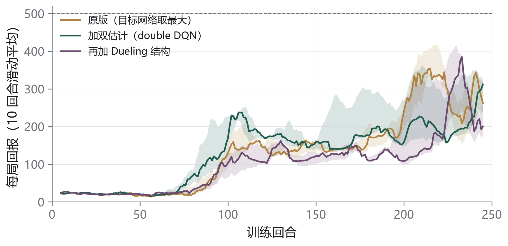

## DQN 的三个改进：Double、Dueling、优先回放

前面实现的 DQN 已经能学会 CartPole。但在更难的任务上，原版会暴露几个问题。

这一章讲三个最常见的改进，每个都只改一小块，效果和代价各不相同。三个实验在同一套代码上跑，方便对照。

### 原版的问题

第一个是高估。目标值里有一个取最大值的操作，它会系统性地偏向噪声大的动作。估计有误差时，被高估的动作更容易被选中，误差沿着自举一路传下去。

第二个是状态价值和动作价值混在一起学。很多状态下动作选哪个差别不大，网络却要为每个动作单独学一遍，浪费样本。

第三个是样本利用率低。所有经验被均匀抽样，那些“错得离谱”的经验本来最该多学几遍，却被淹没了。

三个问题里，第一个最隐蔽。它不会让训练失败，反而会让曲线看起来很好看，因为 Q 值普遍被高估，选出来的动作看上去“回报很高”。等到真的去评估，才发现数字做不得。

这三个问题不是 DQN 的全部问题。后来的改进还有多步回报、分布式价值、噪声探索、竞争式架构等等，它们在更难的任务上提升更大。本章只讲这三个，是因为它们改动最小、最容易看清、也最常被真实项目采用。学和用是两件事，先把改动小的搞明白，再加别的就不容易乱。

### 高估到底有多大

用一个最小例子算一遍就能看清。

假设某个状态的真实价值是零，网络对两个动作的估计各自带噪声，噪声在正负零点五之间均匀分布。真实值都是零，所以两个估计就是一正一负的两个随机数。

取最大值。两个均匀随机数的最大值，期望不是零，而是零点一七左右。噪声越大，偏得越多；动作越多，偏得越多。十个动作一起取最大，期望能到零点四以上。

这就是高估的来源。它不来自任何一个具体的估计错，而来自“取最大”这个操作本身。只要估计有噪声，最大值就有正偏差。而在强化学习里，目标值就是用最大值算的，偏差会沿着自举一轮轮传下去。

更麻烦的是它会自我强化。被高估的动作被选中的概率更大，它的数据被采得更多，而它已经被高估了，于是它的估计更容易继续偏高。

理解了这个机制，就能理解为什么双估计有用。它不是把噪声变小，而是把“选动作”和“评估动作”拆到两个不同的估计上，两个估计的噪声不相关，最大值的偏差就不再直接传给目标。

### 双估计

修高估。做法是把"选动作"和"评估动作"分开。

```python
with torch.no_grad():
    best = q(s2).argmax(dim=1, keepdim=True)      # online net picks
    q_next = target(s2).gather(1, best).squeeze(1)  # target net scores
    y = r + gamma * (1.0 - d) * q_next
```

原版是 `target(s2).max(1).values`，自己选自己评。改成两个网络分工之后，选出来的动作不一定被高估，因为评估用的是另一套参数。

这个写法有三处容易错。

第一处，两个网络用反了。要用在线网络选动作，目标网络打分。反过来的话，目标网络选的动作可能在在线网络上并不最好，更新方向就偏了。代码上很容易手滑，因为两个网络的接口一模一样。

第二处，忘了 `no_grad`。选动作那一步如果带梯度，目标就会带着一条通向参数的路径，反向传播时会多算一份梯度，损失看着正常，学出来的东西不对。

第三处，`gather` 的维度。`argmax` 要带 `keepdim=True`，不然 `gather` 的维度对不上，或者静默地取错列。这种错不会报错，只会让结果差一点，最难查。写完可以加一句断言，把形状打印一次。

```python
with torch.no_grad():
    best = q(s2).argmax(dim=1, keepdim=True)         # (B, 1)
    q_next = target(s2).gather(1, best).squeeze(1)  # (B,)
    assert q_next.shape == r.shape
    y = r + gamma * (1.0 - d) * q_next
```

顺带说一个常见误解，双估计不是“用两个网络算平均”。它不是降低方差的方法，它降的是偏差。两个网络平均一下确实会降低噪声，但目标值里的最大值操作还在，高估也还在。这两件事经常被搞混。

### 为什么它在 CartPole 上看不出效果

一个自然的疑问，高估的危害那么大，为什么加上双估计之后曲线没变好。

因为 CartPole 的高估不致命。这个任务只有两个动作，动作之间的真实差距很大，选错了马上就要态。即使 Q 值普遍被高估了一部分，排序基本不错，策略还是对的。高估的危害主要在“动作差距很小、需要精细分辨”的任务上，比如几个动作只差一点点的控制问题。

另一个原因是回报有上限。五百步封顶，目标值天然有界，不会无限发膘。高估在有界任务上最多让你晚了点收敛，不会让你跑飞。

所以判断双估计值不值得加，不要看小任务上的曲线。看三件事。动作数是不是很多，动作之间的价值差距是不是很小，训练是不是容易在高 Q 值上下不来。三条中两条成立，就值得加。它只多两行代码，算力开销几乎为零，这种情况下没有理由不加。

### Dueling 结构

修状态价值的重复学习。把网络输出拆成两部分，一个状态价值，一个动作优势。

```python
class DuelingNet(nn.Module):
    def forward(self, x):
        h = self.body(x)
        v = self.value(h)             # how good is this state
        a = self.adv(h)               # how much better is each action
        return v + a - a.mean(dim=-1, keepdim=True)
```

减去均值是为了让分解唯一。否则状态价值加一点、优势减一点，输出不变，但两部分没有意义。

它的好处是底层特征共享，状态价值只学一次。动作多的任务上收益更明显。

### Dueling 的减法为什么必要

如果不减均值，这个分解就是不可辨识的。你对状态价值加一，对每个动作优势减一，输出完全不变。两个部分各自训成什么样，取决于初始化和优化路径，不取决于任务本身。

减均值是一个约束，把“优势在动作上的均值等于零”固定下来。这样一来，状态价值就是动作价值在动作上的均值，两边各管一块，分工清楚。

体会一下这个约束在训练时意味着什么。某个状态下四个动作的 Q 值都差不多，优势就都被拉向零，梯度主要去学状态价值。反过来，状态价值稳了之后，优势只管“比其他动作好多少”，学习目标变小了，噪声也就小了。

还有一个工程上的好处，容易被忽略。图像任务里，屏幕上大部分像素和动作选择无关，比如背景。原版网络要拿这些像素去区分每个动作的 Q 值；Dueling 让这些像素只影响状态价值，工作量少了很多。这也是它在 Atari 上有效的重要原因。

两种变体值得一提。有的实现减均值，有的减最大值，两者都能用。减最大值的解释是“最好的动作优势为零”，减均值的解释是“优势平均为零”。文献里两种都出现过，差异不大，用减均值就行。

### 优先回放

修样本利用率。按时间差分误差给样本排优先级，误差大的抽得多。

```python
priority = (abs(td_error) + 1e-6) ** alpha
prob = priority / priority.sum()
```

这个改动有副作用，抽样分布变了，估计有偏。修正的办法是给每个样本乘一个重要性采样权重，并在训练中逐渐加大修正力度。

alpha 控制“按优先级抽”到底有多铁。alpha 为零时退化成均匀抽样，alpha 为一的时候完全按误差抽。常用值在零点四到零点七之间，取一个中间值是因为完全按误差抽会让池子里少数几条异常样本被反复使用，学习会退化。

beta 控制修正力度，从一个小值开始逐渐升到一。一开始不修正是因为初始阶段偏差大、样本少，硬修会让梯度噪声很大；到后期分布稳定了，修正就该跟上，否则估値会一直偏。

本书没有实现优先回放（prioritized experience replay，优先经验回放，2016 年提出）的完整版本，因为它需要改缓冲区、采样器和损失三处，代码量比前两个改进大。思路先记住，实现可以留作练习。

但光看伪代码很容易自信过头，所以下面把三个容易错的地方说清楚，再给一版能跑的简化实现，用来看清它真实的代价。

### 优先回放的三个坑

第一个坑，权重忘了乘进损失。采样分布变了，梯度期望就变了，必须靠权重拉回来。只改采样器不改损失，这个实现就是错的，而且错得很隐晦，因为它能跑出看起来不错的曲线。

第二个坑，权重没归一化。重要性权重的量级很大，直接乘上去会让有效学习率忽大忽小。常见做法是除以当批的最大值，把范围拉回一到几之间，敏感度就正常了。

第三个坑，新样本的优先级。刚进池子的样本还没算过时间差分误差，优先级未知。用零会让它永远抽不到，用随机小值会让它几十局之后才被看见。主流做法是给它当前池子里的最大优先级，保证至少被抽到一次。

还有一个工程上的坑，用 `np.random.choice` 按概率抽。它每次调用都要把整个池子的权重加起来，池子五万条时，一次抽样就是五万次加法。训练四万次更新，就是二十亿次。这个开销比网络前向还大。正式实现要用按优先级分层的树结构，把抽样变成对数次。

### 把优先回放真的写一遍

缓冲区存两份东西，数据和一个优先级数组。新样本进来时给最大优先级，更新时按时间差分误差重算。

```python
class PerBuffer:
    def __init__(self, cap, alpha=0.6, eps=1e-6):
        self.cap = cap
        self.data, self.prio = [], []
        self.alpha, self.eps = alpha, eps
        self.max_prio = 1.0

    def add(self, item, td=None):
        p = self.max_prio if td is None else (abs(td) + self.eps) ** self.alpha
        self.data.append(item)
        self.prio.append(p)
        if len(self.data) > self.cap:
            self.data.pop(0)
            self.prio.pop(0)
        self.max_prio = max(self.max_prio, p)

    def sample(self, batch, rng, beta=0.4):
        p = np.asarray(self.prio, dtype=np.float64)
        prob = p / p.sum()
        idx = rng.choice(len(self.data), size=batch, p=prob)
        w = (len(self.data) * prob[idx]) ** (-beta)
        w = w / w.max()
        return [self.data[i] for i in idx], idx, w
```

损失那里多乘一个权重，更新那里把新的误差写回去。

```python
loss = (weights * F.smooth_l1_loss(pred, y, reduction="none")).mean()
# after backward and step
buffer.update(idx, td_error)
```

跑三组种子，其他设置全部与表 14-2 里“加双估计”那一行一致，只换采样方式。结果如下。

::: {.tabcap}
表 14-1　均匀抽样与优先回放的对照（3 个种子，20 局贪心评估）
:::

| 采样方式 | 种子 0 | 种子 1 | 种子 2 | 中位数 |
| --- | --- | --- | --- | --- |
| 均匀 | 500.0 | 176.7 | 144.2 | 176.7 |
| 按优先级 | 229.1 | 500.0 | 500.0 | 500.0 |

这个结果看起来漂亮，但先别急着下结论。三组种子的波动很大，中位数从一百七十六变成五百，可能真的是优先回放变稳了，也可能只是三个种子换了运气。要确认，得跑到十个种子以上，而每多一个种子，优先回放都要多花一半时间。

更值得看的是分布，不是中位数。开了优先回放之后，三个种子的最后二十局均值分别是 255.5、401.9、500.0；均匀抽样是 399.4、168.5、254.8。两组都有好有坏，但优先回放这一组整体往上移了。基数这么小的时候，看分布的形状比看一个聚合数靠谱。

试过之后才知道的还有一件事，开销不小。同样三个种子，均匀抽样一共用了四分多钟，优先回放用了近六分钟。多出来的部分不是计算，是抽样。如果真要上线，那个树结构是必写的，否则你会花一半时间在选样本上。

### 实验结果

三组配置各跑三个种子，每个种子 250 局。图 14-1 是中位数曲线，阴影是四分位区间。



::: {.tabcap}
表 14-2　三种配置的最终评估（20 局贪心评估）
:::

| 配置 | 种子 0 | 种子 1 | 种子 2 | 中位数 |
| --- | --- | --- | --- | --- |
| 原版 | 324.0 | 113.5 | 500.0 | 324.0 |
| 加双估计 | 500.0 | 176.7 | 144.2 | 176.7 |
| 再加 Dueling | 500.0 | 500.0 | 107.2 | 500.0 |

结果和直觉不完全一致。双估计的中位数反而比原版低，Dueling 的中位数最高，但三个种子里也有一个只到一百出头。

原因有两个。CartPole 太简单，原版也能偶尔冲到五百，高估的害处在这么小的任务上体现不出来。三个种子太少，中位数的波动很大，不足以给三个方法排名。

所以这张表能说明的是"三个改进都能跑通，代码差别很小"，不能说明"哪个更好"。要排名，至少十几个种子，还要在更难的任务上重复。

### 三个种子为什么不够排名

三个种子给出来的信息量比多数人想象的少很多。

把每个种子看成一个样本，三个样本的均值标准误差是标准差除以根号三。CartPole 上同一配置的种子间标准差动辄一百分以上，除以根号三还有六十分。两个方法的均值差不到六十分，你就分不清是方法差异还是噪声。

中位数更糟。三个数的中位数就是中间那个，它只能取三个值中的一个，没有任何平滑作用。表 14-2 里“加双估计”的中位数是一百七十六，“再加 Dueling”是五百，这个差别看起来很大，但两边都只有一个种子过五百，换一批种子就可能翻转。

那怎么办。要么加种子，要么换思路。加种子最直接，十几个种子就能看出分布的形状。换思路的办法是把评估指标从“最终回报”换成更稳的东西，比如学会之前用了多少步，或者最后五十局的均值。这两个指标比单局评估的方差小得多。

还有一个不花钱的办法，配对比较。两种方法用同一批环境种子，逐对相减，得到的差值方差比两个均值各自的方差小得多。因为同一局开局对两种方法的影响方向是相同的，相减时抵消了。

### 三个改进能叠加吗

能，而且实际项目里常常三个一起用。

它们修的是三个不同的问题，双估计修目标的偏差，Dueling 修网络结构，优先回放修数据分布。三者互不干扰，加在一起的总代价也就是两行代码加一个缓冲区改造。

但叠加之后调参会变难。学习率、alpha、同步频率开始互相影响，一个调好了另一个又不对。比较稳的顺序是先把基础版本调好，再逐个加，每加一个就跑一组种子确认没有变差。一次全加上，出了问题你不知道拆哪个。

还有一个隐性的相互作用值得一提。优先回放会把高时间差分误差的样本抽得更多，而高估恰好就会制造出很大的误差。两者放在一起，可能会把那些被高估的样本反复抽出来学，把高估推得更严重。这正是后来那些“双估计加优先回放”组合需要小心调 alpha 的原因。

### 在更难的任务上看

CartPole 上的实验只能说明代码能跑。想看出三个改进的差别，任务得更难一点。

难一档的选择是 LunarLander。它有四个离散动作，回报尺度大，失败会直接给负分，学不好的时候曲线会真的往下掉。在这个任务上，高估的后果明显得多，双估计和 Dueling 的差距开始能看出来。

再难一档是 Atari。它的观测是图像，动作数从四个到十八个不等，回报有正有负。DQN 的三个改进都是在这个基准上被验证的，尤其是 Dueling，论文里的主要证据就来自这里。代价是训练一次要几百万帧，单卡要跑好几天。

如果算力有限，建议在 LunarLander 上做对比。它十分钟到半小时能跑完一组，难度又足够暴露问题，是性价比最高的中间档。

### 一张带阴影的图怎么看

图 14-1 那种画法，中间一条中位数线，外面一层四分位区间。读它的顺序是从外往内。

先看阴影的宽度。阴影很宽，说明种子间差别很大，任何关于均值或中位数的结论都要小心。阴影窄，说明行为稳定，一条主线的位置就很有信息量。

再看三组阴影有没有重叠。中位数差很多但阴影大面积重叠时，差距不一定是真的。中位数差不多但阴影完全分开，反而说明两者的分布形状不同。

最后看时间上的形状，而不是只看末尾。有的配置前期快后期慢，有的相反。只看最终数字会把这两种混成同一种，而它们在实际使用中差别很大，前者适合短预算，后者适合长预算。

这种图也有下限。三个种子算四分位数，每个分位点下面只有不到一个样本，阴影的形状基本是噪声。所以图上写了“3 个种子”，读者就应该把它当成示意图而不是统计结论。

### 三个变体怎么写在一份代码里

最好把三种配置写成一套训练函数加一个参数，而不是复制三份脚本。

理由是复制三份之后，你改了一处忘了另两处，对比就不再公平。而这类错误很难发现，因为三份代码看起来几乎一样。

```python
maker = DuelingNet if variant == "dueling" else QNet
q = maker(obs_dim, n_actions)
target = maker(obs_dim, n_actions)

if variant == "vanilla":
    q_next = target(s2).max(dim=1).values
else:
    best = q(s2).argmax(dim=1, keepdim=True)
    q_next = target(s2).gather(1, best).squeeze(1)
```

两处分支，别处完全一样。同一个种子跑不同变体，初始权重、探索路径、采样顺序全部相同，差异只能来自那两行。这种对照才有说服力。

结果文件名里也把 variant 带上，`dqn_vanilla_s0`、`dqn_dueling_s0`，画图时用两个通配符就能读回两组，不用手写文件名。

参数改得少，日志和结果文件也容易对比。几个变体共用一种格式，打开任何一份都能直接看，不需要先回忆“这一份当时是怎么存的”。

### 怎么选

如果你的任务状态简单、动作少，用原版加双估计就够了。双估计只多两行，几乎没有代价。

如果动作很多，比如几十个离散选项，Dueling 值得加。它能省下不少学状态价值的功夫。

如果样本很贵，比如真机采集，优先回放值得实现。它能把有限的样本用得更充分，代价是实现和调参都更麻烦。

还有一种情况值得单独提，你的任务里存在大量重复、平凡的转移，比如机器人在大部分时间里待着不动。这些样本价值极低，却占满了池子。优先回放会自动把学习重点放到有信息量的转移上，这比手动过滤数据靠谱得多。

三个改进不冲突，可以叠加。实际项目里常见的组合是三个都加，再加上多步回报和噪声探索，这套组合在一些基准上比单项提升明显。

但要提醒一句，叠加不是免费的。每加一个部件，超参数就多一个，调试难度是往上走的。如果时间有限，把基础 DQN 调好、把实验流程做干净，往往比堆四个改进更能拿到可靠的结果。改进是用来解题的，不是用来堆的。

下一章换个动作空间，看看连续动作该怎么办。
