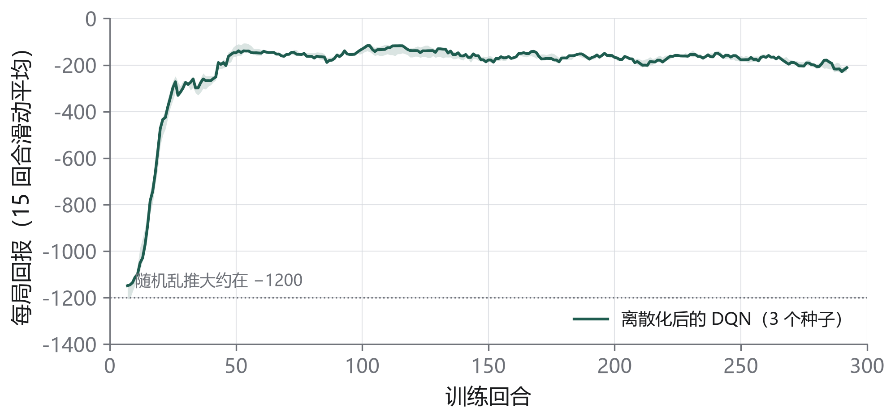

## 连续动作：把扭矩切成七档

CartPole 的动作只有两个，向左或向右。现实里的控制任务很少这么干净，机械臂的关节角度、无人机的推力、方向盘的转角，都是连续的。

DQN 没法直接处理这类问题。它对每个动作算一个 Q 值再比大小，而连续动作有无限多个，比不完。

这一章先用一个最朴素的办法绕过去，把连续动作切成有限档，再看这个办法的极限在哪里。

### 切档

Pendulum 是这类任务的入门环境。一根杆子可以自由旋转，你只能给它一个扭矩，让它从下垂的位置荡起来，停在竖直向上。

扭矩的范围是负二到二。把它切成七档，就变成了七个离散动作。

```python
import numpy as np
TORQUES = np.linspace(-2.0, 2.0, 7)

action_index = 3                  # choose the middle torque
obs, reward, term, trunc, _ = env.step([TORQUES[action_index]])
```

之后所有代码和 CartPole 一样，Dqn、经验回放、目标网络、双估计，一行都不用改。

代价是精度。七档意味着扭矩只能取七个值，中间的控制量全部丢失。档位越多越精细，动作空间越大，学习越慢。这就是离散化的两难。

### 跑出来的结果

三个种子，每个训练三百局，最终用贪心策略评估二十局。

结果比预想的好。三个种子的评估回报分别是负一百八十八、负一百八十、负一百七十九，都在负一百八左右。随机乱推的回报大约在负一千二，说明它确实学会了把杆子稳在某个位置。

图 15-1 是训练曲线。



曲线在五十局左右就抬起来了，之后基本平稳。波动很小，三个种子的带子几乎重合，说明这个任务在这个设置下很稳。

这个结果有一点意外。按教科书的说法，离散化会损失精度，七档应该不够用。但 Pendulum 的最优策略本来就接近"要么全力向左，要么全力向右"，中间扭矩用得不多，所以七档的损失很小。

换一个任务就不一定了。如果最优控制需要精细的力矩调整，比如让杯子里的水不洒出来，七档肯定不够。

### 真正的连续动作方法

要处理真正的连续动作，得换算法。主流的两类是确定性策略梯度和最大熵方法。

DDPG 维护一个 actor 网络，直接输出动作值，不再有"选哪个"这一步。

```python
class Actor(nn.Module):
    def forward(self, x):
        return torch.tanh(self.net(x)) * max_action

class Critic(nn.Module):
    def forward(self, s, a):
        return self.net(torch.cat([s, a], dim=-1))
```

训练时，actor 沿着 critic 给出的梯度调整，让 Q 值变大。critic 用目标网络稳定，动作上加噪声保证探索。

SAC 在 DDPG 基础上加了熵奖励，鼓励策略保持随机，同时用两个 critic 取较小值来抑制高估。它比 DDPG 稳，是目前连续控制最常用的方法之一。

这两类的推导和实现都不短，本书只在概念层面交代。如果你要真正做连续控制，值得单独花时间学一个。

### 四种做法的取舍

::: {.tabcap}
表 15-1　连续动作的几种处理方式（定性对比）
:::

| 做法 | 适用场景 | 样本效率 | 稳定性 | 实现难度 |
| --- | --- | --- | --- | --- |
| 离散化 + DQN | 动作维度低、精度要求不高 | 中 | 好 | 低 |
| DDPG | 连续控制，追求简单 | 中 | 一般 | 中 |
| SAC | 连续控制，追求稳定 | 较高 | 好 | 中高 |
| PPO（高斯策略） | 连续或离散，追求通用 | 低 | 好 | 中 |

这张表只给定性判断，不含实验数字。不同任务上的排序会变，尤其是样本效率，和实现质量关系很大。

### 什么时候离散化就够了

三类情况可以先用离散化。

动作维度只有一两维，比如一个油门或者一个转角。切成十几档，损失可以接受。

任务对精度不敏感，比如"大致停在某个区域"，而不是"精确到毫米"。

你想先验证流程能不能跑通。离散化改动最小，能最快看到曲线动起来。

如果以上都不成立，就老老实实上连续动作算法。硬把高维连续空间切碎，动作数量会指数爆炸，比换算法麻烦得多。

下一章处理另一个常见困境，奖励几乎不出现的时候，学习该怎么发生。
