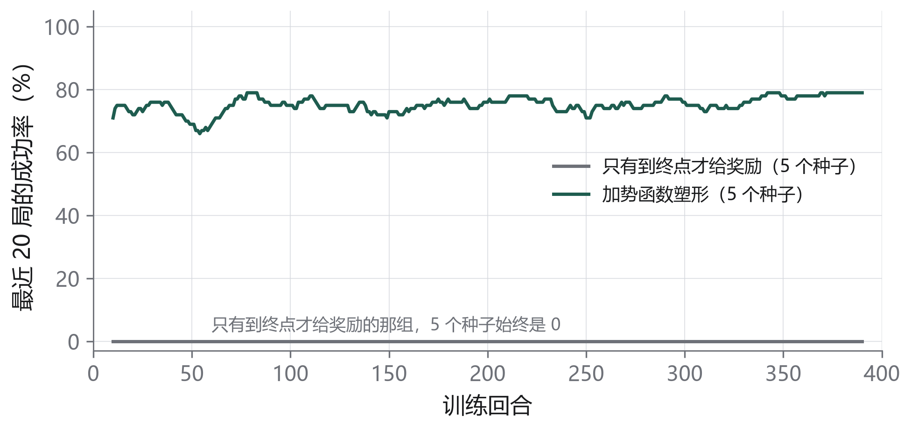

## 稀疏奖励与奖励塑形

有些任务只在终点给分。走迷宫，只有到出口才有奖励；解谜游戏，只有通关才算成功。

这种设置叫稀疏奖励。它对强化学习很不友好，因为在第一次成功之前，所有动作的回报都一样，智能体没有任何依据判断哪一步更好。

这一章用一个迷宫实验看清楚这个困境，再讲一种安全的补救办法。

### 为什么难

强化学习靠回报的差异来区分动作。如果一局里所有动作的回报都是零，梯度就是零，网络学不到任何东西。

随机探索在稀疏奖励下效率极低。一个十乘十的迷宫有一百个格子，从起点随机走到终点，平均要几千步。而一局最多两百步，大多数尝试在碰到终点之前就超时了。

更糟的是，超时的那些尝试被记成"零回报"，与"走错路"没有区别。智能体无法从失败里学到方向。

### 一个对照实验

做一个十乘十的迷宫，四周是墙，中间几道隔墙，起点在左上，终点在右下，每局最多两百步。

两种奖励设置。

第一种只给终点奖励，到终点加一，其他步零。

第二种加一个势函数。离终点越近，中间奖励越高。

```python
def potential(state):
    return -(abs(state[0] - GOAL[0]) + abs(state[1] - GOAL[1]))

reward = gamma * potential(nxt) - potential(state)
```

这个形式叫势函数塑形。它有一个理论保证，加上这一项之后，最优策略不变。因为它只改变"走这一步的即时奖励"，不改变"走到终点总共能拿多少"。

两组各跑五个种子，每个四百局。图 16-1 是最近二十局的成功率。



::: {.tabcap}
表 16-1　稀疏奖励与塑形奖励的对比（5 个种子，贪心评估 20 局）
:::

| 设置 | 学会的种子数 | 成功时的平均步数 |
| --- | --- | --- |
| 只有终点奖励 | 0 / 5 | 未成功 |
| 加势函数塑形 | 4 / 5 | 14 |

差距非常明显。没有塑形的那组，五个种子全部停在零，四百局一次都没成功。加了塑形之后，四个种子学会了，而且走的是十四步的最短路。

剩下那个失败的种子，说明塑形也不是万能的。它的探索路径恰好没有覆盖到关键区域，学习卡住了。这类偶然性在强化学习里很常见。

### 塑形不是随便加

势函数塑形之所以安全，是因为它满足一个形式条件，奖励的增量等于势函数的变化乘上折扣。

随手加的中间奖励没有这个保证。比如"每靠近终点一步加零点一分"，听起来合理，但它会让智能体学会在终点附近来回走，因为来回走能反复拿这个分。

这类错误叫塑形偏差。它不会让训练失败，反而会让曲线很好看，只是学出来的行为不是你要的。

判断一个塑形项安不安全，可以问一句，它能不能写成某个函数的差。能，就是势函数塑形；不能，就要小心。

### 实践中的替代方案

除了塑形，还有几种处理稀疏奖励的思路。

课程学习。先让任务简单一点，比如把终点放近，学会之后再逐步拉远。

事后回放。一局失败了，但如果中途曾经经过终点附近，就把那段经历改写成"从那个位置出发成功了"，当作成功样本学习。

内在奖励。给智能体额外的探索奖励，比如访问新状态加分。这一条在概念上更复杂，容易引入新的偏差。

示范数据。直接给人示范几条成功路径，让智能体从模仿开始，再自己探索。

这几种方法都有效，选择取决于你手上有什么。有专家示范就用示范，能改任务难度就用课程，什么都没有再考虑内在奖励。

### 一个经验

遇到"训练完全不涨"的情况，先检查奖励是不是太稀疏。

打印每一局的奖励总和。如果绝大多数局都是零，问题不在算法，在信号。换一个更密集的奖励，或者先用课程把难度降下来，往往比调参有效得多。

下一章讲怎么系统地试超参数，以及怎么把实验记录得能复查。
