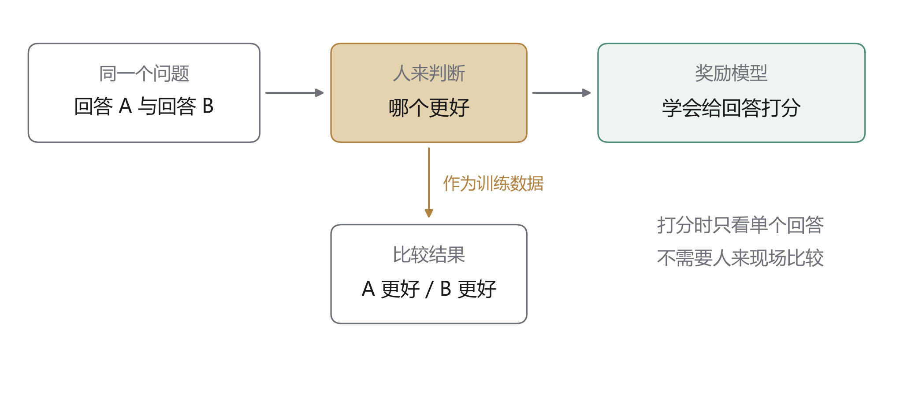

## 奖励模型：把偏好变成一个分数

人类不擅长打绝对分。让他给一段回答打七分还是八分，不同人、不同时间给出的结果差别很大。

但人类很擅长比较。给你两段回答，问你哪个更好，判断通常又快又一致。奖励模型就是把这个比较能力提炼成一个可以自动打分的函数。

### 偏好数据

数据的形式很简单，一个问题加两段回答，标注哪个更好。

$$
(x,\ y_w,\ y_l)
$$

$y_w$ 是被选中的那段，$y_l$ 是落选的那段。注意这里没有“好多少”的信息，只有顺序。

收集这种数据比收集绝对评分便宜得多，也更可靠。标注者只需要读两段，选一个，不需要建立一个评分标准。缺点是信息量少，一段回答是八分还是九分，数据里看不出来。

### Bradley-Terry 模型

把偏好变成概率，最常用的假设是 Bradley-Terry。

$$
P(y_w \succ y_l \mid x) = \sigma\left(r(x,y_w) - r(x,y_l)\right)
$$

$\sigma$ 是 sigmoid 函数，$r$ 是奖励函数。这个式子说的是，一段回答被选中的概率，取决于两段回答的分数差。分数差越大，被选中的概率越接近一。

这个假设有一个隐含的意思，奖励的绝对值没有意义，只有差值有意义。给所有回答的分数都加十，偏好概率不变。这符合直觉，也解释了为什么奖励模型的输出通常需要标准化才能比较。

### 训练

用最大似然，损失是负对数概率。

$$
\mathcal{L}(r) = -\mathbb{E}_{(x,y_w,y_l)}\left[\log\sigma\left(r(x,y_w)-r(x,y_l)\right)\right]
$$

实现上，奖励模型就是语言模型加一个标量输出头。输入一整段回答，取最后一个 token 位置的隐藏状态，经过一个线性层得到分数。

```python
rw = reward_model(x, y_w)      # shape: (batch,)
rl = reward_model(x, y_l)
loss = -logsigmoid(rw - rl).mean()
```

这个损失有一个性质，它只关心差值。如果所有分数一起平移，损失不变；如果所有分数一起缩放，梯度会变。实践中通常会在训练时做归一化，把奖励的尺度控制在合理范围。

### 一个结构性的问题

奖励模型是从偏好数据里学的，而偏好数据有偏。

最常见的一种偏差是长度。标注者倾向于认为更长的回答更详细、更认真，于是偏好数据里长回答被选中的比例偏高。奖励模型学到这一点，就会给长回答更高分。

这个问题很难完全避免，因为“长”和“详细”在真实数据里确实相关。缓解的办法有几种，在数据里控制长度分布，或者训练时对长度做惩罚，或者在评估时单独看长度和质量的分离。

另一种偏差是风格。标注者可能偏爱某种语气、某种排版，奖励模型会把这些学进去。模型于是学会了讨好，而不是变得更有用。

### 奖励模型的评估

怎么知道一个奖励模型好不好？

最直接的办法是看它在留出的偏好数据上的准确率。但这个指标有上限，因为人类标注本身有噪声，两个标注者的一致率通常只有七成到八成。

更有意义的评估是看它和下游效果的关系。用这个奖励模型去训练策略，策略的实际表现如何。有时候准确率更高的奖励模型，训出来的策略反而更差，因为它更擅长被利用。

还有一个办法是看它在对抗样本上的表现。让策略生成一些专门针对奖励模型的回答，看它会不会给出荒谬的高分。这类测试能暴露奖励模型的脆弱之处。

### 从打分到训练

图 2-1 是整个流程。



有了奖励模型，就可以进入强化学习。策略生成回答，奖励模型打分，分数用来更新策略。这个循环在下一章展开。

不过在这之前，有一个替代方案值得提一下。既然偏好数据本身就是“哪个更好”，能不能跳过奖励模型，直接用它优化策略？

可以，这就是 DPO（direct preference optimization，直接偏好优化，2023 年提出）的思路。第四章会看到，它把整个流程化简成一个分类问题，省掉了奖励模型和在线采样。代价是它只能利用固定的数据，不能探索新的回答。
