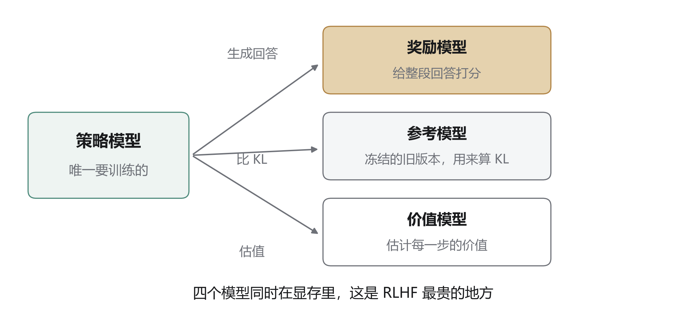

## PPO 训练大模型的工程现场

原理上，用 PPO（proximal policy optimization，近端策略优化，2017 年提出）训练语言模型和在 CartPole 上训练没有区别。实际上，两者的工程量差了两个数量级。

这一章讲工程上的具体问题。四个模型怎么摆，损失怎么算，哪里最容易崩。这些细节不出现在论文的核心公式里，但它们决定了训练能不能跑完。

### 四个模型

图 3-1 是显存里的布局。



策略模型是被训练的那个。奖励模型给回答打分。参考模型是微调后的旧版本，冻结不动，用来算 KL。价值模型估计每个位置的价值，用来算优势。

如果模型是七百亿参数，用半精度存储，一个模型占一百四十 GB。四个模型就是五百六十 GB，还没算优化器状态和梯度。这就是为什么早期的 RLHF 只能在少数机构里做。

后来的工程优化主要围绕减少显存。常见的手段有把参考模型和奖励模型放在 CPU 上按需调用，用低精度量化，或者把价值模型和策略模型合并共享底层。这些做法都有效，但每一种都会带来新的复杂度。

### 损失怎么算

策略的损失还是重要性采样比加裁剪那一套。

$$
L^{\text{policy}} = -\mathbb{E}\left[\min\left(r_t\hat{A}_t,\ \text{clip}(r_t,1-\epsilon,1+\epsilon)\hat{A}_t\right)\right]
$$

$r_t$ 是第 $t$ 个 token 的新旧概率比。注意这里是逐 token 算的，不是整段。

$\hat{A}_t$ 是优势。整段回答只有一个奖励，怎么拆到每个 token 上？常见做法是把整段的分数减去基线，然后赋给每个 token。

$$
\hat{A}_t = R(x,y) - V_\phi(x,y_{<t})
$$

也有实现用 token 级的价值估计，配合类似 GAE（generalized advantage estimation，广义优势估计，2016 年提出）的折扣累加。两种做法都有，前者简单，后者更细。

价值网络的损失是均方误差，目标是实际回报。

$$
L^{\text{value}} = \mathbb{E}\left[\left(V_\phi(x,y_{<t}) - \hat{R}_t\right)^2\right]
$$

$\hat{R}_t$ 可以是整段回报，也可以是折扣后的累积回报。

### 只对回答算损失

一个容易忽略的细节。计算损失时通常只算模型生成的回答部分，不算输入的问题部分。

原因是问题是给定的，模型不需要为它负责。如果对问题部分也算损失，梯度会把模型的注意力拉向“如何复述问题”，而不是“如何回答”。

实现上用一个掩码，把问题位置的损失置零。

```python
labels = input_ids.clone()
labels[:, :prompt_len] = -100       # -100 在交叉熵里被忽略
loss = cross_entropy(logits, labels)
```

同样的掩码要用在所有地方，包括 KL 的计算和重要性采样比的计算。漏掉一处，训练就会出现奇怪的行为。

### KL 怎么算

KL 惩罚有两种实现方式。

一种是把 KL 直接加进奖励。

$$
r_t = r^{\text{RM}}(x,y) - \beta\log\frac{\pi_\theta(y_t\mid x,y_{<t})}{\pi_{\text{ref}}(y_t\mid x,y_{<t})}
$$

另一种是把 KL 作为单独的损失项，不进入奖励。

两种在数学上等价，实现上不同。前者需要在生成时就算 KL，后者在更新时算。多数实现用后者，因为可以在一个批次里统一处理。

$\beta$ 的选择很关键。太大，模型不敢偏离参考模型，学不到东西；太小，模型会跑偏，开始说胡话或者刷分。有些实现会自适应地调 $\beta$，根据实际 KL 和目标 KL 的差距调整。

### 常见的崩溃方式

训练大模型的 PPO 有几种典型的失败。

**奖励刷分**。模型找到奖励模型的漏洞，分数很高但输出质量下降。典型表现是回答变长、重复、堆砌套话。

**KL 爆炸**。某一批更新之后，策略突然偏离参考模型很远，KL 迅速上升，之后的更新全部失效。

**熵坍塌**。策略变得过于确定，几乎总是输出同样的回答。探索停止，训练卡住。

**价值发散**。价值网络的估计越来越大，优势信号失真。

这几种失败往往同时出现，因为它们是同一个问题的不同表现，训练不稳定。

### 一个现实的判断

PPO 在大模型上能work，但很脆弱。同样的配置，换一批数据、换一个基础模型，可能就需要重新调。

这也是为什么后来的方法都在试图绕开它。DPO 绕开了在线采样和奖励模型，GRPO（group relative policy optimization，组相对策略优化，2024 年提出）绕开了价值模型，还有一些方法绕开了整个强化学习，用拒绝采样加监督微调。这些方案的共同点是降低工程复杂度，代价是牺牲一部分效果或者灵活性。

### 什么时候还得用 PPO

如果任务需要在线探索，也就是模型必须生成新的回答才能学到东西，PPO 这一类在线方法仍然有优势。

在可以自动验证的任务上，这个优势尤其明显。模型生成大量尝试，其中少数成功，这些成功样本能带着策略往前走。DPO 做不到这一点，因为它只能用固定的偏好数据。

下一章讲 DPO，看它怎么把这一整套流程化简。
