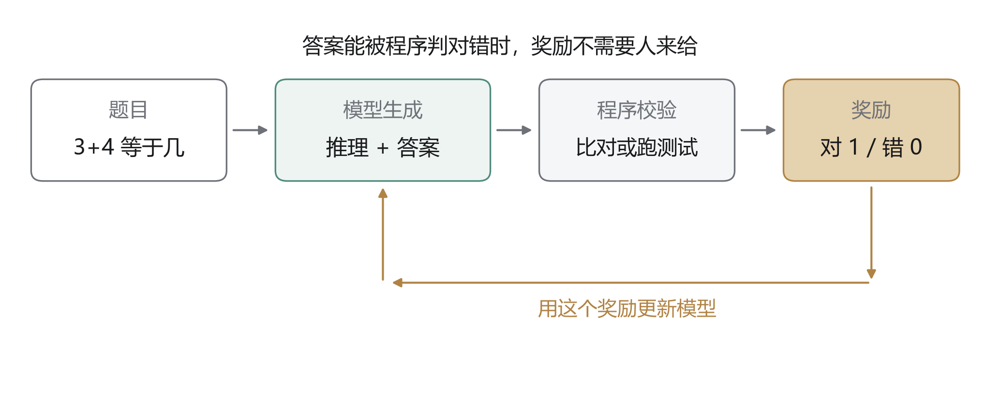

## RLVR：答案能检查时发生了什么

2024 年下半年开始，一类模型在数学和代码上的表现突然提升。它们的共同点是训练时用了一个不会说谎的奖励来源。

这个做法叫 RLVR，带可验证奖励的强化学习。它不是一个新算法，而是把已有的算法用在一个特殊设定上。这一章讲这个设定，以及它带来的意外收获。

### 奖励怎么来

任务要满足一个条件，答案能被程序判断对错。

数学题有标准答案，比对即可。代码题有测试用例，跑一遍即可。逻辑题、格式转换、单位换算，都能自动检验。

流程如图 6-1。

模型生成一段包含推理和答案的回答，程序提取答案，和标准答案比对，对给一分，错给零。这个分数直接作为奖励。

和人比，它有三个优势。一是零成本，可以无限次判断。二是一致，同样的答案永远给同样的分。三是快，不需要等待标注。

### 训练中发生了什么

最直接的变化是准确率上升。这个不意外，因为优化的目标就是准确率。

意外的是行为的变化。

模型开始写更长的推理过程。它在解题前会把条件列出来，把中间步骤写清楚，有时还会检查一遍。

模型开始尝试多种解法。一条路走不通，它会退回来换一条。

模型开始自我纠正。写到一半发现矛盾，它会标记出来重新算。

这些行为在训练数据里不一定有，是从“答对得分”这个信号里自己长出来的。文献里把这类现象叫涌现，用词要谨慎，但行为本身是可观察、可复现的。

### 为什么有效

有两个原因。

第一，信号干净。偏好数据有噪声，不同标注者的判断不一致。可验证奖励没有这个问题，对错是客观的。干净的信号意味着梯度方向可靠，训练可以更激进。

第二，可以大规模扩展。生成回答的成本远低于人工标注，一个模型可以自己生成几百万条，用程序筛选。这让在线训练第一次在经济上可行。

这两个条件缺一不可。信号不干净，规模再大也是学噪声；规模不够，模型探索不出新的解法。

### 在哪里失效

可验证奖励的适用范围比想象中窄。

答案必须能自动检验。写一篇有说服力的文章、给一个有商业价值的建议、判断一段话是否得体，这些没法用程序判对错。

模型会钻规则的空子。如果答案格式是填空，模型可能学会猜格式。如果测试用例是公开的，模型可能记住用例而不是写出通用代码。

能力可能窄化。在数学题上训练的模型，未必能把这套推理迁移到别的问题上。有观察显示，某些模型在特定基准上提升明显，换个领域就没有优势。

训练不稳定。奖励只有零和一，同一组回答全对或者全错时，组内没有区分度，梯度几乎为零。需要靠难度筛选和采样策略来维持信号。

### 一个重要的区别

RLVR 训练出来的能力和监督学习训练出来的，性质不太一样。

监督学习是模仿。数据里有什么解法，模型就学什么解法。数据里没有的，模型不会。

强化学习是搜索。模型自己生成大量候选，其中少数成功，这些成功样本被强化。如果模型的初始能力足够生成正确的解，哪怕概率很低，也能通过这种方式被放大。

这个区别解释了一个现象。RLVR 在小模型上效果有限，因为小模型根本生成不出正确的解，搜索空间里没有可用的样本。在大模型上效果好，因为正确解已经在分布里，只是概率低。

### 和 KL 的关系

RLVR 的训练通常仍然带 KL 约束，但 $\beta$ 往往比 RLHF 小。

原因是奖励更可靠。奖励模型可能被钻空子，所以需要强约束把模型拉在参考模型附近。可验证奖励不容易被钻空子，模型跑偏的风险小，可以放开一些。

不过完全不约束也有风险。模型可能学会一些奇怪的推理格式，虽然答案对，但过程不可读。这在需要展示推理过程的产品里是个问题。

### 下一步的问题

RLVR 把“奖励从哪来”解决了一部分。剩下的问题是“怎么算优势”。

PPO 需要一个价值网络，在大模型上太贵。下一章的 GRPO 用一个更简单的办法替代了它，这也是让 RLVR 大规模可行的关键工程改动之一。
