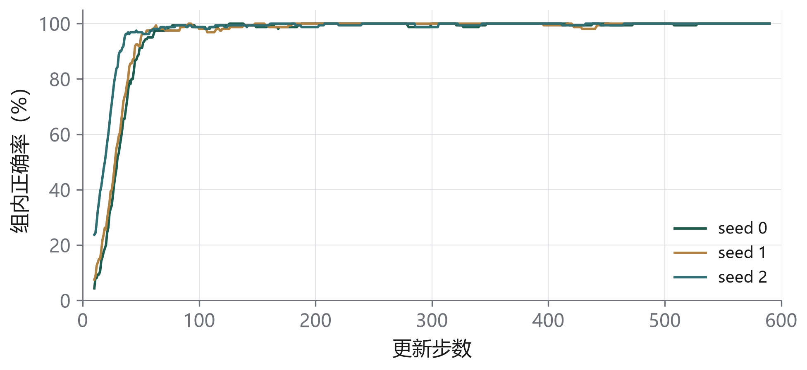

## GRPO：去掉价值网络

PPO 在大模型上有一个绕不过去的成本，价值网络。

它要跟策略模型一样大，占一份显存，训练时还要多跑一次前向和反向。在七百亿参数的量级上，这一份开销可能比省下来的效果更值钱。

这个方法由 DeepSeek 的数学模型 DeepSeekMath 在 2024 年提出，后来被 R1 用于大规模推理训练。GRPO 的做法是把价值网络换掉。办法很朴素，同一道题让模型生成一组回答，用这一组的平均分当基准。

### 组内比较

图 7-1 是这个流程。

对每个问题 $x$，从当前策略采样 $G$ 个回答，比如八个。每个回答用可验证奖励打分，得到 $r_1,\dots,r_G$。

然后用组内的统计量算优势。

$$
\hat{A}_i = \frac{r_i - \operatorname{mean}(r)}{\operatorname{std}(r)}
$$

比平均好的得正优势，比平均差的得负优势。这个量和 PPO 里用价值网络算出来的优势，作用是一样的。

### 损失

策略损失和 PPO 形式相同，只是优势换成了组内估计。

$$
\mathcal{L} = -\mathbb{E}\left[\min\left(\rho_i\hat{A}_i,\ \text{clip}(\rho_i,1-\epsilon,1+\epsilon)\hat{A}_i\right)\right] + \beta\,\mathrm{KL}
$$

$\rho_i$ 是新旧策略对第 $i$ 个回答的概率比。KL 项仍然存在，约束模型不要偏离参考模型太远。

价值网络的损失没有了，整个训练只需要策略模型、参考模型和奖励函数。显存省下一大块，实现也简单很多。

### 为什么这样也行

优势的本质是“这个动作比平均好多少”。价值网络只是估计平均值的一种方式，不是唯一方式。

组内平均是另一种估计。它的好处是不需要额外的模型，缺点是方差大，因为只用了 $G$ 个样本。

样本数越多，估计越准。但每增加一个样本就多一次生成，成本线性增长。八个到十六个是常见的取值。

还有一个隐含的好处。组内比较天然做了归一化，不同题目的奖励尺度差异被消掉了。有些题容易，全组都对；有些题难，全组都错。归一化之后，容易题和难题的信号强度变得相当。

### 零方差的问题

如果一组回答全对或者全错，标准差为零，优势全部为零，这一组数据什么也教不了。

这在训练中很常见。早期模型什么都不会，全错；后期模型什么都会，全对。两头都没有信号。

解决的办法是筛选题目。维护每道题的历史正确率，优先选那些正确率在中间地带的题。太难的跳过，太简单的也跳过。

这个筛选本身也需要工程实现。常见做法是每轮先采样一批，算正确率，只保留符合区间的题目进入训练。这会浪费一部分采样，但比训练没有信号要好。

### 和 PPO 的比较

GRPO 不是全面优于 PPO，它是在特定条件下更划算。

在奖励密集、需要精细价值估计的任务上，PPO 的价值网络有用。它能给出每一步的价值，优势估计更准。

在奖励稀疏、只有终局分数的任务上，价值网络能提供的信息本来就有限，用组内平均替代损失不大。

大模型的 RLVR 恰好属于后者。整段回答一个分数，价值网络能拆出来的信息有限，不如省掉它。

### 一个玩具实验

为了看清机制，我写了一个不涉及语言模型的版本。

任务是五道一位数加法。策略是一张查表，每道题对应一组 logits，覆盖零到十九这些候选答案。奖励是答案对不对。

训练时每道题采样八个答案，用组内平均做基准，按相对好坏更新概率。这实际上就是 GRPO 的核心，只是把语言模型换成了一个极小的策略。

图 7-2 是三个种子的曲线。

曲线在两百步以内基本收敛，三个种子的形状接近。这说明组内比较的机制是有效的，不需要价值网络也能给出可用的优势信号。

当然，这个实验只能说明机制，不能说明大模型上的效果。真实训练里还有 KL 约束、长度控制、难度筛选这些工程细节。

### 实现上的几个细节

**采样温度**。生成组内样本时温度不能太低，否则八个回答几乎一样，组内没有区分度。常见取值在零点八到一之间。

**长度惩罚**。如果不加约束，模型会学会写得很长，因为长回答碰巧答对的概率更高。可以在奖励里减去长度项，或者在损失里加长度惩罚。

**批次构造**。一个批次里通常包含多道题，每道题一组样本。这样组内归一化和跨题混合可以同时进行。

**梯度累积**。生成很贵，更新很便宜。为了充分利用每个样本，通常会在一个大批次上做多次梯度更新，同时用裁剪限制偏离。

这些细节在论文里往往一笔带过，但在实际训练里决定了成败。下一章看一个公开的完整配方。
