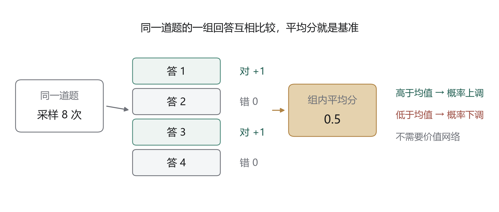

## GRPO：去掉价值网络

PPO 在大模型上有一个绕不过去的成本，价值网络。

它要跟策略模型一样大，占一份显存，训练时还要多跑一次前向和反向。在七百亿参数的量级上，这一份开销可能比省下来的效果更值钱。

这个方法由 DeepSeek 的数学模型 DeepSeekMath 在 2024 年提出，后来被 R1 用于大规模推理训练。GRPO 的做法是把价值网络换掉。办法很朴素，同一道题让模型生成一组回答，用这一组的平均分当基准。

### 组内比较

图 7-1 是这个流程。



对每个问题 $x$，从当前策略采样 $G$ 个回答，比如八个。每个回答用可验证奖励打分，得到 $r_1,\dots,r_G$。

然后用组内的统计量算优势。

$$
\hat{A}_i = \frac{r_i - \operatorname{mean}(r)}{\operatorname{std}(r)}
$$

比平均好的得正优势，比平均差的得负优势。这个量和 PPO 里用价值网络算出来的优势，作用是一样的。

这个式子成立依赖三个假设，值得明白。

第一，同一道题的所有样本必须来自同一个策略版本。如果采样跨越了一次更新，组内的均值和标准差就不对应同一个基线，优势会带上偏差。这也是为什么采样阶段要先把权重冻结。

第二，组内样本要足够多样。温度太低或者 top-p 太窄，八个样本几乎一样，优势全是零或者噪声。

第三，奖励在组内有区分度。这一条直接指向后面的零方差问题，也是 GRPO 最需要工程辩护的地方。

### 损失

策略损失和 PPO 形式相同，只是优势换成了组内估计。

$$
\mathcal{L} = -\mathbb{E}\left[\min\left(\rho_i\hat{A}_i,\ \text{clip}(\rho_i,1-\epsilon,1+\epsilon)\hat{A}_i\right)\right] + \beta\,\mathrm{KL}
$$

$\rho_i$ 是新旧策略对第 $i$ 个回答的概率比。KL 项仍然存在，约束模型不要偏离参考模型太远。

价值网络的损失没有了，整个训练只需要策略模型、参考模型和奖励函数。显存省下一大块，实现也简单很多。

### 损失里的每一项

这个式子看着像 PPO，作用不完全一样，逐项过一遍。

$\rho_i$ 是同一个回答在新旧策略下的概率比。和 PPO 一样，它逐 token 算，再对 token 平均。写成整段的比值会指数爆炸，第一章那个例子已经算过。

裁剪把比值卡在一个区间里，防止一次更新把某个 token 的概率待到其它地方。$\epsilon$ 常取零点二。

最小算子处理两种情况。优势为正时，比值超过上界就封顶，不让模型过度推高；优势为负时，比值低于下界就封顶，不让模型过度压低。两种都是单向的，这是因为优化的目标是“改进但不跑远”，而不是“修正一个已经错的概率”。

KL 项还在这里，常采用 k3 估计器，非负，不会被负值抵消。它和策略损失在同一个式子相加，不是加在奖励里。两种写法在数学上等价，实现上分开写更方便做梯度缩放。

一个容易忽略的点，GRPO 里的 KL 通常只对回答部分算，不算提示。而且它是逐 token 算再求平均，不是整段求和。这决定了 $\beta$ 的量级，和 PPO 实现里的习惯不一定一致。

### 为什么这样也行

优势的本质是“这个动作比平均好多少”。价值网络只是估计平均值的一种方式，不是唯一方式。

组内平均是另一种估计。它的好处是不需要额外的模型，缺点是方差大，因为只用了 $G$ 个样本。

样本数越多，估计越准。但每增加一个样本就多一次生成，成本线性增长。八个到十六个是常见的取值。

还有一个隐含的好处。组内比较天然做了归一化，不同题目的奖励尺度差异被消掉了。有些题容易，全组都对；有些题难，全组都错。归一化之后，容易题和难题的信号强度变得相当。

这句话需要修正一下。全对和全错的时候归一化没有意义，因为标准差为零。归一化能抹平的只是“部分对”的题的尺度差异。真正把难度差异处理掉的，是筛选，不是归一化。

还有一层偏差值得提。除以标准差会让小方差的组被放大。一个组里八个回答只有一个对，标准差很小，那个对的回答的优势会被拉到很大。它在统计上是对的，因为这种组本来就携带更多信息，但实际训练里会让模型对少数几个稀有样本过度敏感。有些实现会给标准差加一个下限，就是为了抑制这个效应。

### 零方差的问题

如果一组回答全对或者全错，标准差为零，优势全部为零，这一组数据什么也教不了。

这在训练中很常见。早期模型什么都不会，全错；后期模型什么都会，全对。两头都没有信号。

解决的办法是筛选题目。维护每道题的历史正确率，优先选那些正确率在中间地带的题。太难的跳过，太简单的也跳过。

这个筛选本身也需要工程实现。常见做法是每轮先采样一批，算正确率，只保留符合区间的题目进入训练。这会浪费一部分采样，但比训练没有信号要好。

### 零方差到底多常见

把这件事算成数字，会看出它的严重程度。

假设奖励只有零和一，一道题的单次正确率是 $p$，组内 $G$ 个回答全对或全错的概率就是 $p^G$ 加 $(1-p)^G$。

这个式子很好用。$p$ 等于零点五、$G$ 等于八时，全同的概率不到百分之一，几乎不用担心。$p$ 等于零点三时是百分之六左右。$p$ 等于零点零五时，同样的八次采样，全同的概率到三分之二，大半个批次是无效的。

这说明零方差不是一个偶发问题，它和题目难度强相关。模型在早期或者遇到新题型时，大量题目落在这个区域。

表 7-1 是实测值，来自一组二项采样的模拟。

::: {.tabcap}
表 7-1　不同组大小下的无效组比例与信号强度
:::

| 组大小 | 全同组比例（正确率 0.3） | 全同组比例（正确率 0.05） | 归一化后平均优势幅度 |
| --- | --- | --- | --- |
| 4 | 24.8% | 81.5% | 0.69 |
| 8 | 5.8% | 66.3% | 0.83 |
| 16 | 0.3% | 44.0% | 0.88 |
| 32 | 0.0% | 19.4% | 0.90 |

最后那一列是模拟里统计的平均绝对优势值，模拟条件正确率零点三。它随组变大而上升，但边际越来越小，从四到八涨了零点一四，从十六到三十二只涨了零点零二。

这些数字给出两个结论。一是组大小要跟正确率匹配，难题多的时候小组合适，容易题多的时候大组也浪费不了多少。二是把组从八加到十六，收益主要体现在消灭无效组上，而不是让优势更准。这是选择八常见的真正理由。还有一个隐含的边界，正确率接近零或一时，再大的组也救不了，只能靠筛题。

### 和 PPO 的比较

GRPO 不是全面优于 PPO，它是在特定条件下更划算。

在奖励密集、需要精细价值估计的任务上，PPO 的价值网络有用。它能给出每一步的价值，优势估计更准。

在奖励稀疏、只有终局分数的任务上，价值网络能提供的信息本来就有限，用组内平均替代损失不大。

大模型的 RLVR 恰好属于后者。整段回答一个分数，价值网络能拆出来的信息有限，不如省掉它。

还有一层差别在偏差上。价值网络是学出来的，它会有一段时间估不准，优势就带着估不准的成分。组内均值是直接算的，不会低估也不会高估，它只是噪声大。在大模型训练里，“有噪声但无偏”通常比“可能有偏”更好调，因为噪声可以靠加大组、批次、梯度累积压下去，偏差不行。

### 组大小怎么选

组大小是 GRPO 最重要的超参，它同时决定了信号质量和采样成本。

成本是线性的。组从八到十六，采样量翻倍，训练时间也差不多翻倍。在采样已经占七成时间的流程里，这个代价很难忽视。简单地算一下，一步八组变成十六组，每日能跑的步数就减半，总训练时长翻倍。这个账必须在开跑之前算清楚，而且要按预期总步数算，不是按单步算。

信号是次线性的。前面那个表已经给出，归一化后的平均优势幅度从零点八三涨到零点八八，收益很小。真正大的收益是无效组比例的下降，从百分之六降到千分之三，但这个收益只在特定难度区间内存在。

所以结论是一个条件句。如果题目偏难、正确率低，加大组能直接降低无效比例，值得。如果题目难度适中、正确率在零点三到零点七之间，八已经够了。这个判断不需要试错，按前面那个式子算一下全同组比例就能得出。

还有一个更省的办法，动态组大小。先采四个，如果全同就继续采，直到出现分歧或者到上限。这在难度不均的数据上能省下不少计算，代价是实现复杂一些，而且每个组的大小不一样，归一化要分别处理。分组之后还要按实际样本数加权，不然大组的梯度会被稀释。

### 三个常见误解

第一个误解，GRPO 没有基线。它有，只是这个基线不是学出来的，是从同一组的样本里算的。去掉的只是“学一个价值函数”这件事，不是基线本身。

第二个误解，GRPO 只能用于可验证奖励。它能用于任何能给单个回答打分的奖励，包括奖励模型。区别在于连续奖励下组内差异更平滑，零方差问题更少。很多 RLHF 实现也在用 GRPO 或者在 PPO 里用组归一化。

第三个误解，GRPO 比 PPO 简单所以更好。简单省的是工程，不是效果。在需要精细信用分配的密集奖励任务上，价值网络仍然有用，把每一步的价值拆开能让优势更准。组内均值只能分辨“整体好坏”，不能分辨“哪一步好”。这也意味着它对同一个回答里所有 token 做同样方向的调整，分不清哪一句是废话。在强制模型多想的长推理里，这会表现为推理过程越来越长但不更有用。缓解的办法是过程奖励或者长度惩罚，前者贵，后者粗。

### 什么时候该改用 PPO

三个信号说明组内比较不够用了。

一是奖励变成连续的、密集的，比如带有过程分的任务。这时候每步都有信号，把它平均到整条轨迹是浪费。

二是任务对局部质量敏感，比如写作、代码风格、对话得体性。这些任务的好坏不能靠一条轨迹的整体分数表达。

三是组样本之间同质化严重。模型很确定时，八个样本几乎一模一样，组内没区分度；而高温度又会让质量掉下来。价值网络在这种情况能提供逐位置的估计，不受样本数量限制。

这三条都不成立时，GRPO 的工程优势是真实的。模型越大，省下一个同规模价值模型的价值就越高。

### 一个玩具实验

为了看清机制，我写了一个不涉及语言模型的版本。

任务是五道一位数加法。策略是一张查表，每道题对应一组 logits，覆盖零到十九这些候选答案。奖励是答案对不对。

训练时每道题采样八个答案，用组内平均做基准，按相对好坏更新概率。这实际上就是 GRPO 的核心，只是把语言模型换成了一个极小的策略。

图 7-2 是三个种子的曲线。


曲线在两百步以内基本收敛，三个种子的形状接近。这说明组内比较的机制是有效的，不需要价值网络也能给出可用的优势信号。

当然，这个实验只能说明机制，不能说明大模型上的效果。真实训练里还有 KL 约束、长度控制、难度筛选这些工程细节。

还有一个现象。训练早期正确率从个位数往上爬的时候，曲线很平滑；到了九成附近开始抖动，偶尔会掉回八成。原因是能拿到正优势的样本变少了，剩下的更新主要来自少数错的样本，方差变大。这和前面算的无效组比例是同一件事。

### 一个最小实现

把语言模型去掉，整个循环只有几十行。

```python
for step in range(steps):
    batch = sample_questions(step)                 # list of (prompt, gold)
    adv_all, tokens = [], []
    for prompt, gold in batch:
        outs = policy.generate(prompt, n=G, temp=0.9)
        rewards = torch.tensor([verifier(o, gold) for o in outs])
        if rewards.std() < 1e-6:
            continue                               # zero-variance group: skip
        adv = (rewards - rewards.mean()) / (rewards.std() + 1e-6)
        for o, a in zip(outs, adv):
            tokens.append((prompt, o))
            adv_all.append(a)
    if not tokens:
        continue
    loss = grpo_loss(policy, ref_policy, tokens, adv_all, beta, eps)
    (loss).backward()
    clip_grad_norm_(policy.parameters(), 1.0)
    opt.step(); opt.zero_grad()
```

里面有几个决定成败的细节。

`n=G` 是同一道题的采样次数，不是最后答案条数，因为可能有被丢弃的组。

`continue` 那一行是零方差处理。丢掉整组，而不是把优势置零，因为置零会让这一组的 token 仍然进入损失，白白拉低平均。

`beta` 不能照搬 PPO 的数值。GRPO 里的 KL 通常是逐 token 平均再求和，量级比整段求和低很多。

`clip_grad_norm_` 不是可选项。RLVR 的奖励是阶跃的，梯度偶尔会突然很大，不裁剪很可能一步就把模型拉坏。

### 实现上的几个细节

**采样温度**。生成组内样本时温度不能太低，否则八个回答几乎一样，组内没有区分度。常见取值在零点八到一之间。

**长度惩罚**。如果不加约束，模型会学会写得很长，因为长回答碰巧答对的概率更高。可以在奖励里减去长度项，或者在损失里加长度惩罚。

**批次构造**。一个批次里通常包含多道题，每道题一组样本。这样组内归一化和跨题混合可以同时进行。

**梯度累积**。生成很贵，更新很便宜。为了充分利用每个样本，通常会在一个大批次上做多次梯度更新，同时用裁剪限制偏离。

这几条展开说一下。

采样温度那一条不只是“别太低”。温度高了会提高多样性，但也会提高无意义回答的比例，因为高温下模型容易跑飞。实践里常见做法是用较高温度采一组，再按长度和格式过一遍，把明显崩掉的那些丢掉。丢掉之后组内样本数不等，归一化要按实际数量算。

批次构造里有一个容易搞错的细节，归一化是按组做的，不是按批做的。一个批次里有几十道题，每道题各自算自己的均值和标准差。如果错误地把整个批次的均值当成基线，难度信息就全乱了，容易题的回答会全部得到负优势。

梯度累积和多轮更新的配合也有讲究。在同一个批次上做四轮更新，从第二轮开始，重要性采样比就不再是一，因为策略已经变过一次。这时候裁剪才开始起作用。轮数多了，大部分 token 都会被裁掉，实际上是在用很少的样本更新，效率反而低。

### 和 RLOO 的差别

GRPO 不是唯一去掉价值网络的做法。同一时期有另一条思路，叫 RLOO，意思是留一法。

它的做法是，算第 $i$ 个样本的基线时，用除它以外其它样本的平均值。这比直接用全组均值少了一点偏差，因为自己不再包含在基线里。对于小样本，这个偏差并不小。

两种做法的差别在细节上。GRPO 还会除以标准差，RLOO 通常不除。除以标准差的好处是尺度统一，坏处是前面说的放大少数样本。不除的好处是保守，坏处是难题的信号很弱。

实际效果上两者差别不大。选哪个往往取决于实现习惯，而不是理论优劣。但只要改了归一化方式，学习率就要重新扫，因为它们对有效步长的影响很大。

这些细节在论文里往往一笔带过，但在实际训练里决定了成败。下一章看一个公开的完整配方。

### 为什么在推理任务上特别有效

推理任务有一个特点，正确的轨迹和错误的轨迹在行为上差异很大。一个对的回答会检查条件、尝试多种方法、验证结果；一个错的往往在中间某一步就偏了。

组内比较恰好能抓住这个差异。它不知道哪一步好，但它知道整条轨迹好，于是把整条轨迹上的所有 token 都抬高。一个对的轨迹里有几千个 token，每个都被抬高一点点，累起来就是一个很强的信号。错的轨迹相反。

这种“整条抬高”看起来粗糙，却正好适合长推理。因为长推理里真正关键的是“要不要继续想、要不要回头检查”这类宏观选择，而这些选择在整个轨迹上是一致的。逐 token 归因在这里没有意义，一个 token 单独看无所谓对错。

反过来说，这也解释了为什么 GRPO 在写作类任务上不如 PPO 加奖励模型。写作的好坏分布在句子层面，整条轨迹的分数无法告诉模型哪一句写得不好，粗粒度的优势在这里就浪费了。

### 奖励不只零和一

前面的讨论默认奖励是答对给一、答错给零。实际系统里没那么纯。

常见的组合是准确率加格式分。格式分给很小，主要是为了减少解析失败。它能稳定训练，但也会轻微地偏移目标，模型会稍微偏爱某种模板。

还有一种做法是给长度归一化的分数，比如答对除以长度。它的目的是抑制长度膨胀，副作用是会让模型偏向特别短的回答，有时短到不写推理直接给答案。

更细的做法是分段奖励，每一步给一点分。它需要过程奖励模型或者可检查的中间量，代价是引入了一个新的可被钻的空子。

选哪种取决于你更怕什么。怕格式崩，加格式分；怕长度膨胀，加长度项；怕过程不可读，加过程分。每加一项都要接受它带来的新偏差，而不用指望只拿好处。

### 长度失控是怎么发生的

模型写长，不是在“故意灌水”，是优化的自然结果。

原因很直接。一段长的推理包含更多的尝试，更多的尝试意味着更高的答对概率。奖励只看结果，不看花销，所以长度是一个免费的资源。只要长一点能多拿一点分，模型就会持续变长。

这个过程会自我加强。长回答答对的样本被强化，短回答答错的被削弱，两三轮之后短回答几乎不出现，模型丧失了简洁解题的能力。

可用的控制手段有三个。一是硬上限，超过长度就截断，并把截断样本的末尾屏蔽掉。二是长度惩罚，直接在奖励里减。三是数据层面的控制，在筛选题目时把“一句话就能答对”的简单题也混进去，让简洁有回报。

第三个最优雅，因为它不引入新的偏差，但需要题目难度分层做得很细。前两个便宜，代价是模型会把“短”当成一个目标去优化。
