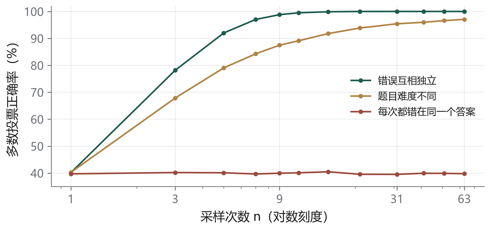

## 测试时计算：采样、投票与搜索

前面所有方法都在训练时花算力。这一章讲另一种花法，在推理时多花。

思路很简单。模型生成一个回答可能错，生成十个回答再看哪个对，正确率会高一些。这部分不需要重新训练，改一下调用方式就行。

### 最简单的做法：多采样

同一道题生成 $n$ 个回答，取答案出现次数最多的那个。

这个做法叫自洽性投票，或者多数投票。它有效的原因是，错误的回答往往各不相同，正确的回答会收敛到同一个答案。

效果可以用一个粗略的模型估计。假设单次正确率是 $p$，$n$ 次独立采样，多数投票正确的概率会随 $n$ 上升，上升速度取决于 $p$ 离零点五有多远。$p$ 越高，投票越有用；$p$ 接近零点五，投票几乎没用，因为对错各半。

这个估计过于乐观，因为采样之间不独立。同一个模型在同一个问题上，往往犯同样的错误。所以实际收益比理论值低。

### 一个真跑的实验

光说“不独立”太抽象。我写了一个小模拟，把三种错误结构放在一起比。

第一种是错误互相独立。每次采样各自犯错，错出来的答案也各不相同。第二种是题目难度不同，每道题有一个固定的正确率，同一道题的多条采样共享这个难度。第三种每次都错在同一个答案，相当于模型有一个固定的思维陷阱。

三种的条件一样，单次正确率都设在零点四，采样次数从一到六十三。

结果如图 9-1。

三条线的差别比预期大。错误独立时，采样九次就能到百分之九十八点八，十五次几乎满分。难度不同时，九次只有百分之八十七点五，六十三次卡在百分之九十七。每次都错在同一个答案时，曲线是平的，采样六十三次还是百分之四十。

这个模拟说明一件事。投票能不能起作用，取决于“多个回答里是否真的存在正确答案”。模型的错误如果是系统性的，再来多少次都没用。

### 加权投票

多数投票假设每个回答同等可信。可以让模型给自己的回答打分，或者用一个奖励模型打分，再按分数加权。

另一个做法是按推理过程的长度加权。有观察显示，更长的推理往往更仔细，正确率更高。这个规律不是绝对的，但在统计上成立。

加权投票的问题是权重本身也可能是错的。如果模型对自己的错误答案特别自信，加权反而会让结果更差。

### 用验证器加权最靠谱

在所有加权方式里，最可靠的一种是拿一个独立的验证器打分。

它和奖励模型的区别在于，验证器只看答案不看表达。“答案是 42”这种判断不需要理解推理过程，因此很难被风格骗。用验证器给每条候选打分，再按分数加权投票，效果比纯多数投票好很多，尤其是当错误答案分散、正确答案不集中时。

代价是验证器不是哪里都有。数学和代码有，开放问答没有。没有验证器的场景只能靠奖励模型，而奖励模型有长度偏置和风格偏置，给错正确答案低分是常事。

还有一种便宜的加权，用模型自己的对数概率。对每条候选算一遍整段对数概率，除以长度做归一化，再当权重。这个信号和“模型有多自信”相关，不直接对应正确率。它在题目简单时有用，在难题上会把模型引向它自己最熟悉的那条错路。

### 搜索

更复杂的做法是把生成看成一棵树，边生成边评估。

最简单的版本是束搜索。每一步保留得分最高的若干条路径，其余丢弃。它的问题是得分来自语言模型本身，而语言模型倾向于给“看起来合理”的续写高分，不等于“推理正确”。

好一点的版本用过程奖励模型。它不只给最终答案打分，而是给推理的每一步打分。有了逐步的分数，搜索可以更准地判断哪条路值得走下去。

这个思路和 AlphaGo 的搜索很像。区别在于棋类的胜负是确定的，推理的对错要靠模型判断，判断本身可能出错。

### 搜索的三种粒度

把“搜索”当成一个东西容易搞混，它其实是三个不同粒度的做法。

最粗的是最佳采样。生成 $n$ 个完整回答，全部打分，取一个。它不叫搜索，但实质一样，都是花采样换正确答案。优点是实现简单，可以在不同的机器上并行；缺点是每个候选都写完了才知道好坏，前面写的部分全浪费。

数组。中间的是束搜索。保留若干条路径，每写一段就打分，剪掉得分低的。它能在题目里早早丢掉错误方向，省下后面几干 token。难点是“一段”怎么切。按句子切，粒度不均匀；按固定长度切，切点不在推理边界上。而且打分器要能对半成品评分，这比整段评分难很多。

实践里束搜索很少用在纯文本推理上，因为半成品评估太难。它真正好用是在结构化生成里，比如生成代码时按函数块剪枝，或者生成表格时按行剪枝。这时候“一段”有天然边界，评估也容易写。

最细的是树搜索。每一步都分枝，每一步都估价值，像下棋一样往前看。它的代价是前向次数爆炸，因为每个节点都要跑一次评估。实际实现里会用缓存、批处理、提前剪枝来控制开销。

三类做法对“评分器”的要求完全不同。最佳采样只需要一个能排整段的东西，用一个奖励就能凑；束搜索需要一个能看半成品的评分器；树搜索还需要一个能区分“这一步看上去好但不通向答案”的信号。后者最难，因为它在局部往往和直觉相反。这也是围棋搜索必须靠自我对弈训练价值网络的原因。

三种做法有一个共同的上限，评分器的质量。评分器不准，三种都白搭；而且评分器越准，搜索越能从“广”变成“深”，效率越高。

### 过程奖励模型怎么训、怎么坏

上面说的搜索，大多需要一个能对中间步骤打分的模型。这就是过程奖励模型（process reward model，PRM）。

训练它的数据有两种做法。一种是人逐步标注，每一步标对错。贵而且慢，标注者需要真的懂解题。另一种是用蒙特卡罗估计，对每个中间步骤一直采样到结尾，用最终对错作为这一步的分数。后者便宜很多，但噪声大，因为一个正确的步骤后面可能接了一个错误的后续，整段就判错。

蒙特卡罗估计有一个改进版，就是每个步骤多采样几次再平均。一次不算，八次平均。这能把噪声压下去，代价是计算量乘八。

还有一件容易被忽略的事，数据分布。用教科书上的标准解法训出来的评分器，对模型自己写出来的错误不敏感，因为它从没见过这些错误。要用模型真实的输出做数据，包括那些错得很像对的步骤。

它坏的方式很具体。

第一，它会学格式。因为数据里正确的步骤往往写得更完整、更公式化，模型就看出了“写得像对的”这个特征。结果是它给堆砌符号的步骤高分。

第二，它的分数不能跨题比较。一道难题上第一个正确步骤的分数可能比一道简单题上最终答案的分数还低。所以用它做搜索时，只能在同题内部比，不能做全局阈值。

第三，它会被搜索本身刷分。一旦策略发现“某类步骤得分很高”，它会反复写这类步骤，即使对解题没用。这在强化学习加 Process Reward 的组合里尤其明显，因为它不只是搜索，而是在直接优化这个分数。

### 一个权衡

测试时计算的收益是递减的。

采样从一到十，正确率提升明显。从十到一百，提升变小。从一百到一千，可能几乎没有变化。

原因有两个。一是错误的相关性，采样的回答不是独立的，重复采样不一定带来新信息。二是模型能力的上限，模型不会的东西，采再多次也不会。

所以在实践中，选择采样次数要算成本。如果一道题的延迟预算是一秒，能采样几次是固定的。

还有一个更精确的算法。假设单次正确率是 $p$，采 $n$ 次的成本是 $n$ 乘以单次成本，收益是“至少对一次”的概率。后者等于一减 $(1-p)^n$。

两个具体数字。$p$ 等于零点四时，采三次至少对一次的概率是零点七八四，采九次是零点九九。从三到九，概率涨了二十个点，成本涨了三倍。从九到十五，又只涨了一个点。

这个算法只能算上界，因为它要求每次采样都是独立的且至少有一次对。真实系统的收益比它低，但形状一样。

这就是递减的来源。它在数学上很明确，不是经验观察。只要采样之间真的独立，这条曲线就是这样。采样不独立时，实际曲线会比它低，但形状一样，都是先快后慢。

### 延迟和吞吐是两笔账

测试时计算最容易算错的就是成本。多采样不等于多倍延迟。

如果服务端把 $n$ 个候选拼成一个大批次同时生成，墙钟时间远小于 $n$ 倍。因为生成是显存带宽受限的，批处理能把利用率抬上去。批次从一加到四，时间可能只多两成；加到十六，时间多一倍多。具体取决于模型大小和卡的数量。

但是批次不能无限大。KV 缓存随序列长度线性增长，长推理的缓存很快就会占满。所以实际能开多大，取决于上下文长度和显卡数量。长推理场景里，一条序列的缓存就可能占几百 MB，十六路并行很快就把一张卡堆满。这也是为什么长推理模型的多采样服务比普通模型贵得多。

这就带来一个工程选择。要低延迟，就把多个候选并行，用大批次推；要低单位成本，就把采样排队，用满载的机器冷一点推。两者不能同时拿。

搜索的延迟更难控。因为它是串行的，下一步要等上一步评完。在一次束搜索里，每个深度都要跑一遍打分模型，延迟随深度线性增长。所以在交互产品里，搜索很少用在需要快速响应的场景。

### 和训练的关系

测试时计算和训练时的强化学习，作用有重叠。

两者都在提高正确率。前者靠多试，后者靠改变模型的分布。

理论上，强化学习的效果更好，因为它改变了模型，后续所有调用都受益。测试时计算只在这一次调用有效，成本随使用次数线性增长。

实际中，两者常常结合。训练时用强化学习把模型的能力推到较高水平，推理时用少量采样再提一截。

还有一个有意思的现象。经过强化学习训练的模型，用同样的采样次数，收益往往更大。原因是它的正确解概率更高，投票更容易收敛到正确答案。

这也解释了为什么测试时计算不能用来弥补训练不足。一个单次正确率零点二的模型，即使采一百次，也未必能赶上单次零点六的模型。图 9-1 里那条“难度不同”的曲线就是证据，它的上限被题目难度卡住了。

训练是抬天花板，测试时计算是逼近天花板。两者不能互相替代。

还有一个数字值得记住。单次正确率零点四，采十五次，“至少对一个”的概率是零点九九九五。在错误互相独立的理想情形里，投票能到零点九九九；但在“每题难度不同”的模拟里，同样十五次只到零点九一八。两个数字差八个点，后面那个才接近真实系统。这八个点就是“多条采样里根本没有正确那条”的比例，它不会因为再加采样而消失。

### 一个可以算的取舍

经常有人说小模型多采样能打大模型。这个说法有时候对，但要看具体数字。

假设小模型单次成本是大模型的十分之一，正确率零点四；大模型正确率零点六。小模型要超过大模型，需要“至少对一个”的概率高于零点六。解方程可得大约三次采样就够，成本只有大模型的三成。

反过来，如果小模型正确率只有零点一，大模型零点五，就需要七次以上，成本到七成，优势已经不明显。再低一点，就完全不划算了。

这些数字是假设下的算术，不是实测。但它们说明了一件事，决定划不划算的是两个正确率的差距，不是模型大小的比例。差距大，多采样救不了；差距小，多采样很划算。

### 投票在哪些任务上不适用

投票需要两个前提，答案能对齐，对错能从重复里看出。很多任务不满足。还有一个隐含的前提，多个回答要不相同，不然投票退化成了单次采样。

开放式写作没有唯一答案。十条短文各不相同，没有“多数”。强行投票只能按相似度聚类，而聚类结果往往是最平庸的那一簇。

代码题也不是简单投票能解决的。一段能跑的代码可能有很多写法，字符串不一样但是都对。要投票得先跑一遍，按行为分组，这回到了验证器那条路。

长链推理更麻烦。中间步骤不同但结论相同，应该算对；结论相同但理由不同，应该算错。多数投票只看结论，区分不了这两种。

有一个折中做法是先规范化再投票。把答案提取出来，统一格式、单位、精度，再比。它能解决一部分问题，但不能解决语义等价。

判断一个任务适不适合投票，问一个简单问题。两个都对但写法不同的回答，能不能被判为等同。能，就能投票。不能，得先建一个能判等价的东西，而那个东西往往就是验证器。

### 把搜索内化进模型

这一章讲的都是在外部花算力。还有一条路，让模型在生成时自己完成搜索，把搜索变成生成的一部分。

具体形式就是长推理。模型在输出里写出多条尝试，自我否定，回头重算。从外面看这是一段文本，从内部看它在有限范围内做了多次尝试和筛选。

这条路的好处是延迟低。它不需要启动多次生成，也不需要额外的评分模型。坏处是容量受限，模型只能在一条序列里搜索，不能像外部搜索那样并行展开很多分支。

一个可以观察的差别是错误会不会累积。外部搜索里，一个候选走偏了还有别的候选傅底；内部搜索里，一旦写进上下文，后面的推理都要带着它往下走，回头只能靠显式否定。这也是长推理模型经常写出“等等，这里不对”的原因，那是内部搜索在纠错。

RLVR 的一个重要效果就是把这个能力推到前面。训练前模型偶尔会回头检查，训练后它几乎总是会。这在某种意义上相当于把一部分测试时计算“硬化”进了权重里。

两边不是替代关系。前者扩展广度，后者提高起点。预算有限时，先抬起点再扩广度，通常比反过来划算。

### 一个常见的误解

媒体上常把“会思考”和“想得久”混为一谈。

模型生成很长的推理过程，不等于它在做搜索。它可能只是学会了写更长的文字，而没有真正评估多个候选。

真正的搜索需要显式地维护多个候选，比较它们，剪枝。多数模型在默认设置下不做这件事，它只是自回归地往下写。

这不是说长推理没用。长的推理过程给了模型更多机会纠正自己，也给了外部检查的抓手。但它和搜索是两件事。

还有一个相关但不同的误解，认为“采样次数越多越接近真实能力”。实际恰恰相反，采样越多越接近“这批样本里最好的一次”，它衡量的是覆盖度，不是模型水平。拿这个数去比模型，会让采样次数多的那边看起来更强。评测上有一个常见的错，用不同的采样预算去比两个模型。正确的做法是固定预算，或者把整个曲线画出来，看同样成本下谁高。

### 实践中的选择

如果任务简单，模型的单次正确率已经很高，不需要测试时计算。

如果任务难，但模型的正确率不为零，多采样加投票是最直接的提升方式。

如果需要可解释性，让模型展开推理过程，即使不投票也有价值。

如果成本敏感，先用小模型加多次采样，和用大模型加一次采样对比，看哪个更划算。这个对比经常出人意料。

下一章讲一个一直存在但很少被正面处理的问题，模型怎么钻奖励的空子。

### 一个工程清单

真要在产品里用测试时计算，这几件事要先想清楚。

预算。单次请求允许花多少 token。这个数一旦定了，采样次数和长度就只能二选一。

一致性。同一批候选要用同一个温度、同一版权重。温度不一致会让投票偏。

答案抽取。提取器必须能处理各种写法，否则投票投的是解析器的产物。

超时。总会有几条跑到长度上限，要有一个硬上限把它们收掉。

监控。上线后要监控采样间的答案分布。如果十条候选的答案几乎全一样，说明模型已经很确定，这时多采样是浪费；如果十条全不同，又说明模型在蒙，投票也靠不住。

四个数里，最后一个最有用。答案分布既告诉你该不该采样，也告诉你投票信不信得过。还有一个可以记下的经验值，在数学题上，五到十次采样的多数投票往往能把正确率抬十个点左右，再往上就很快平了。
