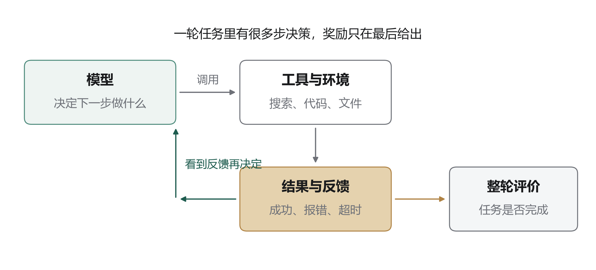

## Agentic RL：多轮、工具与环境

前面讲的都是一轮问答。真实的任务往往要多轮，模型要搜索、读文件、跑代码、看结果、再决定下一步。

这类训练叫 Agentic RL。它把强化学习从“生成一段文本”扩展到“完成一件事”。

### 任务形态

图 11-1 是一个典型的循环。

模型收到任务，决定调用哪个工具，工具返回结果，模型根据结果决定下一步。这个循环重复若干次，直到任务完成或者超时。

动作空间变了。不再只是生成 token，还包括选择工具、填参数。这些动作有的是离散的（选哪个工具），有的是连续的或者结构化的（参数的值）。

奖励也变了。通常只有在任务完成时才知道成功与否，中间没有反馈。

### 环境怎么建

这是工程上最难的部分。

一个可用的训练环境要满足三个条件。可复现，同样的动作序列产生同样的结果。可验证，能自动判断任务是否完成。够快，能承受每秒成百上千次调用。

常见的做法是容器化。每个任务一个容器，里面预装了需要的软件和数据，模型在容器里执行操作。容器可以快速启动和重置，失败也不影响其他任务。

工具也是环境的一部分。搜索接口、代码执行、文件读写，都要封装成统一的调用格式，并且限制权限，防止模型做出危险操作。

### 奖励怎么设计

最简单的奖励是任务是否完成，零或一。

这个信号太稀疏。一个任务可能要走二十步，只有最后一步决定成败。中间二十步没有任何反馈，学习效率极低。

改进的办法有几个。

一是分阶段奖励。把任务拆成几个子目标，完成一个给一部分分。比如写代码的任务，能编译给一分，能通过部分测试给两分，全部通过给三分。

二是过程奖励。训练一个模型给每一步打分，判断这一步是否朝目标前进。这个模型本身要标注数据训练，成本高。

三是相对奖励。同一批任务里，比较不同轨迹的完成度，用相对排名作为奖励。这个做法不需要绝对标准，只需要能排序。

### 信用分配的新问题

单轮任务里，整段回答共享一个奖励，已经很难分摊。多轮任务更难，因为每一轮的决策都可能影响最后结果。

一次搜索用错了关键词，可能后面所有步骤都白费。但错误出现在第一轮，奖励在最后一轮才出现。

常见的处理是给每一轮同样的优势，或者按轮次折扣。两种都粗糙，但比没有好。

更精细的做法是把每一轮当作一个独立的决策点，用价值函数估计每一步的价值。但这又回到了需要价值网络的老问题，在多轮场景下成本更高。

### 训练的工程挑战

**采样成本**。一次 rollout 可能要走几十步，每步都要调用模型和工具。相比单轮生成，成本高一个量级。

**环境稳定性**。工具会超时、会报错、会返回脏数据。训练时要能处理这些异常，不能让一次失败毁掉整批数据。

**并行**。为了跟上训练速度，通常要同时跑几百个环境。这需要调度系统和资源管理。

**数据过滤**。大量 rollout 会失败，全失败的轨迹没有学习价值。要过滤掉，但过滤太多会导致样本偏差。

### 和单轮训练的差别

单轮的 RLVR 里，奖励信号干净，组内比较有效。多轮任务里，奖励稀疏且噪声大，组内比较的方差更大。

单轮的训练可以用简单的 GRPO。多轮任务往往需要更复杂的优势估计，甚至需要重新引入价值网络。

单轮的任务集相对固定，多轮的任务集要不断扩充，因为模型会记住见过的任务。

### 现在的位置

Agentic RL 是目前最活跃的方向之一，也是最不成熟的方向。

有效的结果有不少，比如在代码修复、网页操作、工具调用上的提升。但方法的可迁移性差，一个任务上调好的配置，换一个任务可能要重来。

评估也是一个问题。多轮任务的评估比单轮复杂得多，要考虑成功率、步数、成本，还要考虑失败的模式。

### 一个判断

如果你的任务是单轮问答，先不要上多轮训练。单轮的 RLVR 更简单，效果也更可控。

如果任务天然是多轮的，比如需要查资料、需要试错、需要操作文件，那多轮训练是必要的。但要准备好投入大量工程。

下一章讲怎么评估这些训练的结果。这是整个领域最容易被忽视、也最容易出问题的一环。
