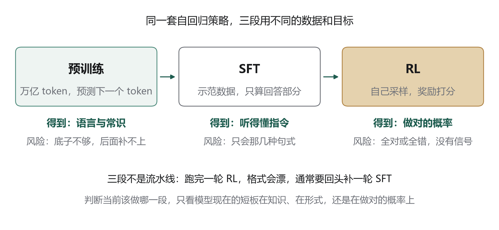

## 预训练、SFT 与 RL 的分工

拿到一个开源基座模型，想让它会做数学题，第一步做什么？

很多人的第一反应是直接上强化学习，反正奖励可以自动判。跑了两天发现分数不涨，才回头补监督数据。

这类弯路大多来自同一个原因。预训练、监督微调、强化学习解决的是不同的问题，用错阶段，投入就白花。

### 三段各自解决什么

图 13-1 是这三段的关系。



预训练解决的是语言和知识。语料是网页、书籍、代码，目标只有一个，预测下一个 token。这一步结束后，模型知道词怎么搭配，知道世界上大致有什么，但不知道该怎么和人对话。

监督微调解决的是形式。数据是问题和示范回答，目标仍然是一个 token 一个 token 地预测，只是只在回答部分算损失。这一步结束后，模型知道该怎么排版、怎么开场、什么时候收尾。

强化学习解决的是概率分布的偏向。模型已经能生成正确答案，只是概率不高。奖励信号把那些偶然出现的正确答案挑出来，提高它们的概率。这一步不教新知识，只改变已有能力的比重。

三段的差别可以用一句话概括。预训练学说话，微调学听话，强化学习学做对。

这个顺序不是随便定的。预训练给了模型生成候选的能力，微调把候选限制在人希望的形式里，强化学习在剩下的候选里挑好的。缺了前一步，后一步没有可挑的东西。

三段各自的失败方式也不一样。预训练不够，后面怎么训都缺底子，模型会背格式但不会推理。微调数据不够或太单一，模型只会那几种句式，换个问法就乱。强化学习上得太早，模型连正确答案都生成不出来，奖励全是零，梯度也全是零。

这三种失败在外表上很像，都是分数不涨。区分办法是看模型自己的采样。让当前模型对一批题各采八条，如果一条都不对，问题在能力，得回去补监督数据。如果有对有错，问题在概率，强化学习才有用武之地。

### 三个目标函数放在一起看

预训练的损失是标准的交叉熵。

$$
\mathcal{L}_{\text{pre}} = -\mathbb{E}_{x}\left[\sum_{t=1}^{T}\log \pi_\theta(x_t\mid x_{<t})\right]
$$

监督微调的形式一模一样，区别只在掩码。问题部分的 token 不计损失，回答部分才计。

$$
\mathcal{L}_{\text{sft}} = -\mathbb{E}_{(x,y)}\left[\sum_{t=1}^{|y|}\log \pi_\theta(y_t\mid x,y_{<t})\right]
$$

强化学习换掉了目标。它不再拟合某个固定答案，而是最大化期望奖励，同时用一个 KL 项把模型拉在参考模型附近。

$$
J(\theta) = \mathbb{E}_{x,\,y\sim\pi_\theta}\left[r(x,y)\right] - \beta\,\mathrm{KL}\left(\pi_\theta\,\|\,\pi_{\text{ref}}\right)
$$

前两个是监督学习，数据里有什么就学什么。第三个是搜索，模型自己生成候选，好坏由奖励判断。这是本质区别，也是后面所有工程复杂度的来源。

同一个批次，两种用法可以写在一起对照。

```python
def sft_loss(logits, labels, response_mask):
    # labels: prompt tokens set to -100 so they are ignored
    logp = log_softmax(logits, dim=-1)
    token_logp = logp.gather(-1, labels.unsqueeze(-1)).squeeze(-1)
    return -(token_logp * response_mask).sum() / response_mask.sum()


def pg_loss(new_logp, old_logp, advantages, mask, clip=0.2):
    # one scalar reward per response, broadcast to every response token
    ratio = (new_logp - old_logp).exp()
    unclipped = ratio * advantages
    clipped = ratio.clamp(1 - clip, 1 + clip) * advantages
    return -(torch.min(unclipped, clipped) * mask).sum() / mask.sum()
```

两段代码共享同一个模型、同一个前向。区别在于，第一段有一个正确答案可以对齐，第二段只有一个标量告诉它整体好不好。

两者之间还有一个折中形式，值得知道。把同一批数据里质量高的样本加权，损失写成

$$
\mathcal{L}_{\text{wsft}} = -\mathbb{E}_{(x,y)}\left[w(y)\sum_{t}\log \pi_\theta(y_t\mid x,y_{<t})\right]
$$

$w(y)$ 可以来自奖励模型的分数，也可以简单地取一或零，零就是不学这条。拒绝采样微调就是后一种。它保留了监督学习的稳定，又用上了奖励提供的信息，代价是不能超出数据里已有的东西。

### 数据量级与成本

三段的规模差得很远。

预训练用万亿级 token，成本最高，通常只有少数机构从头做。监督微调用十万到百万条示范，多数团队能承担。强化学习用的题量往往只有几万到几十万道，但每道题要采样多次，总生成量又会放大一个量级。

公开配方里常见的做法是先几万条冷启动数据，再几万道可验证的题。这两个数字看起来不大，但生成成本不低。一道题采八条回答，每条两千 token，十万道题就是十六亿 token 的生成量。
成本的结构也不同。监督微调的花费几乎全在前向和反向，可以按批次塞满 GPU。强化学习的花费大头在生成，生成是串行的，GPU 利用率天然低。这就是为什么在线训练要靠推理引擎加速，也是为什么它比看上去贵。

数据质量的影响比数量大。同一笔标注预算，花在筛选上比花在扩量上划算。一条格式规范、推理完整的示范，顶上十条凑数的。一个能真判对错的题目集，顶上十道模棱两可的题。团队常犯的错是先堆量，等效果不好再回头清洗，那时候已经花了两倍时间。

### 什么时候只做 SFT 就够

以下几种情况，不必上强化学习。

输出格式固定，比如把自然语言转成 JSON、把合同条款抽成字段。这类任务对错明确，示范数据足够多时，监督微调就能做到很高准确率。

有大量高质量示范，而且示范就是最优解。翻译、摘要、改写属于这一类。模型能模仿到的上限就是示范的水平，强化学习也很难超过。

评价标准难以写成奖励。文案是否有感染力、回答是否得体，这类判断连人都争论不休，硬写一个奖励函数只会引入噪声。

任务单一，调用量不大。强化学习的前期投入要靠规模摊薄，用得少就不划算。
反过来，两种情况值得上强化学习。一是正确答案稀少但可验证，模型偶尔能蒙对，需要把这条路径放大。二是需要超出示范水平的表现，比如更长的推理链、更稳的多步计算，示范数据里没有现成答案。

### 顺序不是单向的

实际项目里，三段的顺序经常来回。

先做一轮监督微调，让模型学会基本格式。再用强化学习提升正确率。训练到后期，模型的输出风格会漂移，回答变得冗长、重复、格式混乱。这时要再插一轮小规模的监督微调，把格式拉回来。

有人把这叫格式税。强化学习优化的是奖励，奖励不惩罚啰嗦，模型就会越来越啰嗦。补一轮示范数据是最省事的修法。

还有一种常见的做法是拒绝采样。强化学习跑一段之后，用模型自己生成大量回答，筛出正确的那些，当作监督数据再训一轮。这一步把探索到的好路径固化下来，效果往往比继续强化学习更直接。

这个循环里有一个容易被低估的细节。每一轮的起点都是上一轮的模型，而不是最初的基座。所以每一轮的数据分布都在变，上一轮调好的奖励权重、长度限制、采样温度，到下一轮可能要重调。能做的是把每一轮的配置和数据都存下来，出问题时能回到某个已知可用的检查点。

所以三段不是流水线，是一个循环。判断当前该做哪一段，只看一件事，模型现在的短板在知识、在形式，还是在做对的概率上。

下一章讲奖励模型的训练。它是偏好类方法的起点，也是最容易被数据质量问题拖垮的一环。
