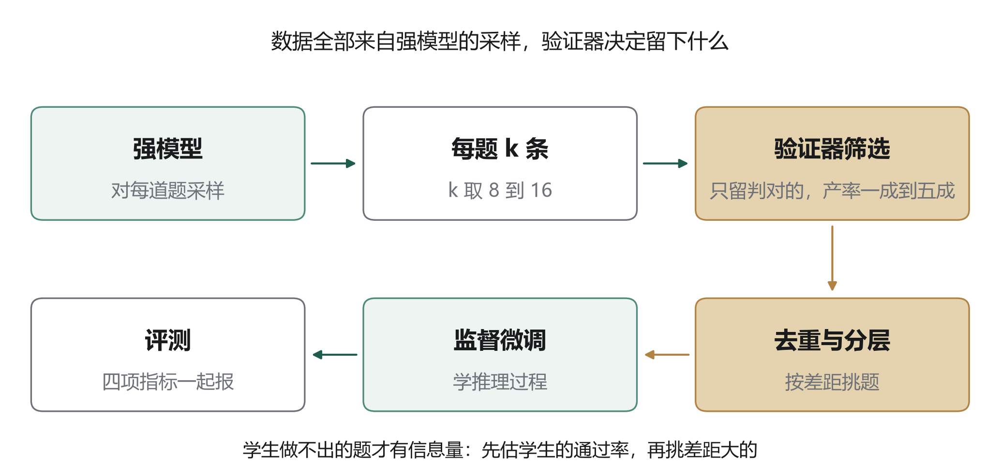

## 蒸馏与小模型复现

不是每个团队都有几千张卡。想在本地复现一部分推理能力，最现实的路是蒸馏。

这一章讲怎么把一个大模型的能力搬到小模型上。数据怎么造，训练怎么设，哪些能力搬得动，哪些搬不动。

### 拒绝采样产数据

蒸馏的第一步是造数据。做法很直接，拿一批题，让强模型每题采若干条回答，用验证器筛掉错的。

图 18-1 是这条流水线。



关键在选择策略。

采样数要够。一道题只采一条，筛完可能什么都不剩。采八到十六条，才能保证中等难度的题有正样本。采样温度也不能太低，太低采出来的都是同一条，等于只采了一次。

筛选要严。只留验证器判对的，格式不合格的也去掉。这一步的产率通常在百分之十到五十之间，难题上更低。产率太低说明题目超出强模型能力，或者格式约定有问题。

难度要匹配。强模型全对的题，学生多半也会，学不到东西。强模型全错的题，学生更学不会。真正有用的是强模型能做出、学生做不出的那一段。做法是先用学生模型对同样的题采一遍，估算它的通过率，再按差距挑题。

去重不能省。同一道题留下几十条相似的正确解，训练时会被反复强化，模型学到的是这个题型的模板。做法是按照答案和推理路径做聚类，每类只留一两条。

数据量不必大。公开的经验是几千到几万条高质量样本就能明显改变一个小模型的行为。十万条噪声数据的效果往往不如五千条干净的。

还有一条经验值得提。同一道题保留不同解法的样本，比保留同一解法的多个副本有用得多。前者教的是思路，后者教的是逐字复述。聚类去重就是为了这个，它强行把重复的路径剔掉，留下真正不同的那几条。

### 蒸馏训练

最直接的做法是监督微调。把强模型的完整推理过程和答案当成标签，学生逐个 token 学。

$$
\mathcal{L}_{\text{sft}} = -\mathbb{E}_{(x,y^*)}\left[\sum_{t}\log\pi_\theta(y^*_t\mid x,y^*_{<t})\right]
$$

这方法简单，效果也不错。它的局限是只学了"强模型最后写出来的那句话"，没学"强模型在每一步有多少其他选择"。

要学到后者，用分布蒸馏。老师对每个位置给一个完整的分布，学生去拟合这个分布，而不是只拟合被选中的那个 token。

$$
\mathcal{L}_{\text{kd}} = (1-\alpha)\,\mathcal{L}_{\text{CE}} + \alpha\,T^{2}\,\mathrm{KL}\left(p^{T}_{\text{teacher}}\,\|\,p^{T}_{\text{student}}\right)
$$

$T$ 是温度，把两个分布都软化。$T^2$ 是补偿项，因为软化之后梯度幅度会变小。$\alpha$ 控制两者的比例。

```python
def kd_loss(student_logits, teacher_logits, labels, T=2.0, alpha=0.5):
    ce = cross_entropy(student_logits, labels, ignore_index=-100)
    s = log_softmax(student_logits / T, dim=-1)
    t = softmax(teacher_logits / T, dim=-1)
    kl = (t * (t.log() - s)).sum(-1).mean()
    return (1 - alpha) * ce + alpha * T * T * kl
```

分布蒸馏要多存一份老师的 logits。词表几万维，一条两千 token 的样本就是几千万个浮点数，存储成本比文本高两个量级。实践中的折中是只存 top-k 的 logits，k 取几十，信息损失不大。

还有第三种，在策略蒸馏。前两种都是老师给标准答案，学生学习。问题在于学生自己的分布和老师不同，学生的错误会把它带到老师从没去过的地方，那里没有示范。

在策略蒸馏让学生自己采样，老师对学生的前缀给分布。

$$
\mathcal{L}_{\text{opd}} = \mathbb{E}_{y\sim\pi_\theta}\left[\sum_t \mathrm{KL}\left(\pi_{\text{teacher}}(\cdot\mid x,y_{<t})\,\|\,\pi_\theta(\cdot\mid x,y_{<t})\right)\right]
$$

学生走到哪，老师就跟到哪打分。这解决了分布漂移，代价是每一步都要调用老师，训练成本高得多。小模型复现的场景里，通常先用拒绝采样把数据造好，再考虑要不要上在策略。

### 能力迁移的边界

蒸馏不是万能的，几件事值得先说清楚。

格式和解题模板最容易迁移。分步骤写、先列条件再计算、最后单独给答案，这些是行为模式，学生看几千条就能学会。所以蒸馏之后，小模型的输出会变得很像大模型，进步最明显的是"看起来会推理"。

具体知识难迁移。大模型记住的定理、常数、冷门事实，小模型的参数装不下。硬灌的结果是背错，比不知道更糟。

长链推理部分可迁移。学生能学会推理的骨架，但链条一长就容易断。表现出来是简单题正确率接近老师，难题差得远。这是容量限制，不是数据问题。

容量有一道坎。学生太小，比如差了两个数量级，蒸馏只会学到表面格式，输出变长、术语变多，正确率不涨。这个现象有专门的名字，叫风格模仿。判断办法很简单，看输出的长度和正确率是不是脱钩了。

多样性会损失。蒸馏的目标是让学生像老师，学生学到的是老师的众数行为。pass@1 上升，pass@k 下降，因为学生把概率集中到了老师最常走的那条路上。

还有一条容易忽视的边界。老师自己的弱点会被原样拄过去。老师在某些题型上系统性错，学生学到的是同样的错。拒绝采样只筛对错，不筛过程，一道题答案凑对了但推理有漏洞，这条数据会被留下。想避开这个问题，筛选时要额外加一道过程审查，或者至少把同一题的多条正解做个对比，取推理更完整的。

### 评测怎么比

蒸馏之后要报什么数字，比想象中讲究。

至少报四项。同分布测试集上的 pass@1，换一个数据集的 pass@1，平均输出长度，以及 pass@1 与 pass@k 的差。

同分布提升是基本要求，不提升说明流程有问题。

换数据集这一项最容易被跳过。学生可能在训练分布上接近老师，换个领域就退回原样。这说明学到的是模板，不是能力。

长度要和正确率一起看。长度涨了百分之五十，正确率涨了两个点，这笔账多半是亏的。

pass@1 和 pass@k 的差反映多样性。差太大说明学生已经只会一条路。

还有一个便宜的检查，拿同一批题让老师和学生各答一遍，人工看五十条。看两件事，学生的错误是不是集中在长链上，学生的推理过程是不是真的在算，还是在模仿格式。这两件事自动指标都看不出来。

### 一条最小复现路线

把上面的东西串起来，一条能跑通的路线是这样。

选一个强模型和一个学生模型，规模差一到两个数量级。准备一个能自动判分的题库，几千道，难度分层。

用学生模型先跑一遍，估计每道题的通过率。挑出强模型能做对学生做不对的那些。

对挑出的题，强模型每题采八到十六条，验证器筛，去重，控制长度。留下的样本做一轮监督微调。

微调之后再评一次，看四项指标。如果同分布提升明显但换数据集没动，回去补更多样的题。如果长度涨得厉害，检查筛选时有没有偏好长回答。

这一轮走完，通常能拿到老师一部分的能力，成本是老师训练的一个零头。想再往上走，就得回到强化学习，那需要另一笔预算。

写到这里，方法层面的事情基本讲完了。最后一章回到最初的问题，训完之后怎么知道有没有变好。
